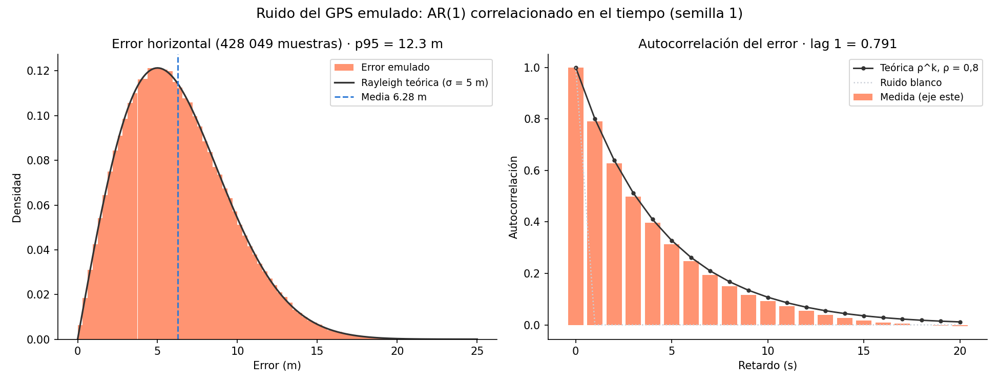
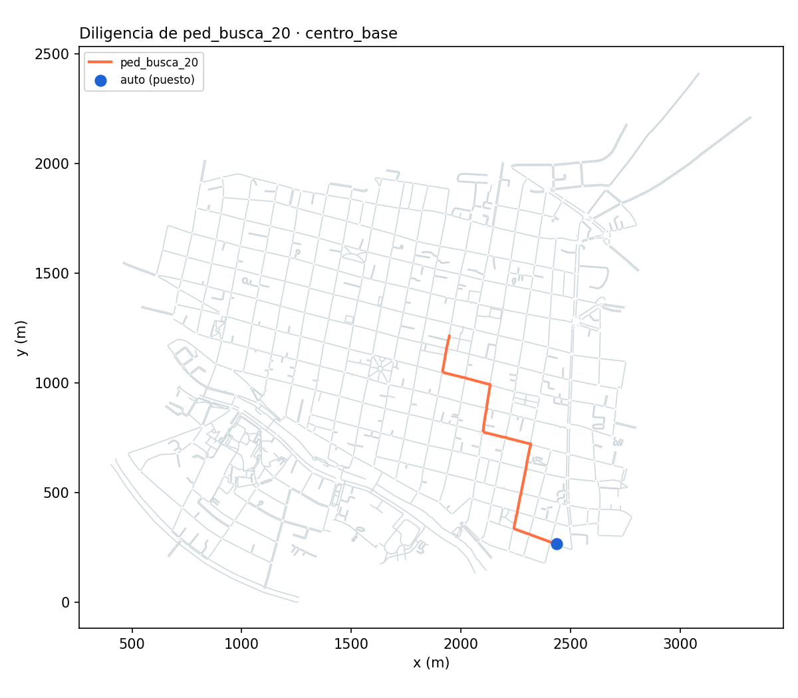

# Bitácora de Freddy 🍅

**Color:** Tomate (`#FF7043`) · **Rol:** Controlador TraCI, emulador GPS, guiado y backend FastAPI

Cada sesión agrega una entrada al final (ver *Protocolo de cierre* en `CLAUDE.md`). No se borra nada.

---

## S1 · Sesión 1 · 2026-10-22 · Contrato v1 y esquemas compartidos
**Estado:** hecha
**Qué hice:**
- Revisé el contrato v0 y escribí el v1 completo y autocontenido en `comun/CONTRATO.propuesto.md`, con la sección "Cambios respecto a v0" (12 puntos).
- Huecos cerrados:
  - el controlador TraCI cierra las sesiones de los autos simulados con `POST /sesiones/{id}/cerrar` e informa las transiciones con `POST /sesiones/{id}/transicion`;
  - formato de error `{"error": {codigo, mensaje, detalle}}` con 15 códigos y su HTTP;
  - header `X-Contrato-Version: 1` y `X-Sim-Token`;
  - `POST /sim/paso`, la vía por la que el backend recibe posiciones y ocupación real;
  - mensaje WS `verdad`, solo para `?rol=visor`;
  - fórmulas de cobro, de la tarjeta SERT y de los avisos;
  - formato del CSV de trazas.
- `comun/esquemas.py`: 41 modelos Pydantic v2 y 9 enums, la unión discriminada `MensajeWS` y `FilaTraza`. Es compatible con Python 3.10.
- `comun/esquemas.ts`: espejo TypeScript escrito a mano.
- `comun/tarifa.json` + `comun/tarifa.py`: carga, validación y cálculos en centavos.
- `comun/ejemplos/`: 29 JSON y `traza.csv`.
- `comun/tests/test_esquemas.py`: 163 tests (ejemplos, 25 casos malos, tarifa, paridad `.ts` ↔ `.py` con un *parser* por regex).
- Diagrama de componentes con matplotlib (`comun/diagrama_contrato.py`).

**Archivos creados o modificados:**
- `semanas/S1/Freddy/codigo/comun/`: `CONTRATO.propuesto.md`, `esquemas.py`, `esquemas.ts`, `tarifa.json`, `tarifa.py`, `__init__.py`, `requirements.txt`, `diagrama_contrato.py`, `ejemplos/*`, `tests/*`.
- `semanas/S1/Freddy/evidencias/s1_contrato-diagrama.png`
- `semanas/S1/Freddy/explicaciones/s1_explicacion.{md,pdf}`
- `semanas/S1/Freddy/estado.json`, `semanas/S1/Freddy/RESUMEN.md`

**Decisiones y por qué:**
- La máquina de estados corre en el controlador TraCI, que tiene el GPS y la IA; el backend valida, guarda y cobra.
- La sesión nace en `ESTACIONADO`: `BUSCANDO` y `GUIADO` son estados del vehículo.
- Si hay `t_sim` al inicio y al cierre, la duración se calcula con él, para que el cobro siga el reloj de SUMO.
- El dinero se calcula en centavos con `Decimal`, para que el KPI de error de facturación no arrastre ruido de coma flotante.
- Tomé de Miguel las propuestas de `Sesion`, `Movimiento` y `ErrorApi`, para que su `tipos.ts` cambie lo mínimo.
- Los `puesto_id` siguen el `puestos.csv` de Tyrone (`pa_<edge>_<n>`, con capacidad). Como contienen `#`, nunca van en la URL.
- Nuevos parámetros de tarifa: `aviso_tiempo_min` y `tarjeta_bloque_min` (supuesto: tarjeta SERT de 1 h).

**Problemas encontrados:**
- No se pudo compilar `esquemas.ts`: la computadora no tiene Node y el contenedor tiene Node 12 sin npm. La paridad la cubren los tests.
- `explicacion_pdf.py` no admite `<code>` dentro de celdas de tabla: las tablas de la explicación van sin comillas invertidas.

**Pedidos a otros:**
- @Tyrone (visor/KPIs): el visor se conecta a `/ws/estado?rol=visor` y recibe `snapshot` (ocupación *estimada*), `kpi` (nombres reservados en §6) y el nuevo `verdad` (ocupación real, `estacionados`, `falsas_liberaciones`). Para la precisión del mapa, compara `snapshot.puestos` con `verdad.puestos`.
- @Tyrone [VPS]: en el despliegue del backend, define `SIM_TOKEN` en el `.env` de Dokploy. Las rutas `/sim/paso` y `/sesiones/{id}/transicion` lo exigen en el header `X-Sim-Token`.
- @Pablo (IA): `clasificar(ventana: list[PuntoGPS]) -> ResultadoModo` con los modelos de `comun.esquemas`. Las trazas usan las 7 columnas de §8 en orden; `segmento_id` va después, como columna extra, y para GeoLife el `usuario_id` es `geolife_<nnn>`.
- @Miguel (app): reemplaza `src/api/tipos.ts` por `comun/esquemas.ts`. Cambios que te afectan:
  - `SesionCerrada` añade `minutos_reales` y `saldo`; `Billetera` añade `bloqueada`;
  - `POST /sesiones` responde 201 y acepta `ts`/`t_sim`;
  - `CuerpoError.error` es `DetalleError` (con `detalle` opcional) y hay 15 códigos;
  - `Tarifa` añade `aviso_tiempo_min` y `tarjeta_bloque_min`;
  - avisos nuevos `saldo_agotado`, `tiempo_maximo_cerca`, `tiempo_maximo_superado` y `sesiones_bloqueadas`;
  - confirma la tarifa SERT vigente para ajustar `tarifa.json`.
- @Freddy (yo, S2): el backend implementa §4 usando `tarifa.py`, y el controlador envía `/sim/paso`, `/transicion` y `/cerrar`. Antes hay que instalar pydantic en el contenedor (`pip3 install --user -r .../comun/requirements.txt`).

**Bucle y verificación:** 2 vueltas.
- Vuelta 1: los tests pasaron, pero `pytest` a secas no encontraba `comun`; lo arreglé con `tests/__init__.py`. Una prueba de mutación (quitar un campo del `.ts` y un valor de enum) confirmó que la paridad falla cuando debe.
- Vuelta 2: el verificador independiente reportó **4/4 criterios cumplidos** y 6 incoherencias menores. Corregí estas:
  - el costo del espejo en el ejemplo del `.md` (0,15 → 0,10) y su definición;
  - IDs y horas ilustrativos que no validaban;
  - el formato de `usuario_id` en las trazas;
  - la redacción de `X-Sim-Token`;
  - el cierre por `deteccion` solo desde `SALIENDO`.

  No corregí el redondeo a 2 decimales: queda documentado como responsabilidad de quien emite el valor.
- Resultado final: 163 passed.

**Pendientes para la próxima sesión:** compilar `esquemas.ts` con `tsc` cuando haya Node 18+; instalar pydantic en el contenedor; ajustar la tarifa cuando Miguel la confirme.

**Evidencias:**  · [Explicación (PDF)](../semanas/S1/Freddy/explicaciones/s1_explicacion.pdf)

## S1 · Sesión 2 · 2026-10-22 · Núcleo del backend (billetera, tarifa y sesiones)
**Estado:** hecha
**Qué hice:**
- `backend/nucleo/db.py`:
  - SQLAlchemy 2 + SQLite, con URL configurable (`:memory:` o archivo);
  - tablas `usuarios`, `movimientos`, `sesiones` y `puestos`, con el dinero en centavos y las horas en UTC;
  - lector del `puestos.csv` de Tyrone y mock de 20 puestos (`# MOCK`).
- `backend/nucleo/tarifa.py`: `minutos_cobrables`, `costo`, `costo_tarjeta_sert` (bloques de 30 min) y `retencion`, sobre `comun/tarifa.py`.
- `backend/nucleo/billetera.py`: `Billetera` con `recargar`, `retener`, `debitar`, `liberar`, `estado` y `movimientos`. El saldo siempre sale del libro y las operaciones son transaccionales.
- `backend/nucleo/sesiones.py`: `ServicioSesiones` con `iniciar`, `transicion`, `cerrar`, `avisos`, `avisos_usuario`, `recibo` y `obtener`.
- `backend/nucleo/ocupacion.py`: `MapaOcupacion` con `libres_cerca` y `recomendar` (haversine).
- `backend/nucleo/errores.py`: `ErrorNucleo` con el código y el HTTP del contrato.
- 63 tests con 99 % de cobertura del núcleo; gráfica `s2_cobro-sert-vs-real.png`.
- Instalé sqlalchemy y pydantic en el contenedor `van3twin` y comprobé que el núcleo se importa y cobra bien allí (Python 3.10.12).

**Archivos creados o modificados:**
- `semanas/S1/Freddy/codigo/backend/`: `__init__.py`, `requirements.txt`, `nucleo/*`, `tests/*` y `graficas/cobro_sert_vs_real.py`.
- `semanas/S1/Freddy/codigo/comun/`: `tarifa.json` (`tarjeta_bloque_min` 60 → 30), `CONTRATO.propuesto.md` (§5: tarjeta de 30 min y definición de `saldo_bajo` durante una sesión) y `tests/test_esquemas.py`.
- Cierre: `evidencias/s2_cobro-sert-vs-real.png`, `explicaciones/s2_explicacion.{md,pdf}`, `estado.json` y `RESUMEN.md`.

**Decisiones y por qué:**
- La tarjeta SERT pasa a bloques de 30 min, como pide el prompt; en S1-1 había supuesto 60.
- El aviso se llama `tiempo_maximo_cerca` (nombre del contrato) y no `tiempo_maximo_proximo` (nombre del prompt), para no romper la paridad con `esquemas.ts`.
- El "bloqueado" se deriva de `saldo < 0` y no se guarda, para que nunca se desincronice del libro.
- El débito se aplica completo aunque el saldo baje de −$0,50 (contrato §5): el auto ya estuvo estacionado. `saldo_negativo_max_usd` solo dispara el aviso `saldo_agotado`. Es mi interpretación del paso 4 ("si queda negativo pero dentro del máximo, bloquea").
- El lugar en el puesto y la sesión única por usuario se validan en la base, dentro de la transacción, con un índice único parcial, porque el controlador TraCI y FastAPI pueden compartir la base. El mapa en memoria solo se sincroniza.
- Si la sesión tiene `t_sim` al inicio y al cierre, la duración sale del reloj de SUMO; si falta alguno, de la hora UTC.

**Problemas encontrados:**
- El test de propiedad tardaba 18 s porque revisaba a todos los usuarios en cada paso. Ahora revisa al usuario afectado en cada paso y a todos al final (11 s).
- El verificador encontró dos bugs, ya corregidos con tests de regresión:
  - dos servicios sobre la misma base podían sobrellenar un puesto;
  - `liberar` aceptaba la sesión de otro usuario.

**Pedidos a otros:**
- @Tyrone: cuando `puestos.csv` entre en `proyecto/sumo/parqueos/`, el núcleo lo carga solo (`puestos_iniciales()`). Mientras tanto usa el mock de 20 puestos.
- @Tyrone (KPIs): el sobrecobro medio de la tarjeta SERT es $0,101 por estadía (19,3 %, 1–120 min). Sirve para la exposición.
- @Miguel: la tarjeta SERT es ahora de bloques de 30 min (`tarjeta_bloque_min: 30`) y `saldo_bajo` se calcula con `saldo − costo en curso`. Confirma si la tarifa SERT real usa tarjetas de 30 min.

**Bucle y verificación:** 3 vueltas.
1. 54 tests y 99 % de cobertura.
2. Optimicé el test de propiedad.
3. El verificador independiente reportó **4/4 criterios cumplidos**, 2 bugs de lógica y 3 desviaciones menores. Corregí los dos bugs, `retener` sin control de dueño ni de disponible, `saldo_bajo` fuera de una sesión y las recargas `nan`/`inf`, y añadí 9 tests de regresión. Resultado final: 63 tests, 99 %.

**Pendientes para la próxima sesión:**
- Capa FastAPI sobre el núcleo (S2).
- `recomendar` por tiempo de manejo.
- Reemplazar el mock de puestos.

**Evidencias:**  · [Explicación (PDF)](../semanas/S1/Freddy/explicaciones/s2_explicacion.pdf)

## S1 · Sesión 3 · 2026-10-22 · Controlador TraCI base y emulador de GPS
**Estado:** hecha
**Qué hice:**
- `traci/sumo.py`: carga la librería TraCI de SUMO como `sumo_traci`, porque nuestro paquete también se llama `traci` y la taparía.
- `traci/controlador.py`: `Controlador(config)` con `traci.start`, `paso()` y `correr(hasta)`; suscripciones de vehículos (posición, velocidad, STOPSTATE) y de personas; hooks con `agregar_hook`; CLI con `--cfg --gui --hasta --semilla --captura`. Crea solo las carpetas de salida del `.sumocfg`.
- `traci/gps.py`: `EmuladorGPS(semilla, sigma_m=5, p_perdida=0.02, tasa_hz=1)` con:
  - ruido AR(1) con ρ = 0,8 por eje;
  - pérdidas de muestra;
  - `precision_m = σ·U(0,8; 1,5)`;
  - velocidad por diferencia de posiciones ruidosas;
  - etiquetas `modo_real`.
- `traci/generar_trazas.py`:
  - corre el escenario de Tyrone con 150 peatones propios (15 % rápidos, a 2,2 m/s): 5 min de calentamiento y 30 min grabados;
  - sigue al 30 % de los autos y a 25 de los de fondo estacionados;
  - escribe el CSV del contrato §8 con columnas extra y una muestra de 5000 filas.
- `traci/obtener_escenario.py`: copia el escenario de la rama de Tyrone a `traci/escenario/`, ignorado por git, sin editar su rama.
- `traci/graficas_gps.py`: las dos evidencias.
- 19 tests (17 en la computadora y 2 de integración que solo corren en el contenedor).
- Contrato §8: convención `ped_<personId>` y columnas extra de las trazas de SUMO.

**Archivos creados o modificados:**
- `semanas/S1/Freddy/codigo/traci/`: `__init__.py`, `.gitignore`, `requirements.txt`, `sumo.py`, `controlador.py`, `gps.py`, `generar_trazas.py`, `obtener_escenario.py`, `graficas_gps.py`, `tests/*` y `trazas/sumo_semilla1_muestra.csv`.
- `semanas/S1/Freddy/codigo/comun/CONTRATO.propuesto.md`.
- Evidencias: `evidencias/s3_trazas-gps.png`, `evidencias/s3_ruido-gps.png` y `evidencias/resumen_S1_Freddy.pdf`.
- Cierre: `explicaciones/s3_explicacion.{md,pdf}`, `estado.json` y `RESUMEN.md`.

**Decisiones y por qué:**
- Usé el escenario real de Tyrone y no un mock, porque ya existía en su rama.
- Añadí peatones propios porque su escenario no tiene; con eso salen las clases `a_pie` y `quieto` de persona.
- Un auto estacionado cuenta como `quieto` (persona adentro), como pide el prompt: en S1 no hay bajada del conductor.
- En el generador, lat/lon se calcula con pyproj y la proyección de la red, que da lo mismo que `convertGeo` (diferencia de 1,6·10⁻⁹ m, verificada por un test) sin una llamada TraCI por punto.
- Las semillas cambian la semilla de SUMO, los peatones y el ruido; la demanda de autos es la de la semilla 1 de Tyrone.

**Problemas encontrados (adaptaciones a SUMO 1.12 y al contenedor):**
- El nombre `traci` choca con el de la librería de SUMO; lo resolví cargándola con importlib.
- Faltaba `pyproj` en el contenedor, aunque `CLAUDE.md` dice que viene. Lo instalé con `traci/requirements.txt` (`pip3 install --user`).
- En SUMO 1.12 la velocidad de un `vType` es `maxSpeed`; `speed` se ignora sin avisar. El verificador detectó que los peatones "rápidos" no lo eran; lo corregí y regeneré las 3 semillas.
- SUMO no crea las carpetas de salida del `.sumocfg`; el controlador las crea.
- La computadora tiene su propio SUMO con `SUMO_HOME`; los tests de integración se limitan al contenedor.

**Pedidos a otros:**
- @Pablo: las trazas de SUMO están en `semanas/S1/Freddy/codigo/traci/trazas/` (tras la unificación, en `proyecto/traci/trazas/`).
  - Formato: las 7 columnas del contrato §8 (`usuario_id,t,lat,lon,precision_m,velocidad_mps,modo_real`) y, después, `lat_real,lon_real,velocidad_real_mps,caso`, con `caso` ∈ {`normal`, `congestion`, `peaton_rapido`}.
  - `usuario_id` es `sim_<veh>` o `ped_<persona>`; GPS a 1 Hz con σ = 5 m, AR(1) ρ = 0,8 y 2 % de pérdidas.
  - Los CSV completos (~40 MB cada uno) no están en git. Se regeneran en el contenedor con `python3 traci/obtener_escenario.py` (en la computadora) y luego `python3 -m traci.generar_trazas --semilla N`; en git va la muestra de 5000 filas.
  - Ojo: `quieto` es ~40 % de las filas, y la velocidad por diferencias de un agente quieto ronda 4 m/s por el ruido, así que hay que balancear las clases.
- @Tyrone, qué necesito del escenario:
  - unificar `centro_base.sumocfg` con su red, demanda y parqueos en `proyecto/sumo/`;
  - en S2, un atributo o tipo que marque a los autos "con app" en `demanda.rou.xml`, para suscribir solo esos;
  - si es posible, peatones o bajada del conductor al estacionar en la demanda;
  - las salidas de su `.sumocfg` apuntan a `salidas/base_1/` fijo; un `--output-prefix` por semilla ayudaría a correr varias en paralelo.
- @Tyrone [Plan] `CLAUDE.md`: dice que el contenedor trae `pyproj`, pero no lo trae (o se perdió al recrearlo); conviene listarlo entre las dependencias que se instalan.

**Bucle y verificación:** 2 vueltas.
1. El controlador corrió a la primera. Corregí el test de integración (con una red sin demanda, `correr()` se detiene enseguida, como debe), el estimador de autocorrelación de la gráfica (restar la media de tramos cortos lo sesgaba: 0,762 → 0,786) y los números del eje de la gráfica.
2. El verificador independiente reportó **4/4 criterios** (el PDF semanal quedaba para el cierre) y un bug importante: los peatones rápidos no eran rápidos (`speed` en lugar de `maxSpeed`). Lo corregí, además de la muestra con pocos agentes (7 → 19), el filtro de autos de fondo y olvidar el estado de los agentes que salen. Regeneré las 3 semillas y añadí un test de velocidad real de los peatones. Resultado final: 19 tests en el contenedor.

**Pendientes para la próxima sesión:**
- Máquina de estados, guiado y `/sim/paso` como hooks.
- Suscripciones más baratas (unos 55 ms/paso con unos 5000 autos).
- Pasar al escenario unificado.

**Evidencias:**   · [Explicación (PDF)](../semanas/S1/Freddy/explicaciones/s3_explicacion.pdf) · [Resumen semanal (PDF)](../semanas/S1/Freddy/evidencias/resumen_S1_Freddy.pdf)

## S2 · Sesión 1 · 2026-10-23 · Capa FastAPI sobre el núcleo, WebSocket y Swagger
**Estado:** parcial. Cumple 5 de 6 criterios; el de Docker queda parcial porque esta máquina no tiene Docker.

**Qué hice:**
- Copié `proyecto/backend/` (sin `pagos/` ni `asistente/`) y `proyecto/comun/` a `semanas/S2/Freddy/codigo/`.
- `backend/api/main.py`:
  - `Config` con pydantic-settings, que lee `ESERT_DB_URL`, `ESERT_TOKEN_SIM`, `ESERT_CORS_ORIGENES`, `ESERT_PUESTOS_CSV` y `ESERT_VISOR_DIR`, con los alias `E_SERT_*` y `SIM_TOKEN`;
  - `crear_app(config)` con el prefijo `/api/v1`;
  - un middleware ASGI que pone `X-Contrato-Version: 1` en toda respuesta (también en los 500), da `400 CONTRATO_INCOMPATIBLE` si llega otra versión y devuelve un 500 con el formato del contrato;
  - CORS, montaje opcional de `backend.pagos.rutas`, `/visor` estático y `/salud` en la raíz.
- `backend/api/rutas/` (`sistema`, `puestos`, `guia`, `eventos`, `sesiones`, `billetera`, `simulacion`): las 14 rutas de la tabla §4.3 más el alias `/interno/snapshot`, con `response_model` de `comun/esquemas.py`. Las dependencias se inyectan con `Depends` desde `app.state.servicios`.
- `backend/api/errores.py`: `ErrorNucleo` → `{"error": {codigo, mensaje, detalle}}` con su estado HTTP; la validación da 422 `VALIDACION`, y los 404/405 de rutas inexistentes salen con el mismo formato.
- `backend/api/ws.py`:
  - `GestorConexiones` (`conectar`, `desconectar`, `difundir` con `asyncio.gather`, que descarta a los clientes caídos);
  - una cola `asyncio.Queue` alimentada por `publicar()`, segura entre hilos;
  - `WS /ws/estado?rol=visor|publico&verdad=0|1`.
  - Para el controlador en proceso: `app.state.servicios.publicar_snapshot(paso)`.
- La lógica nueva fue al núcleo:
  - `nucleo/mundo.py`: último estado de cada usuario, último paso, límite de 1 paso por segundo simulado, `snapshot`/`verdad` y candidatos del espejo;
  - `MapaOcupacion.guiar()`.
- Swagger con título "e-sert API", versión "1", descripción en español, 8 tags y ejemplos de `comun/ejemplos/` en cada ruta (cuerpo, respuesta y errores). `python -m backend.api.exportar_openapi` genera `backend/openapi.json`.
- Tests:
  - `backend/tests/test_api.py` (29, REST);
  - `backend/tests/test_api_ws.py` (10, WebSocket), escrito por un subagente en paralelo;
  - en total 102 tests, con 99 % de cobertura en `api/` + `nucleo/`.
- Para el VPS: `backend/Dockerfile` en dos etapas (`python:3.11-slim`, `ARG ORIGEN`), `requirements-servidor.txt` y `.env.ejemplo`.
- Probé a mano con uvicorn y `curl` usando los ejemplos de `comun/ejemplos/`, y saqué las capturas de `/docs` con Playwright.

**Archivos creados o modificados:**
- `semanas/S2/Freddy/codigo/backend/api/**`
- `semanas/S2/Freddy/codigo/backend/nucleo/mundo.py` (nuevo) y `nucleo/ocupacion.py` (`guiar`)
- `semanas/S2/Freddy/codigo/backend/tests/test_api.py` y `test_api_ws.py`
- `semanas/S2/Freddy/codigo/backend/{Dockerfile,requirements.txt,requirements-servidor.txt,.env.ejemplo,openapi.json}`
- `semanas/S2/Freddy/codigo/comun/CONTRATO.propuesto.md`
- `semanas/S2/Freddy/{estado.json,RESUMEN.md}`, `evidencias/s1_swagger*.png` y `explicaciones/s1_explicacion.{md,pdf}`

**Decisiones y por qué:**
- **El contrato v1 congelado manda sobre el prompt cuando se contradicen.** Las dos variantes funcionan y la diferencia va en `CONTRATO.propuesto.md`:
  - el visor recibe `verdad` por defecto, y `?verdad=0` la apaga;
  - se aceptan `X-Sim-Token` y `Authorization: Bearer`;
  - `/sim/paso` y `/interno/snapshot` son equivalentes.
- **`/interno/snapshot` recibe un `PasoSimulacion`, no un snapshot ya armado.** Así el backend arma `snapshot.puestos` con su propia estimación, como dice el contrato (§6).
- **`POST /eventos/*` no cambia el mapa de ocupación**, aunque el prompt lo pedía: el mapa se estima con las sesiones (diseño de S1). Los eventos solo guardan el último estado de cada usuario.
- **`GET /guia`:** `distancia_m` es la distancia del puesto al destino. El contrato no lo decía; queda como propuesta.
- **Arranque con uvicorn:** `backend.api.main:app` en lugar de `app:app`, porque el paquete es `backend`. La app se crea al pedirla (`__getattr__` del módulo), así los tests no abren `./e-sert.db`.
- **El Dockerfile usa `ARG ORIGEN`** (por defecto `proyecto`) para poder construir también la copia semanal.
- **La etapa 1 del Dockerfile copia `proyecto/`** y elige los archivos que necesita, porque `proyecto/visor/` todavía no existe en git y un `COPY` directo fallaría.

**Problemas encontrados:**
- Docker no está disponible en WSL (falta la integración con Docker Desktop). Lo que hice en su lugar:
  - revisé el Dockerfile;
  - simulé su etapa 1 en el scratchpad;
  - arranqué uvicorn sobre esa carpeta: `/salud` dio 200 y el snapshot sin token dio 401.
- `docker build -f semanas/S2/Freddy/codigo/backend/Dockerfile .` sin argumentos todavía no sirve antes de la unificación: hace falta `--build-arg ORIGEN=semanas/S2/Freddy/codigo`.
- En la computadora solo hay Python 3.10 (no 3.11). El venv `backend/.venv` es 3.10, que es compatible.
- A Chromium (Playwright) le faltaba `libasound.so.2`. La bajé con `apt-get download` y la usé con `LD_LIBRARY_PATH`, sin sudo.
- El emoji 🔒 salía como un cuadro en la captura headless; en los resúmenes de Swagger lo cambié por `[sim]`.
- `/salud` no lleva `version`: `Salud` (`extra="forbid"`) no la admite. Va como propuesta.
- Posible carrera menor en `GestorConexiones.conectar`, entre `accept` y el registro del cliente. No se reprodujo.

**Pedidos a otros:**
- @Miguel:
  - URL base: `http://<host>:8000/api/v1` en local y `https://demo.e-sert.tesisucuenca.com/api/v1` en el VPS. El esquema completo está en `backend/openapi.json`, y Swagger en `/docs`.
  - Arranque local, desde `semanas/S2/Freddy/codigo/` (tras la unificación, desde `proyecto/`): `python -m venv backend/.venv && backend/.venv/bin/pip install -r backend/requirements.txt`, y luego `backend/.venv/bin/uvicorn backend.api.main:app --reload --host 0.0.0.0 --port 8000`.
  - `backend/pagos/`: crea `backend/pagos/rutas.py` con una variable `router = APIRouter(prefix="/pagos", tags=["pagos"])`. Se monta solo bajo `/api/v1` (por ejemplo `/api/v1/pagos/retorno`); si no existe, el backend arranca igual.
  - Todas las respuestas traen `X-Contrato-Version: 1`.
- @Tyrone:
  - Para el visor: `ws://<host>:8000/ws/estado?rol=visor` (`snapshot`, `kpi` y `verdad`). `rol=publico` excluye `verdad`, y `?verdad=0` la apaga en un visor proyectado.
  - Si `proyecto/visor/` tiene archivos, se sirve en `/visor`.
  - El controlador publica con `POST /api/v1/interno/snapshot` (o `/sim/paso`), con el cuerpo `PasoSimulacion` y `Authorization: Bearer $ESERT_TOKEN_SIM` (o `X-Sim-Token`).
- @Tyrone [VPS], después de la unificación de S2, en la app `esert-demo` de Dokploy:
  - Docker File `proyecto/backend/Dockerfile`, contexto `.`, puerto 8000;
  - volumen persistente en `/data`;
  - Environment: `ESERT_DB_URL=sqlite:////data/esert.db`, `ESERT_TOKEN_SIM=<token largo aleatorio>` y `ESERT_CORS_ORIGENES=*` (o los dominios);
  - healthcheck en `GET /salud`.
- @Tyrone [Plan]:
  - `semanas/S2/Freddy/sesion-1.md`:
    - dice "las 9 rutas del contrato", pero el contrato v1 tiene 14;
    - su sección "VPS" contradice al contrato v1 (Bearer frente a `X-Sim-Token`, `?verdad=1` frente a `rol=visor`); conviene alinear el prompt con el contrato o aprobar `CONTRATO.propuesto.md`.
  - `CLAUDE.md`: dice Python ≥ 3.11 en la computadora, pero esta computadora tiene 3.10. El código es compatible; quizá baste con exigir ≥ 3.10.

**Bucle y verificación:** 2 vueltas.
1. Las rutas y los tests REST pasaron al primer intento, salvo un test que suponía mal el orden de los movimientos (la recarga lleva la hora del servidor). En la captura, `espejo/candidatos` salía duplicado por la suma de tags de router y ruta; lo corregí.
2. El verificador independiente reportó **5/6 criterios cumplidos**; el sexto (Docker) queda parcial porque no hay Docker. Encontró que los 404/405 de Starlette no tenían el formato `{"error": ...}`: lo corregí con un handler y un test (102 tests, 99 %).

**Pendientes para la próxima sesión:**
- Un `docker build` real en una máquina con Docker.
- `WS /ws/espejo/{veh_id}` (contrato §7).
- El límite de tasa de recargas.
- Conectar el controlador TraCI con `publicar_snapshot` / `/interno/snapshot` (S2-2 y S2-3).

**Evidencias:**  · [Swagger completo](../semanas/S2/Freddy/evidencias/s1_swagger.png) · [Explicación (PDF)](../semanas/S2/Freddy/explicaciones/s1_explicacion.pdf)

### Adenda · S2 · Sesión 1 · 2026-10-23 · Capturas de Swagger legibles en PDF
- `s1_swagger-rutas.png` (1400 × 3939 px) salía cortada en `s1_explicacion.pdf`: `explicacion_pdf.py` la incrusta a 520 pt de ancho (1463 pt de alto, en una página de 842 pt) y no la reparte en páginas. La captura completa (1400 × 24 458 px) no estaba en ningún PDF.
- Nuevo `semanas/S2/Freddy/codigo/comun/paginar_captura.py`: corta una captura alta por filas en blanco. `--trozos` deja `s1_swagger-rutas_1.png` … `_3.png`, que ahora van uno tras otro en la explicación. `--pdf` deja `evidencias/s1_swagger.pdf` (14 páginas A4).
- Regeneré `s1_explicacion.pdf` y comprobé en el PDF que las tres partes quedan dentro de la página. Actualicé `estado.json` y `RESUMEN.md`.

**Pedidos a otros:** @Tyrone [Plan] herramientas/explicacion_pdf.py: si una imagen es más alta que el espacio de la página, partirla en varias páginas (o escalarla para que quepa); hoy se corta en silencio y cada persona tendría que trocear sus capturas a mano.

**Evidencias:** [Swagger completo (PDF)](../semanas/S2/Freddy/evidencias/s1_swagger.pdf) · [Explicación (PDF)](../semanas/S2/Freddy/explicaciones/s1_explicacion.pdf)

## S2 · Sesión 2 · 2026-10-26 · Máquina de estados y peatones que hacen diligencias
**Estado:** parcial
**Qué hice:**
- `traci/peatones.py`: `GestorPeatones` crea un peatón por cada auto de búsqueda que estaciona, con ida, espera de diligencia y vuelta; extiende la parada a 86400 s y reanuda el auto cuando el peatón regresa. Casos difíciles: regreso corto (15 %) y espera en el auto (10 %).
- `traci/estados.py`: `MaquinaSesion` (pura, reglas y umbrales del contrato §3) y `ControlSesiones` (hook de TraCI: teléfono `sim_<veh>` con `EmuladorGPS`, CSV de transiciones, ventanas y falsas liberaciones).
- `traci/clasificacion.py`: buffer de 30 s por usuario y `clasificar` cada 5 s.
- `traci/correr_sesiones.py` (CLI), `traci/graficas_sesion.py` (evidencias), `traci/tests/` (9 pruebas puras, 3 con SUMO).
- Corrida de 30 min del escenario base en segundo plano (`traci/salidas/`, ignorado por git).

**Archivos creados o modificados:** `semanas/S2/Freddy/codigo/traci/` (todo el módulo, copia de `proyecto/traci/` más lo nuevo), `semanas/S2/Freddy/codigo/traci/escenario/tyrone/sumo/` (copia de `proyecto/sumo/`, ignorada), `semanas/S2/Freddy/evidencias/s2_linea-tiempo-sesion.png`, `semanas/S2/Freddy/evidencias/s2_peaton-diligencia.png`, `semanas/S2/Freddy/explicaciones/s2_explicacion.{md,pdf}`, `semanas/S2/Freddy/estado.json`, `semanas/S2/Freddy/RESUMEN.md`.

**Decisiones y por qué:**
- `getParkingStartingVehicleIDList` del prompt no existe en SUMO 1.12; se usa `getParkingStartingVehiclesIDList`.
- El peatón nace y vuelve a la acera más cercana al auto, no al carril del parkingArea: caminar hasta el carril hizo caer a SUMO al volver.
- Las aristas internas de cruce (`:...`) no admiten fin de caminata en SUMO 1.12; los destinos sin acera o sin camino se sustituyen por otro (contado en `sin_destino`). Museo Pumapungo queda en el borde del mapa y no tiene acera cercana.
- La distancia al puesto se mide al punto donde se estacionó el auto. Un parkingArea mide ~100 m y su centro quedaría a más de 30 m del auto: el regreso (< 30 m) no se cumpliría nunca.
- Solo generan peatón los autos de clase `busca`; los `fondo` ya están estacionados desde el inicio.
- Clasificador: `ia.inferencia` se importa desde `proyecto/ia/` (no se edita). Como `rf_v0.joblib` no está en el repo, todas las ventanas usan la regla de umbral (`fuente = umbral`).
- Se añadió `pydantic` al contenedor (faltaba para las pruebas existentes de S1).

**Problemas encontrados:**
- SUMO 1.12 se caía sin mensaje al volver caminando al carril del parkingArea y al terminar caminatas en aristas internas. Se aisló con bisección (sin hooks, solo peatones, sin caminar, sin ida, sin vuelta) y se corrigió en el código.
- Peatones de destinos lejanos: la ida tarda 15–20 min (1–1,5 km). Con el horizonte de 30 min, la mayoría sigue caminando al final. Las pruebas con SUMO necesitaron 16000 s de horizonte.
- Clasificador de umbral: el ruido AR(1) de 5 m hace que un teléfono quieto aparente moverse a ~4 m/s (por encima de 2,2 m/s). Resultado: 214 falsas liberaciones.

**Resultados de la corrida de 30 min (`centro_base`, semilla 1):**
- Llegadas con peatón: 343. Volvieron al auto: **4 (1,2 %)**; pendientes: 339.
- Sesiones: 343; cerradas 215; abiertas al final 128.
- Falsas liberaciones: **214 = 62,4 por cada 100 sesiones**, con clasificador `umbral` (17 250 ventanas).
- Criterio ">95 % de peatones vuelve en 30 min": **no cumplido**. Criterio "ningún auto parado para siempre": **no cumplido** al corte (128 sesiones abiertas, 339 peatones aún fuera).

**Bucle y verificación:** varias vueltas de depuración (SUMO, pruebas con SUMO 3 de 3 al final). No se lanzó un subagente verificador independiente, porque no se pidió; la verificación fue ejecutar las pruebas y la corrida completa. Pruebas: `-m "not sumo"` 25 pasan; `-m sumo` 3 pasan. Criterios de "hecho": 4 de 5 cumplidos (pruebas, transiciones según contrato, falsas por 100 reportadas, dos PNG); el de 95 % no.

**Pedidos a otros:**
- @Pablo: el modelo `rf_v0.joblib` no está en `proyecto/ia/modelos/`; sin él, `clasificar` usa el umbral, y con ruido de 5 m confunde autos y peatones quietos con movimiento. Pido features robustas al ruido (p. ej. `desplazamiento_neto` sobre la ventana, o velocidad suavizada) o el RF. Además, medir y compartir la latencia de `clasificar` por ventana (no la medí en esta sesión).
- @Tyrone [Plan] `semanas/S2/Freddy/sesion-2.md`: (a) el criterio ">95 % de peatones vuelve en 30 min" no es alcanzable con destinos a 1–1,5 km; propongo un horizonte de 60 min o destinos más cercanos al puesto. (b) El prompt usa `getParkingStartingVehicleIDList`, que no existe en SUMO 1.12 (ya adaptado en el código). (c) La distancia al puesto del contrato §3 necesita aclararse: un parkingArea de ~100 m no sirve como punto de referencia de 30 m. No edité `sesion-2.md`.
- @Tyrone: en `proyecto/sumo/demanda/destinos.csv`, "Museo Pumapungo" (2479.6, 93.6 en SUMO) no tiene acera cercana; conviene moverlo o quitarlo. Y los peatones `ped_*` aún no salen en el snapshot (el controlador no publica todavía a `POST /sim/paso`).

**Pendientes para la próxima sesión:**
- Publicar los eventos al backend (`POST /sim/paso`, `POST /sesiones/{id}/cerrar`), con token.
- Resolver el criterio de 95 % (horizonte o destinos) y volver a medir las falsas liberaciones con el clasificador de Pablo.
- Verificador independiente y latencia de `clasificar`.

**Evidencias:**   · [Explicación (PDF)](../semanas/S2/Freddy/explicaciones/s2_explicacion.pdf)

## S2 · Sesión 3 · 2026-10-26 · Guiado, sesiones y cobro en la simulación
**Estado:** parcial
**Qué hice:**
- `traci/puente_nucleo.py`: billetera, sesiones y mapa de `backend/nucleo` en memoria, recarga inicial U(5, 20) por usuario, `transicion` / `cerrar` / `iniciar`, libro en centavos. Publicador opcional con cola de tamaño 1 y reintentos con backoff.
- `traci/guiado.py`: `Guia` (asignación con `rerouteParkingArea`, revisión cada 10 s, máximo 3 reasignaciones, fuentes `mapa` y `verdad`) y `RegistroBusqueda` (tiempo de búsqueda de todos los autos de búsqueda).
- `traci/estados.py`: la máquina de estados abre y cierra sesiones en el núcleo; si el auto sale de la red sin detección, la sesión se cierra como manual.
- `traci/escenario_app.py` (MOCK de `--porc-app`), `traci/correr_guiado.py`, `traci/auditar_cobro.py`, `traci/graficas_s3.py`, `traci/tests/test_guiado.py`.
- Corridas de 75 min: `app50_s1` (fuente mapa), `app50_s1_verdad` (oráculo) y `base_s1`.

**Archivos creados o modificados:** `semanas/S2/Freddy/codigo/traci/` (módulos y pruebas), `semanas/S2/Freddy/codigo/backend/` sin cambios, `semanas/S2/Freddy/evidencias/s3_*.png`, `semanas/S2/Freddy/evidencias/resumen_S2_Freddy.pdf`, `semanas/S2/Freddy/explicaciones/s3_explicacion.{md,pdf}`, `semanas/S2/Freddy/estado.json`, `semanas/S2/Freddy/RESUMEN.md`. Las salidas de SUMO y los escenarios copiados quedan en carpetas ignoradas por git.

**Decisiones y por qué:**
- Escenario al 50 % con `con_app=1` como MOCK, porque `origin/tyrone/s2` no existe todavía. La línea base sale de la misma demanda; solo cambia `con_app`.
- Sesiones solo para autos con app (`solo_con_app`); los peatones de diligencia siguen para todos los autos de búsqueda.
- El guiado comprueba alcanzabilidad (`findRoute`) antes de `rerouteParkingArea`: sin esa comprobación SUMO aborta con una aserción de ruta.
- Coordenadas no finitas (83 en la corrida final): se usa la coordenada de `puestos.csv` como puesto y se descartan las muestras.
- Cada corrida escribe sus salidas de SUMO en su propia carpeta: dos corridas en la misma carpeta se sobrescriben (ocurrió).
- La distancia de `haversine_m` se acota a [0, 1] por redondeo flotante.
- Las placas son `SIM-0001…`: el formato exige 3–4 dígitos.
- Codificación: TraCI devuelve el texto de los parámetros como latin-1; se convierte al leerlo (`texto_traci`). Afecta también a S2-2.

**Problemas encontrados:**
- Corrida `app50_s1` caída por `math domain error` (coordenada no finita). Corregido con la guarda descrita.
- Corrida `verdad` caída por aserción de SUMO al reencaminar a un puesto sin ruta. Corregido con la comprobación de alcanzabilidad.
- Corrida `verdad` terminó con `malloc_consolidate(): unaligned fastbin chunk detected`, al relanzarla en paralelo con `mapa`. Causa: ambas escribían `stops.xml` en la misma carpeta. Corregido separando carpetas. Con el código final las dos terminaron sin errores.
- Sesiones abiertas de más en el núcleo (20): autos que salían de la red sin detección dejaban la sesión abierta. Corregido cerrándolas como `manual`.

**Resultados (corridas finales, 75 min simulados):**

| Medida | mapa (sistema) | verdad (oráculo) |
|---|---|---|
| Tiempo medio de búsqueda con app / sin app | 11,3 / 10,8 min | 10,0 / 10,7 min |
| Mediana con app / sin app | 10,5 / 9,9 min | 9,3 / 9,9 min |
| Sesiones cerradas / abiertas al final (núcleo) | 380 / 132 | 403 / 138 |
| Falsas liberaciones | 335 (65,4 / 100) | 358 (66,2 / 100) |
| Reasignaciones | 0 | 1257 (209 a ciegas) |
| Auditoría: fallos de débito / libro | 0 / cuadra en 638 usuarios | 0 / cuadra en 638 usuarios |
| Error de facturación medio / máximo | −0,063 / 0,46 USD | −0,072 / 0,50 USD |

El criterio «búsqueda con app menor que sin app» **no se cumple con la fuente del sistema** y sí con la ocupación real. La retención final (33,00 USD) es exactamente 132 sesiones abiertas × 0,25 USD: el libro cuadra, pero la retención no es 0 al cierre.

**Velocidad con `--publicar` a URL caída:** 16,2 frente a 16,7 seg/seg (dos repeticiones, código final). Hay un 3 % de pérdida: no es igual, aunque la simulación nunca espera a la red.

**Bucle y verificación:** varias vueltas de depuración (tres corridas de 75 min con error, dos de ellas corregidas en código). Pruebas finales: `pytest traci/tests` → 37 pasan y 1 omitida (`test_trazas_csv.py` de S1, con parámetros vacíos: no es de esta sesión). No se lanzó un subagente verificador independiente, porque no se pidió.

**Pedidos a otros:**
- @Tyrone: `traci/guiado.py` reemplaza el oráculo de S3-1. Cada vehículo ya trae `param destino` en la demanda; no hace falta añadirlo. Hace falta entregar `origin/tyrone/s2` con `--porc-app`, porque ahora se usa un MOCK al 50 %. Y en `destinos.csv`, "Museo Pumapungo" no tiene acera cercana (ya lo pedí en S2-2).
- @Pablo: cuántas falsas liberaciones produjo `rf_v1` en `app50_s1`: no lo sé, porque el modelo no está en el repo y la corrida usó el umbral de respaldo (65 % de falsas liberaciones). Pido el modelo `rf_v1` (o features robustas al ruido) y la latencia de `clasificar`.
- @Freddy (contrato, propuesta para la unificación): el mapa de ocupación debería contar las reservas de los autos en GUIADO, o el guiado no puede ser mejor que a ciegas con la fuente del sistema (lo mide esta corrida).

**Pendientes para la próxima sesión:**
- Decidir cómo contar reservas en el mapa y volver a correr `app50_s1` con la fuente `mapa`.
- Volver a medir los peatones de S2-2 con la codificación de destinos corregida.
- Publicar al VPS solo con Tyrone (token y despliegue); la prueba local ya está hecha.

**Evidencias:**   · [Resumen semanal (PDF)](../semanas/S2/Freddy/evidencias/resumen_S2_Freddy.pdf) · [Explicación (PDF)](../semanas/S2/Freddy/explicaciones/s3_explicacion.pdf)
