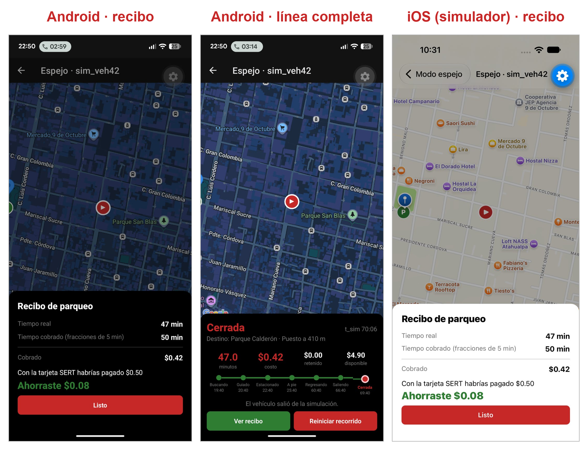
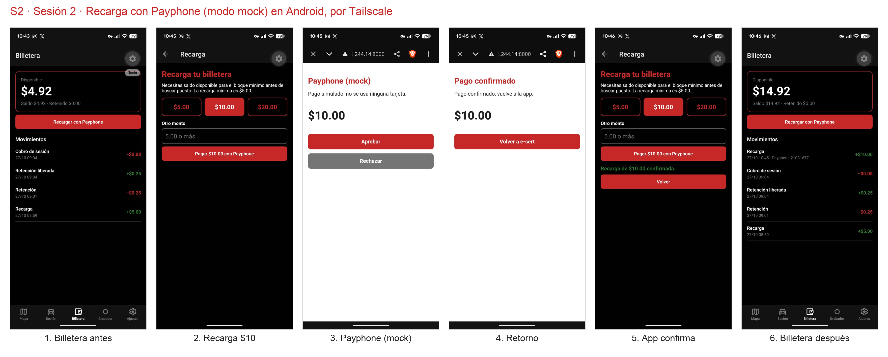
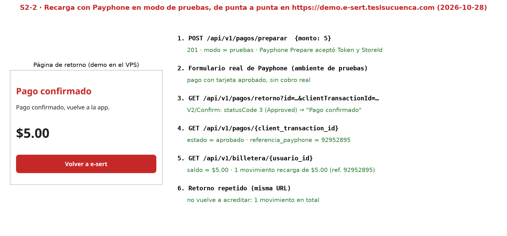

# Bitácora de Miguel 🔴

**Color:** Rojo (`#C62828`) · **Rol:** App Expo: sensores, sesión de parqueo, billetera y Payphone

Cada sesión agrega una entrada al final (ver *Protocolo de cierre* en `CLAUDE.md`). No se borra nada.

---

## S1 · Sesión 1 · 2026-10-22 · Proyecto Expo, navegación y cliente API
**Estado:** hecha

**Qué hice:**
- Creé el proyecto con `create-expo-app --template tabs` (Expo **SDK 58**, RN 0.88, TypeScript 6) y quité las pantallas de ejemplo (`two`, `modal`, `EditScreenInfo`, `ExternalLink`).
- Hice 5 pestañas de `expo-router`:
  - **Mapa** con `react-native-maps`: región en el Parque Calderón y círculos verdes y rojos según `ocupados < capacidad`.
  - **Sesión** (base manual).
  - **Billetera**: saldo, retenido, disponible, movimientos y recarga de prueba.
  - **Grabador** (marcador para la sesión 2).
  - **Ajustes**: URL, modo mock y `usuario_id` (`app_<uuid4>` con `expo-crypto`, guardado en `expo-secure-store`).
- Escribí `src/api/tipos.ts` desde `docs/CONTRATO.md`, con los tipos y la interfaz `ApiESert`, marcado `// SINCRONIZAR con comun/esquemas.ts`.
- `src/api/cliente.ts`: `fetch` con `X-Contrato-Version: 1`, la URL de `EXPO_PUBLIC_API_URL` o de Ajustes, errores `{error:{codigo,mensaje}}` convertidos en `ErrorApi` y un tiempo de espera de 10 s.
- `src/api/mock.ts` (`// MOCK`):
  - 20 puestos con semilla alrededor del Parque Calderón y 300 ms de latencia;
  - un libro de billetera con recarga, retención, débito y liberación;
  - la tarifa del contrato: bloque de 30 min, fracciones de 5 min, mínimo de 10 min y un saldo negativo de hasta $0,50.
- Pruebas:
  - `npm run prueba:mock`: 24 comprobaciones;
  - el cliente HTTP, contra un servidor falso local;
  - `expo-doctor`: 20/20;
  - `expo export`: compilan los bundles de iOS y Android.
- `datos/herramientas/unir_capturas.py` une las capturas con un rótulo (Pillow).

**Archivos creados o modificados:**
- `semanas/S1/Miguel/codigo/app/` (todo el proyecto; lo central está en `app/(tabs)/*.tsx`, `src/api/{tipos,tarifa,cliente,mock}.ts`, `src/api/pruebas/mock.prueba.ts`, `src/ajustes/AjustesContexto.tsx`, `src/ui/*` y `README.md`);
- `semanas/S1/Miguel/codigo/datos/herramientas/unir_capturas.py`;
- `semanas/S1/Miguel/evidencias/s1_app-pantallas.png`, `s1_ios-pestanas.png` y `capturas/*.jpeg`;
- `semanas/S1/Miguel/explicaciones/s1_explicacion.{md,pdf}`, `estado.json` y `RESUMEN.md`.

**Decisiones y por qué:**
- **Me quedé en el SDK 58 (el último).** La App Store solo ofrece la Expo Go más reciente, así que bajar a 57 rompería los 3 iPhone del equipo.
- **El modo mock queda activado por defecto**, porque el backend de Freddy aún no existe. Hay un solo mock compartido para que la billetera no se reinicie al cambiar de pantalla.
- **El mock no usa módulos nativos** (uuid4 propio), para poder probarlo en la computadora con `tsx`.
- **El contrato no define los campos de `GET /sesiones/{id}` ni los de un movimiento.** Propuse `Sesion{sesion_id, usuario_id, placa, puesto_id, estado, inicio, fin, retenido, minutos_cobrados, debitado}` y `Movimiento{movimiento_id, tipo, monto, ts, sesion_id?, referencia_payphone?}`.
- **Las capturas originales de Android** quedaron también fuera del repo, en `Proyecto1/CapturasDesarrollo_Miguel/2026-10-22_S1-sesion1/`. Renombré la carpeta, que tenía espacios en los extremos.

**Problemas encontrados:**
- **Android:** al principio salía "Incompatible SDK version", porque la Expo Go instalada era anterior al SDK 58. Se resolvió actualizando Expo Go a la 58.0.5.
- **Diferencias entre plataformas:**
  - Android usa Google Maps y iOS usa Apple Maps; ambos dibujan bien los círculos.
  - El `Switch` de Android tenía el botón azul del sistema; lo forcé a blanco.
  - En modo claro (iOS), la fila "Modo mock" tenía un fondo blanco sobre el gris; lo arreglé.
  - En esta sesión no se piden permisos de ubicación, así que todavía no hay diferencias de permisos.
- **iOS se probó en el simulador de Xcode** (iPhone 18 Pro, iOS 27, Expo Go), no en un iPhone físico, porque Miguel no tiene uno por ahora.
- **`Themed.tsx` de la plantilla no pasaba `tsc` con RN 0.88** (`DefaultText['props']`). Lo corregí usando `TextProps` y `ViewProps`.
- **`herramientas/explicacion_pdf.py` falla si hay `código` dentro de una tabla:** convierte `<code>` en ``, y fpdf2 no lo admite en `<td>`. Lo esquivé quitando las comillas invertidas en las tablas de mi explicación.
- **En la computadora hay Node 26**, no el 20 LTS: funcionó sin problemas.
- **Al simulador hay que llamarlo con `DEVELOPER_DIR=/Applications/Xcode.app/Contents/Developer`**, porque `xcode-select` apunta a las Command Line Tools. Otra opción es correr `sudo xcode-select -s /Applications/Xcode.app` una vez.

**Pedidos a otros:**
- @Freddy: necesito `comun/esquemas.ts` y `comun/tarifa.json` para reemplazar mis copias. Por favor, define en el contrato los campos de `GET /sesiones/{id}` y los de cada `Movimiento`; mi propuesta está arriba.
- @Tyrone [Plan] herramientas/explicacion_pdf.py: cambiar `<code>` por `` hace fallar fpdf2 cuando hay código dentro de una celda de tabla ("Unsupported nested HTML tags inside <td>"). Sugiero no transformar `<code>` dentro de `<td>`, o quitar la etiqueta ahí.

**Bucle y verificación:**
- Hubo 3 vueltas:
  1. `tsc` falló por los íconos y por `Themed`.
  2. Fallo de Expo Go en Android; el `Switch` y el fondo de la fila en iOS.
  3. Todo en verde.
- El verificador independiente reportó 4/4 criterios cumplidos. Su única observación (de Android solo había capturas de Mapa y Ajustes) quedó resuelta: Miguel capturó también Sesión, Billetera y Grabador en Android, probando el flujo (confirmar llegada → $0,25 retenidos, disponible $4,75).

**Pendientes para la próxima sesión:**
- Sesión 2: el grabador de sensores.
- Probar en un iPhone físico cuando haya uno.
- Sincronizar los tipos y la tarifa con lo que publique Freddy.
- Verificar la tarifa SERT vigente.

**Evidencias:**    · [Explicación (PDF)](../semanas/S1/Miguel/explicaciones/s1_explicacion.pdf)

## S1 · Sesión 2 · 2026-10-22 · Grabador de sensores etiquetado
**Estado:** parcial

**Qué hice:**
- `src/sensores/grabador.ts`, la clase `Grabador`:
  - pide el permiso con `requestForegroundPermissionsAsync`;
  - lee el GPS con `watchPositionAsync` (BestForNavigation, 1000 ms, 0 m) y descarta las lecturas que llegan a menos de 0,5 s;
  - escribe el acelerómetro a 10 Hz en un archivo aparte (`_acel.csv`);
  - mantiene la pantalla encendida con `expo-keep-awake`;
  - vuelca a disco cada 30 s con `expo-file-system` (`write` en modo `append`);
  - permite `cambiarEtiqueta()` en caliente y guarda los instantes en `_meta.json`.
- `src/sensores/formato.ts` y `exportar.ts`:
  - las 7 columnas del contrato más `escenario,telefono,persona`;
  - `vehiculo_lento` se exporta como `vehiculo` + `trafico_lento`;
  - `speed` nulo o −1 deja el campo vacío;
  - el nombre del archivo es `<fecha>_<persona>_<telefono>.csv` y se comparte con `expo-sharing` (CSV del GPS y del acelerómetro).
- La pestaña **Grabador**:
  - selectores de persona, teléfono y etiqueta, con la etiqueta cambiable mientras se graba;
  - el aviso "graba el acompañante";
  - botones grandes Iniciar y Detener;
  - contador de muestras, precisión, velocidad y duración, y la lista de cambios y de grabaciones guardadas.
- `datos/herramientas/graficar_grabacion.py` valida contra el contrato (sale con 1 si hay errores), grafica la traza y la velocidad con franjas, y resume la duración por etiqueta y la precisión.
- `datos/herramientas/anonimizar_grabacion.py` traslada la traza al Parque Calderón, con un error de distancia de 0,0000 m.
- Pruebas:
  - `npm run prueba:grabador`: 12 comprobaciones;
  - una grabación sintética para probar el script;
  - una grabación en el simulador de iOS, manejada por deep links (solo en `__DEV__`) y con ubicación simulada;
  - la prueba casera en Android real.

**Archivos creados o modificados:**
- `codigo/app/src/sensores/{grabador,formato,exportar}.ts`, `src/sensores/pruebas/formato.prueba.ts`, `app/(tabs)/grabador.tsx`, `app.json` (plugin `expo-location`), `package.json` y `README.md`;
- `codigo/datos/herramientas/{graficar_grabacion,anonimizar_grabacion}.py`, `datos/requirements.txt`, `datos/README.md`, `datos/ejemplos/sintetica_muestra.csv` y `datos/grabaciones/*`;
- `evidencias/s2_*.png`, `evidencias/capturas/s2_*.jpeg`, `explicaciones/s2_explicacion.{md,pdf}`, `estado.json` y `RESUMEN.md`.

**Decisiones y por qué:**
- **Seguí la propuesta de contrato v1 de Freddy (§8):** `usuario_id = casa_<persona>_<n>`, `t` en segundos Unix y las columnas extra después de las 7.
- **Separé el formato (`formato.ts`) de lo nativo**, para poder probarlo en la computadora.
- **La grabación casera se anonimizó antes de subirla**, porque tenía las coordenadas reales del lugar donde Miguel grabó. Miguel lo eligió. El original quedó fuera del repo, en `Proyecto1/CapturasDesarrollo_Miguel/2026-10-22_S1-sesion2/`. El clasificador no pierde nada: distancias, tiempos, velocidades y etiquetas quedan iguales.
- **Para probar en el simulador añadí deep links** (`?accion=iniciar|etiqueta|detener`), solo en `__DEV__`.

**Problemas encontrados:**
- `simctl location start` interpretaba la primera coordenada negativa como una opción. Se resolvió pasando los puntos por stdin (`-`).
- En el simulador, una ubicación fija produce una sola actualización. Para "quieto" se simuló el temblor del GPS con un vaivén de ±2 m. En el teléfono real no pasa: hubo 317 muestras quieto.
- El simulador no tiene acelerómetro. La app lo detecta y muestra "no disponible".
- En Android, el GPS tardó 6 s en dar la segunda lectura al arrancar: el único hueco de la grabación.
- La caminata casera fue lenta (3,1 km/h de media, con tramos casi parados). Es útil como caso difícil, pero no representa una caminata por la calle.

**Pedidos a otros:**
- @Tyrone @Freddy @Pablo: instalen **Expo Go** (versión del SDK 58) para probar la app y luego el modo espejo. Las grabaciones caseras son **opcionales**; si alguien graba, que la anonimice con `datos/herramientas/anonimizar_grabacion.py` antes de subirla.
- @Pablo: hay una grabación casera de Android en `semanas/S1/Miguel/codigo/datos/grabaciones/` (5:53 a pie y 5:17 quieto, con el CSV del contrato y el acelerómetro aparte), por si sirve como validación extra. La de iOS es del simulador y no sirve como dato real.
- Si alguien del equipo tiene un iPhone físico disponible: necesito una grabación corta para cerrar el criterio 1.

**Bucle y verificación:**
- Hubo 3 vueltas:
  1. La derivada de la velocidad salía ilegible, así que la suavicé con una mediana de 5 s.
  2. La ruta del simulador no arrancaba (coordenada negativa) y una ubicación fija daba 1 sola muestra.
  3. Todo en verde.
- El verificador independiente reportó **3/4 cumplidos y el criterio 1 parcial**: iOS solo se probó en el simulador, con GPS sintético y sin acelerómetro, y la prueba de iOS duró 3 + 2 min. Además observó que en Android no hay `_meta.json`; el cambio de etiqueta está en el CSV y se confirmó con la captura.

**Pendientes para la próxima sesión:**
- Sesión 3.
- Grabación en un iPhone físico.
- Sincronizar los tipos y la tarifa con `comun/` de Freddy tras la unificación.

**Evidencias:**    · [Explicación (PDF)](../semanas/S1/Miguel/explicaciones/s2_explicacion.pdf)

## S1 · Sesión 3 · 2026-10-22 · Reglas SERT verificadas, prototipo del conductor espejo y protocolo casero
**Estado:** hecha

**Qué hice:**
- **`app/docs/sert_reglas.md`:** reglas del SERT con fuentes oficiales, cada una con su URL y la fecha de consulta (2026-10-22). Las fuentes son la ordenanza de 2012 (R.O. 765), la EMOV EP y el GAD Municipal; la prensa queda como respaldo.
  - Tarifa: USD 0,25 por media hora o fracción (Art. 36).
  - Tiempo máximo: 2 h.
  - Tarjeta: 4 casilleros de 30 min.
  - Tolerancia: 10 min (Art. 10).
  - AppSERT avisa 5 min antes del final.
  - Multa: 5 % del SBU.
  - Marqué como no verificados el horario vigente, el precio de la tarjeta, el inventario de plazas y la recarga mínima.
  - Termina con la tabla para `tarifa.json`: **no hace falta cambiar ningún valor**. `fraccion_min = 5` y `cobro_minimo_min = 10` son reglas de la app, no del SERT.
- **Tipos del espejo** en `tipos.ts` (`CandidatoEspejo`, `MensajeEspejo`, `ReciboEspejo`, `FinEspejo` y `ESTADOS_SESION`), copiados de `comun/esquemas.ts` v1 de Freddy y marcados SINCRONIZAR. La tarifa quedó en v1: `aviso_tiempo_min`, `tarjeta_bloque_min`, `tarjetaSertUsd` y el redondeo mitad hacia arriba de su `tarifa.py`.
- **`src/espejo/recorridoMock.ts`** (`// MOCK`):
  - 59 mensajes `espejo` y un `espejo_fin`, a 1 por segundo;
  - 47 min simulados de sesión, con un recibo de 50 min = $0,42, tarjeta $0,50 y ahorro $0,08;
  - `saldo_bajo` en ESTACIONADO;
  - puestos reales del `puestos.csv` de Tyrone;
  - `suscribirMock`, con la firma del WS real.
- **`recorrido_mock.json`** se genera con `npm run generar-mock`.
- **`validar.ts`** (`esMensajeEspejo` y `esFinEspejo`) y **el test con jest-expo**: 11/11.
- **Pantallas:**
  - `app/espejo/index.tsx`, el selector, con 4 candidatos;
  - `app/espejo/[vehId].tsx`, con MapaEspejo (auto que rota, destino, puesto, Polyline de 5 px y `animateToRegion`), LineaTiempo, CostoVivo, BannerAvisos y el modal ReciboEspejo;
  - el botón "Reiniciar recorrido";
  - la entrada desde la pestaña Sesión.
- **`datos/PROTOCOLO_CASERO.md`**, con la regla de seguridad.

**Archivos creados o modificados:**
- `codigo/app/docs/sert_reglas.md`, `src/api/{tipos,tarifa}.ts`, `src/espejo/**`, `app/espejo/{index,[vehId]}.tsx`, `app/_layout.tsx`, `app/(tabs)/sesion.tsx`, `scripts/generar_mock.ts`, `package.json` (jest-expo, `test` y `generar-mock`) y `README.md`;
- `codigo/datos/PROTOCOLO_CASERO.md`;
- `evidencias/s3_*.png`, `evidencias/capturas/s3_*.jpeg`, `explicaciones/s3_explicacion.{md,pdf}`, `evidencias/resumen_S1_Miguel.pdf`, `estado.json` y `RESUMEN.md`.

**Decisiones y por qué:**
- **La investigación del SERT la hizo un agente en paralelo**, con instrucciones de citar todo y no inventar nada.
- **En los tipos, los campos de §6b son obligatorios y nullables**, porque el JSON los trae siempre. En `esquemas.ts` de Freddy son opcionales, y siguen siendo compatibles.
- **El tiempo simulado no es uniforme**, para que 60 s reales cubran 47 min de parqueo.
- **`saldo_bajo` se calcula como "saldo − max(retención, costo en curso)"**, para que el aviso salga en ESTACIONADO. La regla v1 de Freddy (saldo − costo) no lo dispararía ahí.
- **Las globales de jest se importan de `@jest/globals`**, porque el tsconfig de Expo no carga `@types/jest`.

**Problemas encontrados:**
- **`tsc` fallaba en las rutas tipadas (`/espejo`)** hasta que Metro regeneró `.expo/types`.
- **El modal del recibo:**
  - salía sin fondo (usaba `View` de RN en vez del `View` del tema);
  - quedaba abierto encima de otras pantallas. Ahora se cierra al perder el foco.
- **En iOS**, la lista del selector quedaba debajo del encabezado translúcido (se arregló con `contentInsetAdjustmentBehavior`) y el botón de volver decía "(tabs)".
- **`herramientas/explicacion_pdf.py` falla con `__tests__` dentro de una tabla**, porque Markdown lo vuelve negrita. Lo esquivé escapando los guiones bajos.
- **El verificador encontró un `sesion_id` que no era uuid4.** Ya está corregido y tiene su test.

**Pedidos a otros:**
- **@Freddy:**
  - Valores reales para `tarifa.json`: **no hay que cambiar ninguno** (tabla en `semanas/S1/Miguel/codigo/app/docs/sert_reglas.md`). Sugiero documentar qué claves son reglas del SERT y cuáles de la app, y añadir `tolerancia_ingreso_min: 10` (Art. 10).
  - Los tipos del espejo ya están en tu `comun/esquemas.ts` v1: los copié. Cuando se unifique, los importo.
  - Pregunta: durante la sesión, ¿`saldo_bajo` usa "saldo − costo" o "saldo − max(retención, costo)"? Con la primera, el aviso no aparece mientras la retención cubre el costo.
  - `recorrido_mock.json` queda listo para tu servidor mock de S2-3.
  - El `espejo_fin` del mock trae `t_sim`, `ts` y `motivo` (v1).
- **@Tyrone:** observaciones a `calles_sert.yaml` y `puestos.csv` (rama tyrone/s1):
  1. **Hay demasiadas plazas:** tu red genera **6.194 plazas en 103 calles**, y las fuentes oficiales dan unas **2.500 en toda la ciudad** (1.424 en el Centro Histórico y 388 en El Ejido en 2020, más 204 en 2022). Conviene usar `incluir_nombres` con las calles tarifadas, o bajar la capacidad, por ejemplo con `lado: derecho` solo en calles con línea azul.
  2. **Calles que probablemente no son SERT** y salen con muchas plazas: Avenida 12 de Abril (145), Avenida 3 de Noviembre (73), Héroes de Verdeloma (72) y Avenida Loja (28).
  3. **Zonas oficiales:** Centro Histórico, El Ejido, Feria Libre y el sector del Parque Luis Cordero (Calle Larga – Huayna Cápac – Juan Jaramillo – Vargas Machuca).
  4. **No se encontró un inventario oficial de calles.** Las plazas se marcan con línea azul y número en el piso, así que la lista exacta queda **no verificada**.
- **@Pablo:** las grabaciones caseras son **opcionales**. Si se hacen, siguen `datos/PROTOCOLO_CASERO.md` y quedan en `datos/grabaciones/`, anonimizadas.

**Bucle y verificación:**
- Hubo 3 vueltas:
  1. Las rutas tipadas y los tipos de jest en tsc.
  2. El modal sin fondo, el encabezado "(tabs)", el peatón tapado y el inset de la lista en iOS.
  3. El modal que seguía abierto al navegar, y el `sesion_id` que señaló el verificador.
- El verificador independiente reportó 5/6 criterios cumplidos. El sexto, el PDF semanal, quedó pendiente hasta este cierre y ya está generado. También señaló el `sesion_id` (corregido) y la cita de la multa por remolque, que ahora figura como "no confirmado".

**Pendientes para la próxima sesión:**
- Conectar el espejo al WS real cuando Freddy lo publique (S2-3).
- Sincronizar los tipos tras la unificación.
- Probar en un iPhone físico.

**Evidencias:**   · [Explicación (PDF)](../semanas/S1/Miguel/explicaciones/s3_explicacion.pdf) · [PDF semanal](../semanas/S1/Miguel/evidencias/resumen_S1_Miguel.pdf)

## S2 · Sesión 1 · 2026-10-27 · Flujo de sesión de parqueo en la app (buscar → guiar → confirmar → activa)
**Estado:** parcial (4/5). Lo único pendiente: iOS se probó en el simulador de iPhone, no en un iPhone físico.

**Qué hice:**
- Copié `proyecto/app` a `semanas/S2/Miguel/codigo/app`.
- **Contrato en la app:** `src/contrato/esquemas.ts` (con la cabecera "Copia de comun/, no editar a mano") y `tarifa.json` se copiaron de `proyecto/comun/`. `npm run verificar-contrato` compara el SHA-256 con el original y falla si difieren. `tipos.ts` ahora reexporta el contrato (atiende el pedido de Freddy de S1) y `TARIFA` sale de `tarifa.json`.
- **Cliente API** (`src/api/cliente.ts`):
  - `getGuia`, `crearSesion`, `getSesion`, `cerrarSesion` y `getBilletera`, con *timeout* de 8 s (`AbortController`).
  - Configuración con `EXPO_PUBLIC_API_URL` y `EXPO_PUBLIC_USE_MOCK=1`.
  - `mensajeUsuario` traduce los 15 códigos del contrato y los 2 del cliente (por ejemplo, `SALDO_INSUFICIENTE` → "Recarga al menos $5 para buscar puesto").
- El **mock** quedó alineado con la v1:
  - `SESIONES_BLOQUEADAS` 403, `SESION_ACTIVA`, `SESION_YA_CERRADA`;
  - débito completo aunque el saldo quede negativo;
  - `bloqueada`, `minutos_reales` y `saldo`.
- **Estado** `src/estado/sesion.ts`: `useReducer` + Context con los estados del contrato. Se persiste en AsyncStorage y `RecuperarFlujo` vuelve al guiado o a la sesión activa al reabrir la app.
- **Pantallas:**
  - `buscar.tsx`: partida en Gran Colombia y Benigno Malo (o donde se toque), destinos de `destinos.csv` o pulsación larga, y billetera antes de `/guia`.
  - `recarga.tsx`: "Próximamente" más una recarga de prueba.
  - `sesion/guiar.tsx`: 8 m/s a 1 Hz, `Polyline`, distancia haversine, "Llegar ya" y el intervalo se limpia al salir.
  - `sesion/confirmar.tsx`: placa con `^[A-Z]{3}-?\d{3,4}$` en mayúsculas.
  - `sesion/activa.tsx`: cronómetro, costo en vivo, avisos de tope y saldo, y "Terminar" manual.
- **Pruebas:**
  - Tests en `__tests__/` (delegados en un subagente): placa, tarifa igual a `tarifa.py` en 16 casos, los 15 códigos de error del cliente y el mock. Yo escribí los de estado y persistencia, y los de costo.
  - `scripts/probar_backend.ts`: el flujo completo contra el backend real.
  - `scripts/montaje.py`: la tira de capturas que se reutiliza en S2-2.
- **Backend real:** corrí el de `freddy/s2` en la computadora (extraído al scratchpad, sin tocar su carpeta), con `--host 0.0.0.0`, y probé el flujo con él en el Android de Miguel y en el simulador de iPhone.

**Archivos creados o modificados:** `semanas/S2/Miguel/codigo/app/`:
- `app/buscar.tsx`, `app/recarga.tsx`, `app/sesion/{guiar,confirmar,activa}.tsx`, `app/_layout.tsx`, `app/(tabs)/sesion.tsx`
- `src/contrato/`, `src/api/{cliente,tipos,tarifa,mock}.ts`, `src/estado/sesion.ts`, `src/sesion/{placa,geo,cobro}.ts`, `src/datos/destinos.ts`, `src/ajustes/AjustesContexto.tsx`
- `scripts/{verificar_contrato.mjs,destinos.py,probar_backend.ts,montaje.py}`, `__tests__/*.test.ts`
- `.env.example`, `.gitignore` (excepción `!.env.example`, porque la raíz ignora `.env.*`), `package.json` (AsyncStorage 2.2.0), `README.md`

Fuera del código: `semanas/S2/Miguel/{estado.json,RESUMEN.md,explicaciones/s1_explicacion.*,evidencias/*}`.

**Decisiones y por qué:**
- **`tarifa.json` sin cabecera:** JSON no admite comentarios. Se verifica byte a byte y `esquemas.ts` se verifica sin su primera línea.
- **Tipos del espejo:** `CandidatoEspejo` y `MensajeEspejo` se quedan como versiones más estrictas (campos obligatorios y nullables) que valida `validar.ts`. El resto viene del contrato.
- **`pedirGuia`** ya no devuelve `null` ante un 404: lanza `ErrorApi` `SIN_PUESTOS_LIBRES`, como el backend.
- **Recarga de prueba:** el backend real arranca toda billetera en $0, así que la pantalla Recarga tiene un botón de prueba (`POST /billetera/{id}/recarga`, sin Payphone) para poder probar. Se reemplaza en S2-2.
- **Hora de inicio:** se envía el `ts` del teléfono en `POST /sesiones`, para que el cronómetro y el cobro partan del mismo instante.
- **Mock por defecto:** solo con `EXPO_PUBLIC_USE_MOCK=1`; sin la variable se usa el backend real. Lo guardado en Ajustes manda sobre `.env`.
- **Enlaces de desarrollo** `buscar?destino=0&auto=1` y `sesion/confirmar?placa=...&auto=1` (solo `__DEV__`): `simctl` no puede tocar la pantalla del simulador.
- **Placa:** se mantiene la regla del contrato `^[A-Z]{3}-?\d{3,4}$`.

**Problemas encontrados:**
- `git fetch` falla con `Permission denied (publickey)`: la llave de GitHub no está cargada en el agente SSH. Se trabajó sobre el `origin/main` local (26-oct).
- Expo arrancado con `CI=1` desactiva la recarga y el simulador se quedó con el bundle viejo. Hubo que reiniciarlo sin `CI`.
- En iOS, el contenido de confirmar quedaba debajo del encabezado transparente. Se arregló con `contentInsetAdjustmentBehavior="automatic"` en confirmar, activa y recarga.
- `explicacion_pdf.py` no acepta `__tests__` sin escapar en una celda de tabla (se interpreta como negrita).

**Pedidos a otros:**
- **@Freddy:** diferencias entre tu API S2 y `docs/CONTRATO.md` §3–§5 que vi al conectar la app. Ninguna bloquea:
  1. En `GET /guia`, `distancia_m` es la distancia del puesto al destino. El contrato no lo dice; la app lo muestra así ("a 46 m de Parque Calderón").
  2. Una ruta inexistente responde 404 o 405 con `codigo: "VALIDACION"`, y un `sesion_id` mal formado da 422 en vez de 404. El contrato solo define `VALIDACION` como 422.
  3. El token de simulación se llama `ESERT_TOKEN_SIM` (y acepta `Authorization: Bearer`), mientras el contrato dice `SIM_TOKEN` y `X-Sim-Token`. La app no lo usa.
  4. Todo lo demás coincide: rutas, cuerpos, códigos HTTP, `bloqueada`, `minutos_reales` y `saldo` en el cierre, y `X-Contrato-Version: 1`. `npm run probar-backend` pasa 10/10 contra tu rama.
- **@Tyrone:**
  - `destinos.csv` **sirve tal cual** como lista de destinos de la app. Se copia a `src/datos/destinos.ts` con `scripts/destinos.py`, y los 12 nombres se ven bien en los botones.
  - Los puestos que asigna `/guia` son los de tu `puestos.csv`.
  - Para el teléfono, cuando el backend esté en el VPS, solo hace falta la URL `https://demo.e-sert.tesisucuenca.com/api/v1` con CORS abierto. No pido nada más del VPS por ahora.

**Bucle y verificación:**
- Hubo 4 vueltas:
  1. Errores de tsc al reexportar el contrato (mock sin `bloqueada`, `SesionCerrada` incompleta).
  2. Metro en modo CI sin recarga y los enlaces de desarrollo para el simulador.
  3. El contenido tapado por el encabezado en iOS.
  4. Las correcciones del verificador.
- El verificador independiente reportó **4/5 criterios cumplidos**. El 1 es parcial porque el iPhone solo se probó en el simulador. Sugirió además que el mock no fuera el valor por defecto sin variable y llevar a Recarga cuando `POST /sesiones` responde `SALDO_INSUFICIENTE`; ambas cosas están aplicadas.
- Resultado final: `npm test` 91/91, `tsc` sin errores, `verificar-contrato` OK y `probar-backend` 10/10.

**Pendientes para la próxima sesión:**
- Pagos con Payphone en la pantalla Recarga (S2-2), reutilizando `montaje.py` para la evidencia.
- Probar en un iPhone físico.
- Probar contra el backend del VPS cuando esté publicado.

**Evidencias:**    · [Explicación (PDF)](../semanas/S2/Miguel/explicaciones/s1_explicacion.pdf)

## S2 · Sesión 2 · 2026-10-27 · Billetera y recarga con Payphone en modo de pruebas
**Estado:** parcial

**Qué hice:**
- `backend/pagos/payphone.py`:
  - `ConfigPagos` lee el entorno o `backend/pagos/.env`; la `responseUrl` se arma desde `ESERT_URL_PUBLICA`.
  - `AdaptadorPayphone(config, cliente_http)` implementa *Prepare* (`POST /api/button/Prepare`, montos en centavos, `amount = amountWithoutTax`) y *Confirm* (`POST /api/button/V2/Confirm` con `{id, clientTxId}`; aprobado solo si `statusCode == 3` y `"Approved"`), según https://docs.payphone.app/boton-de-pago consultada el 2026-10-27. Usa `httpx` con 10 s de *timeout* y el token nunca aparece en logs ni en `repr`.
  - `AdaptadorMock` con la misma interfaz y una página local con "Aprobar" y "Rechazar".
- `backend/pagos/intenciones.py`: tabla propia `intenciones_pago` (sin tocar los modelos de Freddy) y `procesar_retorno`, que acredita **una sola vez**: `UPDATE … WHERE estado='pendiente'` en la misma transacción que `Billetera.recargar(…, referencia_payphone=id, s=s)`.
- `backend/pagos/rutas.py`: `POST /pagos/preparar` (`RECARGA_MINIMA` si es menos de $5), `GET /pagos/ir/{id}` (página puente porque Payphone exige Referer del dominio registrado), `GET /pagos/retorno`, `GET /pagos/{id}` y las rutas del mock. Además `.env.ejemplo`, `requirements.txt` (`httpx`) y `README.md`.
- 30 tests con pytest y `httpx.MockTransport`: monto menor a 5, retorno repetido 3 veces, rechazo, cancelación, error de red, monto distinto, token fuera de los logs y saldo de Freddy.
- App:
  - `app/(tabs)/billetera.tsx`: saldo, retenido y disponible, movimientos con fecha local y signo, *pull to refresh*.
  - `app/recarga.tsx`: $5, $10, $20 o monto libre ≥ $5; abre el pago con `WebBrowser.openAuthSessionAsync(pay_url, Linking.createURL('pagos/retorno'))` y consulta `GET /pagos/{id}` hasta 10 veces cada 2 s.
  - `src/api/pagos.ts`, `app/pagos/retorno.tsx`, y `__tests__/pagos.test.ts` (8 tests).
  - Se quitó la recarga de prueba sin pago. Buscar sigue llevando a Recarga si el saldo no alcanza.
- Prueba de punta a punta en Android con Expo Go **por Tailscale** (Mac `100.85.244.14`): $4.92 → aprobar $10 → $14.92; rechazar no acredita; una segunda recarga de $5 también se confirmó.

**Archivos creados o modificados:**
- `semanas/S2/Miguel/codigo/backend/pagos/` (`__init__.py`, `payphone.py`, `intenciones.py`, `rutas.py`, `.env.ejemplo`, `requirements.txt`, `README.md`, `tests/`)
- `semanas/S2/Miguel/codigo/app/app/recarga.tsx`, `app/(tabs)/billetera.tsx`, `app/pagos/retorno.tsx`, `src/api/pagos.ts`, `src/ui/comunes.tsx`, `__tests__/pagos.test.ts`
- `semanas/S2/Miguel/evidencias/s2_billetera-recarga.png`, `s2_recarga-rechazada.png`, `evidencias/capturas/s2_android_*.jpeg`
- `semanas/S2/Miguel/explicaciones/s2_explicacion.{md,pdf}`, `estado.json`, `RESUMEN.md`

**Decisiones y por qué:**
- **Todo en `amountWithoutTax`:** una recarga de billetera no es una venta con IVA, y Payphone exige que la suma cuadre con `amount`.
- **`pay_url` apunta a `/pagos/ir/{id}`** en nuestro dominio, no directamente a Payphone: su formulario rechaza visitas sin Referer del dominio registrado, y la app no puede enviarlo.
- **La intención es la verdad:** la app no acredita nada, solo consulta. Así funciona aunque el navegador no vuelva a la app.
- **Rechazo sin `id`:** la `cancellationUrl` es la misma `responseUrl` sin `id`; se marca rechazado. Si Confirm falla por red, queda pendiente.
- **`url_app` en `preparar`:** el retorno vuelve al deep link que manda la app (`exp://…` en Expo Go, `esert://…` en una app propia). Solo se aceptan esos esquemas, para que no sirva como redirección abierta.
- **Retorno en Android:** el enlace se convierte en `intent://…#Intent;scheme=exp;end` según el *User-Agent*, porque Chrome y Brave no abren esquemas propios desde un enlace.
- **`.env.ejemplo` en vez de `.env.example`:** el `.gitignore` de la raíz ignora `.env.*` salvo `!.env.ejemplo`, igual que Freddy. Con el nombre del prompt la plantilla no se habría subido.
- **Rutas HTML fuera de OpenAPI y ejemplos en las JSON**, para que pase `test_openapi_tiene_todas_las_rutas_con_ejemplos` de Freddy con pagos montado.

**Problemas encontrados:**
- **Volver a la app en Android:** con Expo Go, la página de retorno no vuelve sola a la app, ni con el botón "Volver a e-sert", ni siquiera con el enlace `intent://`. Al cerrar la pestaña, la app confirma igual. En Android, `dismissBrowser` no existe, así que no se puede cerrar la pestaña desde la app. Se espera que funcione con una APK propia (esquema `esert://` registrado); queda pendiente.
- **Modo `pruebas` sin credenciales:** `preparar` responde `ERROR_INTERNO` (500) con `detalle.faltan` (solo nombres de variables). No hay un código de error propio de configuración en el contrato.
- **`git fetch` con `Permission denied (publickey)`** otra vez: la llave SSH no estaba cargada. Se trabajó con las referencias ya descargadas de `origin/freddy/s2`.
- **Enlace simbólico ajeno sin seguimiento** `semanas/S2/semanas`, que apunta a una ruta de Linux que no existe en la Mac. No es de esta sesión: no se borró y no se incluyó en el commit.

**Pedidos a otros:**
- **@Freddy:**
  - Añadir al contrato propuesto (`CONTRATO.propuesto.md`) las rutas `POST /pagos/preparar {usuario_id, monto, url_app?} → 201 {client_transaction_id, payment_id, pay_url, modo}`, `GET /pagos/{client_transaction_id} → {client_transaction_id, usuario_id, monto, estado, referencia_payphone, creada, actualizada}` y `GET /pagos/retorno?id=&clientTransactionId=` (HTML), además del uso de `RECARGA_MINIMA` (422) en `preparar`.
  - Confirmar que `Billetera.recargar` acepta `referencia_payphone`: lo uso así con `s=` (tu sesión SQLAlchemy) y funciona.
  - Agregar `httpx` a `requirements-servidor.txt`. Sin él, `import backend.pagos.rutas` falla y tu `except ImportError` deja pagos sin montar sin avisar. Sugiero registrar en el log por qué no se montó.
- **@Tyrone [Payphone]** (actualizado el 2026-10-28): la aplicación de pruebas en Payphone Developer ya está configurada como tipo **WEB**, con Dominio Web `https://demo.e-sert.tesisucuenca.com` y Url de respuesta `https://demo.e-sert.tesisucuenca.com/api/v1/pagos/retorno`. Te pido hacer la prueba del modo `pruebas` en el VPS:
  1. Desplegar `backend/pagos` (llega con la unificación) con `httpx` instalado; ver el pedido a Freddy sobre `requirements-servidor.txt`. Comprobar en el log de arranque que dice `pagos sí`.
  2. Cargar en Dokploy: `PAYPHONE_MODO=pruebas`, `PAYPHONE_TOKEN` y `PAYPHONE_STORE_ID` (de esa aplicación), `ESERT_URL_PUBLICA=https://demo.e-sert.tesisucuenca.com` y `PAYPHONE_RESPONSE_URL=https://demo.e-sert.tesisucuenca.com/api/v1/pagos/retorno`. Los valores de `PAYPHONE_URL_BASE` quedan vacíos (por defecto `https://pay.payphonetodoesposible.com`).
  3. Probar contra la API real de Payphone:
     - `POST https://demo.e-sert.tesisucuenca.com/api/v1/pagos/preparar` con `{"usuario_id": "app_<uuid4>", "monto": 5}`;
     - abrir `pay_url` en el navegador y pagar (en pruebas, Payphone aprueba todo);
     - comprobar que el retorno muestra "Pago confirmado";
     - comprobar que `GET /api/v1/pagos/{client_transaction_id}` da `aprobado` y que `GET /api/v1/billetera/{usuario_id}` suma $5 con `referencia_payphone`.
  4. Avisarme el resultado. Si Payphone responde error, el `errorCode` queda en el log del backend (`esert.pagos`); el token nunca se registra.
  - Las credenciales nunca van en el repo ni en el chat.
- **@Tyrone [Plan]** `semanas/S2/Miguel/sesion-2.md`: el entregable `backend/pagos/.env.example` debería llamarse `.env.ejemplo`, porque el `.gitignore` de la raíz ignora `.env.*` salvo `!.env.ejemplo`.

**Bucle y verificación:**
- Hubo 4 vueltas:
  1. Prueba rápida del flujo mock con TestClient, más los tests del subagente: tres retornos acreditan una sola vez. Se ajustó el `clientTransactionId` exacto en Confirm y se dejó de enviar a la app el motivo de Payphone.
  2. El LAN se cambió por Tailscale.
  3. Volver a la app en Android: enlace `intent://` y su test. En Expo Go sigue sin volver.
  4. Correcciones del verificador.
- El verificador independiente reportó **4 cumple y 2 parcial**:
  - el criterio del modo `pruebas` es parcial por falta de credenciales;
  - el de las credenciales cumple, con un aviso;
  - encontró que pagos rompía el test de OpenAPI de Freddy y que `.env.example` no se habría subido. Ambos están corregidos.
- Resultado final:
  - **pytest:** 132/132 (102 de Freddy y 30 de pagos);
  - **app:** Jest 99/99 y `tsc` sin errores;
  - **credenciales:** `git grep -i token` no encuentra nada sensible.

**Pendientes para la próxima sesión:**
- Probar el modo `pruebas` de Payphone con las credenciales de Tyrone y la URL pública del VPS.
- Volver a probar el regreso a la app con una APK propia (Chrome y Brave), añadiendo `package=` al `intent://`.
- Probar en un iPhone físico.
- S2-3: conectar el espejo al WebSocket real.

**Evidencias:**   · [Explicación (PDF)](../semanas/S2/Miguel/explicaciones/s2_explicacion.pdf)

## S2 · Sesión 2 (cierre) · 2026-10-28 · Prueba del modo `pruebas` de Payphone en el VPS
**Estado:** hecha (antes parcial, 5/6)
**Qué hice:** cierre hecho por Tyrone en su sesión, a pedido de Miguel (pedido `@Tyrone [Payphone]`):
- `proyecto/backend/` se adelantó en main (`b93a111`) con el backend de Freddy y `backend/pagos` de esta sesión, más `httpx` en `requirements-servidor.txt`.
- Se creó la app `esert-demo` en Dokploy (`proyecto/backend/Dockerfile`, dominio `demo.e-sert.tesisucuenca.com`, volumen `/data`) con `PAYPHONE_MODO=pruebas`, `PAYPHONE_TOKEN`, `PAYPHONE_STORE_ID`, `ESERT_URL_PUBLICA` y `PAYPHONE_RESPONSE_URL`.
- Prueba real: `POST /api/v1/pagos/preparar` por $5 → 201 `modo=pruebas`; pago con tarjeta en el formulario de Payphone; el retorno confirmó (*V2/Confirm*, `statusCode` 3) y mostró "Pago confirmado"; `GET /pagos/rec_64e89b5e-…` → `aprobado`, `referencia_payphone` 92952895; la billetera nueva pasó de $0 a $5.00 con un solo movimiento. Repetir el retorno no volvió a acreditar.
**Archivos creados o modificados:** `semanas/S2/Miguel/evidencias/s2_payphone-pruebas.png`, `semanas/S2/Miguel/estado.json`, `semanas/S2/Miguel/RESUMEN.md`, `semanas/S2/Miguel/explicaciones/s2_explicacion.{md,pdf}`.
**Decisiones y por qué:** no se cambió código de pagos: funcionó tal como lo dejó Miguel. El adelanto en main se hizo para no esperar a la unificación; el domingo se sobrescribe con la copia desde las ramas.
**Problemas encontrados:**
- Los primeros `preparar` dieron `ERROR_INTERNO` (500) hasta corregir el Token y el StoreId en Dokploy. Payphone responde 401 ("Su aplicación no esta autorizada…") si el token está mal copiado; el detalle solo se ve en el log del backend.
- El StoreId es el de la pestaña **Credenciales** de Payphone Developer (no el "Identificador" de Detalles). Id Cliente, Clave secreta y Contraseña de codificación no se usan en el Botón de pagos.
- Un primer pago (`rec_72a744f8-…`) quedó `pendiente` sin confirmarse; Payphone lo reversa a los 5 minutos. No se determinó la causa (probablemente no se completó el pago); el segundo intento funcionó.
- Después de cambiar variables en Dokploy hay que redesplegar: la config de pagos se lee una vez por proceso.
**Pedidos a otros:** ninguno nuevo. Siguen abiertos los pedidos a Freddy (rutas `/pagos/*` en `CONTRATO.propuesto.md` y `httpx` en su `requirements-servidor.txt`).
**Bucle y verificación:** 1 vuelta en el VPS (4 intentos de `preparar`: 3 con credenciales mal cargadas, 1 correcto; 2 pagos: 1 pendiente, 1 aprobado). Se verificaron por API la intención, la billetera y la idempotencia del retorno. Los otros 5 criterios ya los había dado por cumplidos el verificador de la sesión; antes del adelanto en main se volvió a correr pytest (132/132).
**Pendientes para la próxima sesión:** volver a la app en Android con una APK propia (`esert://`); probar en un iPhone físico; probar la recarga desde la app contra el backend del VPS (`EXPO_PUBLIC_API_URL=https://demo.e-sert.tesisucuenca.com`).
**Evidencias:** 
[Explicación (PDF)](../semanas/S2/Miguel/explicaciones/s2_explicacion.pdf)

## S3 · Sesión 1 · 2026-11-08 · Cierre automático en la app y recibo comparado con la tarjeta SERT
**Estado:** hecha

**Qué hice:**
- **Copia de la app para S3:** `proyecto/app` no tiene S2-3 (el espejo por WS), porque la unificación de S2 se hizo antes de esa sesión. Por eso se copió la versión de `miguel/s2` (`fe9dc13`), que es `proyecto/app` + S2-3; se comprobó con `git diff` que es la única diferencia.
- **Contrato:** la copia de `esquemas.ts` se actualizó a v1.2 y se verificó por hash.
- **`src/logica/tarifa.ts` + 50 tests** (subagente):
  - port de `tarifa.py`: `minutosCobrables`, `costo`, `bloquesTarjetaSert`, `costoTarjetaSert`, `ahorro` y `compararConServidor`;
  - mismas cifras que `test_tarifa.py`: 12→15, 3→10, 47→50 = $0.42, tarjeta $0.50, ahorro $0.08, 120 sin ahorro.
- **`src/servicios/seguimientoSesion.ts`:**
  - `DetectorCierre` procesa el cierre una sola vez, venga del WS, de REST o del cierre manual;
  - `usarSeguimientoPropio` consulta `GET /sesiones/{id}` cada 10 s y al volver a primer plano;
  - `usarSeguimientoEspejo` toma los mensajes del `SocketEspejo` de S2-3 y solo usa REST de respaldo si el WS está caído.
- **Recibo:** `src/pantallas/Recibo.tsx` en la ruta `app/recibo.tsx`, abierta con `router.replace` y sin gesto ni botón de volver. Muestra:
  - motivo, placa o vehículo, puesto y calle;
  - llegada y salida en America/Guayaquil;
  - minutos reales y cobrados, débito y saldo;
  - la comparación con la tarjeta SERT;
  - el botón "¿No te fuiste? Avísanos", que guarda el caso en AsyncStorage.
- **`app/sesion/activa.tsx`:** botón "Ya me voy" con `Alert.alert` y sondeo del cierre. Si el servidor ya no conoce la sesión (404), ofrece "Descartar sesión".
- **`src/mocks/cierreMock.ts`:** CERRADA con recibo 20 s después de ESTACIONADO. El espejo lo usa en modo mock.
- **Pruebas en Android por Tailscale**, contra el backend local de `proyecto/` y la simulación de Freddy en `van3twin`:
  - cierre por la simulación;
  - cierre por `curl`;
  - "Ya me voy";
  - modo mock.

  Además, el recibo en el simulador de iPhone.

**Archivos creados o modificados:**
- `semanas/S3/Miguel/codigo/app/` (copia completa de la app, más):
  - `src/logica/`, `src/servicios/`, `src/pantallas/`, `src/mocks/`
  - `app/recibo.tsx`, `app/sesion/activa.tsx`, `app/espejo/[vehId].tsx`, `app/_layout.tsx`
  - `src/espejo/usarEspejo.ts`, `src/api/cliente.ts`, `src/contrato/esquemas.ts`
- `semanas/S3/Miguel/evidencias/s1_recibo.png` y `evidencias/capturas/`
- `semanas/S3/Miguel/explicaciones/s1_explicacion.{md,pdf}`, `estado.json`, `RESUMEN.md`

**Decisiones y por qué:**
- **expo-router:** la app usa expo-router, así que `navigation.replace("Recibo")` del prompt es `router.replace('/recibo')`, con la pantalla en `src/pantallas/Recibo.tsx` como pide el prompt.
- **Navegar con el primer recibo:** Freddy envía el recibo una sola vez por conexión y el latido siguiente trae `recibo: null`, así que el modal de S2 desaparecía a los 2 s. Además, `usarEspejo` retiene el primer mensaje con recibo por si React agrupa estados.
- **Motivo deducido:** ni `GET /sesiones` ni el recibo traen el motivo. Si llega al tope de 120 min, "falta de señal"; un auto del espejo, "la simulación lo detectó"; y "Ya me voy", manual. Si no, "El servidor registró el cierre".
- **Tarjeta en la sesión propia:** el backend no envía la tarjeta para la sesión propia, así que se calcula con `tarifa.ts` y se indica "Tarjeta calculada con la tarifa vigente". En el espejo es la del servidor. Si `tarifa.ts` difiere en más de $0.01, se emite `console.warn`.
- **Sondeo en pausa durante "Ya me voy":** el sondeo se pausa mientras se envía el cierre manual, para que conserve su motivo.
- **Mock:** se aceptan `EXPO_PUBLIC_MOCK=1` (nombre del prompt) y `EXPO_PUBLIC_USE_MOCK=1`.
- **iOS:** la captura salió del simulador con `/recibo?demo=mock` (solo `__DEV__`), que pasa el recorrido del mock por el mismo `DetectorCierre`. `simctl` no puede tocar la pantalla.

**Problemas encontrados:**
- **Sesiones simuladas fuera del backend:** el controlador crea sus sesiones en una base en memoria propia (`puente_nucleo.py`), así que `GET /sesiones/{id}` responde 404 para ellas. En el espejo, el respaldo REST no puede confirmar un cierre y el WS es la única fuente. Además, el mensaje CERRADA llega con `sesion: null`.
- **Preparar la simulación:** hubo que correr `traci/obtener_escenario.py` en la computadora y `python3 -m traci.escenario_app` en el contenedor; ambos escriben en `traci/escenario/`, ignorado por git. También instalar `httpx`, `sqlalchemy` y `pydantic` en el contenedor: `traci/requirements.txt` no los trae.
- **Sesiones muy cortas en la simulación:** con `--ritmo 15` y `5`, las sesiones duraron 0.6–4 min simulados y pasaron de A_PIE a CERRADA sin SALIENDO visible.
- **Corridas que terminaban antes de tiempo:** la primera corrida a 15× terminó antes de que el auto seguido cerrara; se repitió a 5× con `--hasta 7200`.
- **Sesión guardada de S2 en el simulador:** el simulador tenía una sesión de S2 (293 h, otro backend) que quedaba "activa" para siempre. Se añadió el aviso de sesión huérfana con "Descartar sesión".
- **`.env` heredado de S2:** apuntaba el espejo al mock de S2 (`EXPO_PUBLIC_ESPEJO_URL`); se quitó.

**Pedidos a otros:**
- **@Freddy:**
  - El mensaje `espejo` de `CERRADA` sí trae `recibo` completo (§7), pero llega con `sesion: null`. Pido mantener `sesion.sesion_id` también en el mensaje de cierre.
  - `GET /sesiones/{id}` no refleja los cierres de la simulación, porque las sesiones viven en la base en memoria del controlador. Pido que el controlador cree y cierre las sesiones de los autos con app por la API del backend (o con la misma base), para que `GET /sesiones/{id}` responda.
  - Pido añadir `motivo` (`deteccion` / `manual` / `timeout_sin_senal`) a `Sesion` y al `recibo` del espejo: la app hoy lo deduce.
  - Pido añadir `tarjeta_sert_usd` y `ahorro_usd` a la respuesta del cierre o a `GET /sesiones/{id}` cerrada, para que la comparación de la sesión propia también salga del servidor.
  - Pido añadir `httpx`, `sqlalchemy` y `pydantic` a `traci/requirements.txt`, y actualizar el docstring de `correr_guiado`/`obtener_escenario` (todavía dice `semanas/S1/Freddy/codigo`).
- **@Tyrone [Plan]:** pido que la unificación de S4 traiga S2-3 (`fe9dc13` de `miguel/s2`) junto con `miguel/s3`. Esta copia ya lo incluye, así que basta con fusionar `miguel/s3`.

**Bucle y verificación:**
- Hubo 5 vueltas:
  1. Código y tests.
  2. El `.env` heredado y la simulación sin escenario.
  3. La corrida que terminaba antes y el motivo sin SALIENDO.
  4. La sesión huérfana y la captura de iOS.
  5. Las correcciones del verificador.
- El verificador independiente reportó **5/5 criterios**. El 4 es parcial solo en la sesión propia, porque la tarjeta la calcula `tarifa.ts`: el backend no la envía. Encontró defectos menores, ya corregidos:
  - la carrera entre "Ya me voy" y el sondeo;
  - el recibo que podía perderse si React agrupaba mensajes;
  - el `catch` que faltaba en "Avísanos".
- Resultado final: Jest 204/204, `tsc` sin errores, `verificar-contrato` OK. Los 16 tests de `test_tarifa.py` de Freddy pasan con las mismas cifras.

**Pendientes para la próxima sesión:**
- S3-2: avisos de saldo bajo, tiempo máximo y bloqueo por saldo negativo.
- Probar el recibo en un iPhone físico.
- Usar el motivo y la tarjeta del servidor cuando Freddy los envíe.

**Evidencias:**  · [Explicación (PDF)](../semanas/S3/Miguel/explicaciones/s1_explicacion.pdf)
