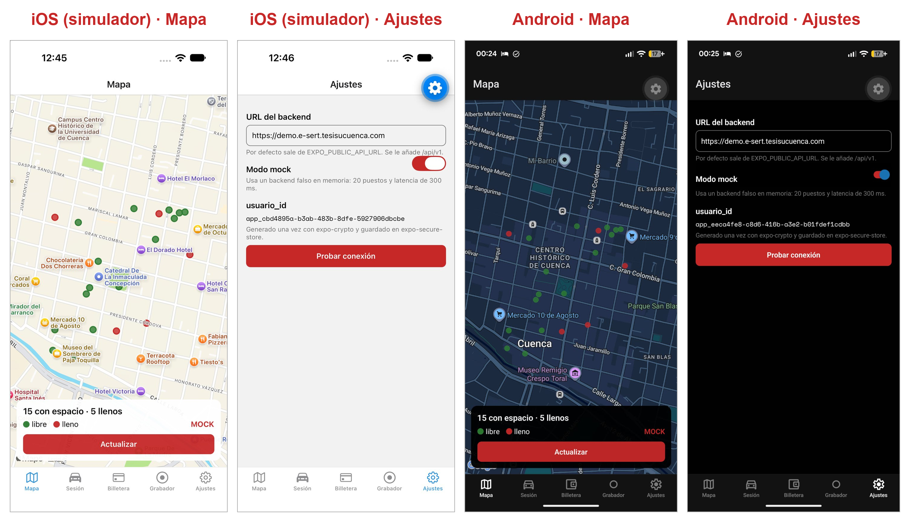
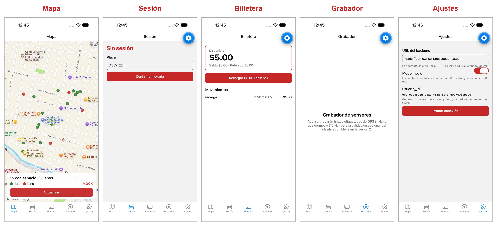
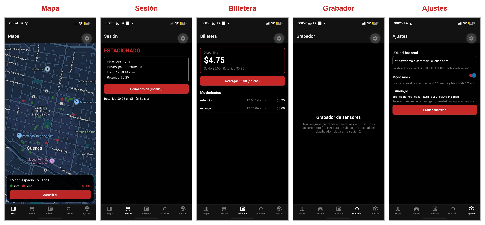
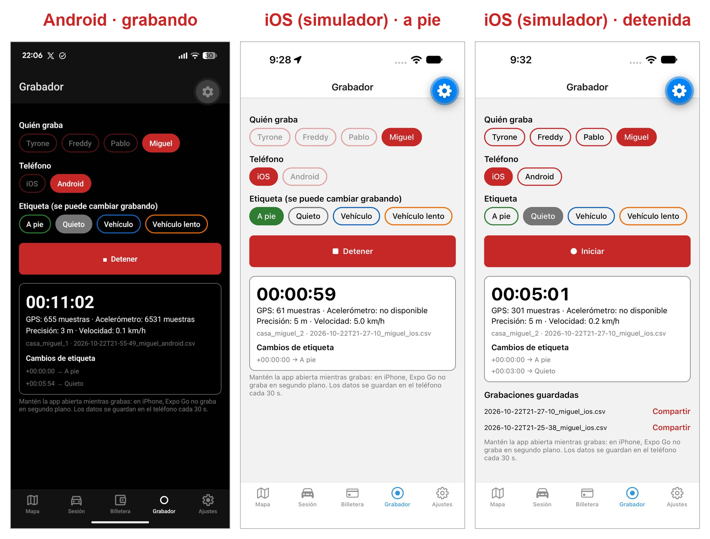
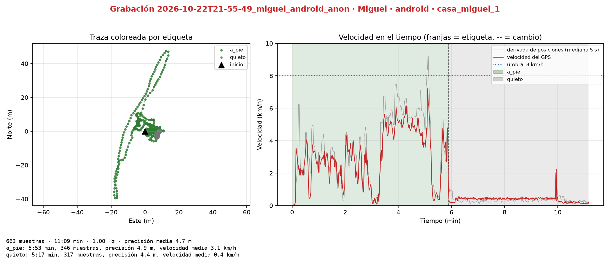
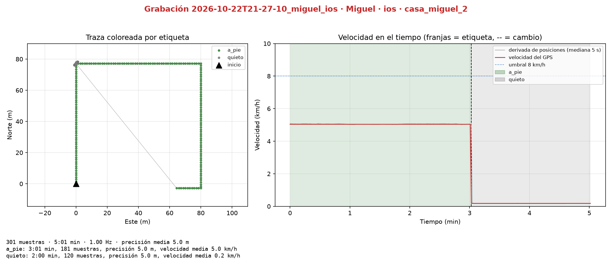

# Bitácora de Miguel 🔴

**Color:** Rojo (`#C62828`) · **Rol:** App Expo: sensores, sesión de parqueo, billetera y Payphone

Cada sesión agrega una entrada al final (ver *Protocolo de cierre* en `CLAUDE.md`). No se borra nada.

---

## S1 · Sesión 1 · 2026-10-22 · Proyecto Expo, navegación y cliente API
**Estado:** hecha

**Qué hice:**
- Creé el proyecto con `create-expo-app --template tabs` (Expo **SDK 58**, RN 0.88, TypeScript 6) y quité las pantallas de ejemplo (`two`, `modal`, `EditScreenInfo`, `ExternalLink`).
- Hice 5 pestañas de `expo-router`:
  - **Mapa** con `react-native-maps`: región en el Parque Calderón y círculos verdes y rojos según `ocupados < capacidad`.
  - **Sesión** (base manual).
  - **Billetera**: saldo, retenido, disponible, movimientos y recarga de prueba.
  - **Grabador** (marcador para la sesión 2).
  - **Ajustes**: URL, modo mock y `usuario_id` (`app_<uuid4>` con `expo-crypto`, guardado en `expo-secure-store`).
- Escribí `src/api/tipos.ts` desde `docs/CONTRATO.md`, con los tipos y la interfaz `ApiESert`, marcado `// SINCRONIZAR con comun/esquemas.ts`.
- `src/api/cliente.ts`: `fetch` con `X-Contrato-Version: 1`, la URL de `EXPO_PUBLIC_API_URL` o de Ajustes, errores `{error:{codigo,mensaje}}` convertidos en `ErrorApi` y un tiempo de espera de 10 s.
- `src/api/mock.ts` (`// MOCK`):
  - 20 puestos con semilla alrededor del Parque Calderón y 300 ms de latencia;
  - un libro de billetera con recarga, retención, débito y liberación;
  - la tarifa del contrato: bloque de 30 min, fracciones de 5 min, mínimo de 10 min y un saldo negativo de hasta $0,50.
- Pruebas:
  - `npm run prueba:mock`: 24 comprobaciones;
  - el cliente HTTP, contra un servidor falso local;
  - `expo-doctor`: 20/20;
  - `expo export`: compilan los bundles de iOS y Android.
- `datos/herramientas/unir_capturas.py` une las capturas con un rótulo (Pillow).

**Archivos creados o modificados:**
- `semanas/S1/Miguel/codigo/app/` (todo el proyecto; lo central está en `app/(tabs)/*.tsx`, `src/api/{tipos,tarifa,cliente,mock}.ts`, `src/api/pruebas/mock.prueba.ts`, `src/ajustes/AjustesContexto.tsx`, `src/ui/*` y `README.md`);
- `semanas/S1/Miguel/codigo/datos/herramientas/unir_capturas.py`;
- `semanas/S1/Miguel/evidencias/s1_app-pantallas.png`, `s1_ios-pestanas.png` y `capturas/*.jpeg`;
- `semanas/S1/Miguel/explicaciones/s1_explicacion.{md,pdf}`, `estado.json` y `RESUMEN.md`.

**Decisiones y por qué:**
- **Me quedé en el SDK 58 (el último).** La App Store solo ofrece la Expo Go más reciente, así que bajar a 57 rompería los 3 iPhone del equipo.
- **El modo mock queda activado por defecto**, porque el backend de Freddy aún no existe. Hay un solo mock compartido para que la billetera no se reinicie al cambiar de pantalla.
- **El mock no usa módulos nativos** (uuid4 propio), para poder probarlo en la computadora con `tsx`.
- **El contrato no define los campos de `GET /sesiones/{id}` ni los de un movimiento.** Propuse `Sesion{sesion_id, usuario_id, placa, puesto_id, estado, inicio, fin, retenido, minutos_cobrados, debitado}` y `Movimiento{movimiento_id, tipo, monto, ts, sesion_id?, referencia_payphone?}`.
- **Las capturas originales de Android** quedaron también fuera del repo, en `Proyecto1/CapturasDesarrollo_Miguel/2026-10-22_S1-sesion1/`. Renombré la carpeta, que tenía espacios en los extremos.

**Problemas encontrados:**
- **Android:** al principio salía "Incompatible SDK version", porque la Expo Go instalada era anterior al SDK 58. Se resolvió actualizando Expo Go a la 58.0.5.
- **Diferencias entre plataformas:**
  - Android usa Google Maps y iOS usa Apple Maps; ambos dibujan bien los círculos.
  - El `Switch` de Android tenía el botón azul del sistema; lo forcé a blanco.
  - En modo claro (iOS), la fila "Modo mock" tenía un fondo blanco sobre el gris; lo arreglé.
  - En esta sesión no se piden permisos de ubicación, así que todavía no hay diferencias de permisos.
- **iOS se probó en el simulador de Xcode** (iPhone 18 Pro, iOS 27, Expo Go), no en un iPhone físico, porque Miguel no tiene uno por ahora.
- **`Themed.tsx` de la plantilla no pasaba `tsc` con RN 0.88** (`DefaultText['props']`). Lo corregí usando `TextProps` y `ViewProps`.
- **`herramientas/explicacion_pdf.py` falla si hay `código` dentro de una tabla:** convierte `<code>` en ``, y fpdf2 no lo admite en `<td>`. Lo esquivé quitando las comillas invertidas en las tablas de mi explicación.
- **En la computadora hay Node 26**, no el 20 LTS: funcionó sin problemas.
- **Al simulador hay que llamarlo con `DEVELOPER_DIR=/Applications/Xcode.app/Contents/Developer`**, porque `xcode-select` apunta a las Command Line Tools. Otra opción es correr `sudo xcode-select -s /Applications/Xcode.app` una vez.

**Pedidos a otros:**
- @Freddy: necesito `comun/esquemas.ts` y `comun/tarifa.json` para reemplazar mis copias. Por favor, define en el contrato los campos de `GET /sesiones/{id}` y los de cada `Movimiento`; mi propuesta está arriba.
- @Tyrone [Plan] herramientas/explicacion_pdf.py: cambiar `<code>` por `` hace fallar fpdf2 cuando hay código dentro de una celda de tabla ("Unsupported nested HTML tags inside <td>"). Sugiero no transformar `<code>` dentro de `<td>`, o quitar la etiqueta ahí.

**Bucle y verificación:**
- Hubo 3 vueltas:
  1. `tsc` falló por los íconos y por `Themed`.
  2. Fallo de Expo Go en Android; el `Switch` y el fondo de la fila en iOS.
  3. Todo en verde.
- El verificador independiente reportó 4/4 criterios cumplidos. Su única observación (de Android solo había capturas de Mapa y Ajustes) quedó resuelta: Miguel capturó también Sesión, Billetera y Grabador en Android, probando el flujo (confirmar llegada → $0,25 retenidos, disponible $4,75).

**Pendientes para la próxima sesión:**
- Sesión 2: el grabador de sensores.
- Probar en un iPhone físico cuando haya uno.
- Sincronizar los tipos y la tarifa con lo que publique Freddy.
- Verificar la tarifa SERT vigente.

**Evidencias:**    · [Explicación (PDF)](../semanas/S1/Miguel/explicaciones/s1_explicacion.pdf)

## S1 · Sesión 2 · 2026-10-22 · Grabador de sensores etiquetado
**Estado:** parcial

**Qué hice:**
- `src/sensores/grabador.ts`, la clase `Grabador`:
  - pide el permiso con `requestForegroundPermissionsAsync`;
  - lee el GPS con `watchPositionAsync` (BestForNavigation, 1000 ms, 0 m) y descarta las lecturas que llegan a menos de 0,5 s;
  - escribe el acelerómetro a 10 Hz en un archivo aparte (`_acel.csv`);
  - mantiene la pantalla encendida con `expo-keep-awake`;
  - vuelca a disco cada 30 s con `expo-file-system` (`write` en modo `append`);
  - permite `cambiarEtiqueta()` en caliente y guarda los instantes en `_meta.json`.
- `src/sensores/formato.ts` y `exportar.ts`:
  - las 7 columnas del contrato más `escenario,telefono,persona`;
  - `vehiculo_lento` se exporta como `vehiculo` + `trafico_lento`;
  - `speed` nulo o −1 deja el campo vacío;
  - el nombre del archivo es `<fecha>_<persona>_<telefono>.csv` y se comparte con `expo-sharing` (CSV del GPS y del acelerómetro).
- La pestaña **Grabador**:
  - selectores de persona, teléfono y etiqueta, con la etiqueta cambiable mientras se graba;
  - el aviso "graba el acompañante";
  - botones grandes Iniciar y Detener;
  - contador de muestras, precisión, velocidad y duración, y la lista de cambios y de grabaciones guardadas.
- `datos/herramientas/graficar_grabacion.py` valida contra el contrato (sale con 1 si hay errores), grafica la traza y la velocidad con franjas, y resume la duración por etiqueta y la precisión.
- `datos/herramientas/anonimizar_grabacion.py` traslada la traza al Parque Calderón, con un error de distancia de 0,0000 m.
- Pruebas:
  - `npm run prueba:grabador`: 12 comprobaciones;
  - una grabación sintética para probar el script;
  - una grabación en el simulador de iOS, manejada por deep links (solo en `__DEV__`) y con ubicación simulada;
  - la prueba casera en Android real.

**Archivos creados o modificados:**
- `codigo/app/src/sensores/{grabador,formato,exportar}.ts`, `src/sensores/pruebas/formato.prueba.ts`, `app/(tabs)/grabador.tsx`, `app.json` (plugin `expo-location`), `package.json` y `README.md`;
- `codigo/datos/herramientas/{graficar_grabacion,anonimizar_grabacion}.py`, `datos/requirements.txt`, `datos/README.md`, `datos/ejemplos/sintetica_muestra.csv` y `datos/grabaciones/*`;
- `evidencias/s2_*.png`, `evidencias/capturas/s2_*.jpeg`, `explicaciones/s2_explicacion.{md,pdf}`, `estado.json` y `RESUMEN.md`.

**Decisiones y por qué:**
- **Seguí la propuesta de contrato v1 de Freddy (§8):** `usuario_id = casa_<persona>_<n>`, `t` en segundos Unix y las columnas extra después de las 7.
- **Separé el formato (`formato.ts`) de lo nativo**, para poder probarlo en la computadora.
- **La grabación casera se anonimizó antes de subirla**, porque tenía las coordenadas reales del lugar donde Miguel grabó. Miguel lo eligió. El original quedó fuera del repo, en `Proyecto1/CapturasDesarrollo_Miguel/2026-10-22_S1-sesion2/`. El clasificador no pierde nada: distancias, tiempos, velocidades y etiquetas quedan iguales.
- **Para probar en el simulador añadí deep links** (`?accion=iniciar|etiqueta|detener`), solo en `__DEV__`.

**Problemas encontrados:**
- `simctl location start` interpretaba la primera coordenada negativa como una opción. Se resolvió pasando los puntos por stdin (`-`).
- En el simulador, una ubicación fija produce una sola actualización. Para "quieto" se simuló el temblor del GPS con un vaivén de ±2 m. En el teléfono real no pasa: hubo 317 muestras quieto.
- El simulador no tiene acelerómetro. La app lo detecta y muestra "no disponible".
- En Android, el GPS tardó 6 s en dar la segunda lectura al arrancar: el único hueco de la grabación.
- La caminata casera fue lenta (3,1 km/h de media, con tramos casi parados). Es útil como caso difícil, pero no representa una caminata por la calle.

**Pedidos a otros:**
- @Tyrone @Freddy @Pablo: instalen **Expo Go** (versión del SDK 58) para probar la app y luego el modo espejo. Las grabaciones caseras son **opcionales**; si alguien graba, que la anonimice con `datos/herramientas/anonimizar_grabacion.py` antes de subirla.
- @Pablo: hay una grabación casera de Android en `semanas/S1/Miguel/codigo/datos/grabaciones/` (5:53 a pie y 5:17 quieto, con el CSV del contrato y el acelerómetro aparte), por si sirve como validación extra. La de iOS es del simulador y no sirve como dato real.
- Si alguien del equipo tiene un iPhone físico disponible: necesito una grabación corta para cerrar el criterio 1.

**Bucle y verificación:**
- Hubo 3 vueltas:
  1. La derivada de la velocidad salía ilegible, así que la suavicé con una mediana de 5 s.
  2. La ruta del simulador no arrancaba (coordenada negativa) y una ubicación fija daba 1 sola muestra.
  3. Todo en verde.
- El verificador independiente reportó **3/4 cumplidos y el criterio 1 parcial**: iOS solo se probó en el simulador, con GPS sintético y sin acelerómetro, y la prueba de iOS duró 3 + 2 min. Además observó que en Android no hay `_meta.json`; el cambio de etiqueta está en el CSV y se confirmó con la captura.

**Pendientes para la próxima sesión:**
- Sesión 3.
- Grabación en un iPhone físico.
- Sincronizar los tipos y la tarifa con `comun/` de Freddy tras la unificación.

**Evidencias:**    · [Explicación (PDF)](../semanas/S1/Miguel/explicaciones/s2_explicacion.pdf)
