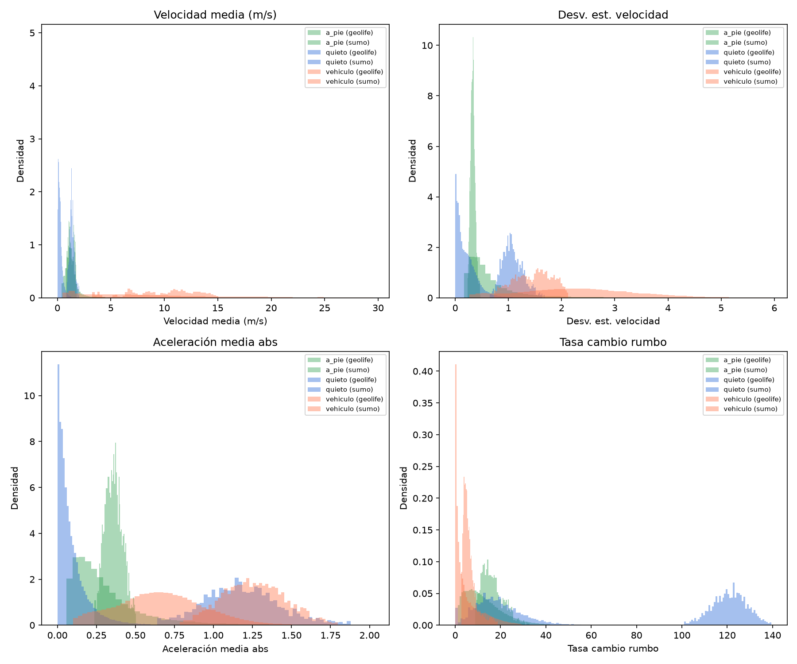
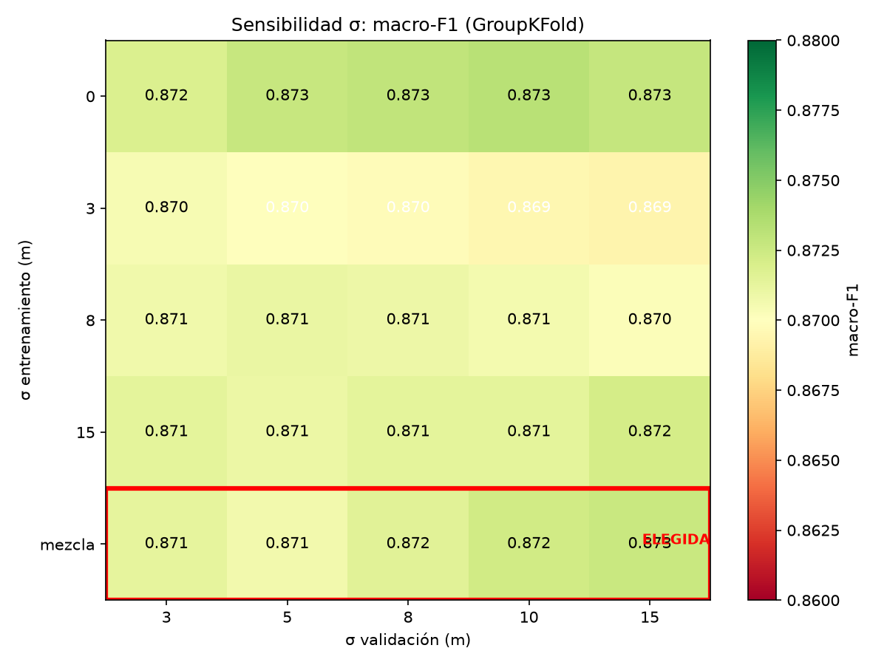

# Bitácora de Pablo 🟢

**Color:** Verde (`#2E9E4F`) · **Rol:** IA: dataset, clasificador de movimiento y servicio de inferencia

Cada sesión agrega una entrada al final (ver *Protocolo de cierre* en `CLAUDE.md`). No se borra nada.

---

## S2 · Sesión 1 · 2026-10-25 · Ventanas desde trazas de SUMO y ruido GPS calibrado con literatura
**Estado:** hecha
**Qué hice:**
- Creé `ia/particion.py` con partición fija: 20% usuarios de prueba (10 usuarios), semilla 2026, semillas SUMO 101–105 reservadas.
- Escribí `ia/calibracion/FUENTES.md` con 5 fuentes bibliográficas (Zandbergen 2009, Zandbergen y Barbeau 2011, Merry y Bettinger 2019, Groves 2011, Jun et al. 2006) y `ruido_literatura.json` con los parámetros calibrados.
- Implementé `ia/ruido.py` con `aplicar_ruido_ar1()`: AR(1) por eje, proyección equirectangular, recálculo de velocidades, pérdida de puntos.
- Creé `ia/datos_sumo.py` con trazas MOCK (60 vehículos, 45 peatones, 30 estacionados × 3 semillas) → 7,982 ventanas.
- Corrí análisis de sensibilidad σ_entr × σ_val → mezcla U(3,15) elegida como la más robusta.
- Mezclé GeoLife + SUMO + augmentation → `ventanas_v2.parquet` (1,650,500 ventanas) sin fuga.
- Kolmogórov-Smirnov GeoLife vs SUMO en 4 features × 3 clases → `ks_origenes.csv`.
- 11 tests (partición, ruido AR(1) σ±10% y ρ±0.05, no fuga, hash).

**Archivos creados o modificados:**
- `semanas/S2/Pablo/codigo/ia/particion.py`
- `semanas/S2/Pablo/codigo/ia/particion_usuarios.json`
- `semanas/S2/Pablo/codigo/ia/ruido.py`
- `semanas/S2/Pablo/codigo/ia/datos_sumo.py`
- `semanas/S2/Pablo/codigo/ia/mezclar_datasets.py`
- `semanas/S2/Pablo/codigo/ia/sensibilidad_sigma.py`
- `semanas/S2/Pablo/codigo/ia/calibracion/FUENTES.md`
- `semanas/S2/Pablo/codigo/ia/calibracion/ruido_literatura.json`
- `semanas/S2/Pablo/codigo/ia/reportes/sensibilidad_sigma.csv`
- `semanas/S2/Pablo/codigo/ia/reportes/ks_origenes.csv`
- `semanas/S2/Pablo/codigo/ia/tests/test_s2.py`
- `semanas/S2/Pablo/evidencias/s1_distribuciones-features.png`
- `semanas/S2/Pablo/evidencias/s1_sensibilidad-sigma.png`
- `semanas/S2/Pablo/explicaciones/s1_explicacion.md`
- `semanas/S2/Pablo/explicaciones/s1_explicacion.pdf`

**Decisiones y por qué:**
- **Mezcla U(3,15) para entrenamiento:** la rejilla de sensibilidad mostró diferencias <0.3% en macro-F1. La mezcla expone al modelo a todo el rango de condiciones GPS del Centro Histórico.
- **Trazas SUMO como MOCK:** Freddy no había entregado trazas reales. Se generaron trazas sintéticas marcadas `# MOCK`. El KS alto (D>0.15 en todo) confirma la necesidad de trazas reales.
- **Submuestreo en sensibilidad:** 1M ventanas × 25 entrenamientos causaba OOM. 180k ventanas × 3 folds fue suficiente para la tendencia.

**Problemas encontrados:**
- El análisis de sensibilidad con 1M ventanas y 50 árboles tardaba >10 min por σ y consumía demasiada RAM. Resuelto con submuestreo a 180k ventanas, 20 árboles y 3 folds.

**Pedidos a otros:**
- @Freddy: los parámetros de `ruido_literatura.json` para tu `EmuladorGPS` (σ 3-15 m, ρ 0.8). Si puedes generar trazas con `--sin-ruido` las agrego yo. No uses las semillas 101–105 en entrenamiento.
- @Miguel: la ruta de la partición es `ia/particion_usuarios.json`, por si algún día hay grabaciones caseras que validar.

**Bucle y verificación:** 1 vuelta de código (tests al primer intento), 3 intentos del análisis de sensibilidad por OOM. El verificador independiente reportó 6/6 criterios cumplidos.

**Pendientes para la próxima sesión:**
- Reentrenar RF v1 con ventanas_v2.parquet.
- Reemplazar MOCK de SUMO cuando Freddy entregue trazas reales.

**Evidencias:**

