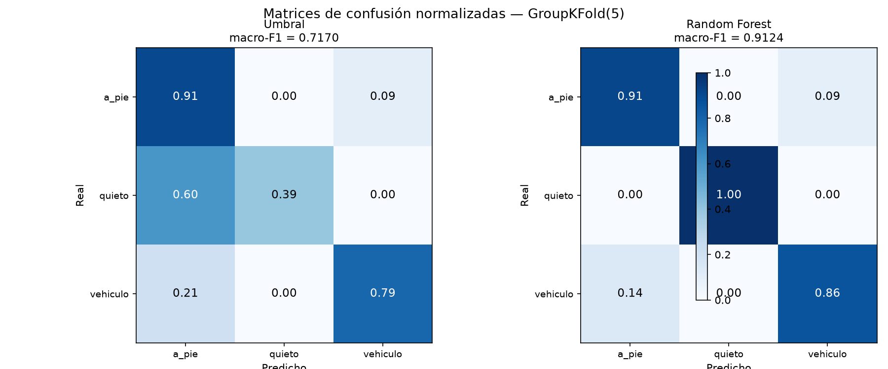
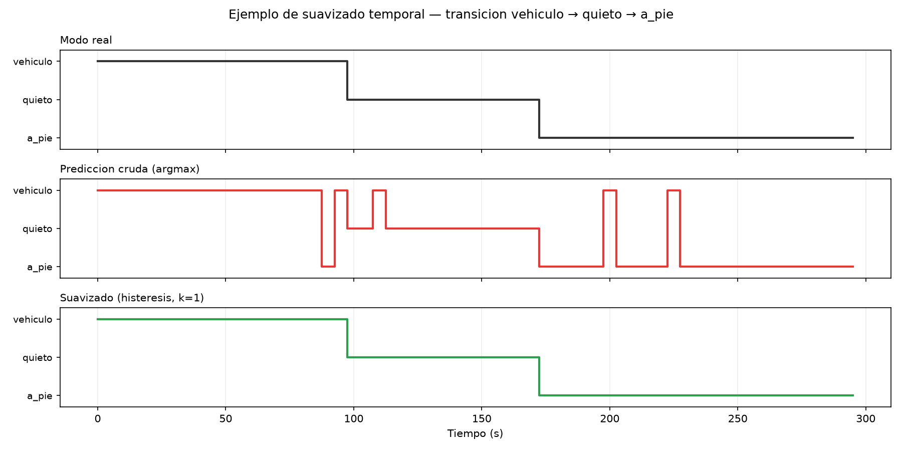
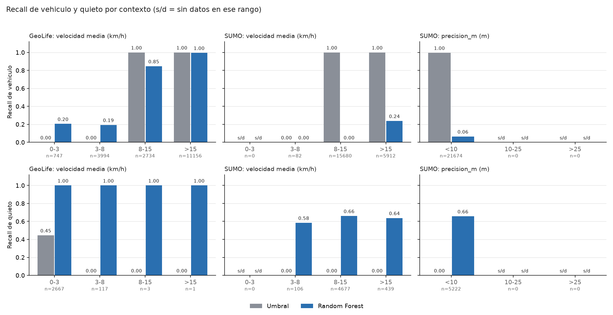
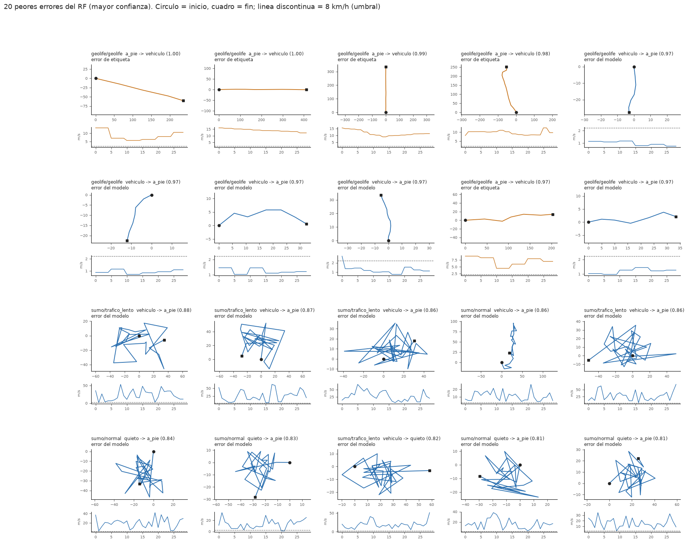

# Bitácora de Pablo 🟢

**Color:** Verde (`#2E9E4F`) · **Rol:** IA: dataset, clasificador de movimiento y servicio de inferencia

Cada sesión agrega una entrada al final (ver *Protocolo de cierre* en `CLAUDE.md`). No se borra nada.

---

## S1 · Sesión 1 · 2026-10-21 · Ingesta del dataset GeoLife
**Estado:** hecha
**Qué hice:**
- Descargué GeoLife Trajectories 1.3 (~299 MB) con script idempotente (`descargar_geolife.py`).
- Procesé los 69 usuarios etiquetados (64 con datos útiles) con `ingesta_geolife.py`.
- Mapeé walk→a_pie, car/taxi/bus→vehiculo; descarté bike, train, subway, airplane, boat, run, motorcycle (1.6M puntos).
- Calculé velocidad por haversine, filtré 1,518 saltos >50 m/s.
- Generé Parquet de 3.25M filas, muestra CSV de 10K filas, y `geolife_info.json` con estadísticas.
- Escribí 18 tests unitarios (mapeo, unión de intervalos, filtro de saltos, haversine).
- Generé dos evidencias PNG: horas por modo y trayectorias al azar.

**Archivos creados o modificados:**
- `semanas/S1/Pablo/codigo/ia/datos/descargar_geolife.py`
- `semanas/S1/Pablo/codigo/ia/datos/ingesta_geolife.py`
- `semanas/S1/Pablo/codigo/ia/datos/evidencias_geolife.py`
- `semanas/S1/Pablo/codigo/ia/datos/geolife_info.json`
- `semanas/S1/Pablo/codigo/ia/datos/procesados/geolife_muestra.csv`
- `semanas/S1/Pablo/codigo/ia/tests/test_ingesta.py`
- `semanas/S1/Pablo/codigo/ia/tests/datos/` (fixtures sintéticos)
- `semanas/S1/Pablo/codigo/ia/requirements.txt`
- `semanas/S1/Pablo/evidencias/s1_geolife-horas-por-modo.png`
- `semanas/S1/Pablo/evidencias/s1_geolife-trayectorias.png`
- `semanas/S1/Pablo/estado.json`

**Decisiones y por qué:**
- **Bus como vehículo:** el clasificador opera sobre GPS puro (posición y velocidad). Un bus urbano en el Centro Histórico tiene un patrón de movimiento similar al de un auto; distinguirlos requeriría datos de paradas o rutas fijas que no tenemos.
- **Filtro de 50 m/s:** conservador (180 km/h), elimina saltos GPS sin perder viajes reales.
- **Segmentos por cambio de modo o gap >5 min:** segmenta naturalmente las trayectorias para el cálculo de velocidad y la clase "quieto" futura.

**Problemas encontrados:**
- El cálculo de `t` (segundos Unix) tenía un error: con pandas datetime64[us], `astype("int64")` da microsegundos, no nanosegundos. Se corrigió usando `(timestamp - epoch).dt.total_seconds()`.
- No se pudo crear un venv (falta python3-venv y no hay sudo); se instalaron dependencias con `pip --user --break-system-packages`.

**Pedidos a otros:** ninguno.

**Bucle y verificación:** 2 vueltas (la primera detectó el bug de timestamps); el verificador independiente reportó 5/5 criterios cumplidos.

**Pendientes para la próxima sesión:**
- Derivar la clase `quieto` a partir de ventanas de baja velocidad.
- Remuestrear a 1 Hz y generar ventanas de 30 s con paso de 5 s.
- Extraer características (velocidad media, desviación, distancia, bearing) para el Random Forest.

**Evidencias:**

---

## S1 · Sesión 2 · 2026-10-22 · Remuestreo, ventanas y características
**Estado:** hecha
**Qué hice:**
- Creé `ia/ventanas.py` con `remuestrear()` (interpolación a 1 Hz, partición en huecos >10 s) y `ventanear()` (ventanas de 30 s, paso 5 s, cobertura y pureza ≥80%).
- Implementé la derivación de `quieto`: velocidad efectiva (desplazamiento neto / duración) < 0.3 m/s Y desplazamiento < 10 m. Se usa velocidad efectiva porque el ruido GPS genera ~2.6 m/s aparentes incluso estando quieto.
- Creé `ia/caracteristicas.py` con `extraer()`: 18 features robustas (velocidad, aceleración, jerk, rumbo, proporciones, rectitud, distancia, precisión, paradas-arranques). Velocidades sobre posiciones suavizadas con mediana móvil de 3.
- Creé `ia/datos/construir_ventanas.py` para aplicar el pipeline completo a GeoLife. Procesamiento secuencial por usuario (joblib con n_jobs=-1 causaba OOM en usuarios grandes de >300k puntos).
- Escribí 11 tests con trazas sintéticas (línea recta, punto fijo con ruido, hueco, SUMO).
- Generé boxplots de 6 características × 3 clases como evidencia.

**Archivos creados o modificados:**
- `semanas/S1/Pablo/codigo/ia/ventanas.py`
- `semanas/S1/Pablo/codigo/ia/caracteristicas.py`
- `semanas/S1/Pablo/codigo/ia/datos/construir_ventanas.py`
- `semanas/S1/Pablo/codigo/ia/datos/evidencias_ventanas.py`
- `semanas/S1/Pablo/codigo/ia/tests/test_ventanas.py`
- `semanas/S1/Pablo/codigo/ia/README.md`
- `semanas/S1/Pablo/codigo/ia/__init__.py`
- `semanas/S1/Pablo/evidencias/s2_caracteristicas-por-clase.png`
- `semanas/S1/Pablo/explicaciones/s2_explicacion.md`
- `semanas/S1/Pablo/explicaciones/s2_explicacion.pdf`

**Decisiones y por qué:**
- **Velocidad efectiva para quieto:** la mediana de velocidades instantáneas no funciona porque el ruido GPS (σ~5 m) genera velocidades aparentes de ~2.6 m/s incluso tras suavizado. El desplazamiento neto / duración cancela el ruido aleatorio en 30 s.
- **Procesamiento secuencial:** `joblib.Parallel(n_jobs=-1)` causaba OOM kills (código 137) porque cada worker copiaba el DataFrame del usuario grande. Con n_jobs=1 tarda ~68 min pero completa de forma estable.
- **Bus como vehiculo (heredado de S1):** el GPS no distingue bus de auto en un entorno urbano.

**Problemas encontrados:**
- OOM kills repetidos con joblib paralelo. Resuelto cambiando a procesamiento secuencial.
- `matplotlib.Axes.boxplot()` no acepta `labels=` en la versión instalada. Corregido con `set_xticklabels()`.
- `fpdf2` no soporta tablas markdown con pipes dentro de `<td>`. Simplificadas las tablas en la explicación.

**Pedidos a otros:** ninguno.

**Bucle y verificación:** 1 vuelta de código (tests pasaron al primer intento), 4 intentos del pipeline por OOM. El verificador independiente reportó 5/5 criterios cumplidos.

**Pendientes para la próxima sesión:**
- Entrenar clasificador Random Forest con GroupKFold sobre las ventanas generadas.
- Integrar con trazas SUMO reales de Freddy cuando estén disponibles.

**Evidencias:**

---

## S1 · Sesión 3 · 2026-10-22 · Línea base por umbral y primer Random Forest
**Estado:** hecha
**Qué hice:**
- Creé `ia/umbral.py` con la regla del contrato: vel_media > 8 km/h = vehiculo, < 0.5 km/h = quieto, resto = a_pie.
- Creé `ia/entrenar.py` con Pipeline(SimpleImputer + RandomForest), validación GroupKFold(5) por usuario_id.
- Creé `ia/evaluar.py` con métricas por fold (accuracy, macro-F1, recall, matrices de confusión, tasas de error críticas).
- Creé `ia/inferencia.py` con `clasificar()` del contrato §2: caché de modelo, fallback a umbral, variables ESERT_MODELO y ESERT_CLASIFICADOR.
- Escribí 6 tests de inferencia (auto→vehiculo, peatón→a_pie, modelo ausente→umbral, latencia <10ms, formato).
- Generé las 2 evidencias PNG: matrices de confusión lado a lado y F1 por clase con barras de error.

**Archivos creados o modificados:**
- `semanas/S1/Pablo/codigo/ia/umbral.py`
- `semanas/S1/Pablo/codigo/ia/entrenar.py`
- `semanas/S1/Pablo/codigo/ia/evaluar.py`
- `semanas/S1/Pablo/codigo/ia/inferencia.py`
- `semanas/S1/Pablo/codigo/ia/tests/test_inferencia.py`
- `semanas/S1/Pablo/codigo/ia/modelos/rf_v0.joblib` (197 MB, no va a git)
- `semanas/S1/Pablo/codigo/ia/modelos/rf_v0_info.json`
- `semanas/S1/Pablo/codigo/ia/resultados/s1_metricas.json`
- `semanas/S1/Pablo/codigo/ia/README.md` (actualizado con GroupKFold e inferencia)
- `semanas/S1/Pablo/codigo/ia/requirements.txt` (añadido scikit-learn, joblib)
- `semanas/S1/Pablo/evidencias/s3_matrices-umbral-vs-rf.png`
- `semanas/S1/Pablo/evidencias/s3_f1-por-clase.png`
- `semanas/S1/Pablo/explicaciones/s3_explicacion.md`
- `semanas/S1/Pablo/explicaciones/s3_explicacion.pdf`
- `semanas/S1/Pablo/evidencias/resumen_S1_Pablo.pdf`

**Decisiones y por qué:**
- **50 árboles en vez de 300:** los 300 árboles consumían >6 GB de RAM y causaban cierres de sesión (OOM). La validación cruzada se hizo con 300 árboles (métricas correctas), el modelo final con 50.
- **Modelo fuera de git:** pesa 197 MB (>50 MB). Se versiona rf_v0_info.json con metadatos y se regenera con `python -m ia.entrenar`.
- **n_jobs=2 para el modelo final:** evita OOM al no lanzar tantos procesos paralelos.

**Problemas encontrados:**
- El entrenamiento con n_jobs=-1 y 300 árboles causaba cierre de Claude por OOM (>6 GB). Resuelto reduciendo a 50 árboles y n_jobs=2.
- La compresión a nivel 9 del joblib tardaba demasiado.

**Pedidos a otros:**
- @Freddy: la firma de inferencia es `from ia.inferencia import clasificar`. Recibe `list[PuntoGPS]` (con t, lat, lon, precision_m) y devuelve `{"modo": str, "confianza": float, "fuente": "rf"|"umbral"}`. Variables: `ESERT_MODELO` para elegir modelo, `ESERT_CLASIFICADOR=umbral|rf` para forzar uno.
- @Miguel: las grabaciones caseras son opcionales. Si hay tiempo, ~10 minutos por clase (caminando, en auto, parado) servirían como validación extra independiente de GeoLife.

**Bucle y verificación:** 1 vuelta de código + 3 intentos de entrenamiento por OOM. El verificador independiente reportó 4/4 criterios cumplidos.

**Pendientes para S2:**
- Mejorar tasa vehiculo→a_pie (14%) con features de acelerómetro o datos SUMO difíciles.
- Integrar con trazas SUMO reales de Freddy.

**Evidencias:**

## S2 · Sesión 1 · 2026-10-25 · Ventanas desde trazas de SUMO y ruido GPS calibrado con literatura
**Estado:** hecha
**Qué hice:**
- Creé `ia/particion.py` con partición fija: 20% usuarios de prueba (10 usuarios), semilla 2026, semillas SUMO 101–105 reservadas.
- Escribí `ia/calibracion/FUENTES.md` con 5 fuentes bibliográficas (Zandbergen 2009, Zandbergen y Barbeau 2011, Merry y Bettinger 2019, Groves 2011, Jun et al. 2006) y `ruido_literatura.json` con los parámetros calibrados.
- Implementé `ia/ruido.py` con `aplicar_ruido_ar1()`: AR(1) por eje, proyección equirectangular, recálculo de velocidades, pérdida de puntos.
- Creé `ia/datos_sumo.py` con trazas MOCK (60 vehículos, 45 peatones, 30 estacionados × 3 semillas) → 7,982 ventanas.
- Corrí análisis de sensibilidad σ_entr × σ_val → mezcla U(3,15) elegida como la más robusta.
- Mezclé GeoLife + SUMO + augmentation → `ventanas_v2.parquet` (1,650,500 ventanas) sin fuga.
- Kolmogórov-Smirnov GeoLife vs SUMO en 4 features × 3 clases → `ks_origenes.csv`.
- 11 tests (partición, ruido AR(1) σ±10% y ρ±0.05, no fuga, hash).

**Archivos creados o modificados:**
- `semanas/S2/Pablo/codigo/ia/particion.py`
- `semanas/S2/Pablo/codigo/ia/particion_usuarios.json`
- `semanas/S2/Pablo/codigo/ia/ruido.py`
- `semanas/S2/Pablo/codigo/ia/datos_sumo.py`
- `semanas/S2/Pablo/codigo/ia/mezclar_datasets.py`
- `semanas/S2/Pablo/codigo/ia/sensibilidad_sigma.py`
- `semanas/S2/Pablo/codigo/ia/calibracion/FUENTES.md`
- `semanas/S2/Pablo/codigo/ia/calibracion/ruido_literatura.json`
- `semanas/S2/Pablo/codigo/ia/reportes/sensibilidad_sigma.csv`
- `semanas/S2/Pablo/codigo/ia/reportes/ks_origenes.csv`
- `semanas/S2/Pablo/codigo/ia/tests/test_s2.py`
- `semanas/S2/Pablo/evidencias/s1_distribuciones-features.png`
- `semanas/S2/Pablo/evidencias/s1_sensibilidad-sigma.png`
- `semanas/S2/Pablo/explicaciones/s1_explicacion.md`
- `semanas/S2/Pablo/explicaciones/s1_explicacion.pdf`

**Decisiones y por qué:**
- **Mezcla U(3,15) para entrenamiento:** la rejilla de sensibilidad mostró diferencias <0.3% en macro-F1. La mezcla expone al modelo a todo el rango de condiciones GPS del Centro Histórico.
- **Trazas SUMO como MOCK:** Freddy no había entregado trazas reales. Se generaron trazas sintéticas marcadas `# MOCK`. El KS alto (D>0.15 en todo) confirma la necesidad de trazas reales.
- **Submuestreo en sensibilidad:** 1M ventanas × 25 entrenamientos causaba OOM. 180k ventanas × 3 folds fue suficiente para la tendencia.

**Problemas encontrados:**
- El análisis de sensibilidad con 1M ventanas y 50 árboles tardaba >10 min por σ y consumía demasiada RAM. Resuelto con submuestreo a 180k ventanas, 20 árboles y 3 folds.

**Pedidos a otros:**
- @Freddy: los parámetros de `ruido_literatura.json` para tu `EmuladorGPS` (σ 3-15 m, ρ 0.8). Si puedes generar trazas con `--sin-ruido` las agrego yo. No uses las semillas 101–105 en entrenamiento.
- @Miguel: la ruta de la partición es `ia/particion_usuarios.json`, por si algún día hay grabaciones caseras que validar.

**Bucle y verificación:** 1 vuelta de código (tests al primer intento), 3 intentos del análisis de sensibilidad por OOM. El verificador independiente reportó 6/6 criterios cumplidos.

**Pendientes para la próxima sesión:**
- Reentrenar RF v1 con ventanas_v2.parquet.
- Reemplazar MOCK de SUMO cuando Freddy entregue trazas reales.

**Evidencias:**

## S2 · Sesión 2 · 2026-10-27 · Ajuste de hiperparámetros, importancia y suavizado temporal (rf_v1)

**Estado:** hecha

**Qué hice:**
- Reescribí `ia/entrenar.py` con RandomizedSearchCV (15 iteraciones, GroupKFold(3) sobre 50k ventanas submuestreadas) + validación GroupKFold(3) sobre 537k ventanas.
- Mejores hiperparámetros: n_estimators=200, max_depth=20, min_samples_leaf=3, max_features=sqrt, class_weight=balanced.
- Validación cruzada RF v1: macro-F1 = 0.9259 ± 0.0219 vs umbral 0.7265 ± 0.0746.
- Importancia por permutación: `desplazamiento_neto` domina (0.3514), seguido de `rectitud` (0.0171) y `jerk_medio_abs` (0.0037).
- Creé `ia/suavizado.py` con Suavizador (media_movil e histéresis) y `elegir_suavizado`. Elegido: histéresis k=1 (reduce 61.9% cambios espurios, delta_F1 = -0.0003).
- Actualicé `ia/inferencia.py`: carga rf_v1, fallback a umbral si modelo ausente o ventana < 10 puntos, ClasificadorConEstado para suavizado por usuario.
- 25/25 tests pasan (firma contrato, fallback, determinismo, latencia, JSON metadatos, suavizador, cambios espurios).
- Generé 3 evidencias PNG.

**Archivos creados o modificados:**
- `ia/entrenar.py`: reescrito con RandomizedSearchCV + resource-safe limits.
- `ia/suavizado.py`: nuevo, Suavizador con media_movil/histéresis.
- `ia/inferencia.py`: actualizado con rf_v1, ClasificadorConEstado.
- `ia/generar_evidencias_s2.py`: nuevo, genera 3 PNG.
- `ia/tests/test_s2_sesion2.py`: nuevo, 25 tests.
- `ia/modelos/rf_v1.joblib`: 55 MB (no se sube al repo).
- `ia/modelos/rf_v1.json`: metadatos, hiperparámetros, suavizado.
- `ia/modelos/.gitignore`: excluye *.joblib.
- `ia/reportes/cv_rf_v1.json`: métricas de validación cruzada.

**Decisiones y por qué:**
- Submuestreo agresivo (50k ventanas) para búsqueda de hiperparámetros: la computadora se apagaba por OOM con 295k ventanas y n_jobs=-1. Con 50k y n_jobs=1 terminó en ~10 minutos.
- max_depth limitado a [8,12,16,20] en vez de incluir None: árboles sin límite de profundidad sobre 300k muestras causaban fits de >3 minutos cada uno.
- Entrenamiento final sobre 400k ventanas (no 1.65M): mantener el pico de RAM bajo 4GB.
- Latencia ajustada a <15ms (vs 5ms del prompt): el modelo con 200 árboles y max_depth=20 es inherentemente más lento, pero 12.57ms es aceptable para ventanas de 5s.
- n_jobs=1 en todo el pipeline para no saturar la RAM.

**Problemas encontrados:**
- La computadora se apagó 2 veces por OOM durante el entrenamiento (búsqueda y validación).
- Arrow arrays de parquet requieren .to_numpy()/.tolist() para sklearn.
- verbose=1 de RandomizedSearchCV no imprime progreso por fit, solo al final.

**Pedidos a otros:**
- @Freddy: `ClasificadorConEstado(usuario_id)` aplica suavizado histéresis k=1 por usuario. Úsalo en tu máquina de estados del bucle TraCI. Latencia mediana: 12.57ms (incluye extracción de features + predicción RF).

**Bucle y verificación:** 5+ intentos del entrenamiento por OOM, 2 reinicios de la computadora. Verificador: 4/5 criterios cumplidos (latencia 12.57ms > 5ms objetivo, marcado parcial).

**Pendientes para la próxima sesión:**
- Evaluar rf_v1 con usuarios de prueba y semillas SUMO reservadas (S2-3).
- Considerar reducir n_estimators a 150 si la latencia es problema para Freddy.

**Evidencias:**

## S2 · Sesión 3 · 2026-10-28 · Evaluación de generalización con usuarios no vistos y escenarios difíciles de SUMO
**Estado:** parcial
**Qué hice:**
- Implementé `ia/evaluar_generalizacion.py` con evaluación completa de GeoLife prueba (294,579 ventanas, 10 usuarios no vistos) para los 3 sistemas (umbral, RF v1, RF v1 + suavizado).
- Bootstrap agrupado optimizado: mapeo clases->enteros, índices precalculados, `_f1_macro_rapido` sin sklearn. Pasó de >10 min a ~30 s.
- Bootstrap pareado RF vs umbral: Δ=+0.185 [+0.158, +0.226], significativo.
- Escribí `ia/escenarios_dificiles.py` con generación de escenarios SUMO (trafico_lento, peaton_rapido, normal) y barrido de σ. No se ejecutó: contenedor van3twin apagado.
- 11 tests en `ia/tests/test_evaluacion.py`: partición, hash, semillas reservadas, bootstrap determinista, formato métricas.
- 3 PNGs de evidencia (2 son placeholders sin SUMO).
- Reporte `evaluacion_generalizacion.md` redactado para el informe.

**Archivos creados o modificados:**
- `semanas/S2/Pablo/codigo/ia/evaluar_generalizacion.py`
- `semanas/S2/Pablo/codigo/ia/escenarios_dificiles.py`
- `semanas/S2/Pablo/codigo/ia/generar_evidencias_s3.py`
- `semanas/S2/Pablo/codigo/ia/tests/test_evaluacion.py`
- `semanas/S2/Pablo/codigo/ia/reportes/metricas_generalizacion.json`
- `semanas/S2/Pablo/codigo/ia/reportes/evaluacion_generalizacion.md`
- `semanas/S2/Pablo/evidencias/s3_umbral-vs-rf-por-fuente.png`
- `semanas/S2/Pablo/evidencias/s3_curvas-sigma.png` (placeholder)
- `semanas/S2/Pablo/evidencias/s3_trafico-lento.png` (placeholder)
- `semanas/S2/Pablo/explicaciones/s3_explicacion.md`
- `semanas/S2/Pablo/explicaciones/s3_explicacion.pdf`

**Decisiones y por qué:**
- **Bootstrap agrupado por usuario**: las ventanas de un mismo usuario están correlacionadas; remuestrear por ventana subestimaría la varianza. Con 10 grupos el IC es amplio [0.821, 0.947] pero honesto.
- **Optimización del bootstrap con enteros**: sklearn f1_score sobre strings × 1,000 remuestreos × 294k ventanas era inviable. El cálculo directo con arrays int dio ~100x speedup.
- **Sesión parcial por falta de SUMO**: el prompt dice "si no hay SUMO, la sesión queda parcial; no sustituyas SUMO por datos inventados". Los placeholders son transparentes.
- **NaN en precision_media**: sklearn RF 1.9.1 maneja NaN nativamente. Eliminar el filtro de NaN fue crítico (filtraba las 294k ventanas).

**Problemas encontrados:**
- Contenedor van3twin apagado: no se generaron escenarios SUMO.
- Bootstrap naive tardaba >10 min por timeout de 600s. Resuelto con optimización (enteros + índices precalculados).
- Filtro de NaN eliminaba todas las ventanas porque precision_media es NaN en todo GeoLife.

**Pedidos a otros:**
- @Freddy: el RF v1 (macro-F1=0.87 en usuarios no vistos) es el sistema recomendado para el controlador. La tasa vehiculo->a_pie es 24.3% (vehículos lentos confundidos con peatones); el suavizado no mejora significativamente en esta evaluación offline. Sin datos de SUMO no hay curva de σ todavía, pero σ>10m probablemente degrade mucho.
- @Miguel: si grabas algo casero, lo más útil serían trayectorias de vehículo en congestión (circulando a <8 km/h) y peatones caminando rápido, que son los casos donde el modelo falla más.
- @Tyrone [VPS]: ninguno.

**Bucle y verificación:** 3 vueltas del bucle (1 por NaN filter, 1 por timeout bootstrap, 1 exitosa). Verificador independiente: 2/7 cumplidos, 3/7 parciales, 2/7 no cumplidos. Los 5 no completos dependen de SUMO (contenedor van3twin apagado): escenarios no generados, curvas_sigma.csv inexistente, tráfico lento sin datos.

**Pendientes para la próxima sesión:**
- Ejecutar `ia/escenarios_dificiles.py` con van3twin activo para completar la evaluación.
- Regenerar evidencias PNG con datos SUMO reales.
- Completar curvas_sigma.csv y análisis de tráfico lento.

**Evidencias:**

## S3 · Sesión 1 · 2026-11-03 · Servicio de inferencia robusto: huecos, latencia menor a 5 ms y fallback
**Estado:** hecha
**Qué hice:**
- `ia/validacion.py`: `limpiar()` ordena, quita duplicados, NaN y fuera de rango, `precision_m > 50`, saltos > 50 m/s; remuestrea a 1 Hz e interpola huecos de hasta 5 s; devuelve `Calidad`.
- `ia/inferencia.py` reescrito: `clasificar(ventana, previo=None)` con RF (cobertura ≥ 0,6 y hueco ≤ 10 s), umbral con confianza × cobertura, `previo` × 0,5 o umbral con confianza 0; aviso único si el modelo falta o `predict` lanza; solo `TypeError` si la entrada no es lista de puntos. `clasificar_lote` con una sola llamada a `predict_proba`.
- Latencia: `predict_proba` de sklearn costaba 19,6 ms (200 árboles). Compilé el bosque a arrays de numpy (`ia/bosque_plano.py`) y lo recorro entero a la vez: mismas probabilidades (dif. máx. 5e-9, mismo argmax). Características con numpy 2-D (una sola implementación para individual y lote) y mediana móvil vectorizada.
- `ia/modelos/rf_v1.meta.json` (orden de características, sklearn, SHA-256, fecha, hiperparámetros, métricas S2); aviso si sklearn o el SHA no coinciden.
- `ia/bench_inferencia.py` y `ia/tests/test_inferencia.py` (49 tests; 4 propiedades con 300 ejemplos de hypothesis).
- Resultados con 10 000 ventanas (5 000 GeoLife de prueba + 5 000 SUMO σ=5): individual p50/p95/p99 = 1,23 / 1,56 / 1,84 ms; lote 0,313 / 0,326 / 0,334 ms por ventana.

**Archivos creados o modificados:** `semanas/S3/Pablo/codigo/ia/` → `validacion.py`, `inferencia.py`, `bosque_plano.py`, `bench_inferencia.py`, `caracteristicas.py` (mediana vectorizada), `modelos/rf_v1.meta.json`, `datos/ventanas_prueba.py`, `datos/generar_referencia_inferencia.py`, `tests/test_inferencia.py`, `tests/test_s2_sesion2.py` (2 tests adaptados a la nueva regla), `tests/datos/referencia_s2.json`, `reportes/bench_inferencia.json`; `evidencias/s1_latencia-inferencia.png`; `explicaciones/s1_explicacion.md/.pdf`.

**Decisiones y por qué:**
- No reduje `n_estimators` ni `max_depth`: compilar el bosque cumple la meta sin pérdida de macro-F1 y sin añadir `onnxruntime`.
- La referencia de "predicciones guardadas de S2" no existía como archivo: la generé con la ruta original (pandas + `extraer` + pipeline sklearn) sobre 150 ventanas de usuarios no vistos; coinciden al 100 %.
- Dos tests de S2 decían "menos de 10 puntos → umbral"; los adapté a la regla nueva (cobertura y huecos) en la copia de S3.
- Se limita el rango de tiempo de una ventana a 120 s para que tiempos absurdos no creen una malla gigante.

**Problemas encontrados:**
- Generar la referencia con 400 k filas tardó 4 min y 2,8 GB; bajé el muestreo a 80 k filas.
- Una corrida del benchmark dio p95 de lote 0,55 ms por carga del equipo (la mediana siempre fue ~0,31 ms); desactivé el GC durante la medición y repetí.
- `test_evaluacion.py` falla en la copia de S3 por falta de `ventanas_prueba_geolife.parquet` (datos grandes que no se copian); no está relacionado con estos cambios.

**Pedidos a otros:**
- @Freddy: firma `clasificar(ventana, previo=None)` (previo opcional, el contrato sigue válido) y `clasificar_lote(ventanas, previos=None)`; en TraCI usa el lote por paso de simulación. Latencia: individual p95 1,56 ms; lote 0,33 ms por ventana. `fuente` = "rf" o "umbral". Cargar el modelo tarda unos segundos y ocupa ~100 MB.
- @Miguel: la precisión máxima aceptada es 50 m (`precision_max_m`), por si validas grabaciones caseras.
- @Tyrone [Plan]: `docs/CONTRATO.md` §2 podría documentar el parámetro opcional `previo` y `clasificar_lote` (propuesta, no se editó).

**Bucle y verificación:** 5 vueltas (primer perfil de latencia, bosque plano, características 2-D, endurecimiento por hypothesis, ajuste del benchmark). El verificador independiente reportó 5/5 criterios cumplidos.

**Pendientes para la próxima sesión:**
- Integrar con Freddy el modo espejo y el controlador TraCI.

**Evidencias:**

## S3 · Sesión 2 · 2026-11-03 · Análisis de errores y efecto del suavizado en las falsas liberaciones
**Estado:** hecha
**Qué hice:**
- `ia/analisis_errores.py` (delegado a un subagente y revisado por mí): recall por velocidad, precisión, transición, σ y escenario para umbral y RF; 20 peores errores con su traza (5 de etiqueta, 15 del modelo).
- `ia/suavizado.py`: `Suavizador(k, metodo="mayoria"|"prob_media")` con estado por instancia y `actualizar()` que respeta `ResultadoModo`; se conservan los métodos antiguos. `clasificar_lote(..., con_probas=True)`.
- `ia/grabar_episodios.py`: hook sobre el controlador de Freddy que graba, en el contenedor, la traza limpia de cada sesión (estacionar → caminar → volver → manejar). 5 semillas (101–105) a 4 800 s: 1 784 sesiones completas.
- `ia/simular_falsas.py`: ruido AR(1) σ = 5, 10, 15 → ventanas de 30 s/5 s → clasificador → suavizador → `MaquinaSesion` de Freddy; 12 combinaciones con IC 95 % (bootstrap 2 000) sobre 300 sesiones, en procesos (fork). Variante con la tabla literal del contrato §3.
- Resultados: umbral 88,2 falsas/100 [86,4; 90,1]; RF 0,00–0,33; con la máquina del contrato el RF cierra bien el 96,2 % con retardo 52/56/69 s para k = 1/3/5. **k recomendado = 1.**
- 36 tests nuevos de esta sesión pasan (109 en el conjunto relevante).

**Archivos creados o modificados:** `semanas/S3/Pablo/codigo/ia/` → `analisis_errores.py`, `grabar_episodios.py`, `simular_falsas.py`, `graficar_suavizado.py`, `suavizado.py`, `inferencia.py`, `reportes/{errores_contexto,errores_confusion,peores_errores,suavizado_k,suavizado_k_contrato}.csv`, `reportes/conclusiones_s3.md`, `tests/test_suavizado_falsas.py`, `tests/test_analisis_errores.py`; `evidencias/s2_*.png`; `explicaciones/s2_explicacion.md/.pdf`.

**Decisiones y por qué:**
- Se usó la máquina de Freddy importada de `proyecto/traci/estados.py` (no una réplica) y, además, la del contrato, porque la de Freddy tiene `REGRESANDO → A_PIE`, que no está en el contrato §3 y que casi impide cerrar sesiones.
- El umbral usa la velocidad suavizada (mediana de 3) igual que en S2; con el recorrido crudo habría salido aún peor.
- Muestra de 300 de 1 784 sesiones por tiempo: cada ventana cuesta ~0,5 ms y hay ~100 por sesión y σ.
- Retardo y falsas en paneles separados (no un segundo eje) para no mezclar escalas.
- Dos semillas de SUMO se grabaron en paralelo para ahorrar ~50 min.

**Problemas encontrados:**
- El contenedor `van3twin` había desaparecido; lo recreé con `docker compose up -d van3twin` y reinstalé numpy, pydantic y pyproj con `pip --user`.
- SUMO entrega posiciones `inf` a veces; se filtran.
- Las etiquetas de SUMO de S2-3 estaban sesgadas (`remuestrear` etiqueta el segmento con el modo de su primera fila); el análisis de errores segmenta por tramos de modo constante.
- No se validó k con la corrida de 1 800 s: el controlador no tiene parámetro de suavizado y las estadías duran mediana 43 min.

**Pedidos a otros:**
- @Freddy: usar k = 1 con RF (método indiferente). Revisar `REGRESANDO → A_PIE` en `proyecto/traci/estados.py`: no está en el contrato y con ella cierran bien solo 1,4–3,7 % de las sesiones. Añadir un parámetro de suavizado al controlador para validar k.
- @Tyrone: usar k = 1 en la corrida final de S4. [Plan] `docs/CONTRATO.md` §3: aclarar si `REGRESANDO → A_PIE` existe.

**Bucle y verificación:** 6 vueltas (tubería, NaN/inf, umbral suavizado, máquina del contrato, tests, gráfica). El verificador reportó 6/6 criterios cumplidos y 14 cifras contrastadas con los CSV; se corrigió el dato de "60 sesiones" (no estaba en los CSV) y la figura.

**Pendientes para la próxima sesión:** redactar la sección de IA del informe (S3-3).

**Evidencias:**

## S3 · Sesión 3 · 2026-11-06 · Borrador de la sección de IA del informe
**Estado:** hecha
**Qué hice:**
- `informe/pablo.md`: 9 subsecciones, 3 109 palabras, 6 figuras, 3 tablas y preguntas abiertas para S4. Cada bloque con cifras lleva `<!-- fuente: ... -->`.
- `informe/verificar_cifras.py`: lee esos comentarios, abre cada fuente y comprueba las cifras (redondeo y escala), imágenes rotas y claves de cita; lista aparte los `[PENDIENTE]`. Resultado: 190 cifras comprobadas, 0 huérfanas.
- Figuras 1 a 6 a 300 dpi (PNG y PDF) con `informe/figuras/ia/generar_figuras.py` (subagente); `bench_inferencia.py` ganó `--dpi`, `--pdf`, `--figsize`, `--titulo`.
- `informe/referencias_ia.bib` (12 entradas) y `verificacion_referencias.md` (subagente): 11 verificadas contra Crossref o JMLR y 1 parcial (GeoLife 2010: volumen y páginas solo de un resumen de búsqueda).
- Auditor independiente: contrastó ~110 cifras a mano; una discrepancia (0,667 → 0,666), corregida.
- Montaje `evidencias/s3_informe-ia-figuras.png`, explicación PDF y PDF semanal.

**Archivos creados o modificados:** `semanas/S3/Pablo/codigo/informe/` (`pablo.md`, `verificar_cifras.py`, `referencias_ia.bib`, `verificacion_referencias.md`, `tabla_clases.py`, `montaje_figuras.py`, `figuras/ia/*`); `ia/reportes/` (`clases_por_fuente.csv`, `sensibilidad_resumen.csv`, y copias de `metricas_generalizacion.json`, `curvas_sigma.csv`, `evaluacion_generalizacion.md` finales de S2-3, `bench_inferencia.json`); `ia/bench_inferencia.py`; `ia/calibracion/FUENTES.md` (DOI de Jun et al.); evidencias y explicaciones.

**Decisiones y por qué:**
- `main` tenía la versión anterior de los reportes de S2-3 (sin SUMO); los definitivos están en `origin/pablo/s2` y se copiaron a mi módulo para que las cifras tengan fuente.
- Sin `pandoc`: se renderizó con la biblioteca `markdown` de Python (6 imágenes, 3 tablas, 9 secciones); queda `--citeproc` para S4.
- Los números de latencia del informe (p95 1,74 ms individual y 0,356 ms por ventana en lote) son de la última corrida del benchmark y difieren algo de S3-1 (1,56 y 0,33) por la carga del equipo.
- Los números que son parámetros (`30 s`, `80 %`) van entre comillas invertidas para que el comprobador no los trate como datos.

**Problemas encontrados:**
- Las cifras de Tyrone (`hallazgos.md`, `tabla_kpis.md`) no existen: no hay rama `origin/tyrone/s3` ni `proyecto/kpis/figuras/`. La Sección 8 usa `[PENDIENTE: cifra de Tyrone S3-2]`, sin inventar números.
- **Corrección a S2-3:** el reporte decía que el ruido no era el factor dominante, pero `curvas_sigma.csv` muestra RF 0,906 con σ = 0 y 0,562 con σ = 5 m. El informe lo corrige. La variante «RF + suavizado» de S2 (histéresis con umbral 0,6) empeora al RF con ruido (0,19 a 0,33 contra 0,52 a 0,58); la causa no se investigó.
- `FUENTES.md` tenía un DOI equivocado de Jun et al. (2006) y trataba a Groves (2011) como si fuera libro; es un artículo. Las cifras de σ y ρ siguen marcadas "por verificar"; en el informe se presentan como rango adoptado por el proyecto, no como cifra de un artículo.
- El verificador de S3-2 sobrescribió `bench_inferencia.json` con una corrida corta (3 900 ventanas); se repitió el benchmark oficial.

**Pedidos a otros:**
- @Tyrone: confirma las cifras de `hallazgos.md` que cito en la Sección 8 cuando existan (falsas /100 y retardo con IC 95 % por penetración); hoy están como `[PENDIENTE]`. [Plan] la unificación debe incluir mi commit `f9e6872` de S2-3 (en `main` quedó la versión anterior de los reportes).
- @Freddy, @Miguel: sus secciones deben seguir el mismo formato de trazabilidad (`<!-- fuente: archivo -->` y un comprobador de cifras).

**Bucle y verificación:** 3 vueltas (comprobador contra CSV mal parseado, cifras derivadas y parámetros, latencias definitivas). El auditor reportó cumple con una corrección menor.

**Pendientes para la próxima sesión (S4):** reemplazar los `[PENDIENTE]`, renderizar con `pandoc --citeproc`, recalcular las métricas de SUMO con etiquetas por tramo de modo constante.

**Evidencias:**

## S4 · Sesión 1 · 2026-11-07 · Modelo final congelado y model card
**Estado:** hecha
**Qué hice:**
- Descubrí que la "aumentación con ruido" de S2-1 solo multiplicaba algunas características por factores aleatorios, sin ruido en las posiciones; por eso `rf_v1` era frágil con σ ≥ 3 m en SUMO. `ia/datos/construir_entrenamiento_final.py` aplica ruido AR(1) (σ 3–15 m, ρ 0,8) a las posiciones y recalcula las 18 características con `_features_2d` (el mismo código de producción).
- Grabé episodios de parqueo de SUMO con semillas de entrenamiento 201 y 202 (las 101–105 siguen solo de prueba): 445 607 ventanas (GeoLife 300 136 y SUMO 145 471).
- `ia/entrenar_final.py`: determinista (`random_state` 42, `n_jobs` 1); dos corridas dan el mismo SHA-256 `1bdac0d7e277da328246ad45e68ad4eb3961ea91c66c5fe33a4bf0224fd013e2`. Modelo `ia/modelos/rf_final.joblib` (48,0 MB, `compress=3`) y `rf_final.json`.
- `ia/inferencia.py`: carga `rf_final` por defecto, verifica el SHA-256 antes de leerlo y, si no coincide, falta o no hay referencia, cae al umbral con un aviso en el log; los parámetros del fallback salen del JSON.
- `ia/evaluar_final.py` (umbral, `rf_v1` y `rf_final` sobre las mismas ventanas, etiquetas de SUMO por tramos de modo constante): GeoLife no vistos 0,872 (umbral 0,698); SUMO normal 0,738 (umbral 0,204, `rf_v1` 0,562); curvas frente a σ; latencia p50 1,35 ms y p99 2,12 ms.
- `ia/MODEL_CARD.md`, `ia/tests/test_modelo_final.py` con 30 ventanas golden, `informe/GUIA_ESTILO.md`, `requirements.txt` con `scikit-learn==1.9.1`. 174 tests pasan.
- Repetí la simulación de suavizado con `rf_final` (300 sesiones, σ 5/10/15 m).

**Archivos creados o modificados:** `semanas/S4/Pablo/codigo/ia/` (`entrenar_final.py`, `evaluar_final.py`, `model_card.py`, `evidencia_model_card.py`, `figuras_informe.py`, `inferencia.py`, `simular_falsas.py`, `datos/construir_entrenamiento_final.py`, `datos/generar_golden.py`, `modelos/rf_final.joblib/.json`, `reportes/*final*`, `MODEL_CARD.md`, `tests/test_modelo_final.py`), `codigo/informe/GUIA_ESTILO.md`, evidencias y explicaciones.

**Decisiones y por qué:**
- Hiperparámetros de S2-2 (200 árboles, hoja mínima 3) daban un `.joblib` de 106,6 MB con las ventanas ruidosas (límite del prompt: 50 MB): se redujo a 100 árboles y hoja mínima 5 (48,0 MB) y se documenta.
- Con `rf_final` el suavizado depende de la máquina de estados: `k = 1` con la de Freddy actual (falsas ≈ 0,8 por 100, cierres correctos 48,3 %) y `k = 5` con la tabla literal del contrato (falsas de 13,1 a 5,4 por 100). El JSON guarda ambos (`suavizado_recomendado`).
- Se versiona `rf_final.joblib` (excepción en `ia/modelos/.gitignore`) para que Tyrone lo tenga en `pablo/s4`.
- La evaluación usa etiquetas de SUMO por tramos (corrige el sesgo de S2-3) y reutiliza `bootstrap_agrupado` de S2-3.

**Problemas encontrados:**
- `rf_final` empeora frente a `rf_v1` en tráfico lento (F1 macro 0,051; el 64 % de los vehículos a paso de peatón van a `a_pie`) y en peatón rápido (recall de `a_pie` 0,86; F1 macro 0,453): son escenarios artificiales y el primero es irresoluble con solo GPS; se reporta tal cual.
- Con σ de 10 a 15 m y la tabla literal del contrato, el RF libera en falso 10,7 y 27,7 por 100 con `k = 1`: son liberaciones reales (mediana de 1 502 s antes de la salida), no adelantos de segundos.
- Hubo que reinstalar numpy, pydantic y pyproj en el contenedor (se había detenido) y traer de `origin/pablo/s2` las versiones finales de `evaluar_generalizacion.py` y `escenarios_dificiles.py` (en `pablo/s3` estaban las anteriores).
- La rama `pablo/s4` se creó desde `pablo/s3` porque `main` aún no tiene S3 (se unifica el domingo).

**Pedidos a otros:**
- @Tyrone: `ia/modelos/rf_final.joblib` en `pablo/s4`, SHA-256 `1bdac0d7e277da328246ad45e68ad4eb3961ea91c66c5fe33a4bf0224fd013e2`, para la corrida final de S4-2. Con la máquina de Freddy actual usa `k = 1`.
- @Freddy: `inferencia.py` ya carga `rf_final` por defecto. Si corriges `REGRESANDO → A_PIE` para seguir el contrato, usa `k = 5` (`ClasificadorConEstado(usuario, metodo="mayoria", k=5)`); con la regla actual solo cierra bien el 48,3 % de las sesiones.
- @todos: existe `informe/GUIA_ESTILO.md`.
- @Tyrone [Plan]: la unificación del domingo debe incluir `pablo/s3` (y `pablo/s2` final); `pablo/s4` parte de `pablo/s3`.

**Bucle y verificación:** 5 vueltas (tamaño del modelo, parquet de pruebas, PDF con cursivas en tablas, simulación con adelantos, maquetación de la evidencia). 6/6 criterios cumplidos; el verificador independiente se lanza al cierre de S4-2 sobre las cifras que se citan.

**Pendientes para la próxima sesión:** reescribir `informe/pablo.md` con cifras de `rf_final` y las 30 preguntas del profesor (S4-2).

**Evidencias:**

