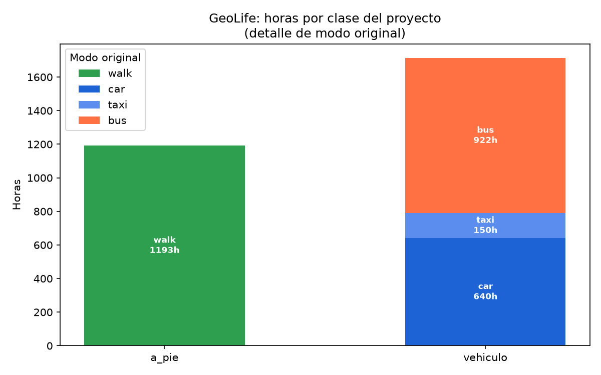
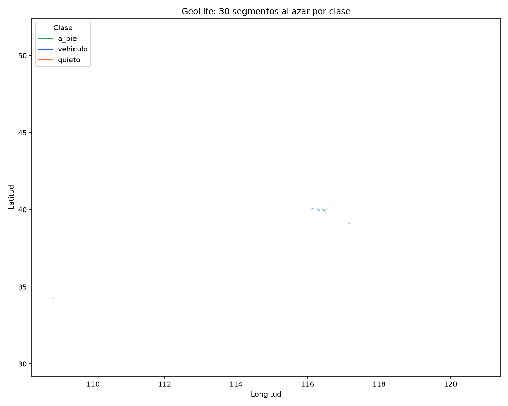

# Bitácora de Pablo 🟢

**Color:** Verde (`#2E9E4F`) · **Rol:** IA: dataset, clasificador de movimiento y servicio de inferencia

Cada sesión agrega una entrada al final (ver *Protocolo de cierre* en `CLAUDE.md`). No se borra nada.

---

## S1 · Sesión 1 · 2026-10-21 · Ingesta del dataset GeoLife
**Estado:** hecha
**Qué hice:**
- Descargué GeoLife Trajectories 1.3 (~299 MB) con script idempotente (`descargar_geolife.py`).
- Procesé los 69 usuarios etiquetados (64 con datos útiles) con `ingesta_geolife.py`.
- Mapeé walk→a_pie, car/taxi/bus→vehiculo; descarté bike, train, subway, airplane, boat, run, motorcycle (1.6M puntos).
- Calculé velocidad por haversine, filtré 1,518 saltos >50 m/s.
- Generé Parquet de 3.25M filas, muestra CSV de 10K filas, y `geolife_info.json` con estadísticas.
- Escribí 18 tests unitarios (mapeo, unión de intervalos, filtro de saltos, haversine).
- Generé dos evidencias PNG: horas por modo y trayectorias al azar.

**Archivos creados o modificados:**
- `semanas/S1/Pablo/codigo/ia/datos/descargar_geolife.py`
- `semanas/S1/Pablo/codigo/ia/datos/ingesta_geolife.py`
- `semanas/S1/Pablo/codigo/ia/datos/evidencias_geolife.py`
- `semanas/S1/Pablo/codigo/ia/datos/geolife_info.json`
- `semanas/S1/Pablo/codigo/ia/datos/procesados/geolife_muestra.csv`
- `semanas/S1/Pablo/codigo/ia/tests/test_ingesta.py`
- `semanas/S1/Pablo/codigo/ia/tests/datos/` (fixtures sintéticos)
- `semanas/S1/Pablo/codigo/ia/requirements.txt`
- `semanas/S1/Pablo/evidencias/s1_geolife-horas-por-modo.png`
- `semanas/S1/Pablo/evidencias/s1_geolife-trayectorias.png`
- `semanas/S1/Pablo/estado.json`

**Decisiones y por qué:**
- **Bus como vehículo:** el clasificador opera sobre GPS puro (posición y velocidad). Un bus urbano en el Centro Histórico tiene un patrón de movimiento similar al de un auto; distinguirlos requeriría datos de paradas o rutas fijas que no tenemos.
- **Filtro de 50 m/s:** conservador (180 km/h), elimina saltos GPS sin perder viajes reales.
- **Segmentos por cambio de modo o gap >5 min:** segmenta naturalmente las trayectorias para el cálculo de velocidad y la clase "quieto" futura.

**Problemas encontrados:**
- El cálculo de `t` (segundos Unix) tenía un error: con pandas datetime64[us], `astype("int64")` da microsegundos, no nanosegundos. Se corrigió usando `(timestamp - epoch).dt.total_seconds()`.
- No se pudo crear un venv (falta python3-venv y no hay sudo); se instalaron dependencias con `pip --user --break-system-packages`.

**Pedidos a otros:** ninguno.

**Bucle y verificación:** 2 vueltas (la primera detectó el bug de timestamps); el verificador independiente reportó 5/5 criterios cumplidos.

**Pendientes para la próxima sesión:**
- Derivar la clase `quieto` a partir de ventanas de baja velocidad.
- Remuestrear a 1 Hz y generar ventanas de 30 s con paso de 5 s.
- Extraer características (velocidad media, desviación, distancia, bearing) para el Random Forest.

**Evidencias:**

