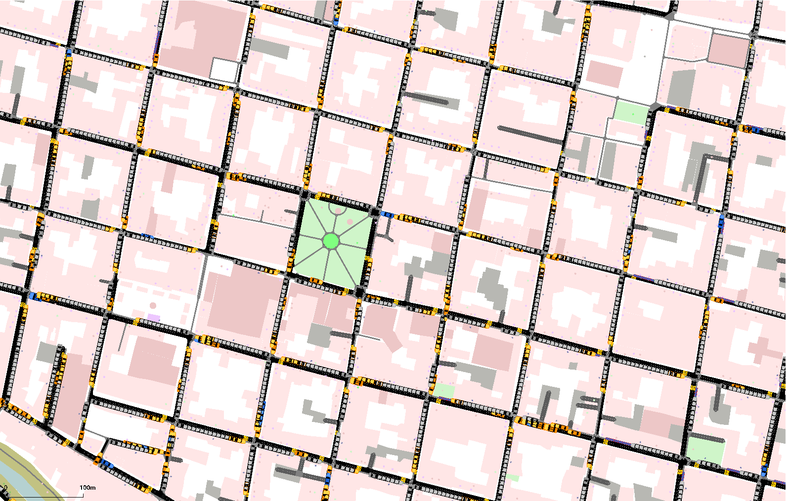
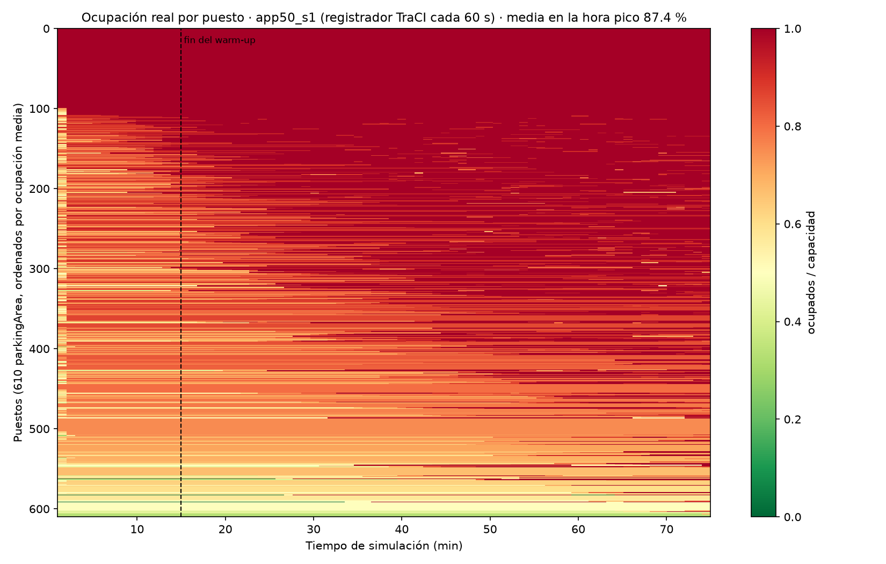
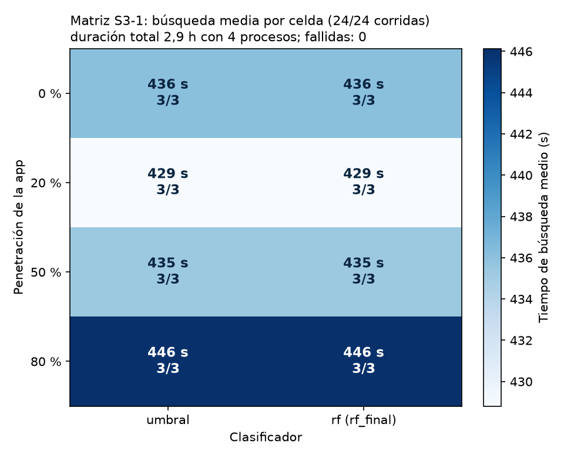
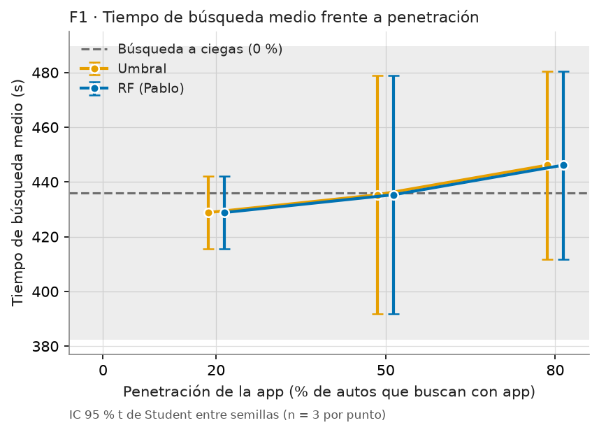
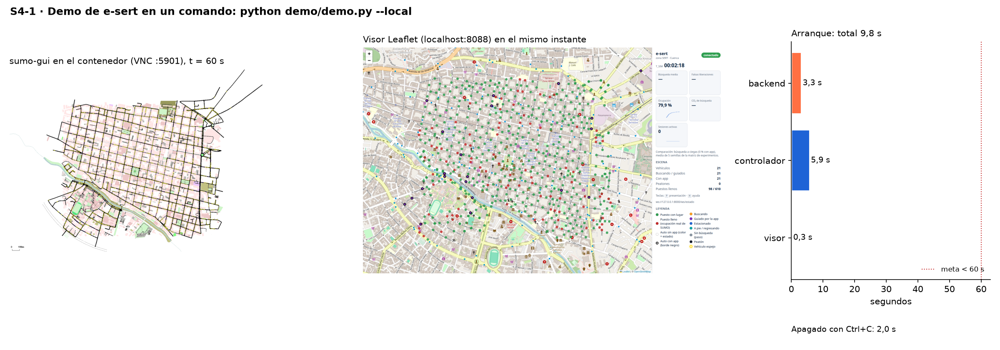
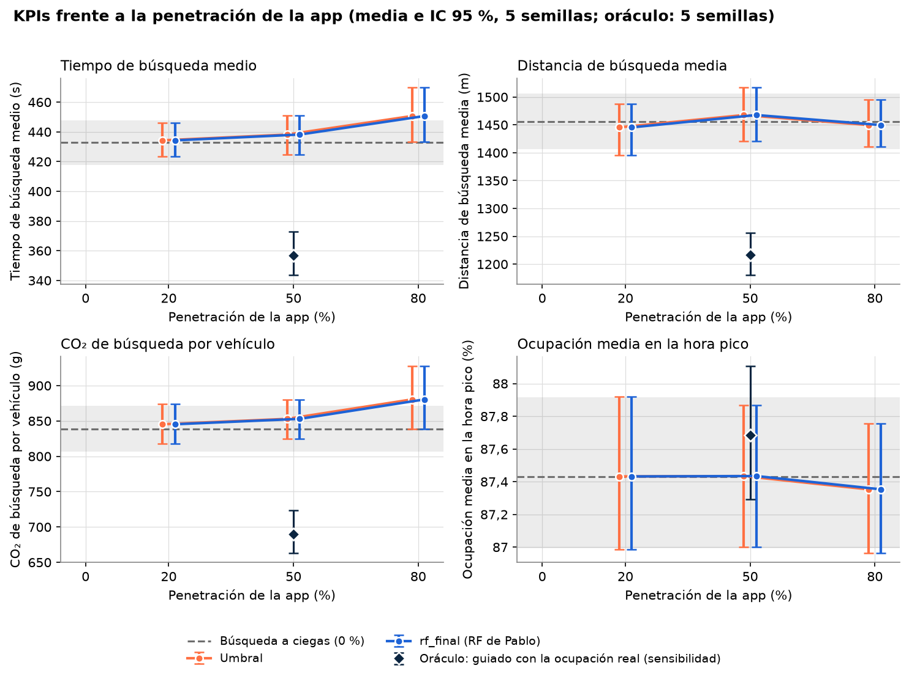
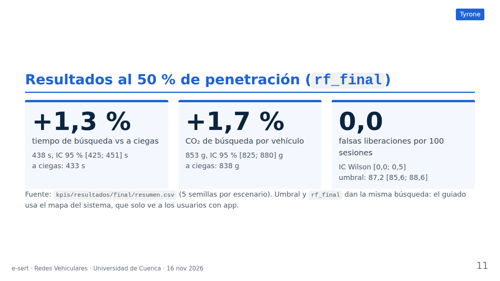

# Bitácora de Tyrone 🔵

**Color:** Azul (`#1E63D6`) · **Rol:** Escenario SUMO, experimentos, KPIs y visor web

Cada sesión agrega una entrada al final (ver *Protocolo de cierre* en `CLAUDE.md`). No se borra nada.

---

## S1 · Sesión 1 · 2026-10-21 · Red vial OSM del Centro Histórico en SUMO
**Estado:** hecha
**Qué hice:**
- `construir_red.py`: descarga el OSM de la bbox `-2.9050,-79.0130,-2.8895,-78.9945` con Overpass (`requests`, 2 servidores espejo) y guarda su SHA-256 en `red_info.json`; `--sin-descarga` reutiliza el OSM local.
- netconvert con todas las opciones del prompt (veredas, cruces, walkingareas, tls, `--proj.utm`) y polyconvert para los edificios; `centro_red.sumocfg` carga solo la red y los polígonos.
- Poda iterativa de componentes fuertemente conexas (Tarjan en Python + `netconvert -s --remove-edges.input-file`): de 138 SCC a 1, quitando 160 edges de autos del borde.
- Validación automática: cifras con sumolib, `sumo --end 10` (código 0) y prueba peatonal (20/20 llegan, 0 teletransportes, 0 atascos).
- Evidencias: gráfica matplotlib, gráfica de la poda y captura de sumo-gui con `traci.gui.screenshot`.
- Resultado: 985 edges de autos, 1824 peatonales, 903 calles con vereda, 775 cruces, 129 semáforos y 90,66 km.

**Archivos creados o modificados:**
- `semanas/S1/Tyrone/codigo/sumo/red/{construir_red.py,centro.net.xml,centro.poly.xml,red_info.json}`
- `semanas/S1/Tyrone/codigo/sumo/{centro_red.sumocfg,requirements.txt}`
- `semanas/S1/Tyrone/evidencias/s1_*.png`
- `semanas/S1/Tyrone/explicaciones/s1_explicacion.{md,pdf}`
- `semanas/S1/Tyrone/{estado.json,RESUMEN.md}`

**Decisiones y por qué:**
- Se podaron los edges fuera de la SCC principal, en lugar de solo documentarlos. Así cualquier par origen-destino de autos es ruteable, algo que necesitan el guiado de Freddy y la demanda de la sesión 2. Los IDs quedan en `red_info.json` y en `s1_componentes-podadas.png`.
- Se sortean 60 viajes peatonales con `--validate` y se simulan los 20 primeros válidos, porque la poda deja pequeñas islas peatonales.
- Los temporales (red cruda, podas, rutas de prueba) van en `sumo/salidas/`, que está ignorada por git.

**Problemas encontrados:**
- Con `withPedestrianConnections=True`, sumolib también devuelve los edges internos (`:nodo_*`): inflaban los conteos y partían las componentes. Se filtran por `getFunction() == ""`.
- SUMO 1.12 no imprime "Teleports: 0" cuando no hay teletransportes, así que se usa `--statistic-output` (teleports y persons jammed).
- `--keep-edges.components` de SUMO 1.12 solo considera componentes débilmente conexas: no sirve para garantizar que la red sea ruteable.
- `randomTrips --validate` dejaba `routes.rou.xml` en la carpeta de trabajo; ahora va a `salidas/` con `-r`.
- `herramientas/explicacion_pdf.py` falla con `código` en línea dentro de las celdas de tabla (fpdf2: "Unsupported nested HTML tags inside <td>"). Se quitaron las comillas invertidas de las tablas de la explicación.

**Pedidos a otros:**
- @Freddy: la red está en `semanas/S1/Tyrone/codigo/sumo/red/centro.net.xml` (desde el domingo, en `proyecto/sumo/red/`). Proyección `+proj=utm +zone=17 +ellps=WGS84 +datum=WGS84 +units=m`, `netOffset -720182.23,321509.41`. Para pasar a lat/lon usa `traci.simulation.convertGeo(x, y)` o `net.convertXY2LonLat(x, y)` de sumolib. Los peatones que crees al parquear deben salir de veredas conectadas: hay islas peatonales pequeñas en el borde.
- @Pablo: la misma ruta y proyección. Para trazas GPS de SUMO, convierte con `convertGeo`, que da lon/lat en WGS84.

**Bucle y verificación:** 5 vueltas (conteos con edges internos → criterio de teletransporte → poda SCC → sobremuestreo peatonal → corrida desde cero). El verificador independiente reportó 6/6 criterios cumplidos tras una corrida desde cero con descarga.
**Pendientes para la próxima sesión:** revisar si las islas peatonales tocan calles SERT al generar los `parkingArea` (sesión 2).
**Evidencias:**    · [Explicación (PDF)](../semanas/S1/Tyrone/explicaciones/s1_explicacion.pdf)

## S1 · Sesión 2 · 2026-10-21 · Generación automática de puestos SERT (parkingArea)
**Estado:** hecha
**Qué hice:**
- `calles_sert.yaml` con los parámetros del prompt, más dos claves nuevas: `excluir_sin_nombre` y `bbox_s_w_n_e`.
- `generar_parkingareas.py`:
  - aplica los filtros de tipo, nombre y `passenger`;
  - elige el carril más a la derecha que permite `passenger` (el 0 es la vereda);
  - calcula `startPos = 8`, `endPos = L − 8` y `capacidad = floor((endPos − startPos)/5.5)`;
  - escribe `parqueos.add.xml`, `puestos.csv` (formato exacto del contrato) y `parqueos_info.json`.
- `centro_parqueos.sumocfg` (red + edificios + puestos): `sumo --end 10` da código 0 y 0 advertencias.
- Prueba de parqueo integrada: 10 viajes con `<stop parkingArea duration="60"/>`, comprobados con `--stop-output`. Los 10 estacionaron.
- Resultado: 610 parkingArea, 6194 puestos y 103 calles. Las que más tienen son Gran Colombia y Simón Bolívar (211 cada una).

**Archivos creados o modificados:**
- `semanas/S1/Tyrone/codigo/sumo/parqueos/{calles_sert.yaml,generar_parkingareas.py,parqueos.add.xml,puestos.csv,parqueos_info.json}`
- `semanas/S1/Tyrone/codigo/sumo/centro_parqueos.sumocfg`
- `semanas/S1/Tyrone/codigo/sumo/requirements.txt` (+pyyaml)
- `semanas/S1/Tyrone/evidencias/s2_puestos-sert.png`
- `semanas/S1/Tyrone/explicaciones/s2_explicacion.{md,pdf}`
- `semanas/S1/Tyrone/{estado.json,RESUMEN.md}`

**Decisiones y por qué:**
- **Nombres normalizados** (sin tildes, sin mayúsculas, sin "Avenida"/"Av."): en OSM la avenida se llama "Gaspar Sangurima", sin "Avenida", y la exclusión del YAML no habría funcionado.
- **Recorte por la bbox de la S1:** sin él salían puestos en radiales fuera del Centro, como Calle Vieja o Barrial Blanco, de hasta 120 puestos por tramo. Con el recorte se pasa de 675/7670 a 610/6194.
- **Calles sin nombre excluidas** (34 edges): no se pueden mostrar en la app ni cruzar con la ordenanza.
- **Interpretación de `lado: ambos`:** en SUMO, una calle de doble sentido son dos edges y ya tiene puestos en las dos aceras con `derecho`. Por eso `ambos` añade `pa_<edge>_1` en el borde izquierdo solo en calles de un sentido con 2 o más carriles. Se probó: 944 parkingArea y 0 advertencias.
- **Resultados de las pruebas fuera de `parqueos_info.json`** (van a `salidas/parqueos_pruebas.json`), para que el resumen sea determinista.

**Problemas encontrados:** ninguno bloqueante; no hubo que adaptar nada de SUMO 1.12.
**Pedidos a otros:**
- @Miguel: verifica `semanas/S1/Tyrone/codigo/sumo/parqueos/calles_sert.yaml` contra la ordenanza SERT. Si hay una lista oficial de calles, ponla en `incluir_nombres`, o dime qué excluir; los 6194 puestos actuales salen solo por tipo de vía.
- @Freddy: `puestos.csv` es tu fuente de puestos (desde el domingo, en `proyecto/sumo/parqueos/`). Columnas `puesto_id,edge,lane,calle,capacidad,lat,lon,x,y`; lat/lon son el punto medio del parkingArea en WGS84. El sufijo `_0` del ID **no es el índice del carril**: el carril real es la columna `lane`, normalmente `<edge>_1`, porque el 0 es la vereda. Usa `puesto_id` directamente en `setParkingAreaStop`.

**Bucle y verificación:** 2 vueltas (la primera generaba puestos fuera del Centro y se añadió el recorte por bbox), más la prueba de `lado: ambos`. El verificador independiente reportó 5/5 criterios cumplidos: determinismo por sha256, su propia prueba de parqueo con otra semilla (10/10) y revisión de las 610 filas del CSV con sumolib.
**Pendientes para la próxima sesión:** ajustar `calles_sert.yaml` cuando Miguel verifique la ordenanza. Las islas peatonales de la S1 no impiden parquear; habrá que vigilarlas cuando Freddy cree los peatones.
**Evidencias:**  · [Explicación (PDF)](../semanas/S1/Tyrone/explicaciones/s2_explicacion.pdf)

## S1 · Sesión 3 · 2026-10-22 · Demanda y búsqueda a ciegas (línea base)
**Estado:** hecha
**Qué hice:**
- `destinos.csv` con los 12 destinos, sus pesos y la fuente OSM de cada uno (columna extra `fuente`). Las coordenadas salen de `centro.osm.xml`; la del Museo Pumapungo, de Nominatim.
- `generar_demanda.py`:
  - entradas y salidas de borde: nodos sin salida a menos de 100 m de la bbox y edges que la cruzan (41 entradas y 43 salidas);
  - buscadores con destino elegido por peso, parada en el parkingArea más cercano y estadía lognormal (media 45 min, recortada a 10–120 min);
  - 40 % de tráfico de paso y llegadas Poisson;
  - `vType auto` con los parámetros `parking.*`, y `param con_app=0` en todos los vehículos;
  - además genera `rerouters.add.xml` (610 rerouters, alternativas a 400 m con `visible="false"`) y `centro_base.sumocfg`.
- `centro_base.sumocfg` con emisiones (probabilidad 1, período 10 s), tripinfo, stop (con `write-unfinished`), vehroute (con `exit-times`), statistic y semilla. Las salidas van en `salidas/base_<semilla>/`.
- `correr_base.py` (varias semillas en paralelo), `analizar_base.py` (ocupación y tiempo de búsqueda provisional) y `captura_gui.py` (sumo-gui en t = 45 min, autos coloreados por clase).
- **Calibración** (semilla 1, fondo 0,80): 600 veh/h → 82,4 %, 1000 → 84,0 %, 1400 → 85,5 %, **1800 → 87,0 %**.
- **Resultado final con 1800 veh/h:**
  - ocupación media en la hora pico: 87,0 % y 87,7 %;
  - 0 teletransportes de 7065 y 7250 vehículos;
  - búsqueda media 230 y 246 s; mediana 188 y 193 s; p90 483 y 525 s.

**Archivos creados o modificados:**
- `semanas/S1/Tyrone/codigo/sumo/demanda/{destinos.csv,generar_demanda.py,correr_base.py,analizar_base.py,captura_gui.py,vista_gui.xml,demanda.rou.xml,rerouters.add.xml}`
- `semanas/S1/Tyrone/codigo/sumo/centro_base.sumocfg`
- `semanas/S1/Tyrone/evidencias/s3_{escenario-base,busqueda-histograma,ocupacion-base}.png`
- `semanas/S1/Tyrone/evidencias/resumen_S1_Tyrone.pdf`
- `semanas/S1/Tyrone/explicaciones/s3_explicacion.{md,pdf}`
- `semanas/S1/Tyrone/{estado.json,RESUMEN.md}`

**Decisiones y por qué:**
- **Ocupación de fondo del 80 %** (autos de larga estadía, ya estacionados al inicio y quietos toda la corrida). Con 6194 puestos y estadías de 45 min, llegar al 85 % solo con buscadores exigiría unos 7000 veh/h, imposible para la red.
- **`--veh-hora` por defecto = 1800** (el prompt sugería 600): es el valor calibrado, así que `generar_demanda.py --semilla 1` reproduce el escenario base.
- **Pesos de búsqueda:**
  - `parking.distance.weight = 1`, que en SUMO 1.12 es un alias de `distanceto`: distancia desde la posición actual;
  - `parking.probability.weight = 0.5`, con `probability` = 1 − 0,9·d/400: cercanía al parkingArea original.

  Lo verifiqué en el código fuente de `MSTriggeredRerouter.cpp` (v1_12_0).
- **Rerouter en el edge del propio parkingArea:** el conductor descubre que está lleno al llegar a esa calle.
- **`demanda.rou.xml` (semilla 1) y `rerouters.add.xml` se versionan,** para que `centro_base.sumocfg` funcione al clonar el repo.

**Problemas encontrados:**
- SUMO 1.12 no tiene `HBEFA4/PC_petrol_Euro-4`: se usa su equivalente `HBEFA3/PC_G_EU4`.
- SUMO 1.12 no admite `departPos="stop"`: los autos de fondo se insertan al inicio de su edge y estacionan en los primeros ~2 min del warm-up.
- Un comentario XML con `--` rompía la carga de la demanda: se cambió a `clave=valor`.
- Overpass no respondía al buscar los destinos: se usó el OSM local de la S1 y, para el Museo Pumapungo, Nominatim.
- La máquina se suspendió durante la calibración. Las corridas siguieron al despertar y no hubo que repetirlas.

**Pedidos a otros:**
- @Freddy: el `param con_app` (hoy `0` en todos) es tu interruptor para guiar a un vehículo en S2. Los buscadores tienen ID `busca_N` y traen además `param destino` y `param pa_objetivo`; los de paso son `paso_N` y los de fondo `fondo_*`, estos últimos sin app.
  - Escenario: `semanas/S1/Tyrone/codigo/sumo/centro_base.sumocfg` (desde el domingo, en `proyecto/sumo/`).
  - `destinos.csv` sirve para el destino del modo espejo.
- @Pablo: si generas trazas GPS desde SUMO, los `busca_*` dan trayectorias de auto en tráfico lento cerca de los destinos (útiles para los escenarios difíciles).

**Bucle y verificación:**
- 5 vueltas: XML con `--` → HBEFA4 → `write-unfinished` en vehroute → calibración (600/1000/1400/1800) → corrección de la serie de ocupación en t = fin. Además, la captura de GUI se rehízo con más zoom.
- El verificador independiente reportó 5/6 criterios cumplidos antes del cierre: repitió la corrida de la semilla 1 y calculó la ocupación por su cuenta (87,03 % y 87,75 %). El único pendiente era el PDF semanal, que se generó en el cierre (6/6).

**Pendientes para la próxima sesión (S2):**
- KPIs formales: tiempo y distancia de búsqueda, CO₂, y tratamiento de las búsquedas censuradas al final (35 y 84 buscadores llevaban más de 10 min sin estacionar).
- Opcional: rotación de la ocupación de fondo para tener un estado estacionario.

**Evidencias:**    · [Explicación (PDF)](../semanas/S1/Tyrone/explicaciones/s3_explicacion.pdf) · [Resumen semanal (PDF)](../semanas/S1/Tyrone/evidencias/resumen_S1_Tyrone.pdf)

## S2 · Sesión 1 · 2026-10-26 · KPIs de la línea base (búsqueda, distancia, CO₂ y ocupación)
**Estado:** hecha

**Qué hice:**
- Abrí la rama `tyrone/s2` desde `main` y copié `proyecto/sumo/` a `semanas/S2/Tyrone/codigo/sumo/`. `proyecto/kpis/` solo tenía un `.gitkeep`.
- Añadí `vehroute-output.route-length` a `centro_base.sumocfg` y a la plantilla de `generar_demanda.py`. Después corrí las 2 semillas en segundo plano en el contenedor, con `correr_base.py` (~16 min).
- Escribí `kpis/lectores.py`: lectores en streaming con `lxml.iterparse` para tripinfo, stops, vehroutes, emisiones, red y demanda.
- Escribí `kpis/kpis.py` (definiciones en el docstring, CLI y `kpis_<escenario>.json` con todas las semillas) y `kpis/graficas.py` (figura 2×2).
- Un subagente escribió 13 tests con XML sintéticos a partir de las firmas que fijé antes.
- Calculé los KPIs de las 2 semillas: búsqueda media de 349 y 362 s, distancia de 1248 y 1310 m, CO₂ de 666 y 693 g, ocupación pico de 87,0 y 87,7 %.

**Archivos creados o modificados:**
- `semanas/S2/Tyrone/codigo/kpis/`: `lectores.py`, `kpis.py`, `graficas.py`, `requirements.txt`, `tests/` y `salidas/` (JSON y CSV de la base).
- `semanas/S2/Tyrone/codigo/sumo/`: copia de `proyecto/sumo/`; se modificaron `centro_base.sumocfg` y `demanda/generar_demanda.py`.
- `semanas/S2/Tyrone/evidencias/s1_kpis-base.png` y `semanas/S2/Tyrone/explicaciones/s1_explicacion.{md,pdf}`.

**Decisiones y por qué:**
- **`inicio_busqueda` con un radio de 300 m o el edge objetivo:** con app, el conductor ya no pasa necesariamente por su puesto objetivo, y la definición tiene que servir para todos los escenarios.
- **Comparación con S1-3:** el tiempo sale 52 % y 47 % mayor que en el cálculo provisional (230 y 246 s). Con `--radio-busqueda-m 0`, `kpis.py` reproduce exactamente 229,9 y 245,6 s, así que la diferencia es solo de definición.
- **Distancia:** solo cuenta los edges completos (exitTime en (inicio, fin]).
- **CO₂:** integral del emission-output, muestreado cada 10 s. Lo validé contra el `CO2_abs` exacto de tripinfo en 330 viajes completos: ratio 0,988 y correlación 0,94.
- **Censurados:** los buscadores que no estacionaron (201 y 248) se excluyen de las estadísticas y se reportan aparte en `conteos`.
- **Dónde corre:** `kpis/` no importa `sumolib` ni `traci`, así que corre en la computadora con su propio `.venv`.
- **Nombres de las claves:** en `kpis_base.json`, `valores` usa los nombres reservados del mensaje WS `kpi` (CONTRATO §6).

**Problemas encontrados:**
- El `PYTHONPATH` de ROS Jazzy de esta computadora rompe pytest al cargar plugins. Se corre con `env -u PYTHONPATH PYTEST_DISABLE_PLUGIN_AUTOLOAD=1`.
- El contenedor no trae `pandas`, así que `kpis/` corre en la computadora. Si el controlador lo importa en S3, hay que instalar `kpis/requirements.txt` en el contenedor.

**Pedidos a otros:**
- @Freddy:
  - Definición de búsqueda: empieza al entrar al primer edge a ≤ 300 m del destino (o al edge del `pa_objetivo`) y termina con el `started` de la primera parada en un `parkingArea`.
  - Claves de `kpis/salidas/kpis_base.json` → `valores`: `busqueda_media_s`, `distancia_busqueda_media_m`, `co2_busqueda_g`, `ocupacion_media_pico` y `falsas_liberaciones_100` (`null` hasta S3). Usa las mismas en tu mensaje WS `kpi`.

**Bucle y verificación:**
- 2 vueltas. Los tests pasaron a la primera. En la segunda vuelta validé el CO₂ contra tripinfo y la diferencia con S1-3 recalculando con radio 0.
- El verificador independiente reportó 6/6 criterios cumplidos: tests 13/13, 4,4 y 4,8 s por semilla, JSON completo, ocupación 87,0/87,7 %, docstring y evidencia.

**Pendientes para la próxima sesión:**
- Aplicar `kpis.kpis` a los escenarios con app (S2-3).
- Opcional: sumar el tramo parcial del edge de parqueo a la distancia.

**Evidencias:**  · [Explicación (PDF)](../semanas/S2/Tyrone/explicaciones/s1_explicacion.pdf)

## S2 · Sesión 2 · 2026-10-26 · Visor web Leaflet y servidor WS de prueba
**Estado:** hecha

**Qué hice:**
- `visor/grabar_snapshots.py` (en el contenedor): simula el escenario base y graba 900 snapshots del contrato (t = 1801–2700 s, hora pico) en `visor/datos/snapshots.jsonl`. Tardó ~8 min en segundo plano.
- `visor/servidor_prueba.py` (FastAPI): `GET /api/v1/puestos`, `WS /ws/estado` (repetición en bucle, `--velocidad 1|5|10`, un `kpi` cada 30 snapshots con los valores de `kpis_base.json`) y estáticos en `/visor/` y `/`.
- `visor/index.html`, `visor.js` y `estilos.css`, con Leaflet 1.9.4 desde unpkg (con SRI):
  - canvas y marcadores actualizados por id;
  - puestos verde/rojo con popup `calle · ocupados/capacidad`;
  - autos por estado y borde grueso con app; halo en los `espejos`;
  - panel con conteos, KPIs, conexión y FPS;
  - `?ws=` configurable, reconexión 1→30 s y capa `?verdad=1`.
- `visor/captura.py` (Playwright): captura a 1600×1000, medición de FPS y prueba de reconexión.
- Un subagente escribió 9 tests (`visor/tests/`): contrato de los 900 snapshots, WS, puestos y rutas relativas.
- Probé el visor contra el backend real de Freddy (`origin/freddy/s2`, extraído con `git archive` a una carpeta temporal, sin editarlo), servido en su `/visor/` con `ESERT_VISOR_DIR`: le envié 40 pasos `POST /api/v1/sim/paso` hechos con mis snapshots.

**Archivos creados o modificados:**
- `semanas/S2/Tyrone/codigo/visor/`: `index.html`, `visor.js`, `estilos.css`, `grabar_snapshots.py`, `servidor_prueba.py`, `captura.py`, `requirements.txt`, `.gitignore`, `tests/` y `datos/snapshots_muestra.jsonl`.
- `semanas/S2/Tyrone/evidencias/s2_visor-leaflet.png` y `semanas/S2/Tyrone/explicaciones/s2_explicacion.{md,pdf}`.

**Decisiones y por qué:**
- **Estado del vehículo (MOCK):** `ESTACIONADO` si `stopState` tiene el bit de parking, `BUSCANDO` si busca y aún no estaciona, `null` para paso y fondo (contrato). El espejo (MOCK) es un buscador al azar con `con_app = true`.
- **Autos de fondo estacionados:** no se envían (~4900 marcadores quietos); ya se ven en el color de los puestos. Así los snapshots bajan a ~100 KB y el visor dibuja ~600 autos más 610 puestos.
- **lat/lon con pyproj y netOffset** en lugar de `convertGeo` por vehículo. Es la misma conversión, comprobada con 20 vehículos al iniciar (< 1e-6°), y evita ~600 llamadas TraCI por segundo.
- **`snapshots.jsonl` (91 MB) se ignora** con un `.gitignore` propio de `visor/`, sin tocar el de la raíz. En git va la muestra de 60 (5,5 MB).
- **URL por defecto:** el WS del mismo origen, y la API REST se deduce de la URL del WS. Así funciona igual detrás del backend en `/visor/`, con el servidor de prueba o con `?ws=`.

**Problemas encontrados:**
- **Backend de Freddy:** con él no hubo diferencias de formato (40 `snapshot` + 40 `verdad`, sin errores). Su mapa sale todo verde porque `snapshot.puestos` es la ocupación estimada por sesiones, y en la prueba no había ninguna. Es lo que dice el contrato; la ocupación real se ve con `?verdad=1`.
- **El escenario base no tiene peatones:** la capa de peatones queda vacía hasta que el backend los envíe.
- **FPS:** se midieron con `requestAnimationFrame` en Chromium headless (Playwright), no en DevTools: 54 de media y 49 de mínimo a velocidad 1.
- **`pkill -f` se mataba a sí mismo:** el patrón aparecía en su propia línea de comandos. Los servidores se paran por PID.

**Pedidos a otros:**
- @Freddy: el visor espera `espejos` y `con_app` en cada snapshot, y usa `estado` para colorear (BUSCANDO, GUIADO, ESTACIONADO, A_PIE, REGRESANDO, SALIENDO; `null` sin búsqueda). También lee `GET /api/v1/puestos` del mismo origen para la posición y la calle de cada puesto.
- @Miguel: para ver resaltado el auto que sigue tu modo espejo, abre `http://<backend>:8000/visor/`, o en la demo `https://demo.e-sert.tesisucuenca.com/visor/`. Con el servidor de prueba: `python -m visor.servidor_prueba --puerto 8001` y `http://localhost:8001/visor/`. El halo amarillo es el vehículo de `espejos`.

**Bucle y verificación:**
- 2 vueltas. En la primera, la muestra provisional de 5 snapshots; en la segunda, la muestra real de 60, el `.gitignore` del archivo grande y la prueba contra el backend de Freddy.
- El verificador independiente reportó 6/6 criterios cumplidos:
  - detrás de `http.server` carga en /visor/ e intenta `ws://<mismo host>/ws/estado`;
  - autos y puestos cambian;
  - 58,6 FPS;
  - 9 tests, y 900 + 60 snapshots válidos;
  - la reconexión funciona sin recarga, comprobado con una marca en `window`;
  - existe la evidencia.

**Pendientes para la próxima sesión:**
- Reemplazar el estado y el espejo MOCK por los del controlador de Freddy.
- Ver los peatones cuando el backend los publique.

**Evidencias:**  · [Explicación (PDF)](../semanas/S2/Tyrone/explicaciones/s2_explicacion.pdf)

## S2 · Sesión 3 · 2026-10-26 · Escenarios con penetración de app y registro de la ocupación real
**Estado:** hecha

**Qué hice:**
- `generar_demanda.py`:
  - `--porc-app` con un generador separado (`numpy.random.default_rng([semilla, 7])`) que sortea `u_i` solo para los buscadores;
  - los buscadores llevan además `param destino` ("lat,lon") y `destino_nombre`;
  - paso y fondo siempre llevan `con_app = 0`.
- `sumo/escenarios/generar_escenarios.py`:
  - genera los 8 `.rou.xml` y `.sumocfg`, y `escenarios.json` con semilla, %, conteos y SHA-256;
  - comprueba que la demanda es idéntica por semilla (7065 y 7250 vehículos) y el anidamiento (253 ⊂ 624 ⊂ 1018; 251 ⊂ 673 ⊂ 1083).
- `kpis/registrar_ocupacion.py`: hook `hook(controlador, t)` del `Controlador` de Freddy (`proyecto/traci/controlador.py`) que escribe `ocupacion_real_<escenario>_s<N>.csv` cada 60 s. Incluye la comprobación contra el stop-output.
- `sumo/escenarios/guiado_oraculo.py` (`# MOCK`): el guiado de Freddy no está en `proyecto/traci/` ni en `origin/freddy/s2`, así que lo reemplaza un oráculo que elige el puesto libre más cercano al destino con `rerouteParkingArea`.
- `sumo/escenarios/correr_escenarios.py`: corre las 8 con `subprocess.Popen`, máximo 3 a la vez.
- `kpis/resumen_escenarios.py`: KPIs de las 8 corridas, `resumen_escenarios.csv` y las 2 figuras.

**Archivos creados o modificados:**
- `semanas/S2/Tyrone/codigo/sumo/demanda/generar_demanda.py`.
- `semanas/S2/Tyrone/codigo/sumo/escenarios/`: scripts, 8 `.sumocfg`, `escenarios.json` y `.gitignore` (los `.rou.xml` se regeneran).
- `semanas/S2/Tyrone/codigo/kpis/`: `registrar_ocupacion.py`, `resumen_escenarios.py`, `.gitignore`, `kpis.py`, `lectores.py`, un test nuevo y `salidas/` (KPIs de los 4 escenarios, `resumen_escenarios.csv`, `ocupacion_real_app50_s1.csv` y `comprobacion_ocupacion_real.json`).
- `semanas/S2/Tyrone/evidencias/s3_penetracion-escenarios.png`, `s3_ocupacion-real.png` y `resumen_S2_Tyrone.pdf`.
- `semanas/S2/Tyrone/explicaciones/s3_explicacion.{md,pdf}`, y `s1_explicacion.{md,pdf}` corregida (censurados).

**Decisiones y por qué:**
- **Convención (started, ended] para comprobar la ocupación:** el hook lee al final del paso t. Con ella la diferencia es 0 en los 75 instantes de las 8 corridas. Con [started, ended) aparecían ±1–2, y 37 en el warm-up, cuando cientos de autos de fondo estacionan en el mismo segundo.
- **Estacionar fuera de la zona:** un auto guiado que estaciona sin entrar a los 300 m del destino cuenta como búsqueda 0 s / 0 m, en lugar de excluirse. Excluirlo sesgaba contra la app.
- **`kpis.kpis --demanda`:** las corridas de escenarios no dejan `demanda.rou.xml` en su carpeta. Sin la opción, las de la semilla 2 se calculaban con la demanda de la semilla 1.
- **Porcentaje de teletransportes:** se divide entre los vehículos insertados, porque con guiado `loaded` suma una carga por cada `rerouteParkingArea`.
- **Versionado:** no se versionan las demandas de los escenarios (18 MB, deterministas, con SHA-256) ni 7 de los 8 CSV de ocupación; va el de `app50_s1`.

**Problemas encontrados:**
- El SUMO 1.12 del contenedor aborta con asserts (`MSVehicle::enterLaneAtMove` y `MSBaseVehicle::replaceRoute`) cuando `rerouteParkingArea` reasigna:
  - en un cruce;
  - hacia un puesto del edge actual (puede quedar detrás del vehículo);
  - sin ruta al nuevo puesto.

  Fallaron 3 corridas. Las diagnostiqué con un log opcional del oráculo (`ESERT_LOG_ORACULO`) y añadí las tres protecciones. Las 6 corridas con app se repitieron con la versión final, así que las 8 son comparables.
- **Error en `kpis` (venía de S2-1):** SUMO escribe `exitTime = -1` en los edges que un vehículo sin terminar aún no recorrió, y el lector lo tomaba como hora válida. Con guiado inflaba la media (474 s en lugar de 121 s para los usuarios con app en app80_s2). En la base no cambian las medias, pero los censurados correctos son 114 y 159, no 201 y 248. Corregí `lectores.py`, añadí un test y anoté la corrección en la explicación de S2-1.
- En la semilla 1 se insertan 7064 de 7065 vehículos: el último sale en t = 4499,08, al límite del fin. Es inocuo.

**Pedidos a otros:**
- @Freddy:
  - la ocupación real está en `semanas/S2/Tyrone/codigo/kpis/salidas/ocupacion_real_<escenario>_s<N>.csv` (desde el domingo, en `proyecto/kpis/salidas/`), con columnas `t_sim,puesto_id,ocupados,capacidad`, cada 60 s desde t = 60 hasta 4500. Para generarla en tu ejecutor: `ctrl.agregar_hook(RegistradorOcupacion("<escenario>_s<N>"))` y `reg.cerrar()` al final. Es la verdad para tu KPI de precisión del mapa;
  - `traci/guiado.py` debe reemplazar a `sumo/escenarios/guiado_oraculo.py` en S3-1;
  - si usas `rerouteParkingArea` en SUMO 1.12, evita reasignar en cruces, hacia puestos del edge actual o sin ruta: el SUMO del contenedor aborta;
  - los buscadores traen `param destino` ("lat,lon") y `destino_nombre` para la lista de candidatos del espejo.

**Bucle y verificación:**
- 4 vueltas:
  1. el oráculo abortó SUMO en 3 corridas;
  2. la convención de la comprobación de ocupación;
  3. el `exitTime = -1` y la demanda de la semilla 2;
  4. el puesto en el edge actual. Con eso se repitieron las 6 corridas con app.
- El verificador independiente reportó los 5 criterios cumplidos en lo técnico (escenarios idénticos y anidados, ocupación ±0, 8 corridas sin errores ni teletransportes, figuras). Faltaba solo el PDF semanal, que se generó en el cierre. Su observación sobre `loaded` se corrigió (ahora se usan los insertados).

**Pendientes para la próxima sesión (S3):**
- Repetir las 8 corridas con el guiado real de Freddy.
- Ejecutor completo con KPIs y precisión del mapa.

**Evidencias:**   · [Explicación (PDF)](../semanas/S2/Tyrone/explicaciones/s3_explicacion.pdf) · [Resumen semanal (PDF)](../semanas/S2/Tyrone/evidencias/resumen_S2_Tyrone.pdf)

## S3 · Sesión 1 · 2026-11-13 · Ejecutor de experimentos: penetración × clasificador × semillas
**Estado:** hecha
**Qué hice:**
- `kpis/correr_una.py`: una corrida aislada sobre el controlador real de Freddy (`proyecto/traci/correr_kpis.correr`).
  - Redirige el escenario y las salidas a esta copia de `sumo/`.
  - Calcula los KPIs de búsqueda de S2-1, con *warm-up* de 900 s, y toma los KPIs de sistema de `KPIsSistema`.
  - Falla en voz alta si se pidió rf y la inferencia no usó ventanas `rf`.
- `kpis/modelo_plano.py`: exporta `rf_final.joblib` de Pablo a arrays de numpy y lo reconstruye en el contenedor sin sklearn. Diferencia máxima de 5·10⁻⁹ y la misma clase en el 100 % de las ventanas.
- `kpis/experimentos.py`:
  - `Pool(spawn, maxtasksperchild=1)` y `hash_config` (cfg + red, parqueos, demanda y modelo);
  - JSON atómicos, reintento único y `progreso.log`;
  - `experimentos.csv` y `metadatos.json` (con `duracion_matriz_s` leída del log);
  - opciones `--rapida`, `--speedup`, `--solo`, `--forzar` y `--dry-run`.
- Matriz completa: 24/24 corridas, 0 fallidas, 2,9 h con 4 procesos y libsumo. Demandas de las semillas 1–5 generadas.
- `kpis/evidencia_matriz.py` y 7 tests en el contenedor.

**Archivos creados o modificados:** `semanas/S3/Tyrone/codigo/kpis/{correr_una,experimentos,modelo_plano,evidencia_matriz}.py`, `kpis/matriz.yaml`, `kpis/tests/test_experimentos.py`, `kpis/resultados/{experimentos.csv,metadatos.json,progreso.log,speedup.json,corridas/,sesiones/,rapida/}`, `kpis/.gitignore`, `sumo/escenarios/escenarios.json`, `evidencias/s1_matriz-progreso.png`, `explicaciones/s1_explicacion.{md,pdf}`.

**Decisiones y por qué:**
- **`rf_final` en lugar de `rf_v1`:** `rf_v1.joblib` no está en el repo y sklearn 1.9.1 no existe para el Python 3.10 del contenedor. Por eso el "rf" de S3 de Freddy era en realidad el umbral. Se usó el modelo congelado de `origin/pablo/s4` (SHA-256 comprobado), exportado a numpy.
- **Timeout de 3600 s** (no 1800): una corrida completa tarda 1 321–2 175 s con 4 en paralelo.
- **libsumo** en la matriz: da los mismos KPIs que TraCI (comprobado con `p50_rf_s1`) y es más rápido. El *speedup* se midió con TraCI.
- **El sorteo de `con_app`** sigue siendo el `numpy.default_rng([semilla, 7])` de S2-3: cumple el anidamiento (test) sin regenerar escenarios.

**Problemas encontrados:**
- Unos SUMO huérfanos de un primer intento escribían en las mismas carpetas. Reinicié la matriz limpia.
  - Causa: `pkill -f` dentro de `bash -lc` se mataba a sí mismo.
- El proceso principal terminó con `gzip.open(mtime=)`, que no existe en Python 3.10.
  - El código ya estaba corregido, pero ese proceso tenía la versión vieja cargada.
  - Relanzar consolidó sin repetir ninguna corrida, lo que de paso probó la reanudación.
- **Resultado importante:** umbral y rf dan **la misma búsqueda** a igual penetración, y la app no la reduce (436 s a ciegas; 429/435/446 s al 20/50/80 %).
  - Causa: `Guia` usa la fuente `"mapa"`, que solo conoce las sesiones de la app. Con 87 % de ocupación real, guía a puestos llenos.
  - Una falsa liberación nunca cambia la recomendación.
  - Coincide con lo que Freddy midió en S2. En S4-2 se añade un oráculo de sensibilidad.

**Pedidos a otros:**
- @Freddy:
  - el guiado con la fuente `"mapa"` no reduce la búsqueda: el mapa solo ve a los usuarios con app y, con 87 % de ocupación, recomienda puestos llenos. ¿Podemos discutir en la exposición una fuente mixta (mapa + ocupación agregada de la SERT) como trabajo futuro?
  - `_alcanzable` acepta un puesto en la misma arista pero detrás del auto. Con la fuente `"verdad"`, SUMO 1.12 aborta (`MSBaseVehicle::replaceRoute`). La guarda está en `semanas/S4/Tyrone/codigo/kpis/correr_una.py:guia_oraculo`.
  - confirma las claves de `KPIsSistema.resumen()` que uso: `falsas_lib_100`, `retardo_cierre_mediana_s`, `error_fact_medio_usd`, `precision_mapa`, `n_sesiones` y `n_falsas`.
- @Pablo: uso `rf_final` de `origin/pablo/s4:semanas/S4/Pablo/codigo/ia/modelos/rf_final.joblib` (SHA-256 `1bdac0d7…`, igual a `rf_final.json`), exportado a numpy con `kpis/modelo_plano.py`. Avísame si lo vuelves a congelar.

**Bucle y verificación:**
- 4 vueltas:
  1. sklearn ausente en el contenedor → RF exportado a numpy;
  2. dependencias del backend en el contenedor y timeout de 3600 s;
  3. procesos SUMO huérfanos → la matriz se reinició limpia;
  4. `gzip.open(mtime=)` en Python 3.10 y `duracion_matriz_s` leída del log.
- El verificador independiente reportó **6/6 criterios cumplidos**:
  - `--rapida` en 60,3 s; 24/24 corridas sin `.error.json`;
  - relanzar da "0 pendientes" sin cambiar el md5 del CSV;
  - 0 % umbral = rf en las 3 semillas; *speedup* de 3,5×; `metadatos.json` completo;
  - 7 tests pasan en el contenedor (222 s).
- Sus observaciones:
  - `duracion_total_s` se reescribe al relanzar (la duración real queda en `duracion_matriz_s`);
  - el test de reanudación usa `pkill -f kpis_p50_rf_s1` en el contenedor y podría tocar otra corrida simultánea con esa etiqueta (la corrida final de S4 no se vio afectada).

**Pendientes para la próxima sesión:**
- Corrida final con las semillas 4 y 5 (S4-2), reutilizando estas 21 corridas por hash.

**Evidencias:**  · [Explicación (PDF)](../semanas/S3/Tyrone/explicaciones/s1_explicacion.pdf)

## S3 · Sesión 2 · 2026-11-13 · Análisis estadístico, figuras y tablas de la matriz
**Estado:** hecha
**Qué hice:**
- `kpis/analisis.py`:
  - IC t entre semillas y *bootstrap* BCa por vehículo (10 000);
  - diferencias pareadas por semilla frente al 0 %;
  - `ttest_rel` umbral frente a rf, con Holm;
  - tablas `tabla_kpis.md` y `.tex` (booktabs), 10 hallazgos y `visor/datos/base.json`.
- `kpis/figuras.py`: F1–F8 en PNG (150 dpi) y PDF, paleta Okabe-Ito y la línea base gris con su banda. Regenera todo en 13,3 s.
- 8 tests (`ic95([1,2,3])`, pareado sintético, figuras con 24 filas y con `NaN`).
- Evidencias: F1 y F4.

**Archivos creados o modificados:** `semanas/S3/Tyrone/codigo/kpis/{analisis,figuras}.py`, `kpis/tests/test_analisis.py`, `kpis/figuras/F1…F8.{png,pdf}`, `kpis/resultados/{tabla_kpis.md,tabla_kpis.tex,hallazgos.md}`, `visor/datos/base.json`, `evidencias/s2_busqueda-vs-penetracion.png`, `evidencias/s2_falsas-liberaciones.png`, `explicaciones/s2_explicacion.{md,pdf}`.

**Decisiones y por qué:**
- La réplica es la semilla: el IC principal es t con n = 3 (t = 4,303). El *bootstrap* por vehículos va aparte y rotulado.
- **CO₂ en kg/h de la zona**, como pide F3. La corrida final añade g por vehículo.
- **F4 rotula las barras del RF (0,0)** para que no parezcan faltantes.
- Las figuras y las tablas no se delegaron en subagentes: la interfaz de `analisis.py` ya estaba fijada y eran pocas horas.

**Problemas encontrados:**
- `figuras.py` fallaba con los CSV de sesiones vacíos del 0 % (`EmptyDataError`). Corregido.
- **Resultado:** ningún Δ de búsqueda es significativo (−1,5 %, −0,1 % y +2,4 %, todos con IC que cruza el cero). El RF elimina las falsas liberaciones: 0 frente a 86–90 por 100 sesiones con el umbral, Holm p < 0,001.
- La precisión del mapa es de ≈58 % en todos los escenarios: el mapa solo ve a los usuarios con app.

**Pedidos a otros:**
- @Pablo: F4 (`kpis/figuras/F4_falsas_liberaciones.{png,pdf}`), F7 (`F7_precision_mapa`) y `kpis/resultados/hallazgos.md` son para tu sección de IA. Las cifras finales, con 5 semillas, saldrán de `semanas/S4/Tyrone/codigo/kpis/resultados/final/resumen.csv`.
- @Freddy: revisa que F5 (retardo de cierre), F6 (error de facturación, negativo con el umbral porque cierra antes) y F7 (precisión del mapa ≈58 % incluso al 0 %) interpreten bien tus KPIs.

**Bucle y verificación:**
- 3 vueltas:
  1. `EmptyDataError` con las sesiones vacías del 0 %;
  2. legibilidad (n = 3, cifras de las barras del RF en F4);
  3. redacción con signo de los hallazgos, tras el verificador.
- El verificador independiente reportó **6/6 criterios cumplidos**: 16 archivos de figuras en 13,3 s, tablas md/tex con Δ pareado, 10 hallazgos y 26 tests de `kpis/tests` en la computadora.
- Sus observaciones:
  - el signo confuso de "baja 1 % (IC −17 a 14 %)" (corregido: "cambia −1,5 % (IC −16,7 a +13,8 %)");
  - F5 con bigotes del umbral hasta ~700 s, que aplastan las medias (queda así; las medias van en la tabla);
  - la tabla de 13 columnas es ancha para una página.

**Pendientes para la próxima sesión:**
- Repetir con las 5 semillas de la corrida final (S4-2).

**Evidencias:**   · [Explicación (PDF)](../semanas/S3/Tyrone/explicaciones/s2_explicacion.pdf)

## S3 · Sesión 3 · 2026-11-13 · Visor final: panel de KPIs, vehículo espejo y modo presentación
**Estado:** hecha
**Qué hice:**
- El visor pasó a módulos ES:
  - `principal.js`, `panel_kpis.js`, `capa_espejo.js`, `presentacion.js`;
  - `logica.js`, la lógica pura testeada con `node --test`;
  - `css/visor.css`.
- **Panel de KPIs:**
  - acepta los nombres reservados del contrato §6 y sus alias;
  - muestra "−X % vs a ciegas" frente a `base.json` de la matriz real;
  - minigráficas de Chart.js 4.4.1, redibujo limitado a 2 Hz.
- **Espejo:** halo pulsante (`L.divIcon`), rastro de 60 s, ruta restante y puesto asignado por `/ws/espejo`. Retiro a los 5 s.
- **Modo presentación:** `P` pantalla completa ×1,5, `E` sigue al espejo, `T` recorre las vistas, `H` ayuda. Reconexión exponencial (1–30 s).
- `servidor_prueba.py`:
  - reloj compartido entre clientes;
  - `kpi` cada 5 s;
  - espejos y `/ws/espejo` MOCK;
  - `--snapshots` para el plan B.
- `captura.py`: pruebas con Playwright (evidencias, rendimiento, reconexión, teclas y retiro).
- QR de la demo y enlace "Demo en vivo" en `roadmap/templates/base.html`.
- Prueba contra el backend real de Freddy con el controlador publicando.

**Archivos creados o modificados:** `semanas/S3/Tyrone/codigo/visor/{index.html,package.json,servidor_prueba.py,captura.py}`, `visor/js/*.js`, `visor/css/visor.css`, `visor/datos/base.json`, `visor/tests/*`, `roadmap/templates/base.html`, `evidencias/s3_{visor-final,visor-presentacion,visor-backend-real,qr-demo}.png`, `explicaciones/s3_explicacion.{md,pdf}`, `evidencias/resumen_S3_Tyrone.pdf`.

**Decisiones y por qué:**
- **Canvas con `circleMarker`** y actualización en el sitio: con 800 autos, p95 de 16,8 ms por cuadro (meta < 33 ms).
- **La ocupación y las sesiones activas se calculan del `snapshot`** porque el `kpi` del backend no las trae.
- **El enlace del roadmap** apunta a `demo.e-sert.tesisucuenca.com/visor/`, que sirve el visor de `main`. Este visor llega ahí con la unificación; mientras tanto se verificó servido por el backend local en `/visor/`.

**Problemas encontrados:**
- El `kpi` real de Freddy no trae `busqueda_media_s` ni CO₂: esas tarjetas muestran "—" con el backend real.
- La nota de la base partía las palabras (`word-break: break-all`). Se cambió a `overflow-wrap: anywhere`.

**Pedidos a otros:**
- @Freddy: el mensaje `kpi` de `/ws/estado` no trae `busqueda_media_s` ni `co2_busqueda_kg_h`, y llega cada 10 s simulados. Si los añades (de `RegistroBusqueda`), el panel los muestra sin cambios.
- @Miguel: el visor acepta `?espejo=<veh_id>` para resaltar el auto que sigue tu teléfono; úsalo en el ensayo de S4-3.

**Bucle y verificación:**
- 4 vueltas:
  1. el `kpi` llegaba antes de que el panel existiera → `kpi_cada_s` parametrizable en el servidor de prueba;
  2. las teclas y el encuadre del modo presentación;
  3. la prueba contra el backend real;
  4. `base.json` de la matriz real y la nota con la palabra partida.
- El verificador independiente reportó **6/7 criterios cumplidos**, y el 7.º solo pendiente del PDF semanal, generado en este cierre:
  - `/visor/` sirve el visor desde el backend real (200);
  - el panel cambia con `POST /sim/kpi` (211 s → 150 s);
  - el espejo tiene ruta de 9 puntos, puesto y retiro en 5,3 s;
  - `P`/`T`/`E`/`H` funcionan; reconexión en 5,1 s;
  - con 800 vehículos, p95 de 16,8 ms;
  - 12 tests de node y 11 de pytest.
- Su observación: la URL pública todavía sirve el visor anterior hasta la unificación.

**Pendientes para la próxima sesión:**
- Probarlo en el proyector y con el teléfono real (ensayo de S4-3).
- Que llegue a la URL pública con la unificación.

**Evidencias:**    · [Explicación (PDF)](../semanas/S3/Tyrone/explicaciones/s3_explicacion.pdf) · [Resumen semanal (PDF)](../semanas/S3/Tyrone/evidencias/resumen_S3_Tyrone.pdf)

## S4 · Sesión 1 · 2026-11-13 · Demo en un comando (backend, sumo-gui y visor)
**Estado:** parcial (5/6: falta probar `demo.ps1` en Windows; esta máquina es Linux, sin `pwsh`)
**Qué hice:**
- `demo/demo.py` levanta en orden el backend FastAPI de Freddy, el controlador con `sumo-gui` en el contenedor y el visor.
  - Antes de arrancar comprueba los prerrequisitos: Python, docker, el contenedor, `sumo-gui`, la pantalla `:99` (si se cayó la relanza), los puertos y el repo dentro de `results/`. Cada fallo trae su solución en español.
  - Mide cada componente con `--cronometro` (`tiempos.json`) y lo apaga todo con Ctrl+C o al cerrarse `sumo-gui`, también dentro del contenedor.
  - Modo remoto (VPS) con caída automática al local.
- `demo.sh`, `demo.ps1`, `config_demo.yaml`, `README.md` (prerrequisitos, IP, firewall y errores frecuentes) y `requirements.txt`.
- `demo/verificar_demo.py` (prueba de humo sin GUI, 120 s): **sale con código 0 y cumple los 7 criterios**:
  - 1 151 snapshots válidos;
  - 610 puestos en la API, igual que en el CSV;
  - la sesión de `sim_busca_18` pasa a `CERRADA`;
  - la billetera cuadra: 14,10 − 0,13 = 13,97;
  - puertos libres y nada vivo en el contenedor.
- `kpis/correr_una.py`: `--publicar`, `--ritmo`, `--gui`, `--captura-gui`, `--delay-ms` y `--libsumo`.
- **Evidencia:** arranque con GUI en 9,8 s (backend 3,3 s, controlador 5,9 s, visor 0,3 s) y apagado en 2,0 s.
  - El primer arranque del día, con imágenes en frío, tardó 20,6 s.
  - El visor muestra 98 de 610 puestos llenos en rojo.

**Archivos creados o modificados:** `semanas/S4/Tyrone/codigo/demo/{demo.py,demo.sh,demo.ps1,config_demo.yaml,README.md,requirements.txt,.gitignore,verificar_demo.py,verificacion.json,evidencia_demo.py}`, `semanas/S4/Tyrone/codigo/kpis/correr_una.py`, `semanas/S4/Tyrone/codigo/visor/js/{principal,panel_kpis}.js` (puestos con la ocupación real), `evidencias/s1_demo-un-comando.png`, `evidencias/s1_demo-evidencia.json`, `explicaciones/s1_explicacion.{md,pdf}`.

**Decisiones y por qué:**
- **Puertos 8000 (backend) y 8088 (visor):** el 8080 lo publica el contenedor de la materia.
- **Escenario de la demo:** semilla 2, `ritmo: 2`.
  - Con la semilla 1, la primera sesión cierra en t = 1 223 s, y el controlador no pasa de ~7× el tiempo real: en 120 s no se ve ningún cierre.
  - Con la semilla 2, el primer cierre es en t = 1 014 s (según la corrida final).
  - Sin GUI se usa libsumo (~9×).
- **El controlador se detiene con `pkill` por un patrón único dentro del contenedor**, porque `docker exec` no propaga las señales.

**Problemas encontrados:**
- **El patrón de apagado `--subdir demo_<sello>` empezaba con guiones:**
  - `pkill`/`pgrep` lo leían como una opción y fallaban sin matar nada;
  - sin GUI quedaba vivo el controlador; con GUI no se notaba, porque termina al cerrarse `sumo-gui`;
  - lo destapó `verificar_demo.py`; ahora el patrón es `subdir demo_<sello>`.
- `verificar_demo.py` seguía a demasiados autos por `/ws/espejo` y frenaba al controlador. Ahora sigue a pocos candidatos y a los autos cuyo conductor ya vuelve.
- La pantalla virtual `:99` del contenedor se había caído: la demo la relanza.
- **El verificador encontró que el visor nunca pintaba puestos en rojo con el backend real:**
  - el mapa del backend (`snapshot.puestos`, `GET /puestos`) se queda en 0 ocupados, porque las sesiones del controlador viven en su núcleo y no llegan a la base del backend;
  - el visor ahora colorea con la ocupación real del mensaje `verdad`, y `?ocupacion=sistema` vuelve al mapa del sistema.
- **El modo remoto sin `ESERT_TOKEN_SIM` solo avisaba:** ahora pasa a local, como cuando el VPS no responde.

**Pedidos a otros:**
- @Freddy:
  - supuse que `correr_kpis.correr` no expone la GUI: la fuerzo con `ConfigControlador(gui=True)` desde `kpis/correr_una.py`;
  - el `kpi` del WS no trae `busqueda_media_s` ni `co2_busqueda_kg_h`;
  - el backend de la demo necesita `ESERT_VISOR_DIR` y `ESERT_PUESTOS_CSV` (ver `demo.py:arrancar_backend`);
  - con `--publicar`, el mapa del backend (`snapshot.puestos` y `GET /puestos`) queda en 0 ocupados durante toda la corrida, aunque hay sesiones `ESTACIONADO` en el controlador: las sesiones del núcleo del controlador no llegan a la base del backend. ¿Puede el `sim/paso` actualizar la ocupación del mapa?
- @Miguel, URL del modo espejo para la demo:
  - **en remoto**, `https://demo.e-sert.tesisucuenca.com`;
  - **en el plan B local**, `http://<IP de la laptop>:8000` (hoy `192.168.50.110:8000`, misma red o el *hotspot* de un teléfono). La demo la imprime en la tabla de arranque.

**Bucle y verificación:**
- 5 vueltas:
  1. Xvfb caído;
  2. tubería rota y `TIME_WAIT` al apagar;
  3. ningún cierre en 120 s → semilla 2 + libsumo;
  4. patrón de `pkill` con guiones y demasiados espejos;
  5. tras el verificador, puestos en rojo con `verdad` y caída a local sin token.
- El verificador independiente reportó **4/6 cumplidos, 1 parcial y 1 no verificable**:
  - remoto → local cuando el VPS no responde;
  - arranque en 10,0 s;
  - Ctrl+C limpio, incluido el contenedor;
  - `verificar_demo.py` con código 0;
  - evidencia;
  - **parcial:** el visor no pintaba puestos en rojo, corregido después y comprobado (59 y 98 llenos);
  - **no verificable:** PowerShell.
- También señaló el remoto sin token, ya corregido.

**Pendientes para la próxima sesión:**
- Probar `demo.ps1` en la laptop Windows de la exposición.
- Probar el modo remoto con `ESERT_TOKEN_SIM` cuando el VPS tenga el backend unificado.

**Evidencias:**  · [Explicación (PDF)](../semanas/S4/Tyrone/explicaciones/s1_explicacion.pdf)

## S4 · Sesión 2 · 2026-11-13 · Corrida final de experimentos con el modelo y el controlador finales
**Estado:** hecha
**Qué hice:**
- `kpis/corrida_final.py`: matriz 4 × 2 × 5 (35 corridas) más 5 corridas de sensibilidad "oráculo" (guiado con la ocupación real) al 50 %.
  - Reutiliza por `hash_config` las 21 corridas de S3-1, así que corrieron 19 nuevas.
  - Total: 40/40 en 8 213 s con 4 procesos y libsumo.
  - `manifiesto.json` guarda el commit, SUMO 1.12, el SHA-256 del modelo (igual a `rf_final.json`) y de cada demanda, la CPU y los comandos.
- `kpis/estadistica_final.py`:
  - IC 95 % *bootstrap* jerárquico (10 000);
  - Mann-Whitney U, Wilson y t entre semillas;
  - búsqueda de los autos con app frente a los sin app;
  - `resumen.csv`, `resumen.md` y `controles.json`.
- `kpis/figuras_finales.py`: 5 figuras a 300 dpi para el informe y 2 evidencias a 150 dpi, desde `resumen.csv`.
- `informe/tyrone.md` (1 677 palabras):
  - escenario, diseño, resultados, controles, discusión y limitaciones;
  - generado desde `tyrone.plantilla.md`: las 31 cifras salen de `resumen.csv` y cada una lleva su `<!-- fuente -->`.

**Archivos creados o modificados:** `semanas/S4/Tyrone/codigo/kpis/{corrida_final,estadistica_final,figuras_finales,correr_una}.py`, `kpis/resultados/final/` (`<id>/kpis.json`, `vehiculos/`, `sesiones/`, `resumen.{csv,md}`, `controles.json`, `manifiesto.json`, `progreso.log`), `informe/{tyrone.plantilla.md,tyrone.md}`, `informe/figuras/tyrone/f01–f05.png`, `evidencias/s2_kpis-finales.png`, `evidencias/s2_falsas-liberaciones.png`, `explicaciones/s2_explicacion.{md,pdf}`; copias de `kpis/`, `sumo/` y `visor/` de S3.

**Decisiones y por qué:**
- **Oráculo de sensibilidad (no estaba en el prompt):** con el sistema real la app no reduce la búsqueda. Para interpretarlo hacía falta una cota: el mismo guiado de Freddy con la fuente `"verdad"`. Va aparte y rotulado; no cuenta entre las 35.
- **Reutilizar las corridas de S3-1 por hash:** tienen las mismas entradas y SUMO es determinista. Ahorra ~1,5 h de cómputo.
- **La estadística corre en la computadora:** en el contenedor, scipy es incompatible con su numpy (`numpy.dtype size changed`).

**Problemas encontrados:**
- **SUMO 1.12 aborta con la fuente `"verdad"`:**
  - `MSBaseVehicle::replaceRoute: Assertion false` cuando el puesto nuevo está en la misma arista pero detrás del auto;
  - `TraCIException` con `findRoute('')` cuando el auto está fuera de la red;
  - `guia_oraculo` en `correr_una.py` añade las dos guardas, sin editar `proyecto/`;
  - `p50_rf_s2_oraculo` falló en el primer intento y pasó en el reintento.
- **Resultados** (controles de cordura cumplidos: teletransportes ≤ 0,166 %, línea base a −0,79 % de S3-1, `rf_final` ≤ umbral):
  - con el mapa del sistema, la búsqueda cambia +0,4 / +1,3 / +4,1 % al 20 / 50 / 80 % (p = 0,865 / 0,125 / 0,054);
  - umbral y `rf_final` dan la misma búsqueda;
  - `rf_final` deja 0 falsas liberaciones frente a 87 por 100 sesiones con el umbral;
  - con el oráculo, la búsqueda baja un **17,6 %** (357 s frente a 433 s, p < 0,001) y el CO₂ un 17,7 %.

**Pedidos a otros:**
- @Pablo:
  - mi sección está en `semanas/S4/Tyrone/codigo/informe/tyrone.md` (se genera desde `tyrone.plantilla.md` con `demo/presentacion/generar_diapositivas.py --plantilla informe/tyrone.plantilla.md --salida informe/tyrone.md`);
  - los números, en `semanas/S4/Tyrone/codigo/kpis/resultados/final/resumen.csv` y `resumen.md`;
  - las figuras, en `informe/figuras/tyrone/`;
  - tu `f08_falsas-por-penetracion.png` todavía es un marcador "PENDIENTE": con `resumen.csv` (columnas `falsas_100`, `falsas_100_wilson_lo/hi`) ya puedes generarla.
- @Freddy:
  - en la corrida, `Guia._alcanzable` acepta puestos en la misma arista detrás del auto y no maneja `getRoadID == ''`; con la fuente `"verdad"`, SUMO 1.12 aborta (guarda en `kpis/correr_una.py:guia_oraculo`);
  - con la fuente `"mapa"` el guiado no reduce la búsqueda, porque el mapa no ve a los autos sin app (precisión del mapa ≈ 57 %);
  - ninguna otra anomalía: ninguna corrida supera el 0,17 % de vehículos con teletransporte.

**Bucle y verificación:**
- 4 vueltas:
  1. SUMO abortaba con el oráculo → guarda de la misma arista;
  2. `findRoute('')` → guarda de auto fuera de la red y reintento;
  3. barras de IC con `NaN` o negativas en las figuras;
  4. signo menos y etiquetas, tras el verificador.
- El verificador independiente reportó **6/6 criterios cumplidos**:
  - 35 + 5 corridas;
  - `resumen.csv` idéntico al recalcular;
  - manifiesto completo;
  - figuras sin SUMO;
  - controles con cifras;
  - informe de 1 681 palabras con las 31 cifras verificadas contra `resumen.csv`.
- Su salvedad: el `git_head` del manifiesto (91691cb) es anterior al código de S4. El código que ejecutó la corrida es el del commit de cierre `bc73ef6` en `tyrone/s4`.

**Pendientes para la próxima sesión:**
- Que Pablo integre `tyrone.md` en el informe.

**Evidencias:**   · [Explicación (PDF)](../semanas/S4/Tyrone/explicaciones/s2_explicacion.pdf)

## S4 · Sesión 3 · 2026-11-13 · Presentación, guion, resultados y ensayo de la demo
**Estado:** hecha
**Qué hice:**
- `demo/presentacion/diapositivas.md` y `.pdf`:
  - 15 diapositivas Marp con tema claro y los colores del equipo;
  - generadas desde `diapositivas.plantilla.md` con `generar_diapositivas.py`: las 37 cifras salen de `resumen.csv`, y `--verificar` comprueba que coinciden;
  - resultados con 3 cifras grandes y su IC, y la figura 2×2 con el oráculo.
- `guion.md`: 15 filas con minuto, persona, frase clave y transición. Total 20:00 (parámetro `DURACION_MIN = 20`) y la demo paso a paso.
- **Dos ensayos desde arranque en frío con `sumo-gui`** (`ensayo.py`), sin tropiezos:

  | Ensayo | Arranque | Demo guiada | Apagado |
  |---|---:|---:|---:|
  | 1 | 11,3 s | 280 s | 1,8 s |
  | 2 | 9,8 s | 156 s | 1,2 s |

  - halo visible en el visor;
  - recibo de `sim_busca_18`: 0,13 USD frente a 0,25 USD de la tarjeta SERT.
- **Plan B:**
  - grabación del ensayo 1: 3 159 mensajes en `plan_b/snapshots_demo.jsonl.gz`, 14 MB;
  - reproducida en el visor con `servidor_prueba` (visor conectado, autos, puestos y espejo);
  - `ensayo.md` con la versión de Marp (4.2.3), el presupuesto, los ensayos, los tropiezos de la preparación y el plan B en 3 escalones.
- `checklist_entrega.md` para el lunes 16. Evidencias: diapositiva de resultados y cronómetro de los ensayos.

**Archivos creados o modificados:** `semanas/S4/Tyrone/codigo/demo/presentacion/{diapositivas.plantilla.md,diapositivas.md,diapositivas.pdf,cifras.json,generar_diapositivas.py,guion.md,ensayo.py,ensayo.plantilla.md,ensayo.md,tropiezos_preparacion.md,evidencia_ensayo.py,checklist_entrega.md,img/,ensayos/}`, `demo/plan_b/snapshots_demo.jsonl.gz`, `visor/servidor_prueba.py` (lee `.gz`), `visor/captura.py`, `visor/js/panel_kpis.js`, `visor/datos/base.json` (corrida final), `evidencias/s3_diapositiva-resultados.png`, `evidencias/s3_ensayo-cronometro.png`, `explicaciones/s3_explicacion.{md,pdf}`, `evidencias/resumen_S4_Tyrone.pdf`.

**Decisiones y por qué:**
- **Duración:** 20 min (15 + 5), porque nadie confirmó otra.
- **Cifras generadas, nunca escritas:** el mismo motor arma el informe.
- **Diapositivas honestas:** la búsqueda no baja con el mapa del sistema y sí con el oráculo. El mensaje es que el clasificador funciona y que falta información de ocupación.
- **La figura `f08` de Pablo es un marcador "PENDIENTE":** se usó la de falsas liberaciones de la corrida final.
- **Diagrama de arquitectura:** el de S1 de Freddy, porque `origin/freddy/s4` no tiene `comun/docs/`.
- **Los ensayos corren a 10×** (caben en 5 min) **y la demo en vivo a 2×**.

**Problemas encontrados:**
- La grabación cruda pesa 136 MB, por encima del límite de GitHub: se versiona en `.gz`.
- Marp necesitó `CHROME_NO_SANDBOX=1`.
- `captura.py` daba 404 con una URL terminada en `/`.
- Lo que no se pudo ensayar aquí: el teléfono físico de Miguel, el proyector y Windows. Va en el *checklist*.

**Pedidos a otros** (parte del guion y minuto en que habla cada uno, `demo/presentacion/guion.md`):
- @Freddy:
  - diapositiva 4, **Arquitectura**, a las **02:30** (1:30): SUMO + TraCI → backend → visor y app;
  - diapositiva 10, **Cobro por tiempo real frente a la tarjeta SERT**, a las **09:30** (1:00).
- @Pablo:
  - diapositiva 7, **IA: ¿el conductor se bajó?**, a las **06:00** (1:30), con tus matrices de confusión;
  - diapositiva 8, **Falsas liberaciones en la simulación**, a las **07:30** (1:00).
- @Miguel:
  - diapositiva 9, **App en modo espejo**, a las **08:30** (1:00);
  - **demo en vivo, de 13:00 a 18:00**: elegir un candidato que busca (halo en el visor) y, a las ~15:30, cambiar a un auto cuyo conductor vuelve (`REGRESANDO`) para mostrar el recibo a las ~16:30;
  - falta el video de respaldo (`app/plan_b/ENLACE_VIDEO.md` en `miguel/s4`): es el escalón 3 del plan B.
- @Tyrone (yo): diapositivas 1–3, 5, 6, 11, 12, 14 y 15 (00:00–05:00, 10:30–13:00 y 18:00–20:00), `sumo-gui` y el visor en la demo.

**Bucle y verificación:**
- 4 vueltas:
  1. diapositivas desbordadas y la figura `f08` de Pablo, que era un marcador;
  2. Marp sin *sandbox*;
  3. recibo fuera de tiempo en el ensayo → seguir a los autos `REGRESANDO`;
  4. grabación de 136 MB → `.gz`.
- El verificador independiente reportó **4/4 criterios verificables cumplidos**, y el PDF semanal y el push pendientes del cierre (hechos en este cierre):
  - las 37 cifras del PDF coinciden con `resumen.csv`, revisadas también a mano;
  - el guion suma 20:00;
  - dos ensayos sin tropiezos;
  - el plan B se reproduce en el visor.
- Encontró que 3 frases clave de `guion.md` (diapositivas 11, 12 y 15) decían que la búsqueda baja. Se reescribieron para que coincidan con los resultados.

**Pendientes para la próxima sesión:**
- El lunes, antes de clase: `checklist_entrega.md`, el ensayo con el teléfono de Miguel y el proyector.
- Que la unificación lleve el visor y la demo a `proyecto/`.

**Evidencias:**   · [Explicación (PDF)](../semanas/S4/Tyrone/explicaciones/s3_explicacion.pdf) · [Resumen semanal (PDF)](../semanas/S4/Tyrone/evidencias/resumen_S4_Tyrone.pdf)

## S4 · Verificación previa a v1.0 · 2026-11-17 · Lista de cierre pedida por Pablo y subida de todo a GitHub
**Estado:** parcial. No se pone el tag `v1.0`: hay criterios sin verificar (ver «Pendientes»).
**Lector:** también la sesión única de Claude Code que ejecutará el trabajo de todo el equipo en una sola computadora, y la sesión integrada con el VPS (sección «Pedidos para el VPS»).

**Qué hice** (sobre una copia limpia de `origin/main` `3e38df6`, en `results/e-sert-v1check`, sin tocar ramas ajenas):
1. **Contenedor:** `van3twin` estaba detenido (código 255). Lo arranqué y reinstalé las dependencias de `backend`, `traci`, `demo`, `kpis`, `sumo` y `comun`, más `pandas` y `scipy`.
2. **SUMO y demo:**
   - `sumo -c proyecto/sumo/centro_base.sumocfg --end 60` termina bien, pero solo después de crear `proyecto/sumo/salidas/base_1/`; en un clon limpio falla con «Could not build output file».
   - `verificar_demo.py` en modo local cumple **7/7** criterios.
     - **No se corre dentro del contenedor**, como decía el pedido de Pablo: es un orquestador de la computadora que llama a `docker` y exige Python ≥ 3.11 (`demo/.venv`).
     - Funcionó tras ajustar en la copia temporal `RAIZ_CONTENEDOR`; ver «Problemas».
3. **Pruebas e2e con `main` tal cual:**
   - backend 10/11: falla `test_simulacion_completa_contra_backend_vivo`, porque el controlador no termina 1 800 s en 240 s;
   - traci 20/21: falla `test_cierre_automatico`, con 4/5 falsas liberaciones y el clasificador en `umbral`.
4. **Causa de los dos fallos:**
   - En el contenedor (Python 3.10) no existe `scikit-learn==1.9.1`: `rf_final.joblib` no carga y la inferencia cae al umbral.
   - La corrección ya estaba hecha por Freddy (`traci/modelo_plano.py`, el RF exportado a `.npz`), pero **solo en esta computadora**: había un commit local sin subir y dos archivos sin commitear en `freddy/s4`.
   - Los integré con los 5 commits que Freddy había subido desde otra máquina y resolví dos conflictos:
     - `puente_nucleo.Publicador`: combiné el cortacircuitos con el cierre limpio;
     - `correr_kpis.py`: `--libsumo` junto a `--gui` y `--captura`.
   - Con eso, en `semanas/S4/Freddy/codigo`: traci unitarias 80 pasan y 12 se saltan, **traci e2e 21/21**, **backend e2e 11/11** (con `p50_rf_s2` y `--libsumo`). Los 2 fallos de `main` desaparecen.
5. **VPS:**
   - `GET /salud` responde 200 (`contrato: 1`) y `/visor/` responde 200.
   - `pytest -m vps` cumple **6/6**: `/sim/paso` e `/interno/snapshot` sin token dan 401, así que `ESERT_TOKEN_SIM` está configurado en Dokploy (pedido VPS-1 de Freddy).
   - Falta probar la publicación con el token verdadero (punto 5).
6. **Video del plan B:** SHA-256 `b5229bcd…283122` y 17 102 744 bytes, iguales a `ENLACE_VIDEO.md`, en la laptop de Tyrone.
7. **Modelo:** el SHA-256 de `proyecto/ia/modelos/rf_final.joblib` (`1bdac0d7…fd013e2`) coincide con `kpis/resultados/final/manifiesto.json` y con `rf_final.json`.
8. **GitHub:** revisé todas las ramas locales.
   - `tyrone/s1`…`s4` ya estaban sincronizadas. Los archivos de `semanas/S3|S4/Tyrone` que aparecían sin seguimiento son salidas ignoradas en sus ramas o idénticas a lo ya subido: los comparé archivo por archivo sobre `origin/tyrone/s3` y `s4`, sin diferencias.
   - Lo único pendiente era lo de Freddy (punto 4), que quedó subido a `freddy/s4`.

**Archivos creados o modificados:**
- `semanas/S4/Freddy/codigo/traci/{modelo_plano.py,puente_nucleo.py,clasificacion.py,correr_kpis.py,tests/test_modelo_plano.py,tests/test_publicador_cierre.py}`;
- `semanas/S4/Freddy/codigo/backend/tests/e2e/test_simulacion_completa.py`;
- esta bitácora.

**Decisiones y por qué:**
- No se pone `v1.0`: la corrección del RF no está en `main` y faltan los puntos de abajo.
- No se aplicó a ciegas la reverificación de S2 de Freddy (`git checkout origin/freddy/s4 -- semanas/S2/Freddy/{RESUMEN.md,estado.json}`): trae bien S2-2 y S2-3, pero **baja S2-1 de «hecha» a «parcial»** y borra el cierre del 2026-11-05 (imagen Docker, `s1_docker-backend.png`), que en `main` es más reciente. Propuesta: aceptar solo S2-2 y S2-3.
- No se cambió `docs/CONTRATO.md` todavía (decisión de Tyrone pendiente, ver «Pendientes»).

**Problemas encontrados:**
- **El RF no corre en el contenedor con `main`:** falta en `main` la exportación `.npz` de Freddy. Hasta fusionar `freddy/s4`, la demo y las corridas clasifican con el umbral, lo que da falsas liberaciones.
- **`demo/demo.py` reescribe `proyecto/sumo/escenarios/escenarios.json`**, un archivo versionado: al generar la demanda de la semilla 2 deja solo ese escenario y borra los demás. Pasó en esta sesión y lo restauré con `git checkout`.
- **`demo/demo.py` exige que el repo esté en `results/e-sert`** (`RAIZ_CONTENEDOR` fijo). El día de la demo esa carpeta tiene que estar en `main`; hoy estaba en `freddy/s4`. Lo mismo exigen los helpers de las pruebas e2e.
- **`/api/v1/asistente/interpretar` da 404 en producción:** `backend/asistente/router.py` (Miguel) existe, pero `backend/api/main.py` no lo monta; solo se monta `pagos`. La app lo llama (`app/src/api/asistente.ts`) y cae al formulario.
- `demo/demo.py`: sin `kpis/externo/rf_final.plano.npz` intenta exportarlo y falla en silencio si la computadora no tiene `scikit-learn==1.9.1`; la demo sigue con el umbral (solo un aviso).
- En esta computadora, el `PYTHONPATH` de ROS Jazzy rompe `pytest` (plugin `launch_testing`): hay que correrlo con `env -u PYTHONPATH PYTEST_DISABLE_PLUGIN_AUTOLOAD=1`.
- El video del plan B quedó suelto en la raíz del repo (`e-sert_demo_plan_b.mp4`) y git **no** lo ignora: no hacer `git add -A`. Moverlo fuera del repo.

**Pedidos a otros:**
- @Freddy:
  - montar `backend.asistente.router` en `api/main.py` (como `_montar_pagos`) y añadir su prueba;
  - confirmar que la combinación de `Publicador` en el rebase es la que querías (`caido`/sondas con `_cerrado`/`_enviando`);
  - confirmar tus respuestas «a confirmar» P21–P25 de `proyecto/informe/anexos/preguntas_profesor.md`.
- @Miguel: confirmar tus respuestas «a confirmar» P31–P35 del anexo; copiar el video del plan B a la memoria USB y comprobar su SHA-256.
- @Pablo: corregir la instrucción de la lista: `verificar_demo.py` corre en la computadora (Python ≥ 3.11), no en el contenedor.
- @Tyrone [Plan]:
  - `docs/CONTRATO.md` §4.3: añadir `POST /pagos/preparar`, `GET /pagos/{client_transaction_id}` y `GET /pagos/retorno` (pedido de Miguel, rutas ya montadas en producción) y `POST /asistente/interpretar` con la nota «montaje pendiente» hasta que Freddy lo monte;
  - decidir la reverificación de S2 de Freddy (propuesta arriba);
  - confirmar P26–P30 del anexo y reconstruir el informe si cambia algo: `python3 proyecto/informe/construir_informe.py --fuentes proyecto` y `verificar_informe.py`.
- @Tyrone (`demo/`, módulo propio): no reescribir `escenarios.json` versionado (escribir la demanda de la demo en `salidas/` o en un archivo aparte), crear `sumo/salidas/<esc>/` antes de lanzar SUMO y tomar `RAIZ_CONTENEDOR` del nombre real de la carpeta.

**Pedidos para el VPS** (los ejecuta la sesión de Claude Code integrada con el VPS/Dokploy; solo Tyrone tiene acceso):
- **[VPS-A] Token de simulación en la máquina de la demo.**
  - Ya está exigido en el VPS (`pytest -m vps` 6/6).
  - Falta poner el **mismo** valor de `ESERT_TOKEN_SIM` de Dokploy en la computadora de la demo, fuera del repo:
    `read -rsp "ESERT_TOKEN_SIM: " T && printf 'export ESERT_TOKEN_SIM=%s\n' "$T" > ~/.esert_token && chmod 600 ~/.esert_token && unset T`
  - Uso: `source ~/.esert_token` antes de `./demo/demo.sh`.
- **[VPS-B] Redesplegar tras fusionar `freddy/s4` en `main`.** Comprobar en Dokploy que el servicio `esert-demo` sigue `main` (On Push) y que el despliegue termina `healthy`. Luego:
  - `ESERT_URL_PUBLICA=https://demo.e-sert.tesisucuenca.com python -m pytest -c backend/pytest.ini backend/tests -m vps` (desde `proyecto/`, con `env -u PYTHONPATH PYTEST_DISABLE_PLUGIN_AUTOLOAD=1` en esta computadora): 6/6;
  - `wss://demo.e-sert.tesisucuenca.com/ws/espejo/x` debe responder `espejo_fin` `no_existe` y cerrar con 4404.
- **[VPS-C] Asistente.** Cuando Freddy monte el router, redesplegar y comprobar:
  - `curl -X POST -H 'content-type: application/json' -d '{"texto":"cerca de la Catedral Nueva una hora"}' https://demo.e-sert.tesisucuenca.com/api/v1/asistente/interpretar` → 200 (hoy da 404);
  - para usar el LLM, `ANTHROPIC_API_KEY` en Dokploy → Environment (nunca en el repo); sin ella responde por reglas.
- **[VPS-D] Persistencia** (pedido VPS-2 de Freddy, sin verificar): `ESERT_DB_URL=sqlite:////data/esert.db` con el volumen `/data` montado; si no, saldos y libro se pierden en cada redeploy.
- **[VPS-E] Demo guiada en línea y mapa en 0/610** (punto 5 de la lista, sin verificar). Hoy, sin simulación publicando, `GET /api/v1/puestos` da 0 ocupados de 610 puestos (capacidad 6 194) y `t_sim: null`. Con el token cargado y `results/e-sert` en `main`:
  - correr `./demo/demo.sh` (modo remoto);
  - abrir `https://demo.e-sert.tesisucuenca.com/visor/` y vigilar `GET /api/v1/puestos` cada 30 s durante la demo guiada;
  - los ocupados deben subir de 0 en el primer minuto. Si se quedan en 0/610, anotarlo como @Freddy (publicación de `/sim/paso`) y presentar con el plan B (video).
- **[VPS-F] Prueba en línea de 10 min** (VPS-4 de Freddy, criterio S3-3) y **límite de tasa de recargas** (VPS-5): siguen abiertos, con las instrucciones de la entrada de traspaso de Freddy (`bitacoras/freddy.md`, «S4 · Traspaso · 2026-11-17»).

**Bucle y verificación:** 3 vueltas.
1. `main` tal cual: 2 fallos e2e.
2. Diagnóstico: sklearn 1.9.1 no existe para Python 3.10.
3. Rebase de `freddy/s4` y nuevas e2e.

Sin verificador independiente: no es una sesión del plan.

**Pendientes (lo que falta para `v1.0`):**
1. Fusionar `freddy/s4` en `main` (RF `.npz`) y repetir las e2e desde `proyecto/`.
2. Decidir y aplicar el contrato §4.3 y la reverificación de S2.
3. Confirmar las 15 respuestas «a confirmar» del anexo (Freddy, Tyrone, Miguel) y reconstruir el informe.
4. VPS-A, VPS-E (0/610) y VPS-B.
5. La copia del video en la memoria USB con su SHA-256.
6. Recién entonces el tag `v1.0` en `main`, con confirmación de Tyrone.

**Evidencias:** sin PNG nuevo (verificación). Salidas: `verificar_demo.py` → `{"ok": true}` 7/7; `pytest -m vps` 6/6; traci e2e 21/21 y backend e2e 11/11 en `freddy/s4`.

## S4 · Cierre · 2026-11-17 · Unificación final, pendientes resueltos y sesión del VPS
**Estado:** hecha en lo que no depende del VPS. Lo del VPS queda en `semanas/S4/sesion-vps.md` para la sesión de Claude Code conectada a Dokploy.

**Qué hice:**
- **Unificación final** (`unificacion/final` → `main`): fusioné `freddy/s4`, `miguel/s4`, `pablo/s4` y `tyrone/s4`, y traje el código de `miguel/s2` y `miguel/s3` a sus carpetas de semana. Detalle en `semanas/S4/unificacion-resultado.md`, sección «Unificación final».
- **Código de Freddy en `proyecto/`:**
  - RF exportado a `.npz` (`modelo_plano.py`) y cierre limpio del publicador;
  - `--libsumo` y e2e con `p50_rf_s2`.
- **RF sin `scikit-learn` en el contenedor:**
  - versioné `proyecto/ia/modelos/rf_final.plano.npz` (SHA-256 `e0db6d5e…`, igual al del manifiesto);
  - `traci`, `kpis.correr_una` y `demo.py` lo usan, y la demo ya corre `p50_rf_s2` con el RF.
- **Visor en 0/610 (causa y arreglo):**
  - causa: las sesiones de los autos simulados viven en el núcleo en memoria del controlador (`PuenteNucleo`), y el backend armaba `snapshot.puestos` solo con sus sesiones HTTP, así que siempre daba 0;
  - arreglo: campo opcional `puestos` en `/sim/paso` (contrato v1.4 §4.4), que el backend suma a su mapa. En la demo local los ocupados suben de 0 a 132 en 1 500 s simulados;
  - «puestos llenos» sigue cerca de 0 porque el mapa estimado solo ve autos con app. Se explica como el KPI de precisión del mapa.
- **Asistente montado** en `backend/api/main.py`: la imagen copia `destinos.csv` e instala `anthropic`, `python-dotenv` y `rapidfuzz`. Prueba nueva: `test_asistente_montado.py`.
- **`demo.py`:** ya no deja `escenarios.json` modificado y toma la ruta del contenedor del nombre real del repo. Los helpers e2e tampoco exigen ya que la carpeta se llame `e-sert`.
- **Planificación** (decisiones mías):
  - `docs/CONTRATO.md` v1.4: `/pagos/*` y `/asistente/interpretar` en §4.3, y `puestos` en §4.4; `verificar_contrato_api.py` sin diferencias;
  - reverificación de S2 de Freddy aceptada solo para S2-2 y S2-3.
- **Anexo:** las 15 respuestas «a confirmar» de Freddy, Tyrone y Miguel quedaron verificadas contra el código, y corregí las referencias a un §6b inexistente. Informe reconstruido con `--fuentes proyecto` y `verificar_informe.py` OK.
- **`semanas/S4/sesion-vps.md`:** el prompt para la sesión del VPS.

**Decisiones y por qué:**
- Pedidos 1 y 2 de Pablo al VPS (`scikit-learn` y `validacion.py` en la imagen): **no aplican**. El backend no importa `ia/` y la clasificación ocurre en el controlador, en la laptop.
- Límite de tasa de recargas: queda como opcional (Traefik) o trabajo futuro, porque la billetera es solo de prueba.
- El video del plan B **no** se versiona (17 MB, está en Drive). En la laptop de Tyrone está fuera de git, con el SHA-256 verificado.

**Problemas encontrados:**
- Matar `demo.py` con `timeout`/SIGTERM dejó una vez el controlador vivo en el contenedor. Con Ctrl+C se apaga limpio (`verificar_demo` lo comprueba). Está anotado en `sesion-vps.md`.
- `pytest` en esta computadora necesita `env -u PYTHONPATH PYTEST_DISABLE_PLUGIN_AUTOLOAD=1`, por ROS Jazzy.

**Pedidos a otros:**
- @Tyrone [VPS]: ejecutar `semanas/S4/sesion-vps.md`.
- @Miguel: copiar el video del plan B a la memoria USB y comprobar su SHA-256 (`b5229bcd…283122`).

**Bucle y verificación:**
- `verificar_demo.py`: 7/7.
- Pruebas unitarias: 326 passed.
- e2e: 32/32 (backend 11 + traci 21, con SUMO en `van3twin`).
- Contrato y API: sin diferencias.
- Informe: OK.
- Mapa del visor medido antes (0) y después (hasta 132) del arreglo.

**Pendientes:** sesión del VPS (redespliegue, token en la laptop, persistencia, demo remota, prueba de 10 min) y luego el tag `v1.0`.

## S4 · Sesión VPS · 2026-11-17 · Redespliegue de `main` final en `esert-demo` y comprobaciones en línea
**Estado:** parcial. Lo que se hace desde el VPS cumple (pasos 1–6); los pasos 7–9 necesitan la laptop de la demo (`van3twin`, Expo Go) y quedan pendientes. Sin tag `v1.0` todavía.

**Commit desplegado:** `4dd748d [S4-U][final] Versión final de entrega` (= `origin/main`). El autodeploy de Dokploy lo tomó solo (deploy `done` 2026-11-17 16:59 UTC).

**Resultado por paso:**
1. **Estado de partida** — cumple. En Dokploy la app de `demo.e-sert.tesisucuenca.com` se llama `api` (`esert-api-ya3sai`, no `esert-demo`): rama `main`, Autodeploy On Push activo, Dockerfile `proyecto/backend/Dockerfile`, contexto `.`, Build Path `/`, dominio con HTTPS (Let's Encrypt, puerto 8000). Contenedor `healthy`.
2. **Variables y volumen** — cumple.
   - Existen `ESERT_TOKEN_SIM` (64 caracteres), `PAYPHONE_TOKEN`, `PAYPHONE_STORE_ID`, `PAYPHONE_MODO=pruebas`, `PAYPHONE_RESPONSE_URL` (= `https://demo.e-sert.tesisucuenca.com/api/v1/pagos/retorno`) y `ESERT_URL_PUBLICA` (= el dominio).
   - `ESERT_DB_URL` no está en Dokploy, pero la imagen la fija en `sqlite:////data/esert.db` (`ENV` del Dockerfile). Volumen `esert-demo-datos` montado en `/data`.
   - `ANTHROPIC_API_KEY` no existe → el asistente usa reglas. `ESERT_CORS_ORIGENES` no existe → `*` por defecto.
   - La URL de respuesta y el Dominio Web en el panel de Payphone no se revisaron desde aquí (solo la variable del contenedor).
3. **Redespliegue** — cumple. La imagen trae `anthropic 1.17.0`, `rapidfuzz 3.14.6` y `python-dotenv 1.2.4`; `destinos.csv` copiado (el asistente responde). Contenedor `healthy`.
4. **Comprobaciones desde fuera** — cumple.
   - `/salud` → `{"ok":true,"contrato":1,...}`; `/visor` → 200.
   - `pytest -m vps` → `6 passed, 134 deselected`.
   - `/asistente/interpretar` «cerca de la Catedral Nueva una hora» → 200, `Catedral Nueva`, `duracion_min: 60`, `fuente: reglas`.
   - `/pagos/no-existe` → 404; `/sim/paso` sin token → 401.
   - `wss://.../ws/espejo/x` → `espejo_fin` con `motivo: no_existe` y cierre **4404** a través de Traefik.
5. **Asistente con LLM** — `fuente: reglas` (sin `ANTHROPIC_API_KEY`). Válido para la demo.
6. **Persistencia del libro** — cumple. `sim_vps_prueba_20261117` recargó 5; tras `docker service update --force` (contenedor nuevo) el saldo siguió en 5.
   - El ID `vps_prueba_<fecha>` del prompt da 422: el contrato exige `sim_…` o `app_<uuid>`. Usé `sim_vps_prueba_20261117`.
7. **Token en la laptop** — pendiente (se hace en la laptop). Comprobado del lado del VPS: sin token → 401.
8. **Demo guiada en línea y mapa** — pendiente (necesita `van3twin` y Expo Go en la laptop).
9. **Prueba de 10 min** — pendiente. Consumo base del contenedor en reposo: CPU 0,17 %, RAM 64,7 MiB de 3,8 GiB.
10. **Límite de tasa** — no implementado; queda como trabajo futuro (billetera solo de prueba).
11. **Tag `v1.0`** — no puesto: faltan los pasos 7 y 8.

**Problemas encontrados:**
- El VPS no tiene credenciales de push a GitHub (repo privado, sin `gh`). Esta entrada se preparó en la rama local `tyrone/vps` y se sube desde la laptop.
- `semanas/S4/sesion-vps.md` usa un ID de prueba que no cumple el patrón del contrato (ver paso 6).

**Pendientes:** pasos 7, 8 y 9 en la laptop; con 7 y 8 en cumple, tag `v1.0`.

## 2026-11-17 · Sesión en la computadora con Docker: demo remota y prueba de 10 min
**Estado:** hecho. Los pasos 7, 8 y 9 de `semanas/S4/sesion-vps.md` cumplen, la prueba del teléfono espejo también y se puso el tag `v1.0`.
**Qué hice:**
- **A1:** `main` actualizada (`04c1329`) y borradas con `git branch -d` las 7 ramas locales viejas, todas ya fusionadas.
- **Acceso al VPS:** clave `~/.ssh/esert_vps` y alias `esert-vps` en `~/.ssh/config` (root@72.60.123.25). El token se copió del contenedor `esert-api-ya3sai` a `~/.esert_token` (permisos 600, 64 caracteres) redirigiendo la salida al archivo, sin que pasara por la pantalla.
- **A4 (paso 7):** `POST /api/v1/sim/paso` con el token y cuerpo vacío → **422**. Cumple.
- **B2 (paso 8), demo remota a ritmo 2:** modo **REMOTO**, escenario `p50_rf_s2`, `--modelo ia/modelos/rf_final.plano.npz`, sin el aviso «sin RF exportado». Los pasos llegaron al VPS: `t_sim` de 60 a 1 567 en 13 min. En el snapshot de `/ws/estado` (lo que dibuja el visor) había **155 plazas ocupadas en t_sim 1 676**, de 6 194 plazas en 610 puestos; en local fueron 132 en t_sim 1 500. Cumple. Se apagó con SIGINT en 2,6 s y no quedaron procesos en `van3twin`.
- **B3 (paso 9), prueba en vivo a ritmo 1:** `backend.espejo.seguir` siguió a `sim_busca_0` durante **901 s sin desconexiones**: 900 snapshots del visor, 896 mensajes espejo, 0 latidos, 900 resaltados en el visor. Cumple.
  - Latencia controlador → cliente: **p50 888 ms, p95 1 193 ms**, máx. 1 716 ms; 262 de 895 mensajes por encima de 1 s.
  - Latencia backend → cliente: **p50 30 ms, p95 202 ms**.
  - Casi todo el retraso está en el tramo laptop → VPS: cada HTTPS a la demo tarda 0,36–0,71 s desde aquí, contra 76/178 ms en local.
  - Resultado en `proyecto/traci/salidas_kpi/espejo_vps.json`.
- **CPU y RAM del contenedor `api` en el VPS** durante B3 (`docker stats` cada ~35 s por SSH): CPU entre 0,35 % y 8,8 %, con un pico aislado de 24,7 %; RAM estable entre 81 y 83 MiB de 3,8 GiB. En reposo eran 0,17 % y 65 MiB.
- Apagado de B3 con SIGINT en 7,7 s; `pgrep` en `van3twin` vacío.
- **Teléfono espejo (B2.5):** con otra corrida remota a ritmo 1 (apagada con SIGINT en 3,6 s, `pgrep` vacío), Tyrone probó el modo espejo en Expo Go contra el VPS: el guiado, la sesión, el costo y el recibo funcionaron. No hay captura.
- Siguen en pie los pasos 3, 4 y 6 del VPS: `/salud` ok, asistente 200, visor 200, `pytest -m vps` 6/6.
**Problemas encontrados:**
- `sesion-laptop.md` (B2.4) mide los ocupados con `GET /api/v1/puestos`, que se quedó en 0 toda la corrida. Ese endpoint solo devuelve el mapa propio del backend (sesiones HTTP de teléfonos reales). El mapa estimado del controlador (v1.4) se suma solo en `snapshot.puestos` del WebSocket. La prueba correcta es leer `/ws/estado`.
- `pytest -m vps` necesita el venv de la demo (`demo/.venv`); el de `backend/` no tiene `httpx`.
- La salida de `demo.py` redirigida a un archivo llega tarde porque Python la guarda en búfer.
**Pendientes:**
- Tag `v1.0` puesto en `main` con la confirmación de Tyrone.
- Corregir el comando de B2.4 en `sesion-laptop.md` (`/ws/estado` en vez de `GET /puestos`) o hacer que `GET /puestos` también sume el mapa del controlador.

## 2026-11-18 · Todo en el VPS: SUMO, demo con botón, sumo-gui en el navegador y van3twin propio
**Estado:** hecho.
**Qué hice:**
- **Imagen única con SUMO** (`proyecto/backend/Dockerfile`): Ubuntu 22.04 con SUMO 1.12 y Python 3.10, igual que `van3twin`, más `libsumo`/`traci`/`sumolib` 1.12.0 de PyPI. Tiene tres etapas: `base`, `dev` (contenedor `van3twin` del VPS, con Node 20, cliente de Docker y `/opt/ia311` con Python 3.11 para `ia`) y la final (app `api`).
- **Demo con botón:** `backend/simulador/` (`GestorSimulacion` + `/api/v1/demo/{estado,iniciar,detener}` con `X-Clave-Demo`). El backend lanza `kpis.correr_una` como subproceso, que publica en `127.0.0.1:8000`. Una corrida a la vez; la parada es SIGINT al grupo y SIGKILL a los 15 s. En el visor, la sección «Simulación en el servidor» (`visor/js/control_demo.js`). Códigos nuevos: `CLAVE_DEMO_INVALIDA` 401, `DEMO_EN_CURSO` 409 y `DEMO_NO_DISPONIBLE` 503 (en Python, TS y la app).
- **sumo-gui en `https://sumo.tesisucuenca.com`:** `backend/arranque.sh` levanta Xvfb :99, fluxbox (ventanas maximizadas), x11vnc (solo localhost, solo ver, con contraseña) y noVNC en :6080. La demo abre `sumo-gui` ahí, con la cámara en la zona SERT (`sumo/demanda/vista_vps.xml`). Dominio añadido a la app `api` de Dokploy (puerto 6080, Let's Encrypt).
- **Secretos nuevos en Dokploy:** `ESERT_CLAVE_DEMO` y `ESERT_CLAVE_VNC`, generados al azar. Copias en `/root/.esert_clave_demo` y `/root/.esert_clave_vnc` (600). Nunca se imprimieron.
- **VPS:** swap de 2 GiB (`/swapfile`, swappiness 10). Repo de trabajo en `/root/van3twin-docker/results/e-sert`. Contenedor `van3twin` creado con `herramientas/van3twin_vps.sh` (1,5 GiB, 0,9 CPU, monta `docker.sock` y `host.docker.internal=127.0.0.1` para las e2e). Demanda de las semillas 1–5 generada.
- **Arreglos que salieron al correr todo en el VPS:**
  - `esquemas.ts` no tenía `PasoSimulacion.puestos` (v1.4): 2 fallos en `comun`;
  - `kpis` buscaba el RF solo en `kpis/externo/` (no versionado): ahora usa `ia/modelos/` (`ruta_modelo`);
  - la prueba de integración de `traci` esperaba sesiones cerradas en `p50_rf_s1` a 900 s, que solo ocurrían porque caía al umbral. Ahora usa `p50_rf_s2` hasta 1 200 s con RF (1 cerrada, 96 abiertas);
  - la e2e de simulación completa tenía 240 s de límite (laptop); en el VPS tarda ~250 s. Ahora es 600 s (`ESERT_E2E_TIMEOUT_S`);
  - los atajos del visor (P, E, T) se activaban al escribir en el campo de la clave.
- **Documentación:** `CLAUDE.md` (todo corre en el VPS), `docs/DESPLIEGUE.md` (arquitectura nueva) y `docs/CONTRATO.md` (`/demo/*`).
**Mediciones:**
- 900 s simulados de `p50_rf_s2` sin GUI: 44 s y 352 MiB de pico.
- Demo sin GUI a ritmo 5: 34 % de CPU y 390 MiB. Con `sumo-gui` a ritmo 2: 46 % de CPU y ~600 MiB.
- Imagen: 1,55 GB.
**Pruebas (en `van3twin` del VPS):**
- Unitarias: comun 169, backend 259 (+11 de la demo), visor 11 + 12 JS, kpis 29, ia 156 (Python 3.11) y traci 91.
- e2e: backend 11/11 y traci 21/21.
- Contrato: sin diferencias; la app coincide con `comun` (`verificar_contrato.mjs`).
- Ciclo completo con la imagen real: iniciar, autos en `/ws/estado` (t_sim 503, 73 vehículos, 15 ocupados), detener (sin procesos de SUMO vivos) y una corrida corta que termina sola (código 0). También `sumo-gui` capturado en la pantalla virtual.
**Problemas encontrados:**
- El paquete de Ubuntu no trae `libsumo`; se instaló el wheel 1.12.0 (con `traci` y `sumolib` 1.12.0, si no, choca).
- `scikit-learn==1.9.1` no existe para Python 3.10: `ia` usa `/opt/ia311`.
- Los puestos no son los reales del SERT: se generan por tipo de vía (610 áreas, 6 194 plazas, frente a ~1 424 plazas reales en el Centro Histórico según la prensa).
**Pendientes:**
- Pruebas `jest`/`tsc` de la app (falta `npm install` en `proyecto/app`).
- Restringir los puestos a las calles SERT reales si se consigue la lista oficial.

## 2026-11-18 · Servicios separados en Dokploy: api, visor y sim, con Watch Paths
**Estado:** hecho (falta verificar en producción tras el despliegue).
**Qué hice:**
- **Control en `sumo-gui`:** x11vnc y noVNC sin modo solo-ver (commit `3a7b792`). Ese push redesplegó la app cuando había una demo corriendo y la cortó: no comprobé el estado antes.
- **Separación en servicios del proyecto `e-sert`** (creados con la API de Dokploy, clave en `/root/.dokploy_api_key`):
  - `api`: backend solo, `python:3.11-slim` (227 MB, ~25 s de build); antes era la imagen de 1,55 GB con SUMO;
  - `visor` (`esert-visor-p5kz4t`): nginx con los estáticos en `/visor` (54 MB);
  - `sim` (`esert-sim-ygqubj`): SUMO + controlador + `sumo-gui`/noVNC + servicio de control en :8100 (`backend/simulador/servicio.py`, `proyecto/sim/Dockerfile`, `proyecto/sim/arranque.sh`).
- El backend habla con `sim` con `ClienteSimulacion` (`ESERT_URL_SIM`, autenticado con `ESERT_TOKEN_SIM`). Las rutas `/api/v1/demo/*` y el botón del visor no cambian. Sin `ESERT_URL_SIM`, el backend usa el gestor local.
- **Watch Paths:** `api` ← `backend/**`, `comun/**` y los CSV; `visor` ← `visor/**`; `sim` ← `sim/**`, `traci/**`, `kpis/**`, `sumo/**`, `ia/**`, `backend/nucleo/**`, `backend/simulador/**`, `comun/**`; `Frontend` ← `Dockerfile`, `roadmap/**`, `docs/**`, `bitacoras/**`, `semanas/**`.
- Variables: `ESERT_URL_SIM` en `api`; `ESERT_CLAVE_VNC` pasa de `api` a `sim`; `sim` tiene además `ESERT_TOKEN_SIM` y `ESERT_URL_BACKEND`.
**Pruebas:**
- backend 268 passed (8 nuevas del servicio y del cliente); visor 11 + 12 JS; contrato sin diferencias.
- Los tres servicios juntos en una red Docker de prueba: 77 snapshots de `sim` llegaron al backend, `sumo-gui` abierto y parada limpia. Consumo: api 82 MiB, visor 3 MiB y sim 613 MiB con la demo corriendo.
**Pendientes:** verificar en producción y mover los dominios (`sumo.tesisucuenca.com` a `sim`; `/visor` a `visor`).
- **Verificación en producción y arreglo de la parada (2026-11-18):** los cuatro servicios quedaron sanos y los dominios movidos (`sumo.tesisucuenca.com` → `sim`; `demo.e-sert.tesisucuenca.com/visor` → `visor`, servido por nginx). Al detener la primera demo en producción, el controlador salió con código 1 y `sumo-gui` quedó zombi:
  - el Ctrl+C iba a todo el grupo y `sumo-gui` moría antes que el controlador. Ahora va solo al controlador, y después se termina lo que quede del grupo;
  - uvicorn era el PID 1 y no recogía huérfanos. Ahora `tini` es el PID 1 de `sim`.
  Con la imagen nueva, dos rondas de iniciar y detener con `sumo-gui`: código −2, sin procesos de SUMO y sin zombis.
- **Parada sin cortar TraCI:** en producción el controlador seguía saliendo con código 1, porque el Ctrl+C llegaba en mitad de un intercambio TraCI y `traci.close()` leía basura. `kpis.correr_una` ahora instala el mismo manejador que `traci.correr_kpis` (S4-3): el Ctrl+C se anota y la corrida se corta entre dos pasos. Probado con la imagen real deteniendo en t≈10, 40 y 90 s: código 130, sin tracebacks, sin procesos ni zombis. `sim` se actualiza en modo stop-first (antes start-first: durante un relevo había dos `sim` y una petición podía ir al viejo).

## 2026-11-18 · App web en línea, tarifa por bloques de 30 min y mapa satelital
**Estado:** hecho (la verificación en producción va al final de la entrada).
**Qué hice:**
- **Tarifa:** $0,25 por bloque de 30 min, sin fracciones ni descuentos (`comun/tarifa.json`: `fraccion_min = cobro_minimo_min = 30`, aviso a 5 min). Se ajustaron los ejemplos del contrato y las pruebas que asumían fracciones de 5 min. El recibo conserva `tarjeta_sert_usd`/`ahorro_usd` solo por compatibilidad con la app Expo (siempre 0 de ahorro).
- **App web** (`visor/app/`, `https://demo.e-sert.tesisucuenca.com/app/`, QR en el visor). Reemplaza a la app Expo en la demo; la app Expo queda como historia.
  - Cada navegador es `app_<uuid>` con $5 de prueba.
  - «Buscar parqueadero cercano» desde una ubicación simulada (toque en el mapa) → auto propio en SUMO por la ruta real al puesto libre más cercano.
  - «Ya estacioné» con el código del puesto → auto estacionado ahí.
  - La IA (RF + máquina de estados) detecta la llegada (pide 30/60/90/120 min, débito inmediato) y la salida tras «Me voy».
  - Alerta a 5 min y renovación automática hasta 120 min; en el máximo, el conductor vuelve solo.
- **Backend:**
  - `backend/web/` (`/api/v1/web/*`): tabla `sesiones_web` y `Billetera.cobrar` (débito sin sesión del núcleo);
  - el temporizador corre en tiempo simulado;
  - órdenes al controlador en `RespuestaSnapshot.ordenes` y eventos de vuelta en `PasoSimulacion.web` (`OrdenSim`, `EventoWeb` en `comun/esquemas.py` y `.ts`).
- **Controlador:** `traci/autos_web.py` crea los autos, elige el puesto con la ocupación real más las reservas web y reasigna si se llena. La `Guia` ya no guía ni revisa los autos web; `GestorPeatones` hace una diligencia larga para el conductor web y tiene `volver()` para «Me voy».
- **Mapa compartido** (`visor/js/mapa_esert.js`), usado por el visor y la app:
  - fondo satelital Esri;
  - nombres de calles dibujados desde la red de SUMO (la capa de etiquetas de CARTO ahora pide clave);
  - puestos en líneas punteadas junto a la acera (verde/rojo), autos estacionados en sus plazas y autos orientados por su rumbo.
  - La geometría sale de `sumo/parqueos/exportar_puestos_geo.py` → `visor/datos/{puestos,calles}_geo.json`.
**Problemas encontrados:**
- El disco del VPS se llenó (99 %) con imágenes y caché de compilación; se liberaron ~10 GB (imágenes de prueba, huérfanas y caché de más de 2 h).
- **Bloqueo de toques:** en la prueba con teléfono (Playwright), el cuadro de alerta oculto tapaba toda la app (`display: grid` anulaba `hidden`). Arreglado con `[hidden] { display: none !important; }`.
- **Toques en el mapa:** tocar el mapa cerca de un puesto cambiaba al modo «Ya estacioné». Ahora solo mueve la ubicación; los puestos se eligen dentro de «Ya estacioné».
- **Cierre en falso:** la sesión web se cerraba con un `REGRESANDO` pasajero de la máquina de estados (conductor quieto a 21 m del auto, que el RF corrigió a `A_PIE` 55 s después). Ahora solo cierra con `SALIENDO`/`CERRADA`.
**Pruebas:**
- `comun`, backend y lo afectado de `traci`: 482 passed.
- App web: 10 pruebas nuevas.
- Recorrido real con teléfono simulado (390×844) contra `api` + `sim` + `visor`: buscar → asignado en 3 s → la IA detectó la llegada en 60 s → pago de 30 min ($4,75).
**Pendientes:** pruebas de unidad de `AutosWeb` con un controlador falso (hoy se cubre con el recorrido real).
- **2026-11-18 · Ritmo 10×:** el selector del visor ofrece ahora 1×, 2×, 5× y 10× (el backend ya aceptaba hasta 10).

## 2026-11-18 · Ritmo en vivo, peatones solo de la app y «mi posición»
**Estado:** hecho.
**Qué hice:**
- **Ritmo en vivo** (1×, 2×, 5×, 10×) desde el selector del visor: `POST /api/v1/demo/ritmo` (clave). Viaja al controlador en `RespuestaSnapshot.ritmo`, y `Ritmo.fijar()` lo aplica en el siguiente paso con una nueva referencia; si la simulación se atrasa más de 2 s, no corre para recuperar. Medido con `sumo-gui`: 1→1,0×, 5→4,47×, 10→6,15×, 2→2,04× y 1→0,96×.
- **Peatones solo de los autos de la app web** en la demo en línea (`--peatones-solo-web`, que pasa el lanzador de `sim`). Los demás conductores se quedan en el auto (la IA sigue con su teléfono ahí). Antes de usar la app, 0 peatones; con 3 usuarios, solo `ped_web_*`. Los experimentos no cambian.
- **App:** «mi posición» como punto azul que late (capa propia, encima del lienzo) y botón flotante «🚗 Mi vehículo / 📍 Mi posición» que alterna el centro del mapa y lo sigue. Los peatones de la app se ven como puntos azules.
**Problemas encontrados:**
- El punto azul quedaba escondido bajo el lienzo de autos y puestos (z-index 450 frente a 400 de los marcadores de Leaflet). Ahora va en su propia capa.
- El mapa centraba mal (el auto quedaba bajo la hoja) porque Leaflet no se enteraba de que la hoja inferior crece. Ahora un `ResizeObserver` llama a `invalidateSize()`.
**Pruebas:** 270 passed (`traci`, backend y `comun` afectados) y visor 11. Recorrido real con teléfono simulado: el botón alterna y centra en el auto y en el peatón, sin errores JS.

## 2026-11-18 · Peatón web: camina hacia su destino y «Me voy» lo devuelve al auto
**Estado:** hecho.
**Qué hice:**
- **Destino:** el conductor web camina hacia la ubicación que puso al buscar (`param destino`), por una acera conectada cerca de ese punto (anillos de hasta 130 m). Si queda a menos de 40 m del auto, usa un lugar de `destinos.csv` a ≤ 200 m. Se descartan los caminos con rodeo largo (más de 250 m o de 3× la línea recta). Si no hay ninguno, se baja y se queda junto a su auto. Antes caía a un destino al azar de toda la zona (hasta 400+ m).
- **«Me voy»:** media vuelta inmediata. Se añade un tramo a pie directo al auto, se quita el resto del itinerario y se corta la etapa actual (se reintenta si está en un cruce). Al llegar, el auto se reanuda y sale manejando hacia un punto a más de 600 m, y la IA cierra.
- **Caminos a pie del peatón web** con el router intermodal (camina en ambos sentidos): el de vehículos respeta el sentido de las calles y rodea manzanas (452 m frente a 125 m en un caso). Los experimentos siguen con `_camino`.
**Mediciones** (ritmo 5, API real):
- «Me voy» → la distancia al auto baja desde el primer segundo en todos los casos (p. ej. 208 → 201 → 189 m) y la sesión se cierra en 32–56 s.
- Al caminar, los casos normales terminan a 16–22 m del punto de búsqueda.
**Problemas encontrados:** en un punto dentro de una manzana, la única acera conectada exigía un rodeo largo; ahora el conductor se queda junto al auto.
**Pruebas:** 61 passed (peatones, guiado, ritmo, espejo, simulador y web).

## 2026-11-18 · Sin peatones simulados salvo los de la app, en todo el proyecto
**Estado:** hecho.
**Qué hice:**
- Por defecto (`GestorPeatones(solo_web=True)`, `peatones_solo_web=True`) solo bajan del auto los conductores de la app web. Vale para la demo en línea, la demo local y los experimentos.
- Los demás se quedan en el auto y se van al terminar su estadía; la IA cierra con ESTACIONADO → SALIENDO.
- Los resultados del proyecto ya se generaron con todos los peatones y no se regeneran. `--todos-los-peatones` (en `kpis.correr_una` y `traci.correr_kpis`) los reproduce. `ia/grabar_episodios.py` (dataset del RF) sigue con todos.
- Las pruebas del comportamiento de los peatones piden ese modo explícitamente.
- `test_robustez` aún esperaba la tarifa vieja (10 min = $0,08); ahora un bloque, $0,25.
**Pruebas:** traci 90 + peatones/robustez 15, kpis 29, e2e backend 11 y e2e traci 21.

## 2026-11-18 · App web con menú, usuarios, historial, Payphone y Probar IA; visor en la raíz
**Estado:** hecho (dominios y verificación en producción al final).
**Qué hice:**
- **App** (`visor/app/`), con la estética de la app Expo (negro, títulos y botones rojos, barra de pestañas):
  - Buscar, Historial, Billetera, Probar IA y Usuario;
  - siete perfiles fijos con $10 (`/web/perfiles`);
  - recarga con Payphone que vuelve a la app (`url_app` https permitido);
  - Probar IA con el GPS real (`/web/ia/clasificar` → servicio `sim` → RF);
  - al cerrar la sesión, vuelve a la pantalla inicial;
  - el punto azul y «Mi posición» solo aparecen en el puesto.
- **Visor:** el nombre de cada usuario sobre su auto (`/web/activos`). Se sirve en la raíz de `e-sert.tesisucuenca.com`; el roadmap pasa a `/roadmap` (ProxyFix en Flask).
- **sumo-gui:** colores por tipo de auto y peatones de la app (`traci/colores_gui.py`), y la vista inicial más cerca (zoom 260).
**Pruebas:**
- 472 passed (backend, comun, visor y peatones/ritmo) y 12 JS.
- Recorrido con teléfono simulado y dos usuarios (Tyrone por la app, Pablo por API): guiado sin punto azul; al llegar, con punto azul y botón; pago y cierre por la IA con vuelta al inicio; visor con los dos nombres.
- Probar IA con GPS simulado: caminando → «Caminando» (RF 51 %); a ~39 km/h → «En vehículo» (RF 92 %).
**Problemas encontrados:**
- sumo-gui 1.12 no acepta el esquema «esert» (autos 3,5× más grandes) ni por el archivo de vista ni por TraCI: queda «standard». Los colores se aplican, pero hay que acercarse con la rueda para verlos bien.
- El GPS del navegador solo funciona con HTTPS (en la prueba local se usó `localhost`).
**Pendientes:** la app Expo (`proyecto/app`) queda como historia, sin estos cambios.

## 2026-11-18 · Visor 3D, puesto por ruta, presentación e informe IEEE del interciclo
**Estado:** hecho.
**Qué hice:**
- **Dominios:**
  - el visor se sirve en la raíz de `e-sert.tesisucuenca.com` (`/api` y `/ws` van al backend);
  - el roadmap pasa a `/roadmap`, con `stripPath`.
- **Visor 3D** con three.js (`visor/js/vista3d.js`): edificios OSM, calles, puestos, autos y el nombre de cada usuario. Se puede seguir un auto con la cámara, y el mapa 2D queda como respaldo.
- **Puesto por ruta** (`traci/autos_web.py`): se elige el libre con la ruta de manejo más corta. En 300 puntos, la distancia media baja de 478 m a 230 m, y los casos de más de 500 m bajan de 105 a 18.
- **Presentación** de 10 min (`presentacion_rvh/`, artefacto de claude.ai):
  - un color por orador;
  - diagrama de la app con zoom por etapa;
  - gráficas de resultados;
  - panel de explicación y notas.
- **Informe IEEE** (`informe_ieee/`), de 6 páginas:
  - estado del arte con seis artículos de 2019 a 2026 verificados en Crossref y su cuadro comparativo;
  - énfasis en SUMO y TraCI;
  - resultados frente a la línea base, discusión, replicabilidad y anexo de supuestos.
**Problemas encontrados:**
- La corrida final de KPIs se hizo con la guía por línea recta, así que la cifra de −17,6 % con ocupación real no incluye la mejora por ruta. El informe lo declara como límite.
- La captura 3D sin GPU (swiftshader) es lenta; en un navegador normal va fluida.
**Pendientes:** ninguno (resueltos en la entrada siguiente).

## 2026-11-18 · Visor 3D más legible y cierre de pendientes del interciclo
**Estado:** hecho.
**Qué hice:**
- **Visor 3D:**
  - calzada de asfalto con línea central amarilla y líneas de carril;
  - aceras y pasos de cebra de la red de SUMO;
  - parques con árboles, canchas, río Tomebamba y parqueaderos;
  - techos de teja;
  - nombres de calles sin repetirse.
- **Parque Calderón:** OSM lo trae como `tourism`/`farm` (polyconvert pierde la etiqueta de parque), así que esos tipos cuentan como zona verde. `historic` es el contorno de todo el Centro y no se dibuja.
- **Matriz con guía por ruta:** no se repite. En los experimentos la guía va al libre más cercano al destino. La elección por ruta es solo de la app en vivo, que no tiene destino. Se corrigió el límite (v) del informe y la explicación de la diapositiva del bucle TraCI.
- **Etiqueta:** `v1.0-interciclo`, creada en el commit evaluado.
**Problemas encontrados:** ninguno nuevo.
**Pendientes:** ninguno.

## 2026-11-25 · Visor para la DGM: usuarios, colores, leyenda y aviso a 10 minutos
**Estado:** hecho.
**Qué hice:**
- **Panel del visor:**
  - el orden es QR, indicadores, leyenda y, al final, «Simulación en el servidor»;
  - la sección «Escena» quedó oculta;
  - el QR ya no tiene texto de prueba;
  - la etiqueta de la hora dice «Hora».
- **Mapa:** título «e-Sert» con la descripción arriba a la izquierda, leyenda mínima (Libre, Ocupado, Usuario e-Sert) y botones para ir a la posición de cada usuario: su auto, o él si va a pie. La cámara deja de seguirlo si se arrastra el mapa.
- **Colores:** cada usuario tiene el color de su avatar de la app, en el auto, el anillo, la etiqueta y el peatón.
- **Autos estacionados:** toman la orientación del puesto más cercano; antes quedaban cruzados.
- **Escena 3D:** se descartó un polígono de agua mal cerrado que tapaba manzanas, y las capas del suelo quedaron más separadas.
- **Aviso:** pasa de 5 a 10 minutos antes del fin (`aviso_tiempo_min`), con los mensajes de la app y el contrato actualizados.
- **Payphone:** sin «modo de pruebas, sin dinero real» en pantalla.
- **Presentación DGM:** portada y problema, y un botón «Ir al visor» en los controles. Se quitó la copia del visor que corría dentro del artefacto.
**Problemas encontrados:** el visor redibujaba los botones de usuarios cada 3 s y se podía perder un clic; ahora solo se redibujan si cambian.
**Pendientes:** el informe IEEE describe la versión del interciclo (aviso a 5 min, etiqueta `v1.0-interciclo`); no se cambió.

## 2026-11-25 · Cinco invitados con $5 en la app
**Estado:** hecho (sin push: la demo estaba corriendo)
**Qué hice:**
- `backend/web/servicio.py`: perfiles = equipo (4, $10) + Invitado 1 a 5 ($5 cada uno, `SALDO_INVITADO_USD`).
- Los invitados usan otra semilla de uuid5, así empiezan con billetera nueva de $5 y no heredan las de los tres invitados de $10.
- App (`visor/app/usuario.js`) y visor (`visor/js/principal.js`): nueve perfiles y dos colores más.
- Test `test_perfiles_fijos_con_saldo_inicial_una_sola_vez`; 283 pruebas del backend pasan.
**Problemas encontrados:** ninguno.
**Pendientes:** push cuando la demo esté inactiva.
