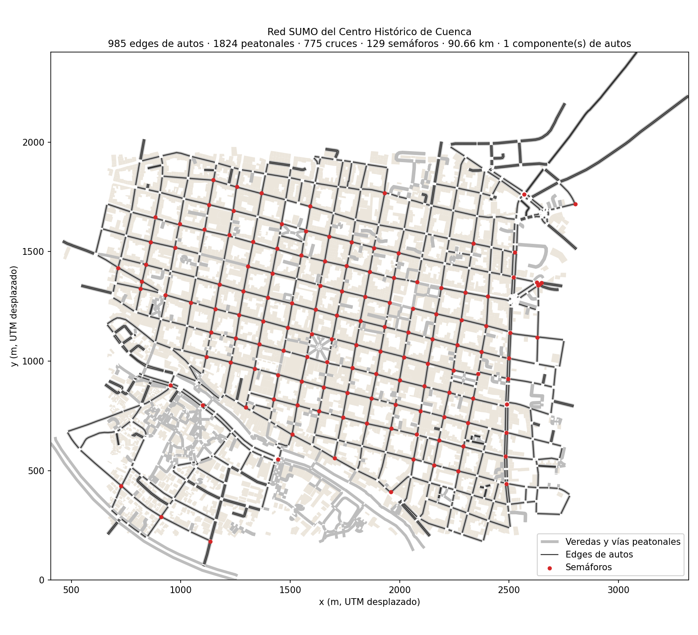
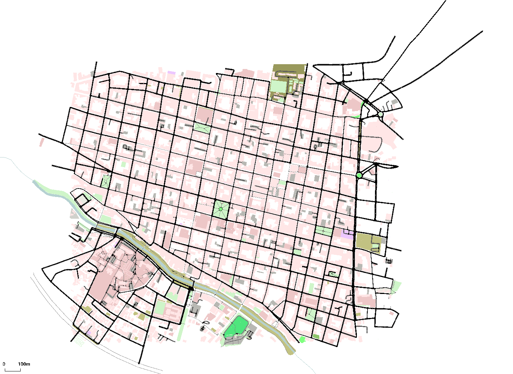

# Bitácora de Tyrone 🔵

**Color:** Azul (`#1E63D6`) · **Rol:** Escenario SUMO, experimentos, KPIs y visor web

Cada sesión agrega una entrada al final (ver *Protocolo de cierre* en `CLAUDE.md`). No se borra nada.

---

## S1 · Sesión 1 · 2026-10-21 · Red vial OSM del Centro Histórico en SUMO
**Estado:** hecha
**Qué hice:**
- `construir_red.py`: descarga el OSM de la bbox `-2.9050,-79.0130,-2.8895,-78.9945` con Overpass (`requests`, 2 servidores espejo) y guarda su SHA-256 en `red_info.json`; `--sin-descarga` reutiliza el OSM local.
- netconvert con todas las opciones del prompt (veredas, cruces, walkingareas, tls, `--proj.utm`) y polyconvert para los edificios; `centro_red.sumocfg` carga solo la red y los polígonos.
- Poda iterativa de componentes fuertemente conexas (Tarjan en Python + `netconvert -s --remove-edges.input-file`): de 138 SCC a 1, quitando 160 edges de autos del borde.
- Validación automática: cifras con sumolib, `sumo --end 10` (código 0) y prueba peatonal (20/20 llegan, 0 teletransportes, 0 atascos).
- Evidencias: gráfica matplotlib, gráfica de la poda y captura de sumo-gui con `traci.gui.screenshot`.
- Resultado: 985 edges de autos, 1824 peatonales, 903 calles con vereda, 775 cruces, 129 semáforos y 90,66 km.

**Archivos creados o modificados:**
- `semanas/S1/Tyrone/codigo/sumo/red/{construir_red.py,centro.net.xml,centro.poly.xml,red_info.json}`
- `semanas/S1/Tyrone/codigo/sumo/{centro_red.sumocfg,requirements.txt}`
- `semanas/S1/Tyrone/evidencias/s1_*.png`
- `semanas/S1/Tyrone/explicaciones/s1_explicacion.{md,pdf}`
- `semanas/S1/Tyrone/{estado.json,RESUMEN.md}`

**Decisiones y por qué:**
- Se podaron los edges fuera de la SCC principal, en lugar de solo documentarlos. Así cualquier par origen-destino de autos es ruteable, algo que necesitan el guiado de Freddy y la demanda de la sesión 2. Los IDs quedan en `red_info.json` y en `s1_componentes-podadas.png`.
- Se sortean 60 viajes peatonales con `--validate` y se simulan los 20 primeros válidos, porque la poda deja pequeñas islas peatonales.
- Los temporales (red cruda, podas, rutas de prueba) van en `sumo/salidas/`, que está ignorada por git.

**Problemas encontrados:**
- Con `withPedestrianConnections=True`, sumolib también devuelve los edges internos (`:nodo_*`): inflaban los conteos y partían las componentes. Se filtran por `getFunction() == ""`.
- SUMO 1.12 no imprime "Teleports: 0" cuando no hay teletransportes, así que se usa `--statistic-output` (teleports y persons jammed).
- `--keep-edges.components` de SUMO 1.12 solo considera componentes débilmente conexas: no sirve para garantizar que la red sea ruteable.
- `randomTrips --validate` dejaba `routes.rou.xml` en la carpeta de trabajo; ahora va a `salidas/` con `-r`.
- `herramientas/explicacion_pdf.py` falla con `código` en línea dentro de las celdas de tabla (fpdf2: "Unsupported nested HTML tags inside <td>"). Se quitaron las comillas invertidas de las tablas de la explicación.

**Pedidos a otros:**
- @Freddy: la red está en `semanas/S1/Tyrone/codigo/sumo/red/centro.net.xml` (desde el domingo, en `proyecto/sumo/red/`). Proyección `+proj=utm +zone=17 +ellps=WGS84 +datum=WGS84 +units=m`, `netOffset -720182.23,321509.41`. Para pasar a lat/lon usa `traci.simulation.convertGeo(x, y)` o `net.convertXY2LonLat(x, y)` de sumolib. Los peatones que crees al parquear deben salir de veredas conectadas: hay islas peatonales pequeñas en el borde.
- @Pablo: la misma ruta y proyección. Para trazas GPS de SUMO, convierte con `convertGeo`, que da lon/lat en WGS84.

**Bucle y verificación:** 5 vueltas (conteos con edges internos → criterio de teletransporte → poda SCC → sobremuestreo peatonal → corrida desde cero). El verificador independiente reportó 6/6 criterios cumplidos tras una corrida desde cero con descarga.
**Pendientes para la próxima sesión:** revisar si las islas peatonales tocan calles SERT al generar los `parkingArea` (sesión 2).
**Evidencias:**    · [Explicación (PDF)](../semanas/S1/Tyrone/explicaciones/s1_explicacion.pdf)

## S1 · Sesión 2 · 2026-10-21 · Generación automática de puestos SERT (parkingArea)
**Estado:** hecha
**Qué hice:**
- `calles_sert.yaml` con los parámetros del prompt, más dos claves nuevas: `excluir_sin_nombre` y `bbox_s_w_n_e`.
- `generar_parkingareas.py`:
  - aplica los filtros de tipo, nombre y `passenger`;
  - elige el carril más a la derecha que permite `passenger` (el 0 es la vereda);
  - calcula `startPos = 8`, `endPos = L − 8` y `capacidad = floor((endPos − startPos)/5.5)`;
  - escribe `parqueos.add.xml`, `puestos.csv` (formato exacto del contrato) y `parqueos_info.json`.
- `centro_parqueos.sumocfg` (red + edificios + puestos): `sumo --end 10` da código 0 y 0 advertencias.
- Prueba de parqueo integrada: 10 viajes con `<stop parkingArea duration="60"/>`, comprobados con `--stop-output`. Los 10 estacionaron.
- Resultado: 610 parkingArea, 6194 puestos y 103 calles. Las que más tienen son Gran Colombia y Simón Bolívar (211 cada una).

**Archivos creados o modificados:**
- `semanas/S1/Tyrone/codigo/sumo/parqueos/{calles_sert.yaml,generar_parkingareas.py,parqueos.add.xml,puestos.csv,parqueos_info.json}`
- `semanas/S1/Tyrone/codigo/sumo/centro_parqueos.sumocfg`
- `semanas/S1/Tyrone/codigo/sumo/requirements.txt` (+pyyaml)
- `semanas/S1/Tyrone/evidencias/s2_puestos-sert.png`
- `semanas/S1/Tyrone/explicaciones/s2_explicacion.{md,pdf}`
- `semanas/S1/Tyrone/{estado.json,RESUMEN.md}`

**Decisiones y por qué:**
- **Nombres normalizados** (sin tildes, sin mayúsculas, sin "Avenida"/"Av."): en OSM la avenida se llama "Gaspar Sangurima", sin "Avenida", y la exclusión del YAML no habría funcionado.
- **Recorte por la bbox de la S1:** sin él salían puestos en radiales fuera del Centro, como Calle Vieja o Barrial Blanco, de hasta 120 puestos por tramo. Con el recorte se pasa de 675/7670 a 610/6194.
- **Calles sin nombre excluidas** (34 edges): no se pueden mostrar en la app ni cruzar con la ordenanza.
- **Interpretación de `lado: ambos`:** en SUMO, una calle de doble sentido son dos edges y ya tiene puestos en las dos aceras con `derecho`. Por eso `ambos` añade `pa_<edge>_1` en el borde izquierdo solo en calles de un sentido con 2 o más carriles. Se probó: 944 parkingArea y 0 advertencias.
- **Resultados de las pruebas fuera de `parqueos_info.json`** (van a `salidas/parqueos_pruebas.json`), para que el resumen sea determinista.

**Problemas encontrados:** ninguno bloqueante; no hubo que adaptar nada de SUMO 1.12.
**Pedidos a otros:**
- @Miguel: verifica `semanas/S1/Tyrone/codigo/sumo/parqueos/calles_sert.yaml` contra la ordenanza SERT. Si hay una lista oficial de calles, ponla en `incluir_nombres`, o dime qué excluir; los 6194 puestos actuales salen solo por tipo de vía.
- @Freddy: `puestos.csv` es tu fuente de puestos (desde el domingo, en `proyecto/sumo/parqueos/`). Columnas `puesto_id,edge,lane,calle,capacidad,lat,lon,x,y`; lat/lon son el punto medio del parkingArea en WGS84. El sufijo `_0` del ID **no es el índice del carril**: el carril real es la columna `lane`, normalmente `<edge>_1`, porque el 0 es la vereda. Usa `puesto_id` directamente en `setParkingAreaStop`.

**Bucle y verificación:** 2 vueltas (la primera generaba puestos fuera del Centro y se añadió el recorte por bbox), más la prueba de `lado: ambos`. El verificador independiente reportó 5/5 criterios cumplidos: determinismo por sha256, su propia prueba de parqueo con otra semilla (10/10) y revisión de las 610 filas del CSV con sumolib.
**Pendientes para la próxima sesión:** ajustar `calles_sert.yaml` cuando Miguel verifique la ordenanza. Las islas peatonales de la S1 no impiden parquear; habrá que vigilarlas cuando Freddy cree los peatones.
**Evidencias:**  · [Explicación (PDF)](../semanas/S1/Tyrone/explicaciones/s2_explicacion.pdf)

## S1 · Sesión 3 · 2026-10-22 · Demanda y búsqueda a ciegas (línea base)
**Estado:** hecha
**Qué hice:**
- `destinos.csv` con los 12 destinos, sus pesos y la fuente OSM de cada uno (columna extra `fuente`). Las coordenadas salen de `centro.osm.xml`; la del Museo Pumapungo, de Nominatim.
- `generar_demanda.py`:
  - entradas y salidas de borde: nodos sin salida a menos de 100 m de la bbox y edges que la cruzan (41 entradas y 43 salidas);
  - buscadores con destino elegido por peso, parada en el parkingArea más cercano y estadía lognormal (media 45 min, recortada a 10–120 min);
  - 40 % de tráfico de paso y llegadas Poisson;
  - `vType auto` con los parámetros `parking.*`, y `param con_app=0` en todos los vehículos;
  - además genera `rerouters.add.xml` (610 rerouters, alternativas a 400 m con `visible="false"`) y `centro_base.sumocfg`.
- `centro_base.sumocfg` con emisiones (probabilidad 1, período 10 s), tripinfo, stop (con `write-unfinished`), vehroute (con `exit-times`), statistic y semilla. Las salidas van en `salidas/base_<semilla>/`.
- `correr_base.py` (varias semillas en paralelo), `analizar_base.py` (ocupación y tiempo de búsqueda provisional) y `captura_gui.py` (sumo-gui en t = 45 min, autos coloreados por clase).
- **Calibración** (semilla 1, fondo 0,80): 600 veh/h → 82,4 %, 1000 → 84,0 %, 1400 → 85,5 %, **1800 → 87,0 %**.
- **Resultado final con 1800 veh/h:**
  - ocupación media en la hora pico: 87,0 % y 87,7 %;
  - 0 teletransportes de 7065 y 7250 vehículos;
  - búsqueda media 230 y 246 s; mediana 188 y 193 s; p90 483 y 525 s.

**Archivos creados o modificados:**
- `semanas/S1/Tyrone/codigo/sumo/demanda/{destinos.csv,generar_demanda.py,correr_base.py,analizar_base.py,captura_gui.py,vista_gui.xml,demanda.rou.xml,rerouters.add.xml}`
- `semanas/S1/Tyrone/codigo/sumo/centro_base.sumocfg`
- `semanas/S1/Tyrone/evidencias/s3_{escenario-base,busqueda-histograma,ocupacion-base}.png`
- `semanas/S1/Tyrone/evidencias/resumen_S1_Tyrone.pdf`
- `semanas/S1/Tyrone/explicaciones/s3_explicacion.{md,pdf}`
- `semanas/S1/Tyrone/{estado.json,RESUMEN.md}`

**Decisiones y por qué:**
- **Ocupación de fondo del 80 %** (autos de larga estadía, ya estacionados al inicio y quietos toda la corrida). Con 6194 puestos y estadías de 45 min, llegar al 85 % solo con buscadores exigiría unos 7000 veh/h, imposible para la red.
- **`--veh-hora` por defecto = 1800** (el prompt sugería 600): es el valor calibrado, así que `generar_demanda.py --semilla 1` reproduce el escenario base.
- **Pesos de búsqueda:**
  - `parking.distance.weight = 1`, que en SUMO 1.12 es un alias de `distanceto`: distancia desde la posición actual;
  - `parking.probability.weight = 0.5`, con `probability` = 1 − 0,9·d/400: cercanía al parkingArea original.

  Lo verifiqué en el código fuente de `MSTriggeredRerouter.cpp` (v1_12_0).
- **Rerouter en el edge del propio parkingArea:** el conductor descubre que está lleno al llegar a esa calle.
- **`demanda.rou.xml` (semilla 1) y `rerouters.add.xml` se versionan,** para que `centro_base.sumocfg` funcione al clonar el repo.

**Problemas encontrados:**
- SUMO 1.12 no tiene `HBEFA4/PC_petrol_Euro-4`: se usa su equivalente `HBEFA3/PC_G_EU4`.
- SUMO 1.12 no admite `departPos="stop"`: los autos de fondo se insertan al inicio de su edge y estacionan en los primeros ~2 min del warm-up.
- Un comentario XML con `--` rompía la carga de la demanda: se cambió a `clave=valor`.
- Overpass no respondía al buscar los destinos: se usó el OSM local de la S1 y, para el Museo Pumapungo, Nominatim.
- La máquina se suspendió durante la calibración. Las corridas siguieron al despertar y no hubo que repetirlas.

**Pedidos a otros:**
- @Freddy: el `param con_app` (hoy `0` en todos) es tu interruptor para guiar a un vehículo en S2. Los buscadores tienen ID `busca_N` y traen además `param destino` y `param pa_objetivo`; los de paso son `paso_N` y los de fondo `fondo_*`, estos últimos sin app.
  - Escenario: `semanas/S1/Tyrone/codigo/sumo/centro_base.sumocfg` (desde el domingo, en `proyecto/sumo/`).
  - `destinos.csv` sirve para el destino del modo espejo.
- @Pablo: si generas trazas GPS desde SUMO, los `busca_*` dan trayectorias de auto en tráfico lento cerca de los destinos (útiles para los escenarios difíciles).

**Bucle y verificación:**
- 5 vueltas: XML con `--` → HBEFA4 → `write-unfinished` en vehroute → calibración (600/1000/1400/1800) → corrección de la serie de ocupación en t = fin. Además, la captura de GUI se rehízo con más zoom.
- El verificador independiente reportó 5/6 criterios cumplidos antes del cierre: repitió la corrida de la semilla 1 y calculó la ocupación por su cuenta (87,03 % y 87,75 %). El único pendiente era el PDF semanal, que se generó en el cierre (6/6).

**Pendientes para la próxima sesión (S2):**
- KPIs formales: tiempo y distancia de búsqueda, CO₂, y tratamiento de las búsquedas censuradas al final (35 y 84 buscadores llevaban más de 10 min sin estacionar).
- Opcional: rotación de la ocupación de fondo para tener un estado estacionario.

**Evidencias:**    · [Explicación (PDF)](../semanas/S1/Tyrone/explicaciones/s3_explicacion.pdf) · [Resumen semanal (PDF)](../semanas/S1/Tyrone/evidencias/resumen_S1_Tyrone.pdf)
