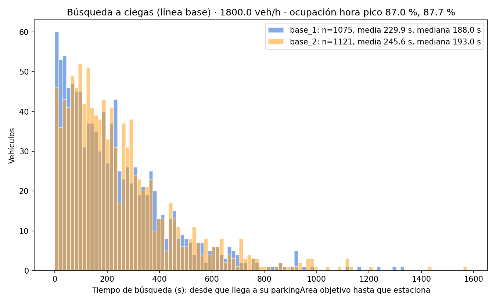

# Bitácora de Tyrone 🔵

**Color:** Azul (`#1E63D6`) · **Rol:** Escenario SUMO, experimentos, KPIs y visor web

Cada sesión agrega una entrada al final (ver *Protocolo de cierre* en `CLAUDE.md`). No se borra nada.

---

## S1 · Sesión 1 · 2026-10-21 · Red vial OSM del Centro Histórico en SUMO
**Estado:** hecha
**Qué hice:**
- `construir_red.py`: descarga el OSM de la bbox `-2.9050,-79.0130,-2.8895,-78.9945` con Overpass (`requests`, 2 servidores espejo) y guarda su SHA-256 en `red_info.json`; `--sin-descarga` reutiliza el OSM local.
- netconvert con todas las opciones del prompt (veredas, cruces, walkingareas, tls, `--proj.utm`) y polyconvert para los edificios; `centro_red.sumocfg` carga solo la red y los polígonos.
- Poda iterativa de componentes fuertemente conexas (Tarjan en Python + `netconvert -s --remove-edges.input-file`): de 138 SCC a 1, quitando 160 edges de autos del borde.
- Validación automática: cifras con sumolib, `sumo --end 10` (código 0) y prueba peatonal (20/20 llegan, 0 teletransportes, 0 atascos).
- Evidencias: gráfica matplotlib, gráfica de la poda y captura de sumo-gui con `traci.gui.screenshot`.
- Resultado: 985 edges de autos, 1824 peatonales, 903 calles con vereda, 775 cruces, 129 semáforos y 90,66 km.

**Archivos creados o modificados:**
- `semanas/S1/Tyrone/codigo/sumo/red/{construir_red.py,centro.net.xml,centro.poly.xml,red_info.json}`
- `semanas/S1/Tyrone/codigo/sumo/{centro_red.sumocfg,requirements.txt}`
- `semanas/S1/Tyrone/evidencias/s1_*.png`
- `semanas/S1/Tyrone/explicaciones/s1_explicacion.{md,pdf}`
- `semanas/S1/Tyrone/{estado.json,RESUMEN.md}`

**Decisiones y por qué:**
- Se podaron los edges fuera de la SCC principal, en lugar de solo documentarlos. Así cualquier par origen-destino de autos es ruteable, algo que necesitan el guiado de Freddy y la demanda de la sesión 2. Los IDs quedan en `red_info.json` y en `s1_componentes-podadas.png`.
- Se sortean 60 viajes peatonales con `--validate` y se simulan los 20 primeros válidos, porque la poda deja pequeñas islas peatonales.
- Los temporales (red cruda, podas, rutas de prueba) van en `sumo/salidas/`, que está ignorada por git.

**Problemas encontrados:**
- Con `withPedestrianConnections=True`, sumolib también devuelve los edges internos (`:nodo_*`): inflaban los conteos y partían las componentes. Se filtran por `getFunction() == ""`.
- SUMO 1.12 no imprime "Teleports: 0" cuando no hay teletransportes, así que se usa `--statistic-output` (teleports y persons jammed).
- `--keep-edges.components` de SUMO 1.12 solo considera componentes débilmente conexas: no sirve para garantizar que la red sea ruteable.
- `randomTrips --validate` dejaba `routes.rou.xml` en la carpeta de trabajo; ahora va a `salidas/` con `-r`.
- `herramientas/explicacion_pdf.py` falla con `código` en línea dentro de las celdas de tabla (fpdf2: "Unsupported nested HTML tags inside <td>"). Se quitaron las comillas invertidas de las tablas de la explicación.

**Pedidos a otros:**
- @Freddy: la red está en `semanas/S1/Tyrone/codigo/sumo/red/centro.net.xml` (desde el domingo, en `proyecto/sumo/red/`). Proyección `+proj=utm +zone=17 +ellps=WGS84 +datum=WGS84 +units=m`, `netOffset -720182.23,321509.41`. Para pasar a lat/lon usa `traci.simulation.convertGeo(x, y)` o `net.convertXY2LonLat(x, y)` de sumolib. Los peatones que crees al parquear deben salir de veredas conectadas: hay islas peatonales pequeñas en el borde.
- @Pablo: la misma ruta y proyección. Para trazas GPS de SUMO, convierte con `convertGeo`, que da lon/lat en WGS84.

**Bucle y verificación:** 5 vueltas (conteos con edges internos → criterio de teletransporte → poda SCC → sobremuestreo peatonal → corrida desde cero). El verificador independiente reportó 6/6 criterios cumplidos tras una corrida desde cero con descarga.
**Pendientes para la próxima sesión:** revisar si las islas peatonales tocan calles SERT al generar los `parkingArea` (sesión 2).
**Evidencias:**    · [Explicación (PDF)](../semanas/S1/Tyrone/explicaciones/s1_explicacion.pdf)

## S1 · Sesión 2 · 2026-10-21 · Generación automática de puestos SERT (parkingArea)
**Estado:** hecha
**Qué hice:**
- `calles_sert.yaml` con los parámetros del prompt, más dos claves nuevas: `excluir_sin_nombre` y `bbox_s_w_n_e`.
- `generar_parkingareas.py`:
  - aplica los filtros de tipo, nombre y `passenger`;
  - elige el carril más a la derecha que permite `passenger` (el 0 es la vereda);
  - calcula `startPos = 8`, `endPos = L − 8` y `capacidad = floor((endPos − startPos)/5.5)`;
  - escribe `parqueos.add.xml`, `puestos.csv` (formato exacto del contrato) y `parqueos_info.json`.
- `centro_parqueos.sumocfg` (red + edificios + puestos): `sumo --end 10` da código 0 y 0 advertencias.
- Prueba de parqueo integrada: 10 viajes con `<stop parkingArea duration="60"/>`, comprobados con `--stop-output`. Los 10 estacionaron.
- Resultado: 610 parkingArea, 6194 puestos y 103 calles. Las que más tienen son Gran Colombia y Simón Bolívar (211 cada una).

**Archivos creados o modificados:**
- `semanas/S1/Tyrone/codigo/sumo/parqueos/{calles_sert.yaml,generar_parkingareas.py,parqueos.add.xml,puestos.csv,parqueos_info.json}`
- `semanas/S1/Tyrone/codigo/sumo/centro_parqueos.sumocfg`
- `semanas/S1/Tyrone/codigo/sumo/requirements.txt` (+pyyaml)
- `semanas/S1/Tyrone/evidencias/s2_puestos-sert.png`
- `semanas/S1/Tyrone/explicaciones/s2_explicacion.{md,pdf}`
- `semanas/S1/Tyrone/{estado.json,RESUMEN.md}`

**Decisiones y por qué:**
- **Nombres normalizados** (sin tildes, sin mayúsculas, sin "Avenida"/"Av."): en OSM la avenida se llama "Gaspar Sangurima", sin "Avenida", y la exclusión del YAML no habría funcionado.
- **Recorte por la bbox de la S1:** sin él salían puestos en radiales fuera del Centro, como Calle Vieja o Barrial Blanco, de hasta 120 puestos por tramo. Con el recorte se pasa de 675/7670 a 610/6194.
- **Calles sin nombre excluidas** (34 edges): no se pueden mostrar en la app ni cruzar con la ordenanza.
- **Interpretación de `lado: ambos`:** en SUMO, una calle de doble sentido son dos edges y ya tiene puestos en las dos aceras con `derecho`. Por eso `ambos` añade `pa_<edge>_1` en el borde izquierdo solo en calles de un sentido con 2 o más carriles. Se probó: 944 parkingArea y 0 advertencias.
- **Resultados de las pruebas fuera de `parqueos_info.json`** (van a `salidas/parqueos_pruebas.json`), para que el resumen sea determinista.

**Problemas encontrados:** ninguno bloqueante; no hubo que adaptar nada de SUMO 1.12.
**Pedidos a otros:**
- @Miguel: verifica `semanas/S1/Tyrone/codigo/sumo/parqueos/calles_sert.yaml` contra la ordenanza SERT. Si hay una lista oficial de calles, ponla en `incluir_nombres`, o dime qué excluir; los 6194 puestos actuales salen solo por tipo de vía.
- @Freddy: `puestos.csv` es tu fuente de puestos (desde el domingo, en `proyecto/sumo/parqueos/`). Columnas `puesto_id,edge,lane,calle,capacidad,lat,lon,x,y`; lat/lon son el punto medio del parkingArea en WGS84. El sufijo `_0` del ID **no es el índice del carril**: el carril real es la columna `lane`, normalmente `<edge>_1`, porque el 0 es la vereda. Usa `puesto_id` directamente en `setParkingAreaStop`.

**Bucle y verificación:** 2 vueltas (la primera generaba puestos fuera del Centro y se añadió el recorte por bbox), más la prueba de `lado: ambos`. El verificador independiente reportó 5/5 criterios cumplidos: determinismo por sha256, su propia prueba de parqueo con otra semilla (10/10) y revisión de las 610 filas del CSV con sumolib.
**Pendientes para la próxima sesión:** ajustar `calles_sert.yaml` cuando Miguel verifique la ordenanza. Las islas peatonales de la S1 no impiden parquear; habrá que vigilarlas cuando Freddy cree los peatones.
**Evidencias:**  · [Explicación (PDF)](../semanas/S1/Tyrone/explicaciones/s2_explicacion.pdf)

## S1 · Sesión 3 · 2026-10-22 · Demanda y búsqueda a ciegas (línea base)
**Estado:** hecha
**Qué hice:**
- `destinos.csv` con los 12 destinos, sus pesos y la fuente OSM de cada uno (columna extra `fuente`). Las coordenadas salen de `centro.osm.xml`; la del Museo Pumapungo, de Nominatim.
- `generar_demanda.py`:
  - entradas y salidas de borde: nodos sin salida a menos de 100 m de la bbox y edges que la cruzan (41 entradas y 43 salidas);
  - buscadores con destino elegido por peso, parada en el parkingArea más cercano y estadía lognormal (media 45 min, recortada a 10–120 min);
  - 40 % de tráfico de paso y llegadas Poisson;
  - `vType auto` con los parámetros `parking.*`, y `param con_app=0` en todos los vehículos;
  - además genera `rerouters.add.xml` (610 rerouters, alternativas a 400 m con `visible="false"`) y `centro_base.sumocfg`.
- `centro_base.sumocfg` con emisiones (probabilidad 1, período 10 s), tripinfo, stop (con `write-unfinished`), vehroute (con `exit-times`), statistic y semilla. Las salidas van en `salidas/base_<semilla>/`.
- `correr_base.py` (varias semillas en paralelo), `analizar_base.py` (ocupación y tiempo de búsqueda provisional) y `captura_gui.py` (sumo-gui en t = 45 min, autos coloreados por clase).
- **Calibración** (semilla 1, fondo 0,80): 600 veh/h → 82,4 %, 1000 → 84,0 %, 1400 → 85,5 %, **1800 → 87,0 %**.
- **Resultado final con 1800 veh/h:**
  - ocupación media en la hora pico: 87,0 % y 87,7 %;
  - 0 teletransportes de 7065 y 7250 vehículos;
  - búsqueda media 230 y 246 s; mediana 188 y 193 s; p90 483 y 525 s.

**Archivos creados o modificados:**
- `semanas/S1/Tyrone/codigo/sumo/demanda/{destinos.csv,generar_demanda.py,correr_base.py,analizar_base.py,captura_gui.py,vista_gui.xml,demanda.rou.xml,rerouters.add.xml}`
- `semanas/S1/Tyrone/codigo/sumo/centro_base.sumocfg`
- `semanas/S1/Tyrone/evidencias/s3_{escenario-base,busqueda-histograma,ocupacion-base}.png`
- `semanas/S1/Tyrone/evidencias/resumen_S1_Tyrone.pdf`
- `semanas/S1/Tyrone/explicaciones/s3_explicacion.{md,pdf}`
- `semanas/S1/Tyrone/{estado.json,RESUMEN.md}`

**Decisiones y por qué:**
- **Ocupación de fondo del 80 %** (autos de larga estadía, ya estacionados al inicio y quietos toda la corrida). Con 6194 puestos y estadías de 45 min, llegar al 85 % solo con buscadores exigiría unos 7000 veh/h, imposible para la red.
- **`--veh-hora` por defecto = 1800** (el prompt sugería 600): es el valor calibrado, así que `generar_demanda.py --semilla 1` reproduce el escenario base.
- **Pesos de búsqueda:**
  - `parking.distance.weight = 1`, que en SUMO 1.12 es un alias de `distanceto`: distancia desde la posición actual;
  - `parking.probability.weight = 0.5`, con `probability` = 1 − 0,9·d/400: cercanía al parkingArea original.

  Lo verifiqué en el código fuente de `MSTriggeredRerouter.cpp` (v1_12_0).
- **Rerouter en el edge del propio parkingArea:** el conductor descubre que está lleno al llegar a esa calle.
- **`demanda.rou.xml` (semilla 1) y `rerouters.add.xml` se versionan,** para que `centro_base.sumocfg` funcione al clonar el repo.

**Problemas encontrados:**
- SUMO 1.12 no tiene `HBEFA4/PC_petrol_Euro-4`: se usa su equivalente `HBEFA3/PC_G_EU4`.
- SUMO 1.12 no admite `departPos="stop"`: los autos de fondo se insertan al inicio de su edge y estacionan en los primeros ~2 min del warm-up.
- Un comentario XML con `--` rompía la carga de la demanda: se cambió a `clave=valor`.
- Overpass no respondía al buscar los destinos: se usó el OSM local de la S1 y, para el Museo Pumapungo, Nominatim.
- La máquina se suspendió durante la calibración. Las corridas siguieron al despertar y no hubo que repetirlas.

**Pedidos a otros:**
- @Freddy: el `param con_app` (hoy `0` en todos) es tu interruptor para guiar a un vehículo en S2. Los buscadores tienen ID `busca_N` y traen además `param destino` y `param pa_objetivo`; los de paso son `paso_N` y los de fondo `fondo_*`, estos últimos sin app.
  - Escenario: `semanas/S1/Tyrone/codigo/sumo/centro_base.sumocfg` (desde el domingo, en `proyecto/sumo/`).
  - `destinos.csv` sirve para el destino del modo espejo.
- @Pablo: si generas trazas GPS desde SUMO, los `busca_*` dan trayectorias de auto en tráfico lento cerca de los destinos (útiles para los escenarios difíciles).

**Bucle y verificación:**
- 5 vueltas: XML con `--` → HBEFA4 → `write-unfinished` en vehroute → calibración (600/1000/1400/1800) → corrección de la serie de ocupación en t = fin. Además, la captura de GUI se rehízo con más zoom.
- El verificador independiente reportó 5/6 criterios cumplidos antes del cierre: repitió la corrida de la semilla 1 y calculó la ocupación por su cuenta (87,03 % y 87,75 %). El único pendiente era el PDF semanal, que se generó en el cierre (6/6).

**Pendientes para la próxima sesión (S2):**
- KPIs formales: tiempo y distancia de búsqueda, CO₂, y tratamiento de las búsquedas censuradas al final (35 y 84 buscadores llevaban más de 10 min sin estacionar).
- Opcional: rotación de la ocupación de fondo para tener un estado estacionario.

**Evidencias:**    · [Explicación (PDF)](../semanas/S1/Tyrone/explicaciones/s3_explicacion.pdf) · [Resumen semanal (PDF)](../semanas/S1/Tyrone/evidencias/resumen_S1_Tyrone.pdf)

## S2 · Sesión 1 · 2026-10-26 · KPIs de la línea base (búsqueda, distancia, CO₂ y ocupación)
**Estado:** hecha

**Qué hice:**
- Abrí la rama `tyrone/s2` desde `main` y copié `proyecto/sumo/` a `semanas/S2/Tyrone/codigo/sumo/`. `proyecto/kpis/` solo tenía un `.gitkeep`.
- Añadí `vehroute-output.route-length` a `centro_base.sumocfg` y a la plantilla de `generar_demanda.py`. Después corrí las 2 semillas en segundo plano en el contenedor, con `correr_base.py` (~16 min).
- Escribí `kpis/lectores.py`: lectores en streaming con `lxml.iterparse` para tripinfo, stops, vehroutes, emisiones, red y demanda.
- Escribí `kpis/kpis.py` (definiciones en el docstring, CLI y `kpis_<escenario>.json` con todas las semillas) y `kpis/graficas.py` (figura 2×2).
- Un subagente escribió 13 tests con XML sintéticos a partir de las firmas que fijé antes.
- Calculé los KPIs de las 2 semillas: búsqueda media de 349 y 362 s, distancia de 1248 y 1310 m, CO₂ de 666 y 693 g, ocupación pico de 87,0 y 87,7 %.

**Archivos creados o modificados:**
- `semanas/S2/Tyrone/codigo/kpis/`: `lectores.py`, `kpis.py`, `graficas.py`, `requirements.txt`, `tests/` y `salidas/` (JSON y CSV de la base).
- `semanas/S2/Tyrone/codigo/sumo/`: copia de `proyecto/sumo/`; se modificaron `centro_base.sumocfg` y `demanda/generar_demanda.py`.
- `semanas/S2/Tyrone/evidencias/s1_kpis-base.png` y `semanas/S2/Tyrone/explicaciones/s1_explicacion.{md,pdf}`.

**Decisiones y por qué:**
- **`inicio_busqueda` con un radio de 300 m o el edge objetivo:** con app, el conductor ya no pasa necesariamente por su puesto objetivo, y la definición tiene que servir para todos los escenarios.
- **Comparación con S1-3:** el tiempo sale 52 % y 47 % mayor que en el cálculo provisional (230 y 246 s). Con `--radio-busqueda-m 0`, `kpis.py` reproduce exactamente 229,9 y 245,6 s, así que la diferencia es solo de definición.
- **Distancia:** solo cuenta los edges completos (exitTime en (inicio, fin]).
- **CO₂:** integral del emission-output, muestreado cada 10 s. Lo validé contra el `CO2_abs` exacto de tripinfo en 330 viajes completos: ratio 0,988 y correlación 0,94.
- **Censurados:** los buscadores que no estacionaron (201 y 248) se excluyen de las estadísticas y se reportan aparte en `conteos`.
- **Dónde corre:** `kpis/` no importa `sumolib` ni `traci`, así que corre en la computadora con su propio `.venv`.
- **Nombres de las claves:** en `kpis_base.json`, `valores` usa los nombres reservados del mensaje WS `kpi` (CONTRATO §6).

**Problemas encontrados:**
- El `PYTHONPATH` de ROS Jazzy de esta computadora rompe pytest al cargar plugins. Se corre con `env -u PYTHONPATH PYTEST_DISABLE_PLUGIN_AUTOLOAD=1`.
- El contenedor no trae `pandas`, así que `kpis/` corre en la computadora. Si el controlador lo importa en S3, hay que instalar `kpis/requirements.txt` en el contenedor.

**Pedidos a otros:**
- @Freddy:
  - Definición de búsqueda: empieza al entrar al primer edge a ≤ 300 m del destino (o al edge del `pa_objetivo`) y termina con el `started` de la primera parada en un `parkingArea`.
  - Claves de `kpis/salidas/kpis_base.json` → `valores`: `busqueda_media_s`, `distancia_busqueda_media_m`, `co2_busqueda_g`, `ocupacion_media_pico` y `falsas_liberaciones_100` (`null` hasta S3). Usa las mismas en tu mensaje WS `kpi`.

**Bucle y verificación:**
- 2 vueltas. Los tests pasaron a la primera. En la segunda vuelta validé el CO₂ contra tripinfo y la diferencia con S1-3 recalculando con radio 0.
- El verificador independiente reportó 6/6 criterios cumplidos: tests 13/13, 4,4 y 4,8 s por semilla, JSON completo, ocupación 87,0/87,7 %, docstring y evidencia.

**Pendientes para la próxima sesión:**
- Aplicar `kpis.kpis` a los escenarios con app (S2-3).
- Opcional: sumar el tramo parcial del edge de parqueo a la distancia.

**Evidencias:**  · [Explicación (PDF)](../semanas/S2/Tyrone/explicaciones/s1_explicacion.pdf)

## S2 · Sesión 2 · 2026-10-26 · Visor web Leaflet y servidor WS de prueba
**Estado:** hecha

**Qué hice:**
- `visor/grabar_snapshots.py` (en el contenedor): simula el escenario base y graba 900 snapshots del contrato (t = 1801–2700 s, hora pico) en `visor/datos/snapshots.jsonl`. Tardó ~8 min en segundo plano.
- `visor/servidor_prueba.py` (FastAPI): `GET /api/v1/puestos`, `WS /ws/estado` (repetición en bucle, `--velocidad 1|5|10`, un `kpi` cada 30 snapshots con los valores de `kpis_base.json`) y estáticos en `/visor/` y `/`.
- `visor/index.html`, `visor.js` y `estilos.css`, con Leaflet 1.9.4 desde unpkg (con SRI):
  - canvas y marcadores actualizados por id;
  - puestos verde/rojo con popup `calle · ocupados/capacidad`;
  - autos por estado y borde grueso con app; halo en los `espejos`;
  - panel con conteos, KPIs, conexión y FPS;
  - `?ws=` configurable, reconexión 1→30 s y capa `?verdad=1`.
- `visor/captura.py` (Playwright): captura a 1600×1000, medición de FPS y prueba de reconexión.
- Un subagente escribió 9 tests (`visor/tests/`): contrato de los 900 snapshots, WS, puestos y rutas relativas.
- Probé el visor contra el backend real de Freddy (`origin/freddy/s2`, extraído con `git archive` a una carpeta temporal, sin editarlo), servido en su `/visor/` con `ESERT_VISOR_DIR`: le envié 40 pasos `POST /api/v1/sim/paso` hechos con mis snapshots.

**Archivos creados o modificados:**
- `semanas/S2/Tyrone/codigo/visor/`: `index.html`, `visor.js`, `estilos.css`, `grabar_snapshots.py`, `servidor_prueba.py`, `captura.py`, `requirements.txt`, `.gitignore`, `tests/` y `datos/snapshots_muestra.jsonl`.
- `semanas/S2/Tyrone/evidencias/s2_visor-leaflet.png` y `semanas/S2/Tyrone/explicaciones/s2_explicacion.{md,pdf}`.

**Decisiones y por qué:**
- **Estado del vehículo (MOCK):** `ESTACIONADO` si `stopState` tiene el bit de parking, `BUSCANDO` si busca y aún no estaciona, `null` para paso y fondo (contrato). El espejo (MOCK) es un buscador al azar con `con_app = true`.
- **Autos de fondo estacionados:** no se envían (~4900 marcadores quietos); ya se ven en el color de los puestos. Así los snapshots bajan a ~100 KB y el visor dibuja ~600 autos más 610 puestos.
- **lat/lon con pyproj y netOffset** en lugar de `convertGeo` por vehículo. Es la misma conversión, comprobada con 20 vehículos al iniciar (< 1e-6°), y evita ~600 llamadas TraCI por segundo.
- **`snapshots.jsonl` (91 MB) se ignora** con un `.gitignore` propio de `visor/`, sin tocar el de la raíz. En git va la muestra de 60 (5,5 MB).
- **URL por defecto:** el WS del mismo origen, y la API REST se deduce de la URL del WS. Así funciona igual detrás del backend en `/visor/`, con el servidor de prueba o con `?ws=`.

**Problemas encontrados:**
- **Backend de Freddy:** con él no hubo diferencias de formato (40 `snapshot` + 40 `verdad`, sin errores). Su mapa sale todo verde porque `snapshot.puestos` es la ocupación estimada por sesiones, y en la prueba no había ninguna. Es lo que dice el contrato; la ocupación real se ve con `?verdad=1`.
- **El escenario base no tiene peatones:** la capa de peatones queda vacía hasta que el backend los envíe.
- **FPS:** se midieron con `requestAnimationFrame` en Chromium headless (Playwright), no en DevTools: 54 de media y 49 de mínimo a velocidad 1.
- **`pkill -f` se mataba a sí mismo:** el patrón aparecía en su propia línea de comandos. Los servidores se paran por PID.

**Pedidos a otros:**
- @Freddy: el visor espera `espejos` y `con_app` en cada snapshot, y usa `estado` para colorear (BUSCANDO, GUIADO, ESTACIONADO, A_PIE, REGRESANDO, SALIENDO; `null` sin búsqueda). También lee `GET /api/v1/puestos` del mismo origen para la posición y la calle de cada puesto.
- @Miguel: para ver resaltado el auto que sigue tu modo espejo, abre `http://<backend>:8000/visor/`, o en la demo `https://demo.e-sert.tesisucuenca.com/visor/`. Con el servidor de prueba: `python -m visor.servidor_prueba --puerto 8001` y `http://localhost:8001/visor/`. El halo amarillo es el vehículo de `espejos`.

**Bucle y verificación:**
- 2 vueltas. En la primera, la muestra provisional de 5 snapshots; en la segunda, la muestra real de 60, el `.gitignore` del archivo grande y la prueba contra el backend de Freddy.
- El verificador independiente reportó 6/6 criterios cumplidos:
  - detrás de `http.server` carga en /visor/ e intenta `ws://<mismo host>/ws/estado`;
  - autos y puestos cambian;
  - 58,6 FPS;
  - 9 tests, y 900 + 60 snapshots válidos;
  - la reconexión funciona sin recarga, comprobado con una marca en `window`;
  - existe la evidencia.

**Pendientes para la próxima sesión:**
- Reemplazar el estado y el espejo MOCK por los del controlador de Freddy.
- Ver los peatones cuando el backend los publique.

**Evidencias:**  · [Explicación (PDF)](../semanas/S2/Tyrone/explicaciones/s2_explicacion.pdf)

## S2 · Sesión 3 · 2026-10-26 · Escenarios con penetración de app y registro de la ocupación real
**Estado:** hecha

**Qué hice:**
- `generar_demanda.py`:
  - `--porc-app` con un generador separado (`numpy.random.default_rng([semilla, 7])`) que sortea `u_i` solo para los buscadores;
  - los buscadores llevan además `param destino` ("lat,lon") y `destino_nombre`;
  - paso y fondo siempre llevan `con_app = 0`.
- `sumo/escenarios/generar_escenarios.py`:
  - genera los 8 `.rou.xml` y `.sumocfg`, y `escenarios.json` con semilla, %, conteos y SHA-256;
  - comprueba que la demanda es idéntica por semilla (7065 y 7250 vehículos) y el anidamiento (253 ⊂ 624 ⊂ 1018; 251 ⊂ 673 ⊂ 1083).
- `kpis/registrar_ocupacion.py`: hook `hook(controlador, t)` del `Controlador` de Freddy (`proyecto/traci/controlador.py`) que escribe `ocupacion_real_<escenario>_s<N>.csv` cada 60 s. Incluye la comprobación contra el stop-output.
- `sumo/escenarios/guiado_oraculo.py` (`# MOCK`): el guiado de Freddy no está en `proyecto/traci/` ni en `origin/freddy/s2`, así que lo reemplaza un oráculo que elige el puesto libre más cercano al destino con `rerouteParkingArea`.
- `sumo/escenarios/correr_escenarios.py`: corre las 8 con `subprocess.Popen`, máximo 3 a la vez.
- `kpis/resumen_escenarios.py`: KPIs de las 8 corridas, `resumen_escenarios.csv` y las 2 figuras.

**Archivos creados o modificados:**
- `semanas/S2/Tyrone/codigo/sumo/demanda/generar_demanda.py`.
- `semanas/S2/Tyrone/codigo/sumo/escenarios/`: scripts, 8 `.sumocfg`, `escenarios.json` y `.gitignore` (los `.rou.xml` se regeneran).
- `semanas/S2/Tyrone/codigo/kpis/`: `registrar_ocupacion.py`, `resumen_escenarios.py`, `.gitignore`, `kpis.py`, `lectores.py`, un test nuevo y `salidas/` (KPIs de los 4 escenarios, `resumen_escenarios.csv`, `ocupacion_real_app50_s1.csv` y `comprobacion_ocupacion_real.json`).
- `semanas/S2/Tyrone/evidencias/s3_penetracion-escenarios.png`, `s3_ocupacion-real.png` y `resumen_S2_Tyrone.pdf`.
- `semanas/S2/Tyrone/explicaciones/s3_explicacion.{md,pdf}`, y `s1_explicacion.{md,pdf}` corregida (censurados).

**Decisiones y por qué:**
- **Convención (started, ended] para comprobar la ocupación:** el hook lee al final del paso t. Con ella la diferencia es 0 en los 75 instantes de las 8 corridas. Con [started, ended) aparecían ±1–2, y 37 en el warm-up, cuando cientos de autos de fondo estacionan en el mismo segundo.
- **Estacionar fuera de la zona:** un auto guiado que estaciona sin entrar a los 300 m del destino cuenta como búsqueda 0 s / 0 m, en lugar de excluirse. Excluirlo sesgaba contra la app.
- **`kpis.kpis --demanda`:** las corridas de escenarios no dejan `demanda.rou.xml` en su carpeta. Sin la opción, las de la semilla 2 se calculaban con la demanda de la semilla 1.
- **Porcentaje de teletransportes:** se divide entre los vehículos insertados, porque con guiado `loaded` suma una carga por cada `rerouteParkingArea`.
- **Versionado:** no se versionan las demandas de los escenarios (18 MB, deterministas, con SHA-256) ni 7 de los 8 CSV de ocupación; va el de `app50_s1`.

**Problemas encontrados:**
- El SUMO 1.12 del contenedor aborta con asserts (`MSVehicle::enterLaneAtMove` y `MSBaseVehicle::replaceRoute`) cuando `rerouteParkingArea` reasigna:
  - en un cruce;
  - hacia un puesto del edge actual (puede quedar detrás del vehículo);
  - sin ruta al nuevo puesto.

  Fallaron 3 corridas. Las diagnostiqué con un log opcional del oráculo (`ESERT_LOG_ORACULO`) y añadí las tres protecciones. Las 6 corridas con app se repitieron con la versión final, así que las 8 son comparables.
- **Error en `kpis` (venía de S2-1):** SUMO escribe `exitTime = -1` en los edges que un vehículo sin terminar aún no recorrió, y el lector lo tomaba como hora válida. Con guiado inflaba la media (474 s en lugar de 121 s para los usuarios con app en app80_s2). En la base no cambian las medias, pero los censurados correctos son 114 y 159, no 201 y 248. Corregí `lectores.py`, añadí un test y anoté la corrección en la explicación de S2-1.
- En la semilla 1 se insertan 7064 de 7065 vehículos: el último sale en t = 4499,08, al límite del fin. Es inocuo.

**Pedidos a otros:**
- @Freddy:
  - la ocupación real está en `semanas/S2/Tyrone/codigo/kpis/salidas/ocupacion_real_<escenario>_s<N>.csv` (desde el domingo, en `proyecto/kpis/salidas/`), con columnas `t_sim,puesto_id,ocupados,capacidad`, cada 60 s desde t = 60 hasta 4500. Para generarla en tu ejecutor: `ctrl.agregar_hook(RegistradorOcupacion("<escenario>_s<N>"))` y `reg.cerrar()` al final. Es la verdad para tu KPI de precisión del mapa;
  - `traci/guiado.py` debe reemplazar a `sumo/escenarios/guiado_oraculo.py` en S3-1;
  - si usas `rerouteParkingArea` en SUMO 1.12, evita reasignar en cruces, hacia puestos del edge actual o sin ruta: el SUMO del contenedor aborta;
  - los buscadores traen `param destino` ("lat,lon") y `destino_nombre` para la lista de candidatos del espejo.

**Bucle y verificación:**
- 4 vueltas:
  1. el oráculo abortó SUMO en 3 corridas;
  2. la convención de la comprobación de ocupación;
  3. el `exitTime = -1` y la demanda de la semilla 2;
  4. el puesto en el edge actual. Con eso se repitieron las 6 corridas con app.
- El verificador independiente reportó los 5 criterios cumplidos en lo técnico (escenarios idénticos y anidados, ocupación ±0, 8 corridas sin errores ni teletransportes, figuras). Faltaba solo el PDF semanal, que se generó en el cierre. Su observación sobre `loaded` se corrigió (ahora se usan los insertados).

**Pendientes para la próxima sesión (S3):**
- Repetir las 8 corridas con el guiado real de Freddy.
- Ejecutor completo con KPIs y precisión del mapa.

**Evidencias:**   · [Explicación (PDF)](../semanas/S2/Tyrone/explicaciones/s3_explicacion.pdf) · [Resumen semanal (PDF)](../semanas/S2/Tyrone/evidencias/resumen_S2_Tyrone.pdf)
