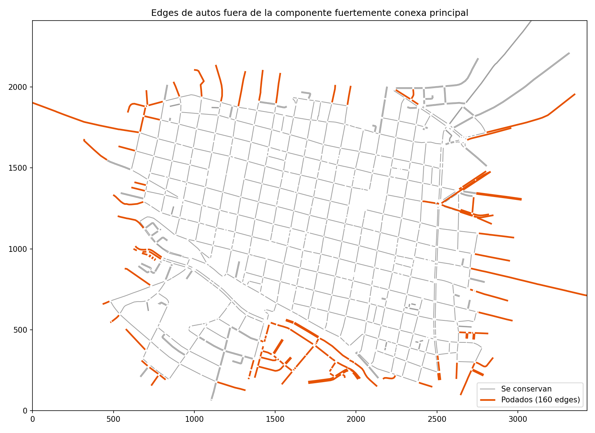

# Bitácora de Tyrone 🔵

**Color:** Azul (`#1E63D6`) · **Rol:** Escenario SUMO, experimentos, KPIs y visor web

Cada sesión agrega una entrada al final (ver *Protocolo de cierre* en `CLAUDE.md`). No se borra nada.

---

## S1 · Sesión 1 · 2026-10-21 · Red vial OSM del Centro Histórico en SUMO
**Estado:** hecha
**Qué hice:**
- `construir_red.py`: descarga el OSM de la bbox `-2.9050,-79.0130,-2.8895,-78.9945` con Overpass (`requests`, 2 servidores espejo) y guarda su SHA-256 en `red_info.json`; `--sin-descarga` reutiliza el OSM local.
- netconvert con todas las opciones del prompt (veredas, cruces, walkingareas, tls, `--proj.utm`) y polyconvert para los edificios; `centro_red.sumocfg` carga solo la red y los polígonos.
- Poda iterativa de componentes fuertemente conexas (Tarjan en Python + `netconvert -s --remove-edges.input-file`): de 138 SCC a 1, quitando 160 edges de autos del borde.
- Validación automática: cifras con sumolib, `sumo --end 10` (código 0) y prueba peatonal (20/20 llegan, 0 teletransportes, 0 atascos).
- Evidencias: gráfica matplotlib, gráfica de la poda y captura de sumo-gui con `traci.gui.screenshot`.
- Resultado: 985 edges de autos, 1824 peatonales, 903 calles con vereda, 775 cruces, 129 semáforos y 90,66 km.

**Archivos creados o modificados:**
- `semanas/S1/Tyrone/codigo/sumo/red/{construir_red.py,centro.net.xml,centro.poly.xml,red_info.json}`
- `semanas/S1/Tyrone/codigo/sumo/{centro_red.sumocfg,requirements.txt}`
- `semanas/S1/Tyrone/evidencias/s1_*.png`
- `semanas/S1/Tyrone/explicaciones/s1_explicacion.{md,pdf}`
- `semanas/S1/Tyrone/{estado.json,RESUMEN.md}`

**Decisiones y por qué:**
- Se podaron los edges fuera de la SCC principal, en lugar de solo documentarlos. Así cualquier par origen-destino de autos es ruteable, algo que necesitan el guiado de Freddy y la demanda de la sesión 2. Los IDs quedan en `red_info.json` y en `s1_componentes-podadas.png`.
- Se sortean 60 viajes peatonales con `--validate` y se simulan los 20 primeros válidos, porque la poda deja pequeñas islas peatonales.
- Los temporales (red cruda, podas, rutas de prueba) van en `sumo/salidas/`, que está ignorada por git.

**Problemas encontrados:**
- Con `withPedestrianConnections=True`, sumolib también devuelve los edges internos (`:nodo_*`): inflaban los conteos y partían las componentes. Se filtran por `getFunction() == ""`.
- SUMO 1.12 no imprime "Teleports: 0" cuando no hay teletransportes, así que se usa `--statistic-output` (teleports y persons jammed).
- `--keep-edges.components` de SUMO 1.12 solo considera componentes débilmente conexas: no sirve para garantizar que la red sea ruteable.
- `randomTrips --validate` dejaba `routes.rou.xml` en la carpeta de trabajo; ahora va a `salidas/` con `-r`.
- `herramientas/explicacion_pdf.py` falla con `código` en línea dentro de las celdas de tabla (fpdf2: "Unsupported nested HTML tags inside <td>"). Se quitaron las comillas invertidas de las tablas de la explicación.

**Pedidos a otros:**
- @Freddy: la red está en `semanas/S1/Tyrone/codigo/sumo/red/centro.net.xml` (desde el domingo, en `proyecto/sumo/red/`). Proyección `+proj=utm +zone=17 +ellps=WGS84 +datum=WGS84 +units=m`, `netOffset -720182.23,321509.41`. Para pasar a lat/lon usa `traci.simulation.convertGeo(x, y)` o `net.convertXY2LonLat(x, y)` de sumolib. Los peatones que crees al parquear deben salir de veredas conectadas: hay islas peatonales pequeñas en el borde.
- @Pablo: la misma ruta y proyección. Para trazas GPS de SUMO, convierte con `convertGeo`, que da lon/lat en WGS84.

**Bucle y verificación:** 5 vueltas (conteos con edges internos → criterio de teletransporte → poda SCC → sobremuestreo peatonal → corrida desde cero). El verificador independiente reportó 6/6 criterios cumplidos tras una corrida desde cero con descarga.
**Pendientes para la próxima sesión:** revisar si las islas peatonales tocan calles SERT al generar los `parkingArea` (sesión 2).
**Evidencias:**    · [Explicación (PDF)](../semanas/S1/Tyrone/explicaciones/s1_explicacion.pdf)
