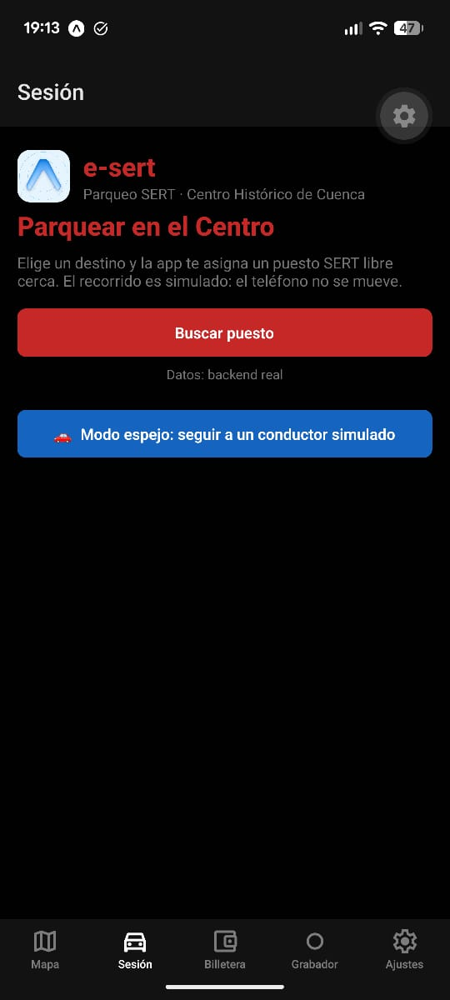
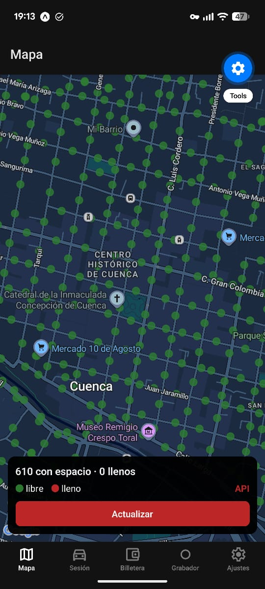
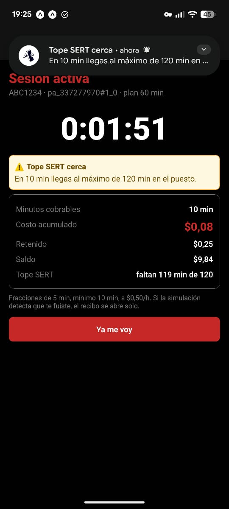
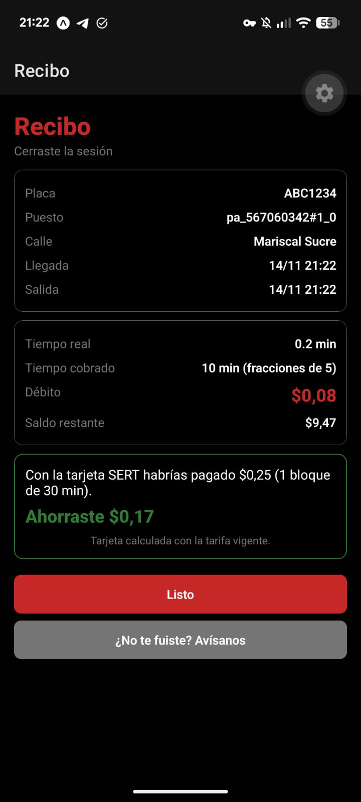
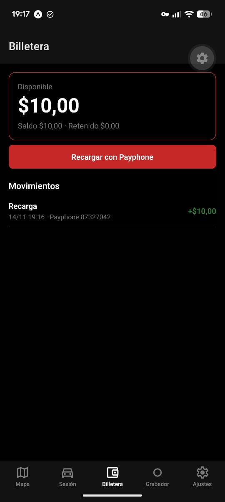
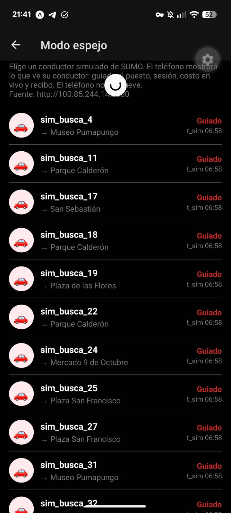
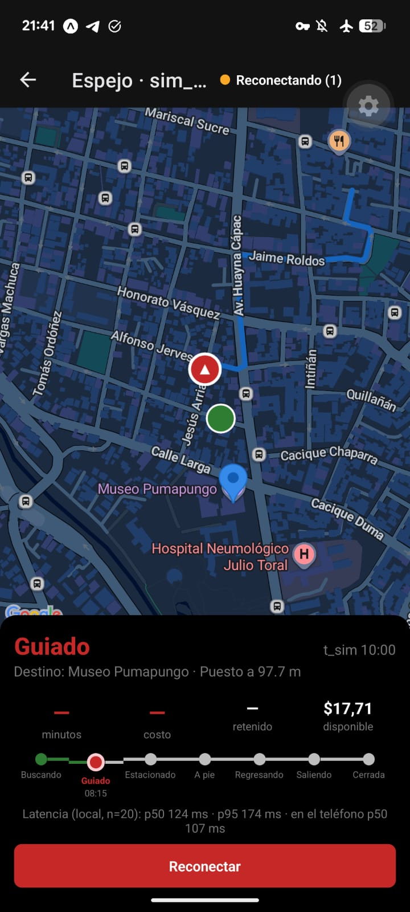
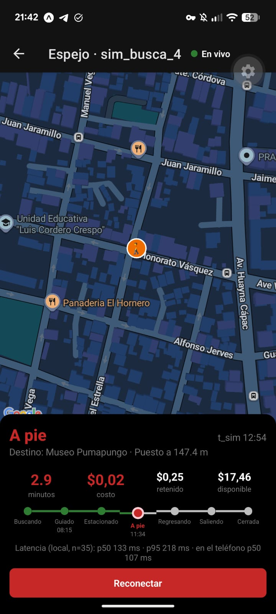

# Manual de usuario de e-sert

e-sert es una app para **parquear en la zona SERT del Centro Histórico de Cuenca pagando solo el
tiempo real**, en lugar de comprar tarjetas SERT de 30 minutos. Todo lo que pasa en la calle es
**simulado** con SUMO: el teléfono no se mueve y nadie maneja durante la demo.

## 1. Qué hace la app

- Te muestra los puestos SERT libres en un mapa.
- Te asigna un puesto libre cerca de tu destino y te guía hasta él.
- Cuando llegas, abre una **sesión de parqueo** y cobra de tu billetera **en tiempo real**.
- Te avisa cuando te queda poco saldo o cuando te acercas al **máximo de 2 horas** de la regla SERT.
- Cuando la simulación detecta que te fuiste, cierra la sesión y te muestra el **recibo**, con lo
  que habrías pagado con la tarjeta SERT.
- El **modo espejo** te deja ver en el teléfono lo que ve un conductor simulado de SUMO.

## 2. Instalar y abrir

1. Instala **Expo Go** desde Google Play o la App Store. Tiene que ser la versión para el SDK 58.
2. En la computadora del grupo se ejecuta `npx expo start` (o `demo.py`).
   - Aparece un **código QR**.
3. Escanea el QR:
   - en Android, con Expo Go;
   - en iPhone, con la cámara.
4. La app abre en la pestaña **Sesión**.

No hace falta crear una cuenta: el teléfono recibe un usuario de prueba la primera vez.

## 3. Las pantallas

### Inicio (Sesión)

Desde aquí empieza todo:

- **Buscar puesto:** eliges un destino y la app busca un puesto libre cerca. Puedes escribirlo
  con tus palabras, por ejemplo "voy al Parque Calderón".
- **Modo espejo:** sigue a un conductor simulado (sección 5).

Si tu saldo es negativo, "Buscar puesto" se desactiva y la app te pide recargar.

### Mapa

Puestos SERT en verde (libres) o rojo (llenos), con el resumen abajo. **Actualizar** los vuelve a
pedir al servidor.

### Sesión activa y avisos

Después de confirmar tu placa y el puesto:

- ves el cronómetro, los minutos que se cobran, el costo acumulado y tu saldo;
- llegan **avisos** en dos casos:
  - cuando el saldo alcanza para menos de 10 min;
  - cuando faltan 10 min para el máximo de 120 min de la regla SERT.

Si te vas antes de que la simulación lo detecte, toca **Ya me voy**.

### Recibo

Al cerrar, el recibo muestra:

- el tiempo real;
- el tiempo cobrado (en fracciones de 5 min, con un mínimo de 10 min);
- el débito y el saldo que te queda;
- **cuánto habrías pagado con la tarjeta SERT** y cuánto ahorraste.

### Billetera

Saldo, dinero retenido y movimientos. **Recargar con Payphone** abre el pago:

- la recarga mínima es $5,00;
- en la demo, Payphone está en **modo de pruebas**: no se cobra dinero real.

### Modo espejo

| Elegir un auto | Guiado | A pie |
|---|---|---|
|  |  |  |

Ver la sección 5.

## 4. Cobro en tiempo real frente a la tarjeta SERT

| | Tarjeta SERT | e-sert |
|---|---|---|
| Unidad de cobro | bloques de 30 min ($0,25 cada uno) | fracciones de 5 min ($0,50/h) |
| Mínimo | 30 min | 10 min |
| Si te vas antes | pierdes lo que sobra del bloque | pagas solo lo usado |
| Máximo en un puesto | 2 horas | 2 horas, con aviso 10 min antes |

Ejemplo de la demo:

- 65,8 min con e-sert = 70 min cobrados = **$0,58**;
- con tarjetas SERT = 3 bloques = **$0,75**.

Al llegar, la app **retiene** $0,25 (un bloque de 30 min) para asegurar el pago. Al salir, cobra
lo real y libera la retención.

## 5. Modo espejo

1. Sesión → **Modo espejo**.
   - Aparecen los autos simulados que usan la app, con su destino y su estado.
   - Desliza hacia abajo para actualizar la lista.
2. Toca uno. El teléfono muestra lo que vería su conductor:
   - el mapa con su posición y la ruta al puesto;
   - el estado: Buscando → Guiado → Estacionado → A pie → Regresando → Saliendo → Cerrada;
   - el costo en vivo y su billetera.
3. Cuando la simulación cierra su sesión, se abre el **recibo** solo.

Arriba a la derecha está el estado de la conexión:

- **En vivo:** llegan datos.
- **Reconectando:** se cortó la red; la app vuelve a intentarlo sola.
- **Finalizado:** el auto salió de la simulación o terminó la corrida.

## 6. Preguntas frecuentes

**¿Tengo que mover el teléfono?**
No. Los recorridos los hace SUMO; el teléfono solo muestra.

**¿Se cobra dinero de verdad?**
No. Payphone está en modo de pruebas y la billetera es simulada.

**Dice "No hay conexión con el servidor".**
Revisa el Wi-Fi o los datos y toca **Revisar conexión**. Te lleva a los Ajustes de demo
(sección 7).

**Dice "Ese puesto no existe".**
El código del puesto está mal escrito o ese puesto no está en la red. Toca **Buscar otro puesto**.

**"Buscar puesto" está desactivado.**
Tu saldo es negativo. Toca **Recargar** y recarga al menos $5,00.

**El Grabador dice "Sin permiso de ubicación".**
Da el permiso de ubicación a Expo Go en los ajustes del teléfono y vuelve a intentarlo. El
Grabador es el único que usa la ubicación.

**En el modo espejo no hay autos.**
La simulación no está corriendo o ya terminaron todos los recorridos. Pide que la vuelvan a lanzar
y desliza para actualizar.

## 7. Modo demo (para quien presenta)

Mantén pulsado el **logo de e-sert** durante 3 segundos, en la pestaña Sesión o en Ajustes. Se
abre **Ajustes de demo**:

- **VPS:** usa `https://demo.e-sert.tesisucuenca.com`.
- **Local:** escribe la IP que imprime `demo.py --local` (por ejemplo `192.168.1.20`) y toca
  **Usar local**. La app usa el puerto 8000.
- **Otra URL:** para cualquier otro backend.
- **Probar conexión:** muestra si responden `/salud`, la lista de candidatos del espejo y el
  WebSocket, con la latencia en ms.

El cambio se guarda en el teléfono y se aplica al instante, sin reinstalar la app.
