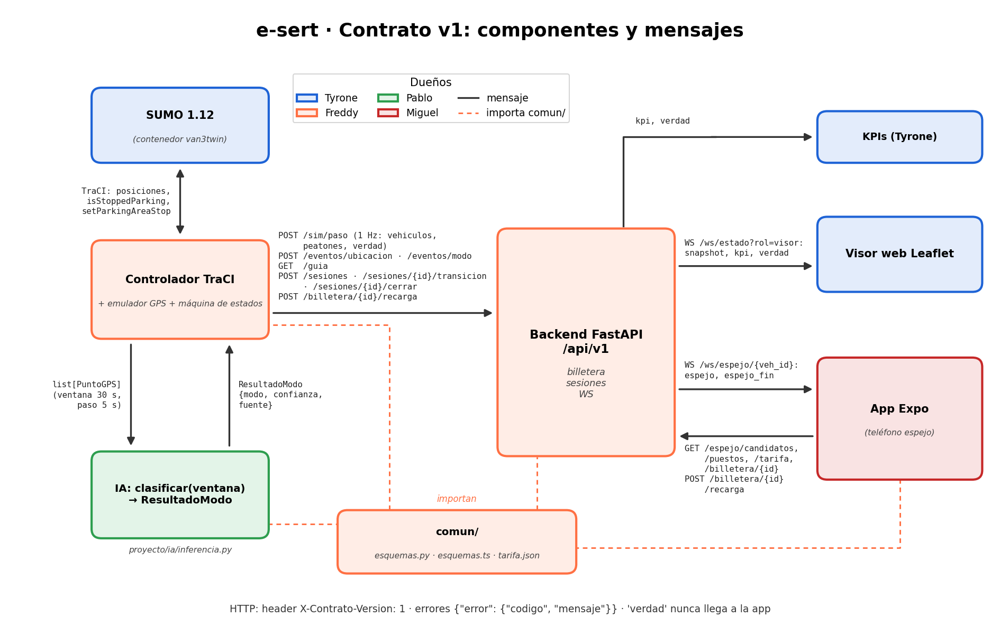
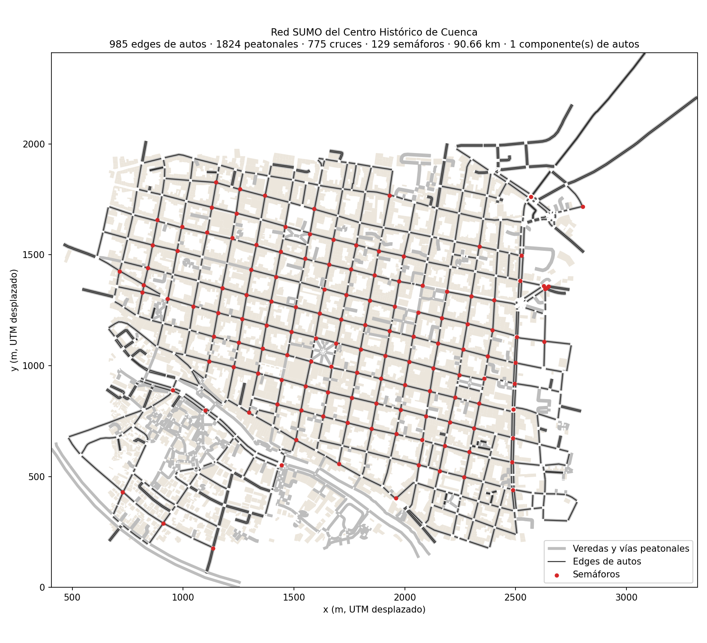
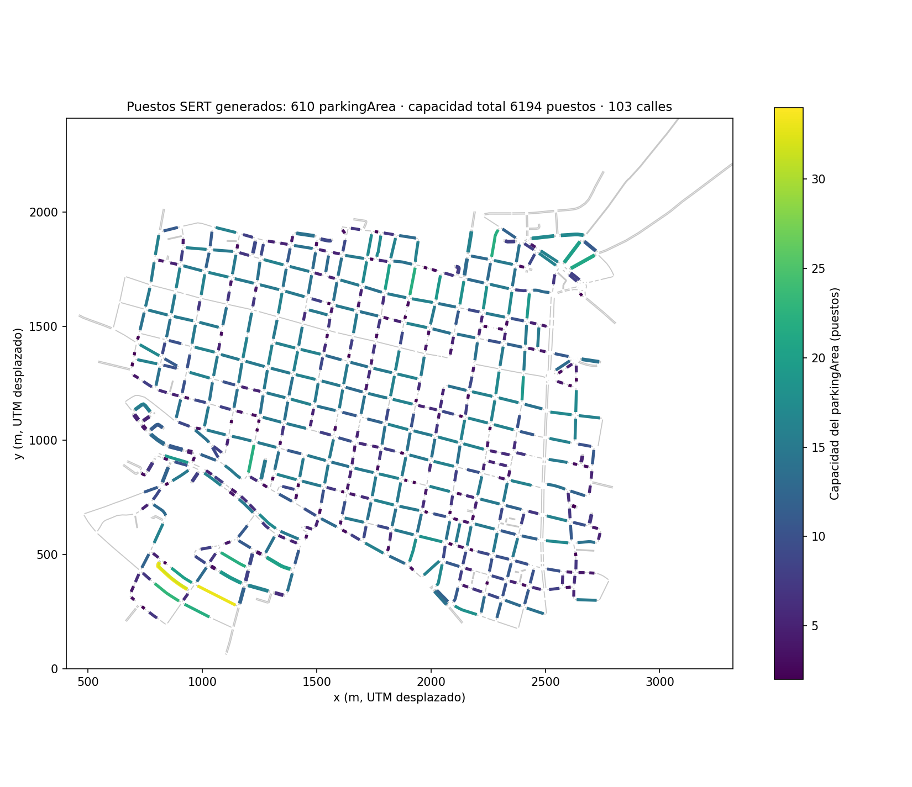
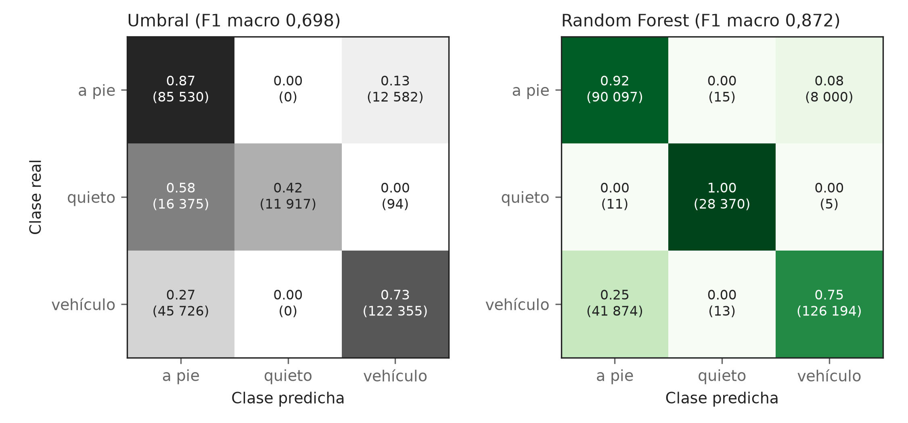
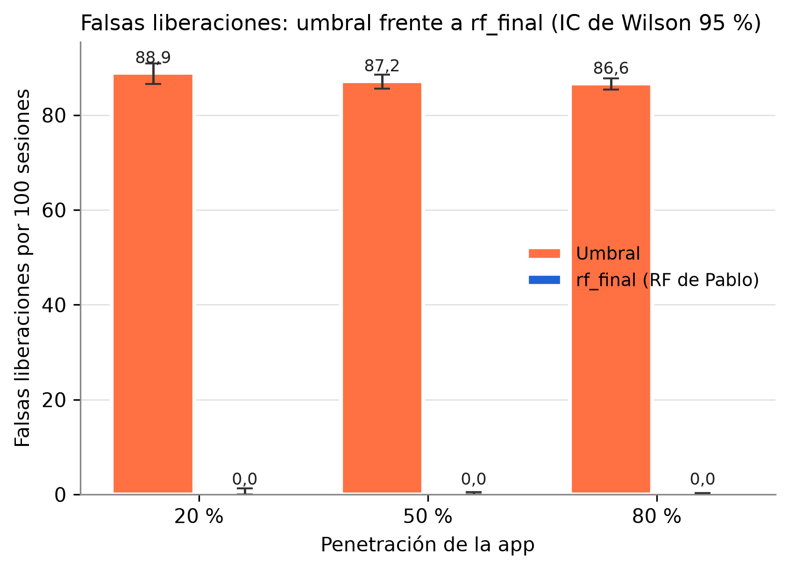
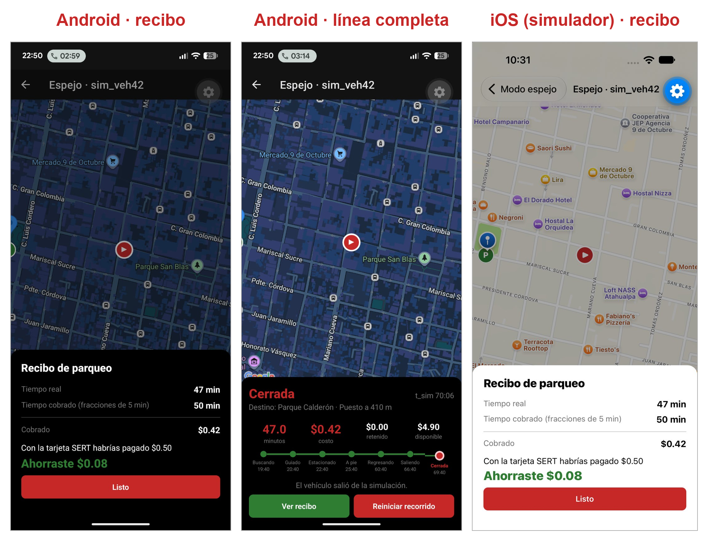
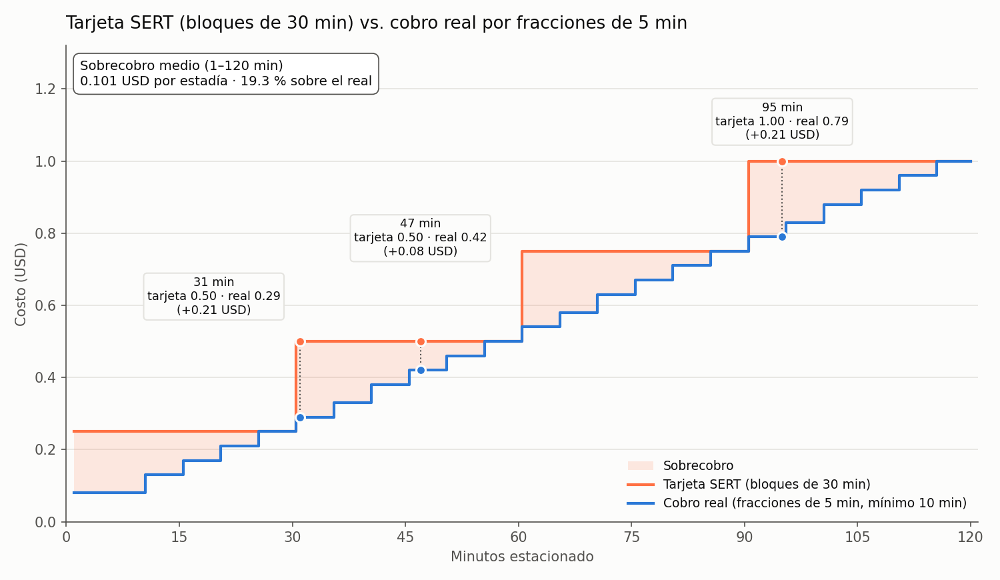
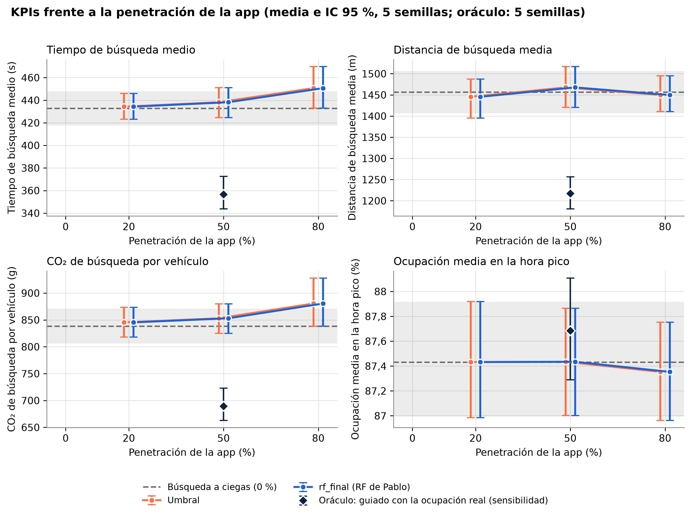

<!-- _class: titulo -->
<!-- _paginate: false -->

# e-sert: parqueo inteligente en la zona SERT de Cuenca

Simulación con SUMO + TraCI, clasificador de movimiento y app con cobro por tiempo real

Tyrone · escenario, experimentos, visorFreddy · TraCI y backendPablo · IAMiguel · app

---

## El problema: dar vueltas buscando parqueo

Tyrone

- En el Centro Histórico de Cuenca el parqueo en la vía es **tarifado (SERT)** y escaso en hora pico.
- Quien busca no sabe qué puestos están libres: **circula a ciegas**, gasta tiempo y combustible y congestiona a los demás.
- La tarjeta SERT se paga **por bloques** de tiempo, se use o no el bloque completo.

**Pregunta:** si una parte de los conductores usa una app que sabe qué puestos se liberan, ¿cuánto baja la búsqueda para todos?

---

## Objetivo y alcance

Tyrone

- **Mapa de ocupación en vivo** a partir del movimiento del teléfono: un clasificador detecta cuándo el conductor se baja (parquea) y cuándo vuelve a conducir (libera).
- **Guiado** de los usuarios de la app al puesto libre más cercano y **cobro por el tiempo real**.
- Medir el efecto con **penetración de la app** de 0, 20, 50 y 80 %.

<strong>Todo es simulado:</strong> tráfico, conductores y GPS salen de SUMO; el teléfono solo <em>refleja</em> un auto simulado (modo espejo). No hay pruebas de campo.

---

## Arquitectura

Freddy

SUMO + controlador TraCI (contenedor) → backend FastAPI (sesiones, billetera, WebSocket) → visor web y app. Contrato v1.2.

---

## Escenario SUMO: Centro Histórico

Tyrone

Red de OpenStreetMap, puestos SERT como <code>parkingArea</code>, demanda de hora pico calibrada a 85–95 % de ocupación; 75 min simulados (15 de <em>warm-up</em>) × 5 semillas.

---

## Línea base: búsqueda a ciegas (0 %)

Tyrone

433 s

tiempo medio de búsqueda

IC 95 % [418; 448] s

1 456 m

recorridos buscando

IC 95 % [1 407; 1 506] m

838 g

CO₂ de búsqueda por vehículo

IC 95 % [806; 871] g

4 646 vehículos que estacionan, 5 semillas; ocupación media 87,4 %. IC <em>bootstrap</em> jerárquico (semillas → vehículos, 10 000 remuestreos).

---

## IA: ¿el conductor se bajó o sigue manejando?

Pablo

Ventanas de GPS ruidoso → velocidad, aceleración, giros. Umbral de velocidad frente a <em>random forest</em> (<code>rf_final</code>, congelado). Una <strong>falsa liberación</strong> marca libre un puesto que sigue ocupado.

---

## IA en la simulación: falsas liberaciones

Pablo

Corrida final, 5 semillas. Al 50 %: umbral 87,2 y <code>rf_final</code> 0,0 falsas liberaciones por 100 sesiones: el umbral confunde caminar despacio con volver a conducir.

---

## App en modo espejo

Miguel

- El teléfono **sigue a un auto simulado** (`/ws/espejo`): ve su búsqueda, el puesto asignado y la sesión.
- Al volver al auto, la sesión se **cierra sola** y llega el **recibo** a la billetera.
- Recarga con Payphone en modo de pruebas.

---

## Cobro por tiempo real frente a tarjeta SERT

Freddy

La tarjeta cobra por bloques; e-sert cobra los minutos usados. Error de facturación medio al 50 % con <code>rf_final</code>: 0,018 USD por sesión.

---

## Resultados al 50 % de penetración (`rf_final`)

Tyrone

+1,3 %

tiempo de búsqueda vs a ciegas

438 s, IC 95 % [425; 451] s a ciegas: 433 s

+1,7 %

CO₂ de búsqueda por vehículo

853 g, IC 95 % [825; 880] g a ciegas: 838 g

0,0

falsas liberaciones por 100 sesiones

IC Wilson [0,0; 0,5] umbral: 87,2 [85,6; 88,6]

Fuente: <code>kpis/resultados/final/resumen.csv</code> (5 semillas por escenario). Umbral y <code>rf_final</code> dan la misma búsqueda: el guiado usa el mapa del sistema, que solo ve a los usuarios con app.

---

## Resultados frente a la penetración

Tyrone

Medias con IC 95 %: azul <code>rf_final</code>, tomate umbral, gris discontinuo la búsqueda a ciegas. El rombo oscuro es el <strong>oráculo</strong> al 50 % (guiado con la ocupación real): búsqueda −17,6 % frente a ciegas.

---

## Demo en vivo

Miguel 

- **sumo-gui:** el Centro Histórico con autos buscando parqueo.
- **Visor** (`demo.e-sert.tesisucuenca.com/visor`): puestos libres u ocupados, KPIs en vivo y el auto espejo resaltado.
- **Teléfono de Miguel** en modo espejo: búsqueda → puesto asignado → sesión → recibo.

Un comando: <code>python demo/demo.py</code> (backend, controlador con sumo-gui y visor). Plan B: sin GUI → grabación → video.

---

## Limitaciones

Tyrone

- **Todo es simulado:** sin pruebas de campo ni GPS real; el ruido GPS es un modelo AR(1).
- La IA se entrenó con GeoLife (Pekín), no con trazas de Cuenca.
- Una sola franja (hora pico) y una red recortada al Centro Histórico.
- 5 semillas por escenario: los IC entre semillas son anchos.
- El cobro y la billetera usan Payphone en modo de pruebas.

---

## Conclusiones

Tyrone

- **El clasificador funciona:** `rf_final` deja 0,0 falsas liberaciones por 100 sesiones al 50 % (umbral: 87,2), y el cobro por tiempo real queda correcto.
- **La búsqueda no baja con el mapa del sistema** (+1,3 % al 50 %): la app solo conoce a sus usuarios y la zona está al 87,4 % de ocupación.
- **Con ocupación real (oráculo) sí baja:** −17,6 % al 50 %. Falta una fuente de ocupación independiente de los usuarios (trabajo futuro).
- El sistema completo corre de punta a punta: SUMO → TraCI → backend → visor y app.

**Gracias. ¿Preguntas?**
