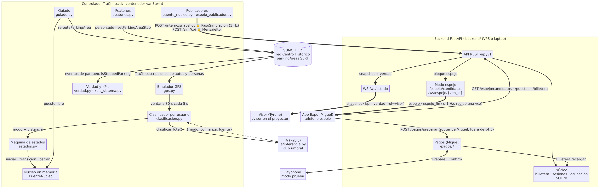
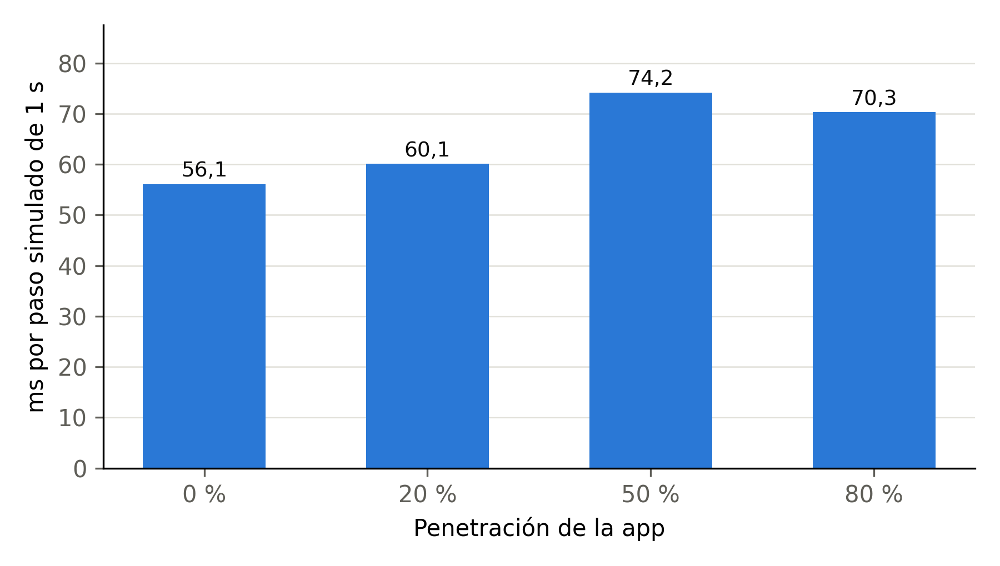
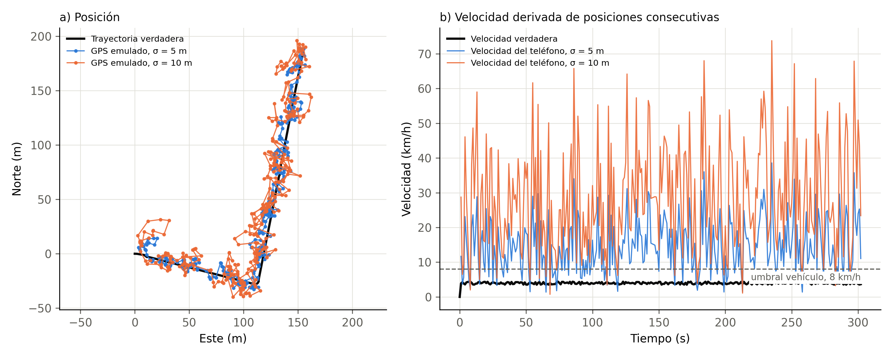
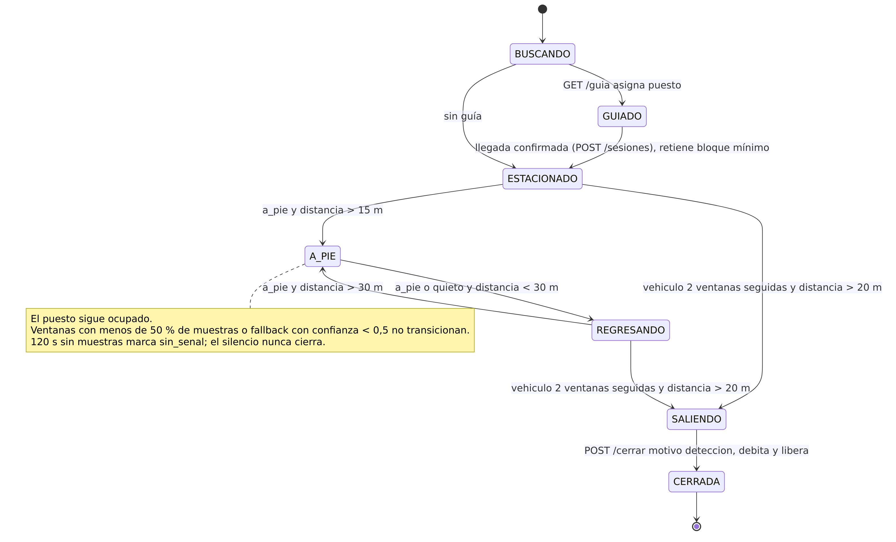

## Arquitectura, controlador TraCI y backend

Esta sección describe el controlador que conecta SUMO con el resto del sistema, el emulador GPS,
la máquina de estados que decide cuándo termina una sesión y el backend que cobra, y presenta los
indicadores medidos y las pruebas. El contrato está en `docs/CONTRATO.md` y la documentación
técnica, en `comun/docs/`.

### Arquitectura

*Componentes de e-sert y el mensaje del contrato que viaja por cada flecha.*

El sistema tiene tres bloques, y entre ellos solo viajan los mensajes del contrato:

- **Simulación.** SUMO [@lopez2018sumo] y el **controlador TraCI** [@wegener2008traci] corren
  juntos en el contenedor `van3twin`. El controlador hace dos papeles: es el mundo real y es el
  teléfono. Mueve autos y peatones, emula el GPS de cada conductor con la app, clasifica su modo
  de movimiento con la IA y decide las transiciones de cada sesión.
- **Backend** (FastAPI). Guarda billeteras, sesiones y mapa de ocupación, valida las
  transiciones, cobra y difunde el estado por WebSocket.
- **Clientes:** el visor del proyector, la app Expo como «teléfono espejo» de un conductor
  simulado y Payphone en modo de pruebas.

El **backend no deduce por su cuenta que un auto se fue**. Lo decide el controlador, que es
quien tiene las posiciones y el clasificador, y se lo informa con `POST /sesiones/{id}/cerrar`.
Las razones de cada decisión están en `comun/docs/decisiones.md`.

### Controlador TraCI

El controlador (`traci/controlador.py`) avanza SUMO en pasos de `1 s`. En cada paso ejecuta, en
este orden, unas funciones enganchadas al bucle (*hooks*): peatones, guiado, sesiones, registro,
verdad y KPIs y, si hay backend, el publicador de snapshots.

El estado se lee con **suscripciones** de TraCI, que entregan todas las variables de un objeto
en una sola respuesta por paso, y solo de los autos que buscan parqueo. SUMO 1.12 no permite
suscribirse a un `parkingArea`, así que la ocupación real se cuenta con los eventos de inicio y
fin de parqueo.

Cuando un auto estaciona, `traci/peatones.py` crea con `person.add` a su conductor. El conductor
camina hasta el destino del viaje, hace sus diligencias y vuelve, mientras `setParkingAreaStop`
mantiene el auto detenido. Hay dos variantes:

- una fracción `0,10` de los conductores se queda esperando dentro del auto;
- de los que salen, una fracción `0,15` hace una diligencia, vuelve al auto, espera `60 s` y sale
  a otra.

Estos peatones ponen a prueba al sistema: alejarse caminando **no** debe liberar el puesto.

El costo por paso se midió con los escenarios de Tyrone, con todo su tráfico de fondo, `1 800 s`
simulados, semilla `1`, TraCI por socket y todos los *hooks* y KPIs activos.

*Costo del controlador por paso simulado según la penetración de la app.* <!-- fuente: informe/datos/freddy/corridas.json -->

| Penetración | ms por paso | Tiempo de cómputo (s) | Sesiones iniciadas |
|---:|---:|---:|---:|
| 0 % | 56,1 | 101,0 | 0 |
| 20 % | 60,1 | 108,1 | 56 |
| 50 % | 74,2 | 133,5 | 172 |
| 80 % | 70,3 | 126,5 | 270 |

*Milisegundos por paso de 1 s simulado con 0, 20, 50 y 80 % de penetración.* <!-- fuente: informe/datos/freddy/corridas.json -->

Aun en el peor caso, 74,2 ms por paso, la simulación corre más de diez veces más rápido que el
tiempo real. Para la demo en vivo se frena con `--ritmo 1`. Sin ningún usuario de la app el paso
ya cuesta 56,1 ms, así que la mayor parte del costo es el tráfico mismo. <!-- fuente: informe/datos/freddy/corridas.json -->
Hay una sola corrida por penetración, así que no se puede separar el efecto de la app de la
variación entre corridas; en particular, no se interpreta la baja de 50 a 80 %.

### Emulador GPS

El teléfono de cada conductor con la app se emula en `traci/gps.py` a partir de la posición
verdadera que da SUMO: la del auto si va manejando y la del peatón si camina.

El error de un GPS urbano no salta al azar de un segundo al siguiente: se arrastra, porque
depende de qué satélites ve el receptor y de los reflejos en los edificios. Por eso se modela en
cada eje como un proceso autorregresivo de orden 1:

$$e_t = \rho\, e_{t-1} + \sqrt{1-\rho^2}\,\sigma\,\varepsilon_t, \qquad \varepsilon_t \sim \mathcal{N}(0,\,1),$$

donde $\sigma$ es la desviación estacionaria del error en metros y $\rho$ es la autocorrelación
entre muestras a `1 Hz`. El factor $\sqrt{1-\rho^2}$ mantiene la varianza en $\sigma^2$. Si falta
una muestra, el proceso avanza igual, con $\rho^k$ para un hueco de $k$ segundos.

La calibración de Pablo toma estos valores de la literatura:

- **Ruido $\sigma$:** de 3 m con cielo abierto [@zandbergen2009accuracy] a 15 m en un cañón
  urbano profundo [@groves2011shadow]. <!-- fuente: proyecto/ia/calibracion/ruido_literatura.json -->
  Para el Centro Histórico, los valores más representativos son 8 a 10 m
  [@zandbergen2011positional; @merry2019smartphone]. <!-- fuente: proyecto/ia/calibracion/ruido_literatura.json -->
- **Autocorrelación:** $\rho = 0{,}8$ [@zandbergen2011positional; @jun2006smoothing]. <!-- fuente: proyecto/ia/calibracion/ruido_literatura.json -->
- **Pérdida de muestras:** con probabilidad de 0,02 a 0,1 por segundo [@groves2011shadow]. <!-- fuente: proyecto/ia/calibracion/ruido_literatura.json -->

Las corridas de esta sección usan `sigma_m = 5` y `p_perdida = 0,02`, el extremo favorable del
rango. Por eso sus resultados son **optimistas** para el Centro Histórico; la sensibilidad al
ruido está en la sección de Pablo. La precisión que reporta el teléfono es
$\sigma \cdot U(0{,}8;\,1{,}5)$.

Igual que en un teléfono, la velocidad no viene de SUMO: se **deriva** de dos posiciones ruidosas
consecutivas.

*Peatón de SUMO: traza verdadera frente a la que emite el emulador con σ = 5 y 10 m (a) y velocidad derivada por el teléfono frente al umbral de 8 km/h (b).*

Esa decisión explica el principal resultado negativo de esta sección. En la figura, el peatón
camina a 3,95 km/h de media, pero con $\sigma = 5$ m el teléfono le calcula 14,74 km/h, y el
77 % de sus muestras de un segundo supera el umbral de vehículo de `8 km/h`. Con $\sigma = 10$ m
lo supera el 93,3 %. <!-- fuente: informe/datos/freddy/traza_gps.json -->
La regla de reserva del clasificador no usa muestras sueltas, sino la velocidad suavizada media
de la ventana de `30 s`. Aun así, en el escenario controlado descrito más abajo, con
$\sigma = 5$ m, 59 de las 70 ventanas en que el conductor caminaba (84,3 %) salieron `vehiculo`;
con $\sigma = 2$ m, ninguna. <!-- fuente: informe/datos/freddy/cierre_sigma.json -->

### Máquina de estados de la sesión

*Máquina de estados de la sesión con los umbrales del contrato.*

La sesión existe desde que el auto queda `ESTACIONADO`. Cada `5 s`, el clasificador recibe los
últimos `30 s` del GPS y devuelve un modo: `a_pie`, `quieto` o `vehiculo`. La distancia se mide
hasta el punto exacto donde se detuvo el auto, no al centro del `parkingArea`, que mide unos
`100 m`. Con el modo y la distancia, `traci/estados.py` aplica la primera regla de esta tabla
que se cumpla, en orden.

*Transiciones de la sesión y sus umbrales (contrato §3 y `traci/estados.py`).*

| Desde | Hacia | Condición |
|---|---|---|
| `ESTACIONADO` o `REGRESANDO` | `SALIENDO` | modo `vehiculo` en `2` ventanas seguidas y distancia > `20 m` |
| `ESTACIONADO` | `A_PIE` | modo `a_pie` y distancia > `15 m` |
| `A_PIE` | `REGRESANDO` | modo `a_pie` o `quieto` y distancia < `30 m` |
| `REGRESANDO` | `A_PIE` | modo `a_pie` y distancia > `30 m` |
| `SALIENDO` | `CERRADA` | en el mismo paso: `POST /cerrar` con motivo `deteccion` |

En `A_PIE`, **el puesto sigue ocupado**. Alejarse del auto no significa que el auto se fue: el
conductor puede estar haciendo diligencias a dos cuadras.

Solo un movimiento sostenido en vehículo desde `ESTACIONADO` o desde `REGRESANDO`, nunca desde
`A_PIE`, indica una salida. Así, un bus o un taxi tomado lejos del puesto no cierra la sesión.

Una ventana con menos del `50 %` de las muestras esperadas, o con la regla de reserva y
confianza < `0,5`, no produce transiciones. En las corridas de esta sección esa protección no
retuvo ninguna ventana, porque la regla de reserva informa como confianza la cobertura de la
ventana. <!-- fuente: informe/datos/freddy/corridas.json -->

Tras `120 s` sin muestras, la sesión se marca `sin_senal`. El silencio no la cierra: solo se
cierra al llegar al tiempo máximo de `120 min`, con motivo `timeout_sin_senal`.

### Guiado

`traci/guiado.py` recomienda **el puesto con plazas libres ahora más cercano al destino**, según
el mapa del sistema y no una ocupación predicha, y desvía el auto con `rerouteParkingArea`. Si el
puesto se llena en el camino (se revisa cada `10 s`), reasigna otro con ruta (`findRoute`), hasta
`3` veces; después el conductor busca a ciegas. `GET /guia` del backend usa el mismo criterio.

### Backend: núcleo y billetera

El controlador importa como biblioteca el mismo **núcleo** del backend (`backend/nucleo/`, Python
puro), sin HTTP: los experimentos no dependen de la red y las reglas de cobro son un solo código.

La billetera es un **libro de movimientos** (`recarga`, `retencion`, `debito` y `liberacion`), en
centavos enteros. Los saldos no se guardan, se derivan:

$$\text{saldo} = \sum \text{recargas} - \sum \text{débitos}, \quad \text{retenido} = \sum \text{retenciones} - \sum \text{liberaciones}, \quad \text{disponible} = \text{saldo} - \text{retenido}.$$

Al estacionar se **retiene** el bloque mínimo de `30 min`. Al cerrar se **debita** el tiempo
real, redondeado hacia arriba a fracciones de `5 min` y con un mínimo de `10 min`, y se libera la
retención. La tarifa es de `0,50 USD` por hora (`comun/tarifa.json`).

*Ejemplo de cobro de una estadía de 47 min con una recarga de 5 USD.* <!-- fuente: informe/datos/freddy/cobro_47min.json -->

| Concepto | Valor |
|---|---:|
| Retención al estacionar (USD) | 0,25 |
| Disponible durante la sesión (USD) | 4,75 |
| Minutos cobrados (10 fracciones de 5 min) | 50 |
| Débito al salir (USD) | 0,42 |
| Saldo final (USD) | 4,58 |
| Tarjeta SERT de papel, 2 bloques de 30 min (USD) | 0,50 |
| Ahorro frente a la tarjeta (USD) | 0,08 |

Con la tarjeta de papel se paga la media hora completa aunque se use una parte; la app cobra el
tiempo usado en fracciones de 5 min.

### Indicadores del sistema

Los indicadores comparan lo que cree el sistema con la verdad de SUMO (`traci/kpis_sistema.py`).

Sea $S$ el conjunto de sesiones cerradas de autos con la app. Para cada sesión $s$, $t^{c}_s$ es
la hora de cierre y $t^{\mathrm{lleg}}_s$ y $t^{\mathrm{sal}}_s$ son la llegada y la salida reales.

- **Falsas liberaciones por 100 sesiones:** sesiones cerradas mientras el auto seguía estacionado,
  $F_{100} = 100 \cdot |\{s \in S : \texttt{isStoppedParking}(s, t^{c}_s)\}| \,/\, |S|$.
- **Retardo de cierre:** $t^{c}_s - t^{\mathrm{sal}}_s$, solo en cierres correctos (mediana).
- **Error de facturación:** $\text{debitado}_s - \text{costo}\big((t^{\mathrm{sal}}_s - t^{\mathrm{lleg}}_s)/60\big)$,
  en las sesiones con estadía real conocida (media).
- **Precisión del mapa:** cada `60 s`, la fracción de puestos cuyo estado libre o lleno coincide
  con la realidad. Se calcula contra la ocupación total y contra la de los usuarios de la app.
  Su complemento son los **libres fantasma**: puestos libres en el mapa pero llenos en la realidad.

Los valores vienen de las corridas de esta sección (escenarios de Tyrone, `1 800 s`, semilla `1`),
con el clasificador disponible al medir.

*Indicadores del sistema por penetración de la app.* <!-- fuente: informe/datos/freddy/corridas.json -->

| Indicador | 0 % | 20 % | 50 % | 80 % |
|---|---:|---:|---:|---:|
| Sesiones cerradas | 0 | 35 | 120 | 172 |
| Falsas liberaciones por 100 sesiones | — | 100 | 99,17 | 99,42 |
| Cierres correctos | 0 | 0 | 1 | 1 |
| Retardo de cierre (s) | — | — | 12 | 15 |
| Sesiones con estadía real conocida | 0 | 1 | 5 | 6 |
| Error de facturación medio (USD) | — | −0,050 | −0,072 | −0,062 |
| Precisión del mapa, ocupación total | 0,745 | 0,743 | 0,746 | 0,745 |
| Precisión del mapa, usuarios de la app | 1,0 | 1,0 | 1,0 | 0,9998 |
| Libres fantasma por muestra (de 610 puestos) | 155,3 | 156,7 | 154,7 | 155,3 |

Estos valores **no describen el sistema terminado**. El modelo Random Forest de Pablo
(`ia/modelos/rf_v1.joblib`) no estaba en el repositorio, así que todas las ventanas se
clasificaron con la regla de reserva por velocidad, y casi toda sesión se cerró mientras el auto
seguía estacionado.

Con 0 o 1 cierres correctos por corrida, el retardo es el de una sola sesión, y el error de
facturación se promedia sobre 1 a 6 sesiones: son ilustrativos, no estadísticos.

La **precisión contra la ocupación total** ya vale 0,745 sin ningún usuario de la app, y no
cambia con la penetración. Sus errores son libres fantasma, cerca del 25,5 % de los puestos:
lugares ocupados por autos sin la app, que el mapa no puede ver. <!-- fuente: informe/datos/freddy/corridas.json -->
Contra los usuarios de la app es casi perfecta, pero tampoco refleja las falsas liberaciones: un
puesto solo cuenta como lleno cuando todas sus plazas están ocupadas.

Para separar la máquina de estados del clasificador se usó un escenario controlado
(`traci/tests/e2e/escenario_cierre.py`): cinco autos con estadías de 4 a 8 min cuyos conductores
hacen diligencias y vuelven, con la misma regla de reserva.

- Con $\sigma = 5$ m se cerraron 4 de 5 sesiones en falso. <!-- fuente: informe/datos/freddy/cierre_sigma.json -->
- Con $\sigma = 2$ m, cuando la velocidad derivada ya no engaña a la regla, hubo 0 falsas
  liberaciones en 5 sesiones, con retardos de cierre de 12 a 13 s (mediana de 12 s). <!-- fuente: informe/datos/freddy/cierre_sigma.json -->

La máquina de estados cierra bien y rápido cuando el modo que recibe es correcto. El cuello de
botella es la clasificación del modo bajo ruido urbano. Si el Random Forest lo resuelve se evalúa
en la sección de inteligencia artificial.

### Pruebas

Además de las pruebas unitarias, una suite **de punta a punta** (`pytest -m e2e`) levanta el
backend real y prueba el recorrido de la app por HTTP, el WebSocket, los cuatro errores del
contrato y una corrida de SUMO contra el backend vivo (libro de cada billetera, mapa, modo espejo
y falsas liberaciones).

*Pruebas automáticas y cobertura del núcleo.* <!-- fuente: informe/datos/freddy/pruebas.json -->

| Conjunto | Pasan | Fallan | Omitidos | Duración (s) |
|---|---:|---:|---:|---:|
| Unitarias del backend | 118 | 0 | 1 | 37,3 |
| Unitarias del controlador | 72 | 0 | 12 | 8,5 |
| Unitarias del contrato (`comun`) | 169 | 0 | 0 | 0,6 |
| Punta a punta, con SUMO | 30 | 2 | 0 | 216,3 |

La cobertura de líneas de `backend/nucleo/` es del 99 % (4 de 547 líneas sin cubrir).
<!-- fuente: informe/datos/freddy/pruebas.json:cobertura_nucleo -->
Las omitidas necesitan SUMO (`pytest -m sumo`). Las 2 de punta a punta que fallan exigen cero
falsas liberaciones: fallan por la causa descrita arriba y se dejaron estrictas a propósito.

### Limitaciones

- **Clasificador de reserva y ruido favorable.** Los indicadores se midieron sin el Random Forest
  y con $\sigma = 5$ m. Hay que repetirlos con el modelo, con $\sigma$ de 8 a 10 m y con la corrida
  final de Tyrone, que no estaba publicada al cerrar esta sección.
- **Una sola semilla y una corrida por penetración.**
- **Peatones simplificados:** no entran a edificios, donde el GPS se pierde; las ráfagas sin señal
  de `traci/gps.py` no estuvieron activas.
- **El mapa solo ve a los usuarios de la app.** Aun con un clasificador perfecto, la precisión
  contra la ocupación total tiene un techo que depende de la penetración.
- **Simulación, no campo.** No se probó con un GPS real en el Centro Histórico.
- **Un solo backend con SQLite:** basta para la demo, no para una ciudad.
