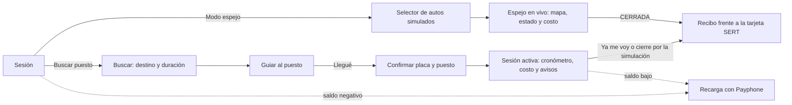
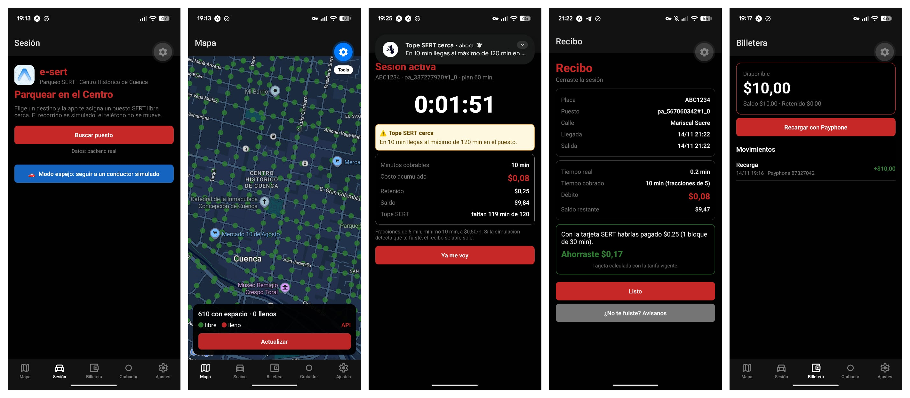
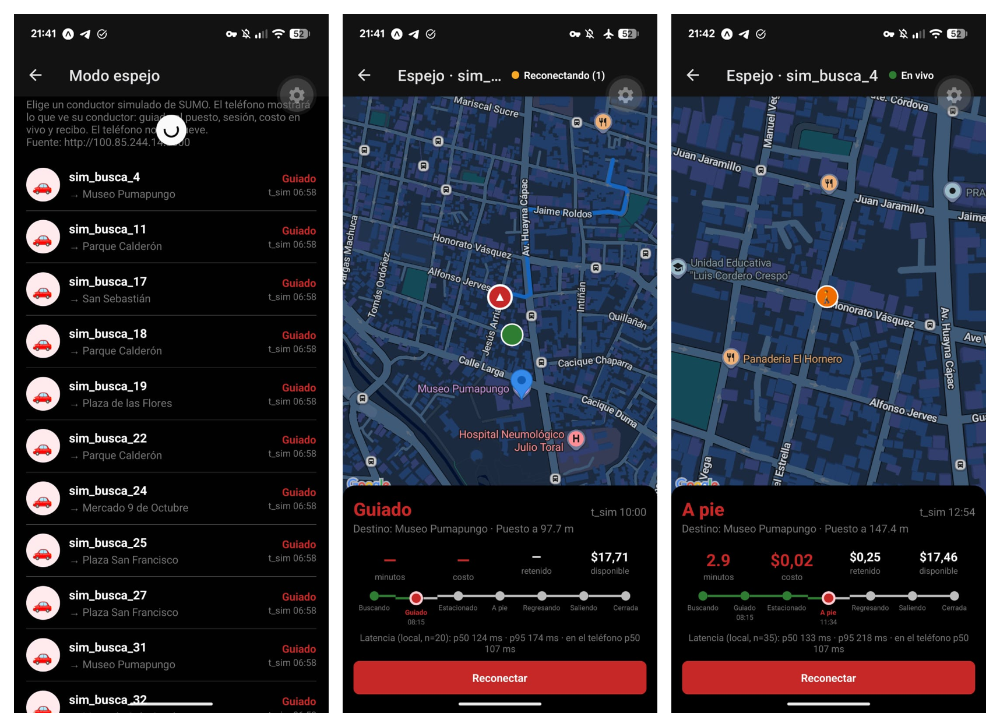
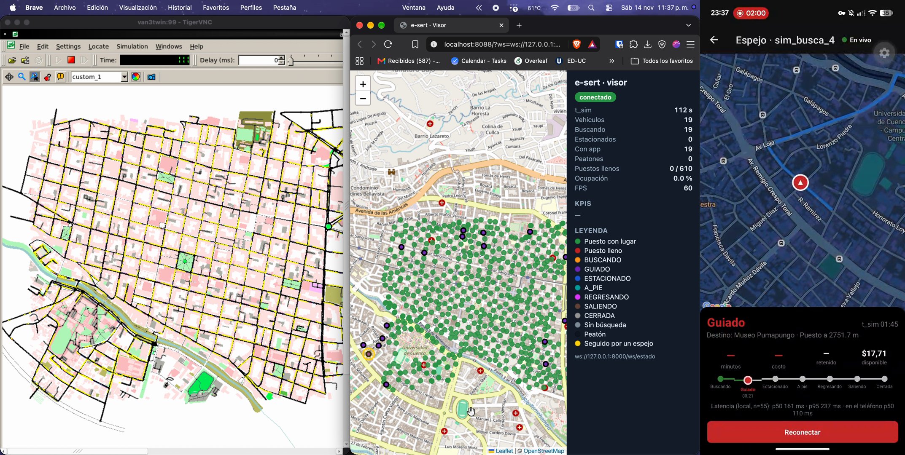
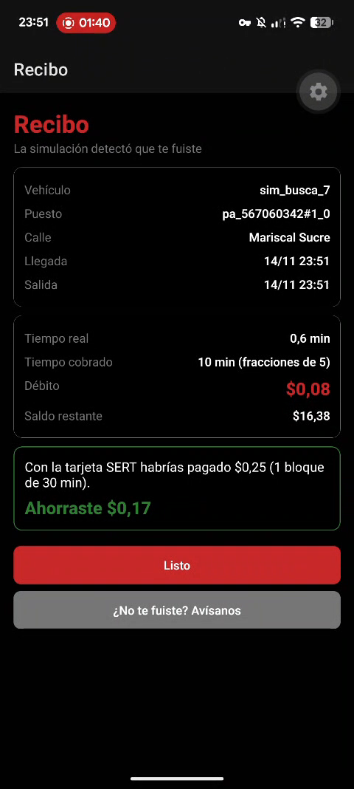

## La app móvil y el teléfono espejo

La app de e-sert es la parte del sistema que ve el conductor. Busca un puesto SERT libre cerca del
destino, guía hasta él, abre una sesión que cobra el tiempo real y, cuando la simulación detecta
que el auto se fue, cierra la sesión y muestra el recibo junto a lo que habría costado con la
tarjeta SERT. Está hecha con Expo (SDK `58`) y React Native, y se prueba en Expo Go en Android e
iOS. Todo el comportamiento de la calle es **simulado** en SUMO: en ninguna prueba se manejó un
auto ni se usó el GPS del teléfono para mover la sesión.

### Diseño de la app

La app tiene cinco pestañas (Mapa, Sesión, Billetera, Grabador y Ajustes) y dos flujos:

- el de la **sesión propia**, en el que el usuario del teléfono busca, confirma su puesto y paga;
- el del **modo espejo**, en el que el teléfono muestra lo que vive un conductor simulado.

*Flujo de pantallas de la app: sesión propia (arriba) y modo espejo (abajo).*

*Pantallas principales en Android: inicio, mapa de puestos, sesión activa con el aviso de tope SERT, recibo y billetera.*

Cada error del servidor llega con un código del contrato, por ejemplo `PUESTO_NO_EXISTE` o
`SALDO_INSUFICIENTE`. La app lo convierte en un mensaje en español con un botón de acción: Recargar,
Buscar otro puesto, Reintentar, Revisar conexión o Volver al inicio. Nada técnico llega a la
pantalla. Lo desconocido se muestra con un mensaje genérico y el detalle va solo al registro.

Una pantalla oculta, **Ajustes de demo**, se abre manteniendo pulsado el logo durante `3 s`. Permite
cambiar entre el backend del VPS y el de una laptop local sin reinstalar la app, y mide la latencia
de `/salud`, de la lista de candidatos y del WebSocket del espejo. En la prueba, `/salud` respondió
en 197 ms y los candidatos en 26 ms. <!-- fuente: semanas/S4/Miguel/evidencias/capturas/s4_demo.jpeg -->

### Modo espejo

Mostrar la demo con el GPS de un teléfono real obligaría a manejar por el Centro Histórico durante
la exposición, y el alcance acordado lo descarta. Por eso el teléfono **sigue a un conductor
simulado**: SUMO mueve el auto, el controlador TraCI publica su estado en el backend y el teléfono
lo dibuja. El teléfono queda quieto en la mano y muestra exactamente lo que vería el conductor de
ese auto.

- **Elegir el auto:** `GET /api/v1/espejo/candidatos` devuelve los autos con app que están en la
  simulación, con su destino y su estado.
- **Seguirlo:** `WS /ws/espejo/{veh_id}` envía un mensaje `espejo` por segundo con la posición, la
  ruta, el puesto asignado, el estado de la sesión, el costo en curso, la billetera y los avisos.
  Cuando el auto sale de la simulación, o termina la corrida, llega `espejo_fin` y la pantalla
  marca "Finalizado".
- **Reconexión exponencial:** si pasan `5 s` sin mensajes, la app da la conexión por perdida.
  Reintenta con esperas de `1 s`, `2 s`, `4 s`… hasta un tope de `30 s`, con un poco de azar. El
  indicador muestra "Reconectando (n)" y vuelve a "En vivo" sin que haya que salir de la pantalla.
- **Notificaciones locales:** los avisos de saldo bajo y de tope SERT se programan en el teléfono
  al iniciar la sesión, con `expo-notifications`. Así suenan aunque la app esté en segundo plano.

*Modo espejo: selector de candidatos, auto en Guiado con su ruta y conductor A pie con el costo en vivo.*

**Segundo plano en iOS.** Expo Go no mantiene abierto un WebSocket ni graba la ubicación con la app
en segundo plano en iPhone. Para la demo se resolvió de dos maneras:

- el espejo vuelve a conectarse solo cuando la app regresa al primer plano (`AppState`);
- los avisos importantes se programan como notificaciones locales, que el sistema entrega aunque
  la app esté dormida.

En Android se comprobó que, tras `30 s` en segundo plano, el espejo se recupera solo. <!-- fuente: semanas/S4/Miguel/codigo/app/CHECKLIST_QA.md -->

### Sesión y cierre automático

La sesión sigue la máquina de estados del contrato:

`BUSCANDO → GUIADO → ESTACIONADO → A_PIE → REGRESANDO → SALIENDO → CERRADA`

Durante A_PIE **el puesto sigue ocupado**: que el conductor camine no libera la plaza. En el modo
espejo, el teléfono no decide nada: cada mensaje trae el estado que fijó el controlador TraCI, y la
app lo marca en una línea de tiempo con la hora de cada cambio.

El cierre lo dispara la simulación. Cuando el controlador detecta que el auto vuelve a moverse como
vehículo y se aleja del puesto, llama a `POST /sesiones/{id}/cerrar` con motivo `deteccion`. El
backend debita el tiempo real y libera la retención. El espejo recibe el estado CERRADA con el
recibo, y la app abre la pantalla del recibo sola, una sola vez y sin botón de "atrás".

En la sesión propia, el usuario también puede cerrar con **Ya me voy** (motivo `manual`).

### Billetera y Payphone en modo de prueba

**Cobro:**
- Al confirmar el puesto, el backend **retiene** el bloque mínimo de `30 min` ($0,25).
- Al cerrar, cobra el tiempo real en fracciones de `5 min`, con un mínimo de `10 min`, a `$0,50/h`,
  y libera la retención. <!-- fuente: semanas/S4/Miguel/codigo/app/src/contrato/tarifa.json -->
- Si el débito deja el saldo negativo, la billetera queda bloqueada. "Buscar puesto" se desactiva
  y muestra la deuda hasta que el usuario recarga al menos `$5`.

**Recarga:**
- La app pide al backend que prepare el pago y abre la página de Payphone en el navegador del
  sistema.
- Al volver por el enlace profundo, consulta el estado de la intención de pago. La respuesta del
  backend manda, aunque el usuario cierre la pestaña.
- En la demo, Payphone corre en **modo de prueba**, o con la página simulada del backend
  (`PAYPHONE_MODO=mock`). No se cobra dinero real.

**Credenciales:** el token y el `store_id` de Payphone, y la clave del asistente, viven solo en
`.env`. Ese archivo está en `.gitignore`, y en el repositorio solo hay plantillas con los nombres de
las variables vacías.

**Autos simulados:** nunca llaman a Payphone. Cada usuario `sim_<veh>` recibe una recarga inicial
interna en el controlador, y sus cobros son movimientos de la billetera del backend. Así la
simulación no depende de un servicio externo, ni puede generar pagos.

### Reglas SERT verificadas

La tarifa y el tiempo máximo se tomaron de fuentes oficiales, consultadas el 2026-10-22 y
registradas en `app/docs/sert_reglas.md`:

- **Tarifa:** "0,25 centavos por el uso de una plaza de estacionamiento, por media hora o fracción
  de media hora". Ordenanza del SERT, Art. 36, R.O. 765 de 2012, publicada por la EMOV EP.
- **Tiempo máximo:** `2 h` (`120 min`) en el mismo puesto. Según la EMOV EP (2022) y el GAD
  Municipal, la tarjeta tiene 4 casilleros de 30 minutos y AppSERT permite de 30 a 120 minutos.

El horario de cobro y el número de plazas solo aparecen en la prensa, así que se dejaron como no
verificados. La app avisa `10 min` antes del máximo.

La comparación del recibo usa la regla de la tarjeta: un bloque de 30 min por cada media hora o
fracción. <!-- fuente: semanas/S4/Miguel/codigo/app/docs/sert_reglas.md -->

### Grabador de sensores

El Grabador sirve para juntar datos reales de movimiento para el clasificador. No influye en la
sesión.

- **Ubicación:** `expo-location` con precisión `BestForNavigation`, una muestra por segundo
  (`timeInterval` de `1000 ms`) y sin filtro de distancia.
- **Acelerómetro:** `expo-sensors` con `Accelerometer` a `100 ms`, si el teléfono lo tiene.
- **Etiquetas:** A pie, Quieto, Vehículo y Vehículo lento. Las de vehículo las graba siempre el
  acompañante, nunca quien maneja.
- **Permisos:** la app solo pide la ubicación dentro del Grabador. Si se deniega, muestra un
  mensaje claro sin cerrarse.

En `proyecto/datos/grabaciones/` hay dos grabaciones caseras de Miguel, del 2026-10-22:

*Minutos grabados por modo y teléfono (2026-10-22).*

| Teléfono | A pie (min) | Quieto (min) |
|---|---:|---:|
| Android | 5,9 | 5,3 |
| iPhone | 3,0 | 2,0 |

<!-- fuente: proyecto/datos/grabaciones/2026-10-22T21-55-49_miguel_android_anon.csv; proyecto/datos/grabaciones/2026-10-22T21-27-10_miguel_ios.csv (suma de intervalos por modo_real) -->

No hay grabaciones de vehículo, porque no hubo pruebas de campo.

### Ensayo de la demo

**QA (S4-1).** Antes del ensayo se corrió una batería de 19 casos en Android contra el backend local y
la simulación: permisos, recarga con éxito, cancelación y error, sesión y avisos, los cinco casos del
espejo, bloqueo por saldo negativo, sin red, backend caído, cambio de Wi-Fi a datos, Ajustes de demo
y errores del contrato.

- Pasaron 18, y el caso del aviso de saldo bajo quedó con una observación.
- La batería encontró tres fallas, que quedaron corregidas:
  - el código de puesto mal escrito daba un error genérico;
  - la recarga sin conexión no tenía botón;
  - había decimales con punto.

<!-- fuente: semanas/S4/Miguel/codigo/app/CHECKLIST_QA.md -->

**Ensayo general (S4-2).** Se hizo en local:
- laptop con el backend, el visor y sumo-gui;
- teléfono Android por Tailscale, siguiendo autos con el modo espejo.

Se cortó la red del teléfono a propósito con el modo avión, y los tiempos se leyeron cuadro a cuadro
de la grabación de pantalla.

*Latencia evento → pantalla y reconexión en el ensayo local.*

| Medida | Valor |
|---|---:|
| Mensajes medidos (n) | 55 |
| Latencia total, mediana | 161 ms |
| Latencia total, percentil 95 | 237 ms |
| Tiempo en el teléfono, mediana | 110 ms |
| Reconexiones provocadas | 2 |
| Detección del corte | 5 s |
| Recuperación tras volver la red | 3–4 s |
| Recuperación total (corte → En vivo) | 21–26 s |

<!-- fuente: semanas/S4/Miguel/codigo/app/ensayo/resultados_ensayo.json:latencia_en_pantalla; semanas/S4/Miguel/codigo/app/ensayo/resultados_ensayo.json:reconexiones; semanas/S4/Miguel/codigo/app/ensayo/eventos_ensayo.json:reconexiones (red_vuelve → recuperado: 4 s y 3 s) -->

*Ensayo: sumo-gui y visor en la laptop y, a la derecha, el teléfono espejo siguiendo al mismo auto (halo amarillo en el visor).*

Los recibos cuadraron con la tarifa:

- `sim_busca_7` estuvo 0,6 min: se cobraron 10 min = $0,08, frente a $0,25 con una tarjeta.
- En la batería de QA, `sim_busca_4` estuvo 65,8 min: se cobraron 70 min = $0,58, frente a $0,75
  con tres bloques de tarjeta.

<!-- fuente: semanas/S4/Miguel/codigo/app/ensayo/resultados_ensayo.json:recibos; semanas/S4/Miguel/evidencias/capturas/07_recibo_espejo.jpeg -->

*Recibo abierto por la simulación en el ensayo: 0,6 min cobrados como 10 min, frente a la tarjeta SERT.*

**Lo que salió mal en el ensayo:**

- **Sin ensayo contra el VPS:** publicar la simulación en el VPS requiere un token que solo tiene
  Tyrone, así que se ensayó solo en local.
- **CSV de latencias:** el botón "Exportar CSV" hace que Expo Go en Android salga al gestor de
  archivos y reinicie la app. Por eso la latencia se tomó del resumen que la app muestra en pantalla.
- **Puestos llenos:** el visor marcó "Puestos llenos 0/610" durante todo el ensayo, incluso con
  autos estacionados. En el video no se ve el puesto en rojo durante A_PIE, solo que la sesión sigue
  abierta y cobrando. <!-- fuente: semanas/S4/Miguel/codigo/app/plan_b/fotogramas/toma_2.png; semanas/S4/Miguel/codigo/app/ensayo/registro_ensayo.md -->
- **Duración del guion:** no se cumplió con ±30 s. Un auto tardó demasiado en cerrar y otro cerró a
  los 8 s de estacionar.
  - Para la demo: seguir a un auto de cierre corto hasta el recibo y luego a otro que esté a pie.
  - Como respaldo queda el video del plan B, de 3 min 40 s. <!-- fuente: semanas/S4/Miguel/codigo/app/ensayo/resultados_ensayo.json:tomas (toma 6, real_s 8); semanas/S4/Miguel/codigo/app/plan_b/ENLACE_VIDEO.md -->

### Usabilidad y limitaciones

**Usabilidad:**
- Los botones tienen al menos `44 pt` y etiquetas de accesibilidad.
- Los montos usan coma decimal ($0,50) y las horas están en la hora de Ecuador.
- Todos los errores proponen una acción.
- La entrada en lenguaje natural ("voy a la Catedral una hora") llena el destino y la duración. Si
  el asistente no responde, el formulario sigue disponible.

**Limitaciones:**
- No hubo un iPhone físico: en iOS solo se probaron, en el simulador de Xcode, las pantallas que no
  necesitan tocar.
- Expo Go limita el segundo plano en iPhone.
- El modo espejo depende de que la simulación esté corriendo: sin corrida, el selector queda vacío.
- La app no usa el GPS para la sesión, por decisión de alcance. El Grabador es la única parte que
  lee sensores reales.
