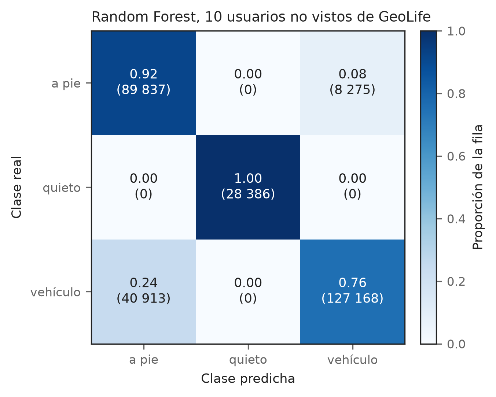
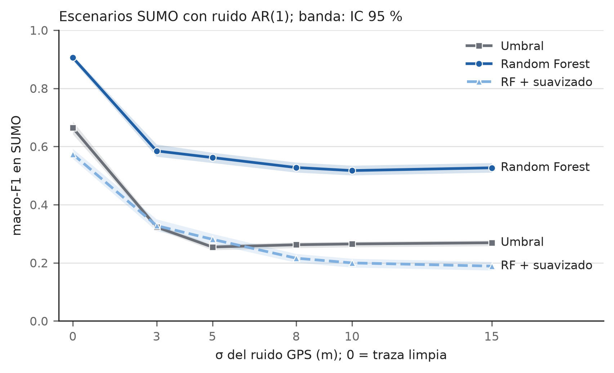
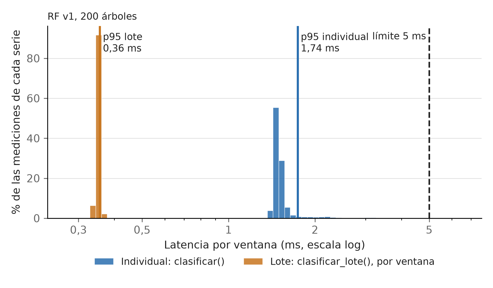

# Clasificación de movimiento para el cierre automático de sesiones de parqueo

*Sección de IA del informe del proyecto e-sert. Borrador S3 (Pablo). Las cifras llevan un comentario `fuente` con el archivo del que salen; `informe/verificar_cifras.py` las comprueba.*

## 1. Problema

La aplicación cobra el parqueo por el tiempo real de estadía: cuando el conductor regresa a su auto y se va, la sesión debe cerrarse sola y liberar el puesto. Para decidirlo, el sistema solo dispone del GPS del teléfono y debe distinguir tres modos de movimiento: `a_pie`, `quieto` y `vehiculo` (contrato §2). La máquina de estados de la sesión (contrato §3) cierra cuando dos ventanas seguidas se clasifican como `vehiculo` y el teléfono está a más de `20 m` del puesto.

El error que más cuesta es la **falsa liberación**: cerrar la sesión, y marcar el puesto como libre, mientras el auto sigue estacionado. Un conductor que ya no está pagando ocupa un puesto que la aplicación ofrece a otros; en la simulación se detecta con `traci.vehicle.isStoppedParking`. Por eso la métrica que importa no es la exactitud por ventana sino cuántas sesiones por cada 100 se cierran en falso, y cuánto tarda en cerrarse una sesión correcta (retardo de cierre).

## 2. Datos

**GeoLife** [@zheng2008understanding; @zheng2008learning; @zheng2010geolife] es un conjunto de trayectorias GPS reales de Beijing. Tras filtrar los modos que no usamos (bicicleta, tren y otros) quedan 64 usuarios con 3 254 173 puntos etiquetados en 10 418 segmentos, con 1 193,09 horas a pie y 1 712,74 horas en vehículo (bus, auto y taxi). El muestreo original es irregular, con mediana de 2 s y percentil 90 de 5 s, así que se remuestrea a `1 Hz` con interpolación lineal. <!-- fuente: ia/datos/geolife_info.json -->

GeoLife no tiene la clase `quieto`; se **deriva**: una ventana etiquetada `a_pie` o `vehiculo` pasa a `quieto` si su velocidad mediana es menor que `0,3 m/s` y su desplazamiento neto menor que `10 m`.

**Partición fija.** Se reservan 10 usuarios de GeoLife para prueba, nunca vistos en el entrenamiento, y 41 quedan para entrenar (semilla `2026`; se exige un mínimo de minutos por clase en prueba, con 8 176 min a pie, 2 365,5 quietos y 14 006,8 en vehículo). <!-- fuente: ia/particion_usuarios.json -->

**SUMO** [@lopez2018sumo]. Se simula el Centro Histórico de Cuenca con el escenario de Tyrone. Las semillas `101 a 105` se reservan solo para evaluación, con tres escenarios: `normal`, `trafico_lento` (autos forzados a velocidad de peatón, `0,8 a 2,0 m/s`) y `peaton_rapido` (`1,8 a 2,5 m/s`). El GPS simulado lleva ruido **AR(1)** por eje, es decir, un error que se parece al del instante anterior (coeficiente `ρ = 0,8`), con desviación σ de `3 a 15 m`, un rango adoptado a partir de la literatura sobre error de GPS en entornos urbanos [@zandbergen2009accuracy; @zandbergen2011positional; @merry2019smartphone] (los valores exactos de σ y ρ son una elección del proyecto, no una cifra de un artículo), y una pérdida del `5 %` de los puntos.

Para el entrenamiento se usó una mezcla `U(3, 15) m` de σ: un análisis de sensibilidad sobre ventanas de GeoLife (σ de entrenamiento × σ de validación) mostró que el macro-F1 medio apenas cambia: queda entre 0,8698 y 0,8727 según la σ de entrenamiento. <!-- fuente: ia/reportes/sensibilidad_resumen.csv -->

**Tabla 1.** Ventanas por clase y fuente. <!-- fuente: ia/reportes/clases_por_fuente.csv -->

| Fuente | Uso | `a_pie` | `quieto` | `vehiculo` | Total |
|---|---|---|---|---|---|
| Mezcla de entrenamiento (GeoLife, SUMO simulado y aumento) | entrenamiento | 519 418 | 160 951 | 970 131 | 1 650 500 |
| GeoLife, 10 usuarios no vistos | prueba | 98 112 | 28 386 | 168 081 | 294 579 |
| SUMO normal (σ = 5 m) | prueba | 85 540 | 41 400 | 126 445 | 253 385 |
| SUMO tráfico lento (σ = 5 m) | prueba | 0 | 2 837 | 89 564 | 92 401 |
| SUMO peatón rápido (σ = 5 m) | prueba | 7 831 | 251 | 0 | 8 082 |

## 3. Preprocesamiento y características

Cada traza a `1 Hz` se parte en **ventanas de `30 s` con paso de `5 s`**; se descarta una ventana con menos del `80 %` de cobertura o cuya etiqueta mayoritaria no llegue al `80 %` de pureza. De cada ventana se extraen `18` características, calculadas sobre posiciones suavizadas con una mediana móvil de 3 muestras para tolerar el ruido:

- **Velocidad** (6): media, mediana, percentiles 10 y 85, máximo y desviación estándar de la velocidad entre muestras.
- **Dinámica** (3): media del valor absoluto de la aceleración, su desviación estándar y la media del valor absoluto del *jerk* (derivada de la aceleración).
- **Rumbo** (2): tasa media de cambio de rumbo (grados por segundo) y proporción de giros de más de 30°.
- **Paradas** (3): proporción de muestras detenidas (velocidad menor que `0,5 m/s`), proporción de muestras lentas (entre `0,5 y 2 m/s`) y número de transiciones parada-arranque.
- **Geometría** (3): distancia total recorrida, desplazamiento neto entre el primer y el último punto, y rectitud (desplazamiento neto dividido por distancia total).
- **Precisión** (1): precisión media reportada; si falta (GeoLife no la trae), se imputa con la mediana del entrenamiento.

La importancia por permutación (cuánto cae el macro-F1 al mezclar al azar una característica) muestra que el modelo se apoya casi por completo en una sola: el desplazamiento neto aporta 0,351, la rectitud 0,017 y ninguna otra supera 0,004 (Figura 3). Varias importancias son ligeramente negativas, es decir, equivalentes a cero. <!-- fuente: ia/modelos/rf_v1.json -->

## 4. Modelos

**Línea base por umbral.** Es la regla del contrato: si la velocidad media de la ventana supera `8 km/h` es `vehiculo`; si es menor que `0,5 km/h`, `quieto`; en otro caso, `a_pie`.

**Random Forest** [@breiman2001random] con scikit-learn [@pedregosa2011scikit]: `200` árboles de profundidad máxima `20`, mínimo `3` muestras por hoja, `sqrt` características por división y pesos de clase balanceados. Los hiperparámetros salen de una búsqueda aleatoria de 15 combinaciones. <!-- fuente: ia/modelos/rf_v1.meta.json; ia/reportes/cv_search_rf_v1.csv -->

**Validación por usuario.** Se usa `GroupKFold` con 3 particiones donde todas las ventanas de un usuario caen del mismo lado. Las ventanas se solapan `25` de sus `30` segundos y un mismo usuario repite rutas y estilo, así que una validación aleatoria vería ventanas casi idénticas en entrenamiento y validación y sobrestimaría la calidad. En esta validación el RF obtiene un macro-F1 de 0,9259 ± 0,0219 frente a 0,7265 ± 0,0746 del umbral. <!-- fuente: ia/reportes/cv_rf_v1.json -->

## 5. Evaluación

**Usuarios no vistos de GeoLife.** Sobre las 294 579 ventanas de los 10 usuarios de prueba, el RF alcanza un macro-F1 de 0,874 (IC 95 % por *bootstrap* de usuarios: 0,821 a 0,947) y el umbral 0,698 (0,619 a 0,756). La diferencia, 0,185 (0,158 a 0,226), es significativa. La brecha frente a la validación cruzada es de solo 5,2 puntos, por lo que no hay sobreajuste evidente al dominio de GeoLife. Por clase, `quieto` sale perfecto (recall 1,00), `a_pie` tiene recall 0,916 y precisión 0,687, y `vehiculo` recall 0,757; el 24,3 % de las ventanas de vehículo se clasifican `a_pie` (Figura 1). <!-- fuente: ia/reportes/metricas_generalizacion.json -->

**Escenarios de SUMO.** La generalización a SUMO es mucho peor: el macro-F1 del RF baja a 0,640 en `normal`, 0,666 en `peaton_rapido` y 0,333 en `trafico_lento` (σ = 5 m). <!-- fuente: ia/reportes/metricas_generalizacion.json -->

**El ruido es el factor dominante.** Al barrer σ en SUMO, el macro-F1 del RF cae de 0,906 con σ = 0 a 0,585 con σ = 3 y 0,562 con σ = 5, y se queda entre 0,517 y 0,528 con σ de 8 a 15 (Figura 2). El umbral se desploma a 0,254 con σ = 5, porque el error autocorrelacionado hace que un teléfono quieto parezca avanzar a más de 8 km/h. Esto corrige una frase del reporte de S2-3 que decía que el ruido no era el factor dominante: las curvas dicen lo contrario. Además, la variante «RF + suavizado» de S2 (histéresis que solo cambia de modo si la confianza del nuevo llega a `0,6`) empeora al RF con ruido, de 0,52 a 0,58 a solo 0,19 a 0,33; la causa no se investigó y en S3 se sustituyó por el suavizado por mayoría y por probabilidad media de la Sección 6. <!-- fuente: ia/reportes/curvas_sigma.csv -->

**Tráfico lento.** En 399 ventanas con velocidad menor que 8 km/h (33,2 minutos), ningún sistema reconoce un vehículo: el recall de `vehiculo` es 0 y el RF las clasifica como `a_pie` en el 95,0 % de los casos. Con solo GPS, un auto a paso de peatón es indistinguible de un peatón. <!-- fuente: ia/reportes/metricas_generalizacion.json -->

**Dónde se equivoca.** En GeoLife, el recall de `vehiculo` del RF es 0,20 y 0,19 con velocidades de 0 a 3 y de 3 a 8 km/h (el umbral da 0), y de 0,85 y 1,00 por encima; en SUMO con σ = 5 m, el RF recupera solo 0,24 de los vehículos a más de 15 km/h (Figura 4). De los 20 errores del RF con mayor confianza, 5 son errores de etiqueta (GeoLife, `a_pie` anotado a 25 a 50 km/h) y 15 del modelo. Un hallazgo posterior invalida parte de las cifras de SUMO de S2-3: la etiqueta de un segmento se tomaba de su primera fila y el 47 % de los usuarios `normal` alternan `a_pie` y `quieto`; el análisis de errores ya segmenta por tramos de modo constante. <!-- fuente: ia/reportes/errores_contexto.csv; ia/reportes/conclusiones_s3.md -->

## 6. Suavizado temporal y falsas liberaciones

Se estudió si promediar varias ventanas reduce las falsas liberaciones. El suavizador guarda por usuario las últimas `k` ventanas y decide por **mayoría** de modos o por **probabilidad media**; con `k = 1` no suaviza. Cada ventana extra añade hasta 5 s de retardo. Para medirlo se grabaron en SUMO 1 784 sesiones completas (estacionar, caminar, volver y manejar; semillas 101 a 105), de las que se simularon 300 con ruido σ de 5, 10 y 15 m. Cada ventana pasa por el clasificador, el suavizador y la máquina de estados de Freddy; la falsa liberación es cerrar mientras el modo real no es `vehiculo`, y el retardo es el cierre menos la salida real. Los intervalos son *bootstrap* de 2 000 remuestreos sobre sesiones. <!-- fuente: ia/reportes/conclusiones_s3.md -->

**Tabla 2.** Las 12 combinaciones (máquina de estados de Freddy). <!-- fuente: ia/reportes/suavizado_k.csv -->

| Sistema | Método | k | Falsas /100 [IC 95 %] | Retardo mediano (s) | Cierres correctos (%) |
|---|---|---|---|---|---|
| rf | mayoría | 1 | 0,00 [0,00; 0,00] | 12,5 | 3,6 |
| rf | mayoría | 3 | 0,00 [0,00; 0,00] | 13,0 | 2,6 |
| rf | mayoría | 5 | 0,00 [0,00; 0,00] | 17,0 | 1,4 |
| rf | prob. media | 1 | 0,00 [0,00; 0,00] | 12,5 | 3,6 |
| rf | prob. media | 3 | 0,33 [0,00; 0,78] | 12,0 | 3,7 |
| rf | prob. media | 5 | 0,11 [0,00; 0,33] | 13,0 | 3,7 |
| umbral | mayoría | 1 | 88,22 [86,44; 90,11] | 13,0 | 8,7 |
| umbral | mayoría | 3 | 87,44 [85,67; 89,22] | 13,0 | 6,6 |
| umbral | mayoría | 5 | 87,78 [85,89; 89,67] | 13,0 | 5,1 |
| umbral | prob. media | 1 | 88,22 [86,44; 90,11] | 13,0 | 8,7 |
| umbral | prob. media | 3 | 87,78 [86,00; 89,56] | 13,0 | 6,4 |
| umbral | prob. media | 5 | 88,11 [86,33; 89,89] | 13,0 | 4,9 |

Tres resultados. Primero, el **umbral es inutilizable con ruido de 5 m o más**: 88,2 de cada 100 sesiones se cierran en falso, y todas lo hacen con σ de 10 y 15 m; ningún `k` lo arregla. Segundo, el **RF casi no libera en falso** (de 0,00 a 0,33 por 100, con cotas superiores menores que 1) y suavizar no mejora nada, porque ya parte de cero. Tercero, suavizar sí cuesta: con la tabla literal del contrato §3 el retardo mediano del RF sube de 52 s con `k = 1` a 56 s con `k = 3` y a 69 s con `k = 5`, que incumple los 60 s, y los cierres correctos bajan de 96,2 % a 93,6 %. <!-- fuente: ia/reportes/suavizado_k.csv; ia/reportes/suavizado_k_contrato.csv -->

**k elegido: 1 (sin suavizar), con RF.** Es el menor `k` entre los que empatan dentro del intervalo con mínimas falsas liberaciones y retardo mediano de 60 s o menos; coincide con la configuración guardada en `rf_v1.meta.json`.

Hay un hallazgo para el sistema: con la máquina de Freddy tal como está, el 96 % a 98,6 % de las sesiones con RF queda sin cerrar. La causa es la transición `REGRESANDO → A_PIE`, que no figura en la tabla del contrato: cuando el auto arranca, la ventana de `30 s` todavía parece caminata y la distancia ya supera `30 m`, así que la sesión retrocede a `A_PIE`, desde donde no hay camino a `SALIENDO`. Con las transiciones literales del contrato cierran bien el 96,2 % de las sesiones con `k = 1`. <!-- fuente: ia/reportes/suavizado_k.csv; ia/reportes/suavizado_k_contrato.csv -->

## 7. Servicio de inferencia

`clasificar` corre dentro del controlador de TraCI con cientos de usuarios y detrás del modo espejo del backend, así que debe ser rápido y no fallar nunca por datos sucios. Antes de clasificar, la ventana se **limpia**: se ordena por tiempo, se eliminan duplicados, coordenadas inválidas, puntos con precisión peor que `50 m` y saltos de más de `50 m/s`, se remuestrea a `1 Hz` y se interpolan los huecos de hasta `5 s`. Además de la clase, el servicio mide la cobertura (fracción de segundos con dato) y el hueco máximo.

El servicio **degrada de forma escalonada**: con cobertura de al menos `0,6` y hueco máximo de `10 s` o menos usa el RF; con menos cobertura pero al menos `5` puntos usa el umbral del contrato con la confianza multiplicada por la cobertura; con menos de `5` puntos devuelve el resultado previo con la mitad de confianza, o el umbral con confianza 0 si no hay previo. Si el modelo no carga o la predicción falla, usa el umbral y emite un solo aviso. Solo lanza `TypeError` si la entrada no es una lista de puntos; 49 pruebas, cuatro de ellas con 300 ejemplos aleatorios de `hypothesis`, cubren NaN, huecos, tiempos desordenados y precisiones extremas.

**Latencia.** La predicción de scikit-learn con 200 árboles costaba 19,6 ms por ventana. Se compilaron los árboles a arreglos de NumPy y se recorren todos a la vez, un nivel por paso, lo que da las mismas predicciones sin perder macro-F1 y permite una versión en lote con una sola llamada. Con 10 000 ventanas (5 000 de usuarios de GeoLife no vistos y 5 000 de SUMO) y descartando las 100 primeras como calentamiento, la latencia por ventana es de 1,49 ms de mediana, 1,74 ms en el percentil 95 y 2,52 ms en el 99; en lotes de 500 ventanas baja a 0,348 ms, 0,356 ms y 0,363 ms. Se cumplen ambas metas, menos de 5 ms individual y menos de 0,5 ms por ventana en lote (Figura 6). <!-- fuente: ia/reportes/bench_inferencia.json; bitacoras/pablo.md -->

## 8. Efecto en el sistema

Las cifras del sistema completo, con la simulación de Tyrone (falsas liberaciones por 100 sesiones y retardo de cierre con IC `95 %` según la penetración de la app, con umbral y con RF), aún no están disponibles en el repositorio.

| Penetración de la app | Falsas /100 con umbral | Falsas /100 con RF | Retardo mediano de cierre |
|---|---|---|---|
| 20 % | [PENDIENTE: cifra de Tyrone S3-2] | [PENDIENTE: cifra de Tyrone S3-2] | [PENDIENTE: cifra de Tyrone S3-2] |
| 50 % | [PENDIENTE: cifra de Tyrone S3-2] | [PENDIENTE: cifra de Tyrone S3-2] | [PENDIENTE: cifra de Tyrone S3-2] |
| 80 % | [PENDIENTE: cifra de Tyrone S3-2] | [PENDIENTE: cifra de Tyrone S3-2] | [PENDIENTE: cifra de Tyrone S3-2] |

Las mediciones de la Sección 6 se hicieron fuera de línea, con sesiones grabadas y sin tráfico ni otros usuarios; son una cota del comportamiento del clasificador y no sustituyen a las del sistema completo.

## 9. Limitaciones y trabajo futuro

- **Todo es simulado.** No hay datos de campo: GeoLife es Beijing, con otro tráfico y otra geometría urbana, y SUMO no modela el multitrayecto real que rebota la señal en las fachadas del Centro Histórico. El ruido AR(1) captura el error lento y correlacionado, pero no los saltos del multitrayecto.
- **Brecha de dominio.** El RF es bueno en GeoLife y frágil en SUMO con σ ≥ 3 m. Reentrenar con trazas de SUMO realistas (no simuladas a mano) y ruido es el siguiente paso con más retorno.
- **Solo GPS.** Un auto en atasco a paso de peatón es indistinguible de una persona caminando. Un acelerómetro, o el conjunto SHL [@gjoreski2018shl] para aprender de sensores inerciales, resolvería ese caso.
- **Precisión.** En SUMO la precisión reportada vale 4 a 7,5 m sin importar σ, y GeoLife no la trae; no se pudo medir su efecto.
- **Simulación de sesiones.** Se usó una muestra de 300 de 1 784 sesiones completas y el buffer del teléfono empieza al estacionar, como en el controlador actual.
- **Etiquetas.** Parte de las etiquetas de SUMO de S2-3 estaban sesgadas (Sección 5).
<!-- fuente: ia/reportes/conclusiones_s3.md -->

## Preguntas abiertas para S4

1. Confirmar con Tyrone las cifras del sistema completo (Sección 8) y reemplazar los marcadores `[PENDIENTE]`.
2. ¿Freddy corrige `REGRESANDO → A_PIE` o se acepta en el contrato? Repetir entonces la corrida final con `k = 1`.
3. Recalcular las métricas de SUMO de S2-3 con etiquetas por tramo de modo constante.
4. ¿Se reentrena el RF con ventanas de SUMO realistas para cerrar la brecha de dominio?
5. ¿Hay grabaciones caseras de Miguel para validar con GPS real de teléfono?

## Referencias

Las referencias están en `referencias_ia.bib`.
