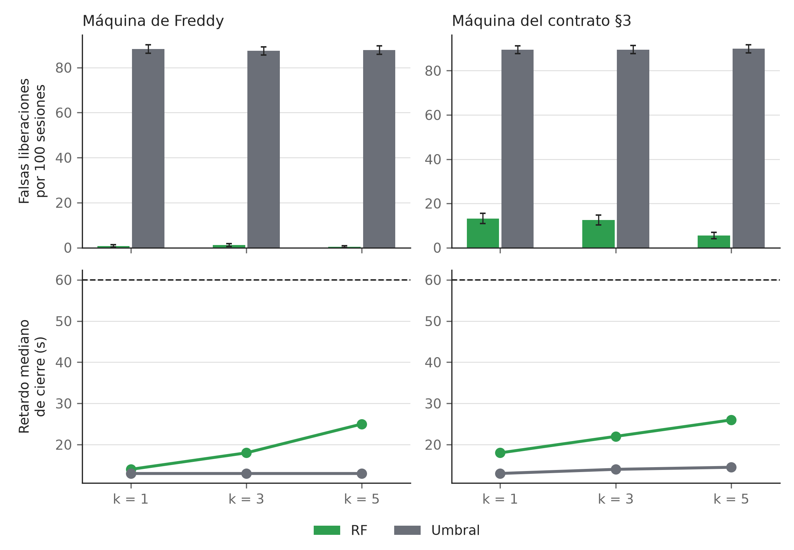

## Inteligencia artificial: clasificación de movimiento

### Problema

La aplicación cobra el parqueo por el tiempo real de estadía: cuando el conductor regresa a su auto y se va, la sesión debe cerrarse sola y liberar el puesto. Para decidirlo solo se dispone del GPS del teléfono, y el sistema debe distinguir tres modos de movimiento: `a_pie`, `quieto` y `vehiculo` (contrato §2). La máquina de estados de la sesión cierra cuando dos ventanas seguidas se clasifican como `vehiculo` y el teléfono está a más de `20 m` del puesto.

El error más costoso es la **falsa liberación**: cerrar la sesión, y ofrecer el puesto a otros, mientras el auto sigue estacionado. En la simulación se detecta con `traci.vehicle.isStoppedParking`. La exactitud por ventana no mide ese riesgo; lo que importa es cuántas sesiones por cada 100 se cierran en falso y cuánto tarda en cerrarse una sesión correcta, el retardo de cierre.

Una regla de velocidad (más de `8 km/h` es vehículo, menos de `0,5 km/h` es quieto) falla por tres motivos: un auto en tráfico lento va a paso de peatón, un peatón que trota se acerca a la velocidad de un auto detenido y arrancando, y el error del GPS, que se parece de un segundo al siguiente, hace que un teléfono quieto parezca avanzar. En la simulación con ruido de 5 a 15 m, esa regla cierra en falso 88,2 de cada 100 sesiones. <!-- fuente: ia/reportes/suavizado_k_final.csv -->

### Datos

**GeoLife** [@zheng2008understanding; @zheng2008learning; @zheng2010geolife] reúne trayectorias GPS reales de Beijing. Tras descartar los modos que no se usan, quedan 64 usuarios con 3 254 173 puntos en 10 418 segmentos, con 1 193,09 horas a pie y 1 712,74 horas en vehículo (bus, auto y taxi). El muestreo original es irregular, con mediana de 2 s y percentil 90 de 5 s, así que cada segmento se interpola linealmente a `1 Hz` y se parte donde hay huecos de más de `10 s`. <!-- fuente: ia/datos/geolife_info.json -->

GeoLife no tiene la clase `quieto`, que se **deriva**: una ventana a pie o en vehículo pasa a `quieto` si su velocidad efectiva es menor que `0,3 m/s` y su desplazamiento neto menor que `10 m`.

**SUMO** [@lopez2018sumo] simula el Centro Histórico de Cuenca con el escenario de Tyrone. Se graban episodios completos de parqueo (estacionar, caminar, volver, manejar) con los peatones de Freddy. El GPS lleva ruido **AR(1)**, un error que depende del instante anterior (`ρ = 0,8`), con desviación σ de `3 a 15 m`, un rango adoptado a partir de la literatura sobre error de GPS urbano [@zandbergen2009accuracy; @zandbergen2011positional; @merry2019smartphone]; los valores exactos son una elección del proyecto, no una cifra de un artículo.

**Partición fija.** Diez usuarios de GeoLife y las semillas de SUMO `101 a 105` son solo de prueba y no entran jamás al entrenamiento; un test lo comprueba. Para entrenar se usan los 38 usuarios restantes con datos y las semillas `201` y `202`. <!-- fuente: ia/modelos/rf_final.json:entrenamiento -->

*Ventanas por clase y fuente.* <!-- fuente: ia/modelos/rf_final.json:entrenamiento; ia/reportes/metricas_rf_final.json -->

| Fuente | Uso | `a_pie` | `quieto` | `vehiculo` |
|---|---|---:|---:|---:|
| GeoLife (muestreo) | entrenamiento | 100 340 | 100 119 | 99 677 |
| SUMO (muestreo) | entrenamiento | 50 255 | 49 873 | 45 343 |
| GeoLife, 10 usuarios no vistos | prueba | 98 112 | 28 386 | 168 081 |
| SUMO normal, σ = 5 m | prueba | 17 216 | 15 825 | 24 964 |
| SUMO tráfico lento, σ = 5 m | prueba | 0 | 1 881 | 58 158 |
| SUMO peatón rápido, σ = 5 m | prueba | 7 831 | 251 | 0 |

*Ventanas por clase y fuente (escala logarítmica). No hay grabaciones caseras.*

Un análisis inicial sobre ventanas de GeoLife, con ruido AR(1) de distintos σ en entrenamiento y validación, mostró poca sensibilidad: el F1 macro medio quedó entre 0,8698 y 0,8727. La evaluación posterior en SUMO sí la muestra con claridad (Sección de resultados), por lo que esa primera prueba no basta para descartar el ruido. <!-- fuente: ia/reportes/sensibilidad_resumen.csv -->

El primer entrenamiento (S2) "aumentaba" las ventanas multiplicando algunas características por factores al azar, sin ruido en las posiciones; por eso el modelo era frágil en SUMO. El modelo final aplica el ruido a las **posiciones** y recalcula las características con el mismo código que usa la inferencia.

*Distribución de la velocidad media de la ventana por clase. La línea punteada marca el umbral de 8 km/h.*

### Ventanas y características

Cada traza a `1 Hz` se parte en **ventanas de `30 s` con paso de `5 s`**; se descartan las que tienen una etiqueta mayoritaria de menos del `80 %`. De cada ventana se extraen `18` características, calculadas sobre posiciones suavizadas con una mediana móvil de tres muestras.

*Características de cada ventana.*

| Característica | Definición |
|---|---|
| `vel_media`, `vel_mediana` | media y mediana de la velocidad entre muestras |
| `vel_p10`, `vel_p85` | percentiles 10 y 85 de la velocidad |
| `vel_max`, `vel_std` | máximo y desviación estándar de la velocidad |
| `acc_media_abs`, `acc_std` | media del valor absoluto y desviación de la aceleración |
| `jerk_medio_abs` | media del valor absoluto de la derivada de la aceleración |
| `tasa_rumbo_media` | cambio de rumbo medio por segundo (grados) |
| `prop_giros_30` | proporción de cambios de rumbo de más de 30° |
| `prop_detenido` | proporción de muestras con velocidad menor que `0,5 m/s` |
| `prop_lento` | proporción con velocidad entre `0,5 y 2 m/s` |
| `rectitud` | desplazamiento neto dividido por distancia total |
| `distancia_total` | suma de las distancias entre muestras consecutivas |
| `desplazamiento_neto` | distancia entre el primer y el último punto |
| `precision_media` | precisión reportada media (se imputa si falta) |
| `n_paradas_arranques` | transiciones entre detenido y en movimiento |

La importancia por permutación sobre usuarios no vistos (cuánto cae el F1 macro al mezclar una característica) muestra que el modelo se apoya sobre todo en una: el desplazamiento neto aporta 0,340 y la rectitud 0,017; ninguna otra supera 0,003. <!-- fuente: ia/reportes/importancia_permutacion_final.csv -->

*Importancia por permutación de las características de `rf_final` sobre usuarios no vistos.*

### Modelo

**Random Forest** [@breiman2001random] con scikit-learn [@pedregosa2011scikit]: `100` árboles de profundidad máxima `20`, mínimo `5` muestras por hoja, `sqrt` características por división, pesos de clase balanceados y `random_state = 42`. Los hiperparámetros parten de una búsqueda aleatoria sobre 15 combinaciones, evaluada con `GroupKFold` por usuario: en esa validación todas las ventanas de un mismo usuario quedan del mismo lado, porque las ventanas se solapan `25` de sus `30` segundos y un usuario repite rutas, y una validación aleatoria vería casi las mismas ventanas en entrenamiento y validación. Se redujeron los árboles (de 200 a 100) y se subió la hoja mínima (de 3 a 5) para que el archivo pese menos de `50 MB`. <!-- fuente: ia/modelos/rf_final.json:hiperparametros; ia/reportes/busqueda_hiperparametros.csv -->

El modelo se **congela**: `ia/modelos/rf_final.joblib` pesa 48,0 MB y su SHA-256 se verifica al cargarlo; dos entrenamientos dan el mismo hash. Se entrenó con 445 607 ventanas de GeoLife, con ruido en la mitad, y de SUMO, con ruido en el `90 %` de ellas (tabla anterior). Cualquier cambio posterior sería `rf_final_v2`. <!-- fuente: ia/modelos/rf_final.json -->

### Línea base y suavizado temporal

La **línea base** es la regla del contrato, con los umbrales de `8 km/h` y `0,5 km/h` sobre la velocidad media de la ventana. El **suavizado temporal** decide por mayoría de modos, o por probabilidad media, entre las últimas `k` ventanas del usuario; con `k = 1` no suaviza y cada ventana extra suma hasta `5 s` de retardo.

Para medir su efecto se grabaron sesiones completas de SUMO (semillas 101 a 105) y se simularon 300 con ruido σ de `5`, `10` y `15 m`. Cada ventana pasa por el clasificador, el suavizador y la máquina de estados de Freddy; es falsa liberación cerrar mientras el modo real no es `vehiculo`. Los intervalos son *bootstrap* de 2 000 remuestreos sobre sesiones; los de GeoLife, de `1 000` remuestreos de usuarios.

*Falsas liberaciones por 100 sesiones y retardo de cierre según `k`, con la máquina de estados de Freddy.* <!-- fuente: ia/reportes/suavizado_k_final.csv -->

| Sistema | k | Falsas /100 [IC 95 %] | Retardo mediano (s) | Cierres correctos (%) | Sin cierre (%) |
|---|---:|---|---:|---:|---:|
| RF | 1 | 0,78 [0,22; 1,33] | 14,0 | 48,3 | 50,9 |
| RF | 3 | 1,11 [0,55; 1,78] | 18,0 | 30,3 | 68,6 |
| RF | 5 | 0,44 [0,11; 0,89] | 25,0 | 21,6 | 78,0 |
| Umbral | 1 | 88,22 [86,44; 90,11] | 13,0 | 8,7 | 3,1 |
| Umbral | 3 | 87,44 [85,67; 89,22] | 13,0 | 6,6 | 6,0 |
| Umbral | 5 | 87,78 [85,89; 89,67] | 13,0 | 5,1 | 7,1 |

Con la máquina de Freddy el RF casi no libera en falso, pero en parte porque no llega a cerrar: con `k = 1` solo cierra bien el 48,3 % de las sesiones y el 50,9 % queda sin cerrar (tabla anterior). La causa es que la transición `REGRESANDO → A_PIE`, que no está en la tabla del contrato, devuelve la sesión a `A_PIE` cuando el auto arranca y desde allí no hay camino a `SALIENDO`. Con las transiciones literales del contrato el RF cierra bien el 86,6 % de las sesiones (retardo mediano de 18 s) pero libera en falso 13,1 por 100 con `k = 1`; con `k = 5` baja a 5,4 por 100, con retardo de 26 s, dentro del límite de `60 s`. Esas liberaciones ocurren, en mediana, 1 502,5 s antes de la salida real: son genuinas, no cierres anticipados por segundos. Por nivel de ruido, con `k = 1`: 1,0, 10,7 y 27,7 por 100 con σ de 5, 10 y 15 m. <!-- fuente: ia/reportes/suavizado_k_final_contrato.csv; ia/reportes/suavizado_k_final.csv -->

**Recomendación:** `k = 1` con la máquina de Freddy actual, y `k = 5` si se adopta la tabla del contrato. El umbral no mejora con ningún `k`.

*Falsas liberaciones y retardo mediano de cierre según k, con la máquina de Freddy y con la del contrato.*

### Resultados

**Usuarios de GeoLife nunca vistos.** Sobre 294 579 ventanas de 10 usuarios, el RF alcanza un F1 macro de 0,872 (IC 95 % por *bootstrap* de usuarios: 0,818 a 0,946) frente a 0,698 del umbral (0,619 a 0,756); la diferencia, 0,183 (0,156 a 0,224), es significativa. Por clase, `quieto` sale casi perfecto (F1 0,999, en parte porque esa clase se deriva con una regla de velocidad y desplazamiento), `a_pie` tiene F1 0,783 y `vehiculo` 0,835; el 24,9 % de las ventanas de vehículo se clasifican `a_pie`, sobre todo en atascos. <!-- fuente: ia/reportes/metricas_rf_final.json -->

*Matrices de confusión normalizadas por fila en usuarios no vistos, umbral frente a RF.*

**Escenarios de SUMO.** SUMO mide la robustez al ruido modelado, no el desempeño real: el entrenamiento y la prueba comparten el generador de ruido y el escenario, y GeoLife es el único dato real. Con σ = 5 m el RF obtiene un F1 macro de 0,738 en `normal` (0,712 a 0,760), frente a 0,204 del umbral. En los dos escenarios difíciles rinde peor: 0,453 en peatón rápido y 0,051 en tráfico lento. En `normal`, la precisión de `vehiculo` es 1,00 y su *recall* 0,55. Las etiquetas de SUMO se calculan por tramos de modo constante. <!-- fuente: ia/reportes/metricas_rf_final.json -->

**El ruido es el factor dominante.** Al barrer σ en SUMO (escenario normal, semillas `101 y 103`), el F1 macro del RF baja de 0,911 sin ruido a 0,793 con σ = 3 m, 0,711 con 5 m y 0,519 con 15 m; el umbral cae de 0,798 a 0,202 con σ = 5 m, porque el error autocorrelacionado hace que un teléfono quieto parezca avanzar. La proporción de vehículos clasificados como a pie sube de 0,15 sin ruido a entre 0,28 y 0,32 con σ de 3 a 10 m, y baja a 0,2 con 15 m. <!-- fuente: ia/reportes/curvas_sigma_final.csv -->

*F1 macro y vehículos clasificados como a pie frente a σ en SUMO.*

**Línea base de un solo atributo.** Un árbol de decisión de profundidad 3 que solo usa el desplazamiento neto, entrenado con las mismas ventanas, obtiene un F1 macro de 0,750 en GeoLife no vistos, frente a 0,872 del RF, y de 0,775 en SUMO normal (las mismas 58 005 ventanas), frente a 0,738 del RF. En datos reales el RF aporta bastante más que esa regla; en SUMO, con ruido propio, no la supera. <!-- fuente: ia/reportes/linea_base_desplazamiento.json -->

**Tráfico lento.** En 60 039 ventanas de autos forzados a velocidad de peatón, ningún sistema reconoce vehículos con velocidad menor que 8 km/h (308 ventanas): el *recall* es 0 y el RF clasifica a pie el 63,7 % de los vehículos. El umbral parece acertar solo porque con σ = 5 m llama vehículo a todo, y en `normal` no acierta ningún `quieto`. Con solo GPS, un auto a paso de peatón es indistinguible de un peatón. <!-- fuente: ia/reportes/metricas_rf_final.json -->

*F1 y recall de vehículo en tráfico lento, umbral frente a RF.*

**Latencia.** En 9 900 llamadas de `clasificar` (tras 100 de calentamiento), la latencia es de 1,35 ms de mediana y 2,12 ms en el percentil 99, por debajo de la meta de 5 ms. El servicio limpia la ventana (duplicados, NaN, precisión peor que `50 m`, saltos de más de `50 m/s`, huecos de hasta `5 s`) y, si faltan datos o el modelo, cae al umbral con un aviso. <!-- fuente: ia/reportes/metricas_rf_final.json -->

**Impacto en el sistema.** Las falsas liberaciones por 100 sesiones y el retardo de cierre de la corrida final con la app (penetraciones de `20, 50 y 80 %`) son de Tyrone: [PENDIENTE: cifra de Tyrone S4-2].

*Falsas liberaciones por 100 sesiones según la penetración de la app (corrida final).*

### Discusión, limitaciones y trabajo futuro

Los datos reales y los simulados cuentan historias distintas: el RF generaliza bien a usuarios nuevos de GeoLife, pero su desempeño en SUMO depende del nivel de ruido, y por eso el modelo final se entrenó con ruido sobre las posiciones. El modelo final rinde bien en el escenario realista y mal en los dos adversariales, que son artificiales.

- **Todo es simulado.** No hay datos de campo: GeoLife es Beijing y SUMO no modela el multitrayecto real de las fachadas del Centro Histórico; el AR(1) captura el error lento pero no los saltos.
- **Solo GPS.** Un auto en atasco es indistinguible de una persona caminando. Un acelerómetro, por ejemplo con el conjunto SHL [@gjoreski2018shl], resolvería ese caso y el del teléfono dejado dentro del auto.
- **Ruido alto.** Con σ de 10 a 15 m el RF puede cerrar en falso si se adopta la tabla literal del contrato; hace falta `k = 5` o más precisión de GPS.
- **Entrenamiento.** Solo dos semillas de SUMO y una configuración de escenario; sin grabaciones caseras.
- **Validación.** El `k` recomendado y la comparación de máquinas de estados se evaluaron con las semillas 101 a 105, las mismas de la evaluación del sistema: no hay un conjunto de validación separado y esas cifras son optimistas. Los hiperparámetros se eligieron solo con usuarios de entrenamiento.
- **Intervalos.** Los de la simulación remuestrean sesiones de cinco semillas, que no son del todo independientes, y los de GeoLife se apoyan en solo diez usuarios: son optimistas.
- **Frecuencia real.** No se ha estimado cuántos casos del Centro Histórico real caen en tráfico lento, el que el modelo no resuelve.
- **Trabajo futuro:** validar con grabaciones reales de teléfono, entrenar con más semillas y escenarios, y añadir sensores inerciales.

Las limitaciones y el uso previsto del modelo están en su ficha (*model card*) [@mitchell2019modelcards].
