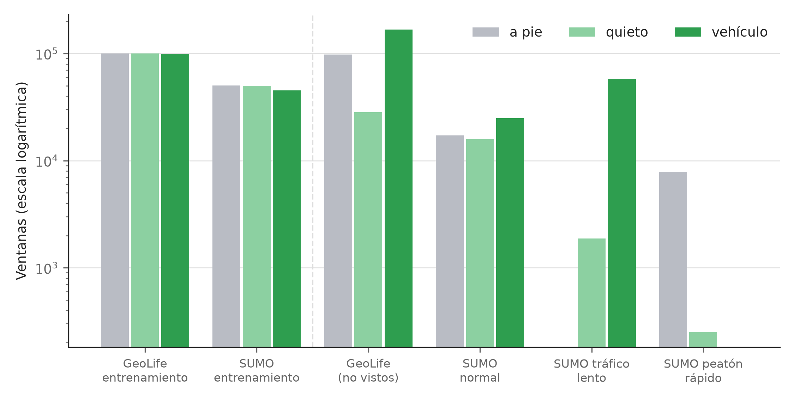
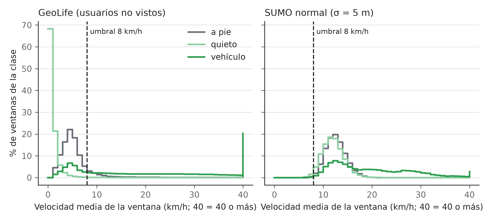
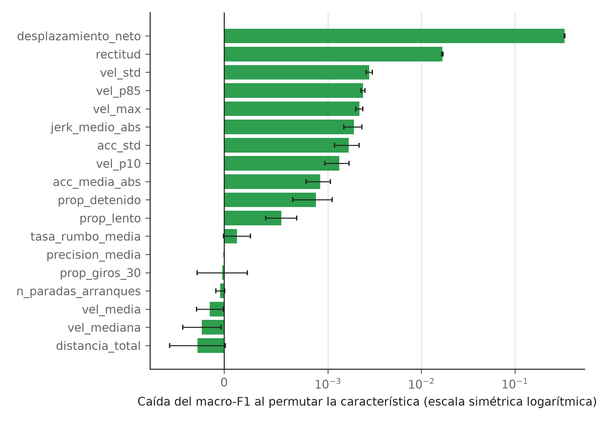
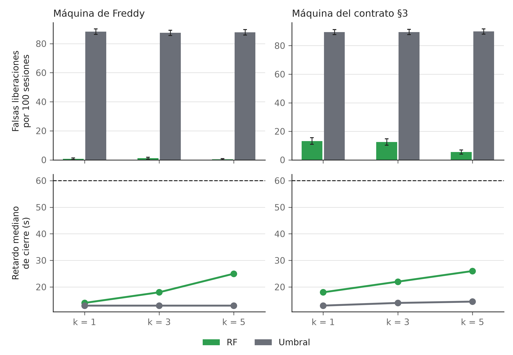
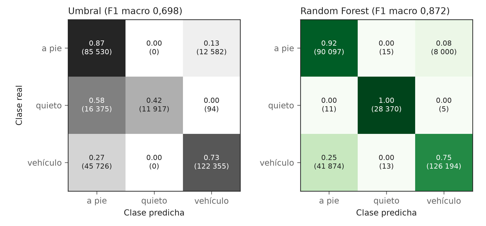
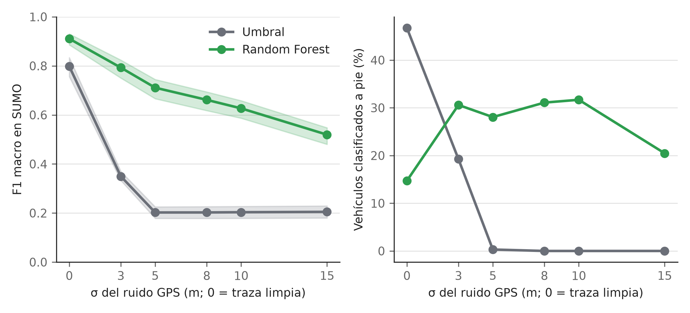
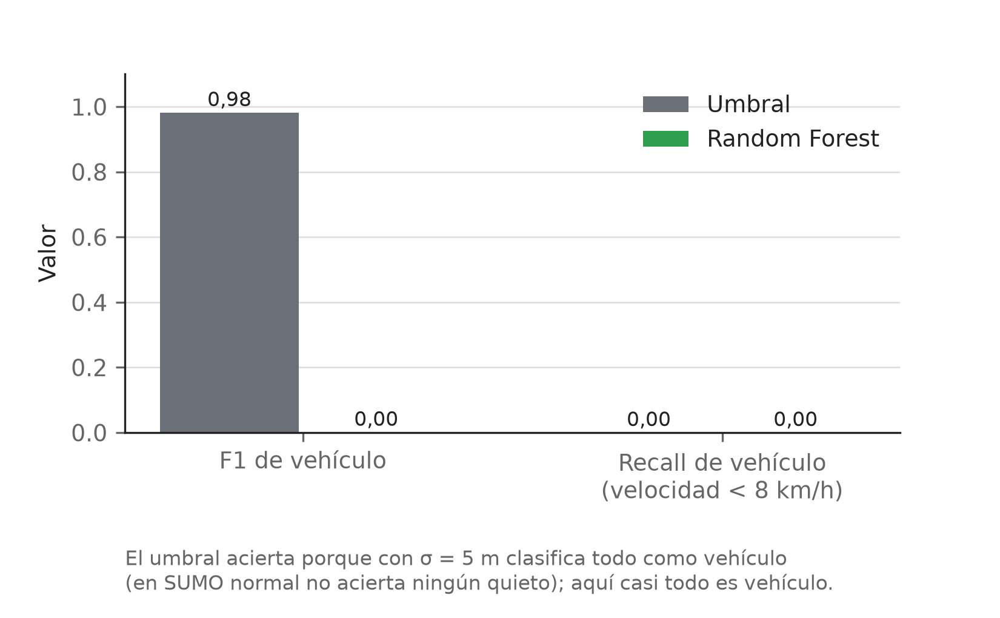
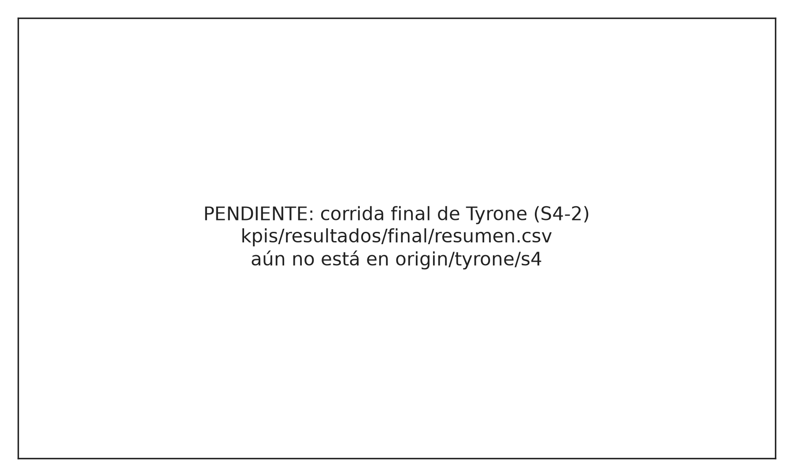

<!-- inicio-seccion: comun/00_portada.md -->

**Universidad de Cuenca**

**Redes Vehiculares**

# e-sert: una aplicación de parqueo para la zona SERT del Centro Histórico de Cuenca con SUMO, TraCI y un clasificador de movimiento

Proyecto grupal de la materia Redes Vehiculares.

**Integrantes**

- Tyrone: escenario SUMO, experimentos, KPIs y visor web.
- Freddy: controlador TraCI, emulador GPS, guiado y backend.
- Pablo: inteligencia artificial, clasificador de movimiento y servicio de inferencia; editor del informe.
- Miguel: aplicación móvil, sesión de parqueo, billetera y pagos en modo de pruebas.

Cuenca, 16 de noviembre de 2026

<!-- fin-seccion: comun/00_portada.md -->

<!-- salto -->

<!-- inicio-seccion: comun/01_resumen.md -->

## Resumen

Buscar parqueo en la zona de estacionamiento rotativo tarifado (SERT) del Centro Histórico de Cuenca consume tiempo, combustible y calles. Este trabajo construye y evalúa, íntegramente en simulación, una aplicación que detecta la llegada y la salida reales del auto, mantiene un mapa de ocupación en vivo, guía al puesto libre más cercano al destino y cobra el tiempo real de estadía.

El sistema combina SUMO para el escenario, TraCI para el control, un servidor FastAPI para sesiones y billetera, una aplicación Expo que sigue a un auto simulado (teléfono espejo) y un clasificador de movimiento con Random Forest. El clasificador decide si el usuario va a pie, quieto o en vehículo, para no liberar un puesto que sigue ocupado: la falsa liberación. Se compara contra la regla simple de velocidad mayor que 8 km/h.

Resultados principales de la corrida final:

- Tiempo medio de búsqueda con la app frente a la búsqueda a ciegas: [PENDIENTE: cifra de Tyrone S4-2].
- Falsas liberaciones por cada 100 sesiones, con umbral y con Random Forest: [PENDIENTE: cifra de Tyrone S4-2].
- Retardo mediano de cierre de la sesión: [PENDIENTE: cifra de Tyrone S4-2].

Todo es simulado: no hay datos de campo en el Centro Histórico.

<!-- fin-seccion: comun/01_resumen.md -->

## Índice

- Resumen
- 1 Introducción
  - 1.1 Objetivos
  - 1.2 Alcance
  - 1.3 Organización del informe
- 2 Trabajo relacionado
- 3 Glosario
- 4 Inteligencia artificial: clasificación de movimiento
  - 4.1 Problema
  - 4.2 Datos
  - 4.3 Ventanas y características
  - 4.4 Modelo
  - 4.5 Línea base y suavizado temporal
  - 4.6 Resultados
  - 4.7 Discusión, limitaciones y trabajo futuro
- 5 Resultados integrados
- 6 Conclusiones
- 7 Trabajo futuro
- 8 Preguntas probables del profesor
  - 8.1 Inteligencia artificial (Pablo)
  - 8.2 Sistema y simulación (Freddy)
  - 8.3 Escenario y KPIs (Tyrone)
  - 8.4 App y cobro (Miguel)
  - 8.5 Preguntas añadidas tras la revisión externa (IA, Pablo)
  - 8.6 Resumen

<!-- salto -->

<!-- inicio-seccion: comun/02_introduccion.md -->

## 1 Introducción

Dar vueltas buscando un lugar donde estacionar es una fuente conocida de congestión y de emisiones en las zonas urbanas centrales [@shoup2006cruising]. En Cuenca, el Centro Histórico tiene un sistema de estacionamiento rotativo tarifado, el SERT, que administra la EMOV EP y cuya ordenanza fija una tasa base de 0,25 por media hora o fracción [@concejo2012sert]. <!-- fuente: informe/referencias.bib -->

En el SERT se paga por adelantado, en bloques de media hora, con una tarjeta o con la aplicación oficial AppSERT, y no por el tiempo real de estadía. <!-- fuente: proyecto/app/docs/sert_reglas.md --> Este proyecto propone una aplicación que detecta cuándo el auto llega y cuándo se va, publica un mapa de ocupación, guía al puesto libre más cercano al destino y cobra el tiempo exacto. Detectar la salida es la parte delicada: si el conductor se baja a caminar y el sistema lo toma por una salida, marca libre un puesto que sigue ocupado. A ese error lo llamamos **falsa liberación**.

### 1.1 Objetivos

- Medir si la aplicación reduce el tiempo, la distancia y las emisiones de la búsqueda de parqueo frente a una línea base sin ella.
- Detectar la llegada y la salida reales con un clasificador de movimiento sobre el GPS del teléfono, y medirlo por sus falsas liberaciones y su retardo de cierre.
- Cobrar el tiempo real con una billetera de movimientos (recarga, retención, débito y liberación).

### 1.2 Alcance

Todo el proyecto es simulado. El escenario corre en SUMO [@lopez2018sumo] y lo controla TraCI [@wegener2008traci]; el teléfono no envía su GPS, sino que sigue a un vehículo simulado y muestra lo que vería su conductor. No se hicieron pruebas de campo en el Centro. Quedan fuera la predicción de ocupación futura, el aprendizaje por refuerzo, la integración con la EMOV y las motos.

### 1.3 Organización del informe

Las secciones siguientes describen la arquitectura (controlador TraCI, emulador GPS, backend), el escenario y los experimentos, el clasificador de movimiento, la aplicación móvil, los resultados integrados, las conclusiones y el trabajo futuro. Cada cifra lleva un comentario con el archivo del que sale.

<!-- fin-seccion: comun/02_introduccion.md -->

<!-- inicio-seccion: comun/03_trabajo_relacionado.md -->

## 2 Trabajo relacionado

**Búsqueda de parqueo.** Shoup estudió el efecto de dar vueltas buscando estacionamiento en el tránsito de las zonas centrales [@shoup2006cruising]. Este proyecto toma esa motivación y la evalúa en un escenario simulado de Cuenca, con y sin una aplicación que guía al puesto libre.

**Simulación de tráfico y acoplamiento.** SUMO es el simulador microscópico de tráfico que usamos [@lopez2018sumo]. TraCI permite controlarlo en línea desde un programa externo [@wegener2008traci], que es como el controlador crea peatones, emula el GPS, sigue la sesión de cada usuario y guía a los autos.

**Detección del modo de transporte con GPS.** El proyecto GeoLife publicó trayectorias reales y trabajos sobre cómo inferir el modo de transporte a partir de datos GPS crudos [@zheng2008learning; @zheng2008understanding; @zheng2010geolife]. Usamos esas trayectorias como fuente de entrenamiento y de prueba con usuarios no vistos. Un enfoque complementario es el conjunto SHL, que incluye sensores inerciales [@gjoreski2018shl]; queda como trabajo futuro por exigir el acelerómetro.

**Modelo y documentación.** El clasificador es un Random Forest [@breiman2001random] implementado con scikit-learn [@pedregosa2011scikit]. Para documentar el modelo congelado se sigue el formato de las *model cards* [@mitchell2019modelcards].

**Diferencia con lo anterior.** La métrica que nos importa no es la exactitud por ventana de GPS, sino cuántas sesiones se cierran mientras el auto sigue estacionado (falsas liberaciones por 100 sesiones) y cuánto tarda en cerrarse una sesión correcta, medidas en el sistema completo.

<!-- fin-seccion: comun/03_trabajo_relacionado.md -->

<!-- inicio-seccion: comun/05_glosario.md -->

## 3 Glosario

- **Falsa liberación:** cerrar la sesión de parqueo, y ofrecer el puesto a otros, mientras el auto sigue estacionado.
- **Retardo de cierre:** tiempo entre la salida real del auto y el cierre de la sesión.
- **Contrato (§2, §3):** el documento del proyecto que fija los modos de movimiento, la máquina de estados de la sesión y la API.
- **Teléfono espejo:** teléfono que, en vez de enviar su propio GPS, sigue a un auto simulado y muestra lo que vería su conductor.
- **Ventana:** tramo de 30 s de GPS a 1 Hz sobre el que se clasifica el movimiento, con paso de 5 s.
- **F1 macro:** promedio del F1 (equilibrio entre precisión y *recall*) de las tres clases; 1 es perfecto.
- **Ruido AR(1):** error de posición que se parece al del instante anterior; `σ` es su tamaño típico en metros.
- **Bootstrap agrupado:** forma de medir la incertidumbre remuestreando usuarios o sesiones completos, no ventanas sueltas.
- **GroupKFold:** validación que deja todas las ventanas de un usuario del mismo lado.
- **Penetración de la app:** porcentaje de conductores que usan la aplicación en una simulación.

<!-- fin-seccion: comun/05_glosario.md -->

<!-- inicio-seccion: freddy.md -->

> **[SECCIÓN PENDIENTE: Freddy]**

<!-- fin-seccion: freddy.md -->

<!-- inicio-seccion: tyrone.md -->

> **[SECCIÓN PENDIENTE: Tyrone]**

<!-- fin-seccion: tyrone.md -->

<!-- inicio-seccion: pablo.md -->

## 4 Inteligencia artificial: clasificación de movimiento

### 4.1 Problema

La aplicación cobra el parqueo por el tiempo real de estadía: cuando el conductor regresa a su auto y se va, la sesión debe cerrarse sola y liberar el puesto. Para decidirlo solo se dispone del GPS del teléfono, y el sistema debe distinguir tres modos de movimiento: `a_pie`, `quieto` y `vehiculo` (contrato §2). La máquina de estados de la sesión cierra cuando dos ventanas seguidas se clasifican como `vehiculo` y el teléfono está a más de `20 m` del puesto.

El error más costoso es la **falsa liberación**: cerrar la sesión, y ofrecer el puesto a otros, mientras el auto sigue estacionado. En la simulación se detecta con `traci.vehicle.isStoppedParking`. La exactitud por ventana no mide ese riesgo; lo que importa es cuántas sesiones por cada 100 se cierran en falso y cuánto tarda en cerrarse una sesión correcta, el retardo de cierre.

Una regla de velocidad (más de `8 km/h` es vehículo, menos de `0,5 km/h` es quieto) falla por tres motivos: un auto en tráfico lento va a paso de peatón, un peatón que trota se acerca a la velocidad de un auto detenido y arrancando, y el error del GPS, que se parece de un segundo al siguiente, hace que un teléfono quieto parezca avanzar. En la simulación con ruido de 5 a 15 m, esa regla cierra en falso 88,2 de cada 100 sesiones. <!-- fuente: ia/reportes/suavizado_k_final.csv -->

### 4.2 Datos

**GeoLife** [@zheng2008understanding; @zheng2008learning; @zheng2010geolife] reúne trayectorias GPS reales de Beijing. Tras descartar los modos que no se usan, quedan 64 usuarios con 3 254 173 puntos en 10 418 segmentos, con 1 193,09 horas a pie y 1 712,74 horas en vehículo (bus, auto y taxi). El muestreo original es irregular, con mediana de 2 s y percentil 90 de 5 s, así que cada segmento se interpola linealmente a `1 Hz` y se parte donde hay huecos de más de `10 s`. <!-- fuente: ia/datos/geolife_info.json -->

GeoLife no tiene la clase `quieto`, que se **deriva**: una ventana a pie o en vehículo pasa a `quieto` si su velocidad efectiva es menor que `0,3 m/s` y su desplazamiento neto menor que `10 m`.

**SUMO** [@lopez2018sumo] simula el Centro Histórico de Cuenca con el escenario de Tyrone. Se graban episodios completos de parqueo (estacionar, caminar, volver, manejar) con los peatones de Freddy. El GPS lleva ruido **AR(1)**, un error que depende del instante anterior (`ρ = 0,8`), con desviación σ de `3 a 15 m`, un rango adoptado a partir de la literatura sobre error de GPS urbano [@zandbergen2009accuracy; @zandbergen2011positional; @merry2019smartphone]; los valores exactos son una elección del proyecto, no una cifra de un artículo.

**Partición fija.** Diez usuarios de GeoLife y las semillas de SUMO `101 a 105` son solo de prueba y no entran jamás al entrenamiento; un test lo comprueba. Para entrenar se usan los 38 usuarios restantes con datos y las semillas `201` y `202`. <!-- fuente: ia/modelos/rf_final.json:entrenamiento -->

*Ventanas por clase y fuente.* <!-- fuente: ia/modelos/rf_final.json:entrenamiento; ia/reportes/metricas_rf_final.json -->

| Fuente | Uso | `a_pie` | `quieto` | `vehiculo` |
|---|---|---:|---:|---:|
| GeoLife (muestreo) | entrenamiento | 100 340 | 100 119 | 99 677 |
| SUMO (muestreo) | entrenamiento | 50 255 | 49 873 | 45 343 |
| GeoLife, 10 usuarios no vistos | prueba | 98 112 | 28 386 | 168 081 |
| SUMO normal, σ = 5 m | prueba | 17 216 | 15 825 | 24 964 |
| SUMO tráfico lento, σ = 5 m | prueba | 0 | 1 881 | 58 158 |
| SUMO peatón rápido, σ = 5 m | prueba | 7 831 | 251 | 0 |

*Figura 1. Ventanas por clase y fuente (escala logarítmica). No hay grabaciones caseras.*

Un análisis inicial sobre ventanas de GeoLife, con ruido AR(1) de distintos σ en entrenamiento y validación, mostró poca sensibilidad: el F1 macro medio quedó entre 0,8698 y 0,8727. La evaluación posterior en SUMO sí la muestra con claridad (Sección de resultados), por lo que esa primera prueba no basta para descartar el ruido. <!-- fuente: ia/reportes/sensibilidad_resumen.csv -->

El primer entrenamiento (S2) "aumentaba" las ventanas multiplicando algunas características por factores al azar, sin ruido en las posiciones; por eso el modelo era frágil en SUMO. El modelo final aplica el ruido a las **posiciones** y recalcula las características con el mismo código que usa la inferencia.

*Figura 2. Distribución de la velocidad media de la ventana por clase. La línea punteada marca el umbral de 8 km/h.*

### 4.3 Ventanas y características

Cada traza a `1 Hz` se parte en **ventanas de `30 s` con paso de `5 s`**; se descartan las que tienen una etiqueta mayoritaria de menos del `80 %`. De cada ventana se extraen `18` características, calculadas sobre posiciones suavizadas con una mediana móvil de tres muestras.

*Tabla 1. Características de cada ventana.*

| Característica | Definición |
|---|---|
| `vel_media`, `vel_mediana` | media y mediana de la velocidad entre muestras |
| `vel_p10`, `vel_p85` | percentiles 10 y 85 de la velocidad |
| `vel_max`, `vel_std` | máximo y desviación estándar de la velocidad |
| `acc_media_abs`, `acc_std` | media del valor absoluto y desviación de la aceleración |
| `jerk_medio_abs` | media del valor absoluto de la derivada de la aceleración |
| `tasa_rumbo_media` | cambio de rumbo medio por segundo (grados) |
| `prop_giros_30` | proporción de cambios de rumbo de más de 30° |
| `prop_detenido` | proporción de muestras con velocidad menor que `0,5 m/s` |
| `prop_lento` | proporción con velocidad entre `0,5 y 2 m/s` |
| `rectitud` | desplazamiento neto dividido por distancia total |
| `distancia_total` | suma de las distancias entre muestras consecutivas |
| `desplazamiento_neto` | distancia entre el primer y el último punto |
| `precision_media` | precisión reportada media (se imputa si falta) |
| `n_paradas_arranques` | transiciones entre detenido y en movimiento |

La importancia por permutación sobre usuarios no vistos (cuánto cae el F1 macro al mezclar una característica) muestra que el modelo se apoya sobre todo en una: el desplazamiento neto aporta 0,340 y la rectitud 0,017; ninguna otra supera 0,003. <!-- fuente: ia/reportes/importancia_permutacion_final.csv -->

*Figura 3. Importancia por permutación de las características de `rf_final` sobre usuarios no vistos.*

### 4.4 Modelo

**Random Forest** [@breiman2001random] con scikit-learn [@pedregosa2011scikit]: `100` árboles de profundidad máxima `20`, mínimo `5` muestras por hoja, `sqrt` características por división, pesos de clase balanceados y `random_state = 42`. Los hiperparámetros parten de una búsqueda aleatoria sobre 15 combinaciones, evaluada con `GroupKFold` por usuario: en esa validación todas las ventanas de un mismo usuario quedan del mismo lado, porque las ventanas se solapan `25` de sus `30` segundos y un usuario repite rutas, y una validación aleatoria vería casi las mismas ventanas en entrenamiento y validación. Se redujeron los árboles (de 200 a 100) y se subió la hoja mínima (de 3 a 5) para que el archivo pese menos de `50 MB`. <!-- fuente: ia/modelos/rf_final.json:hiperparametros; ia/reportes/busqueda_hiperparametros.csv -->

El modelo se **congela**: `ia/modelos/rf_final.joblib` pesa 48,0 MB y su SHA-256 se verifica al cargarlo; dos entrenamientos dan el mismo hash. Se entrenó con 445 607 ventanas de GeoLife, con ruido en la mitad, y de SUMO, con ruido en el `90 %` de ellas (tabla anterior). Cualquier cambio posterior sería `rf_final_v2`. <!-- fuente: ia/modelos/rf_final.json -->

### 4.5 Línea base y suavizado temporal

La **línea base** es la regla del contrato, con los umbrales de `8 km/h` y `0,5 km/h` sobre la velocidad media de la ventana. El **suavizado temporal** decide por mayoría de modos, o por probabilidad media, entre las últimas `k` ventanas del usuario; con `k = 1` no suaviza y cada ventana extra suma hasta `5 s` de retardo.

Para medir su efecto se grabaron sesiones completas de SUMO (semillas 101 a 105) y se simularon 300 con ruido σ de `5`, `10` y `15 m`. Cada ventana pasa por el clasificador, el suavizador y la máquina de estados de Freddy; es falsa liberación cerrar mientras el modo real no es `vehiculo`. Los intervalos son *bootstrap* de 2 000 remuestreos sobre sesiones; los de GeoLife, de `1 000` remuestreos de usuarios.

*Falsas liberaciones por 100 sesiones y retardo de cierre según `k`, con la máquina de estados de Freddy.* <!-- fuente: ia/reportes/suavizado_k_final.csv -->

| Sistema | k | Falsas /100 [IC 95 %] | Retardo mediano (s) | Cierres correctos (%) | Sin cierre (%) |
|---|---:|---|---:|---:|---:|
| RF | 1 | 0,78 [0,22; 1,33] | 14,0 | 48,3 | 50,9 |
| RF | 3 | 1,11 [0,55; 1,78] | 18,0 | 30,3 | 68,6 |
| RF | 5 | 0,44 [0,11; 0,89] | 25,0 | 21,6 | 78,0 |
| Umbral | 1 | 88,22 [86,44; 90,11] | 13,0 | 8,7 | 3,1 |
| Umbral | 3 | 87,44 [85,67; 89,22] | 13,0 | 6,6 | 6,0 |
| Umbral | 5 | 87,78 [85,89; 89,67] | 13,0 | 5,1 | 7,1 |

Con la máquina de Freddy el RF casi no libera en falso, pero en parte porque no llega a cerrar: con `k = 1` solo cierra bien el 48,3 % de las sesiones y el 50,9 % queda sin cerrar (tabla anterior). La causa es que la transición `REGRESANDO → A_PIE`, que no está en la tabla del contrato, devuelve la sesión a `A_PIE` cuando el auto arranca y desde allí no hay camino a `SALIENDO`. Con las transiciones literales del contrato el RF cierra bien el 86,6 % de las sesiones (retardo mediano de 18 s) pero libera en falso 13,1 por 100 con `k = 1`; con `k = 5` baja a 5,4 por 100, con retardo de 26 s, dentro del límite de `60 s`. Esas liberaciones ocurren, en mediana, 1 502,5 s antes de la salida real: son genuinas, no cierres anticipados por segundos. Por nivel de ruido, con `k = 1`: 1,0, 10,7 y 27,7 por 100 con σ de 5, 10 y 15 m. <!-- fuente: ia/reportes/suavizado_k_final_contrato.csv; ia/reportes/suavizado_k_final.csv -->

**Recomendación:** `k = 1` con la máquina de Freddy actual, y `k = 5` si se adopta la tabla del contrato. El umbral no mejora con ningún `k`.

*Figura 4. Falsas liberaciones y retardo mediano de cierre según k, con la máquina de Freddy y con la del contrato.*

### 4.6 Resultados

**Usuarios de GeoLife nunca vistos.** Sobre 294 579 ventanas de 10 usuarios, el RF alcanza un F1 macro de 0,872 (IC 95 % por *bootstrap* de usuarios: 0,818 a 0,946) frente a 0,698 del umbral (0,619 a 0,756); la diferencia, 0,183 (0,156 a 0,224), es significativa. Por clase, `quieto` sale casi perfecto (F1 0,999, en parte porque esa clase se deriva con una regla de velocidad y desplazamiento), `a_pie` tiene F1 0,783 y `vehiculo` 0,835; el 24,9 % de las ventanas de vehículo se clasifican `a_pie`, sobre todo en atascos. <!-- fuente: ia/reportes/metricas_rf_final.json -->

*Figura 5. Matrices de confusión normalizadas por fila en usuarios no vistos, umbral frente a RF.*

**Escenarios de SUMO.** SUMO mide la robustez al ruido modelado, no el desempeño real: el entrenamiento y la prueba comparten el generador de ruido y el escenario, y GeoLife es el único dato real. Con σ = 5 m el RF obtiene un F1 macro de 0,738 en `normal` (0,712 a 0,760), frente a 0,204 del umbral. En los dos escenarios difíciles rinde peor: 0,453 en peatón rápido y 0,051 en tráfico lento. En `normal`, la precisión de `vehiculo` es 1,00 y su *recall* 0,55. Las etiquetas de SUMO se calculan por tramos de modo constante. <!-- fuente: ia/reportes/metricas_rf_final.json -->

**El ruido es el factor dominante.** Al barrer σ en SUMO (escenario normal, semillas `101 y 103`), el F1 macro del RF baja de 0,911 sin ruido a 0,793 con σ = 3 m, 0,711 con 5 m y 0,519 con 15 m; el umbral cae de 0,798 a 0,202 con σ = 5 m, porque el error autocorrelacionado hace que un teléfono quieto parezca avanzar. La proporción de vehículos clasificados como a pie sube de 0,15 sin ruido a entre 0,28 y 0,32 con σ de 3 a 10 m, y baja a 0,2 con 15 m. <!-- fuente: ia/reportes/curvas_sigma_final.csv -->

*Figura 6. F1 macro y vehículos clasificados como a pie frente a σ en SUMO.*

**Línea base de un solo atributo.** Un árbol de decisión de profundidad 3 que solo usa el desplazamiento neto, entrenado con las mismas ventanas, obtiene un F1 macro de 0,750 en GeoLife no vistos, frente a 0,872 del RF, y de 0,775 en SUMO normal (las mismas 58 005 ventanas), frente a 0,738 del RF. En datos reales el RF aporta bastante más que esa regla; en SUMO, con ruido propio, no la supera. <!-- fuente: ia/reportes/linea_base_desplazamiento.json -->

**Tráfico lento.** En 60 039 ventanas de autos forzados a velocidad de peatón, ningún sistema reconoce vehículos con velocidad menor que 8 km/h (308 ventanas): el *recall* es 0 y el RF clasifica a pie el 63,7 % de los vehículos. El umbral parece acertar solo porque con σ = 5 m llama vehículo a todo, y en `normal` no acierta ningún `quieto`. Con solo GPS, un auto a paso de peatón es indistinguible de un peatón. <!-- fuente: ia/reportes/metricas_rf_final.json -->

*Figura 7. F1 y recall de vehículo en tráfico lento, umbral frente a RF.*

**Latencia.** En 9 900 llamadas de `clasificar` (tras 100 de calentamiento), la latencia es de 1,35 ms de mediana y 2,12 ms en el percentil 99, por debajo de la meta de 5 ms. El servicio limpia la ventana (duplicados, NaN, precisión peor que `50 m`, saltos de más de `50 m/s`, huecos de hasta `5 s`) y, si faltan datos o el modelo, cae al umbral con un aviso. <!-- fuente: ia/reportes/metricas_rf_final.json -->

**Impacto en el sistema.** Las falsas liberaciones por 100 sesiones y el retardo de cierre de la corrida final con la app (penetraciones de `20, 50 y 80 %`) son de Tyrone: [PENDIENTE: cifra de Tyrone S4-2].

*Figura 8. Falsas liberaciones por 100 sesiones según la penetración de la app (corrida final).*

### 4.7 Discusión, limitaciones y trabajo futuro

Los datos reales y los simulados cuentan historias distintas: el RF generaliza bien a usuarios nuevos de GeoLife, pero su desempeño en SUMO depende del nivel de ruido, y por eso el modelo final se entrenó con ruido sobre las posiciones. El modelo final rinde bien en el escenario realista y mal en los dos adversariales, que son artificiales.

- **Todo es simulado.** No hay datos de campo: GeoLife es Beijing y SUMO no modela el multitrayecto real de las fachadas del Centro Histórico; el AR(1) captura el error lento pero no los saltos.
- **Solo GPS.** Un auto en atasco es indistinguible de una persona caminando. Un acelerómetro, por ejemplo con el conjunto SHL [@gjoreski2018shl], resolvería ese caso y el del teléfono dejado dentro del auto.
- **Ruido alto.** Con σ de 10 a 15 m el RF puede cerrar en falso si se adopta la tabla literal del contrato; hace falta `k = 5` o más precisión de GPS.
- **Entrenamiento.** Solo dos semillas de SUMO y una configuración de escenario; sin grabaciones caseras.
- **Validación.** El `k` recomendado y la comparación de máquinas de estados se evaluaron con las semillas 101 a 105, las mismas de la evaluación del sistema: no hay un conjunto de validación separado y esas cifras son optimistas. Los hiperparámetros se eligieron solo con usuarios de entrenamiento.
- **Intervalos.** Los de la simulación remuestrean sesiones de cinco semillas, que no son del todo independientes, y los de GeoLife se apoyan en solo diez usuarios: son optimistas.
- **Frecuencia real.** No se ha estimado cuántos casos del Centro Histórico real caen en tráfico lento, el que el modelo no resuelve.
- **Trabajo futuro:** validar con grabaciones reales de teléfono, entrenar con más semillas y escenarios, y añadir sensores inerciales.

Las limitaciones y el uso previsto del modelo están en su ficha (*model card*) [@mitchell2019modelcards].

<!-- fin-seccion: pablo.md -->

<!-- inicio-seccion: miguel.md -->

> **[SECCIÓN PENDIENTE: Miguel]**

<!-- fin-seccion: miguel.md -->

<!-- inicio-seccion: comun/80_resultados_integrados.md -->

## 5 Resultados integrados

Esta sección reúne en una sola tabla los indicadores del sistema completo, medidos en la corrida final de Tyrone con la búsqueda a ciegas como línea base y la aplicación con 20, 50 y 80 % de usuarios. El detalle de cada indicador está en la sección de su dueño: escenario y experimentos (Tyrone), arquitectura (Freddy), clasificador (Pablo) y aplicación (Miguel).

*Tabla 2. Indicadores del sistema por escenario.*

| Indicador | Línea base | App 20 % | App 50 % | App 80 % |
|---|---:|---:|---:|---:|
| Tiempo de búsqueda (s) | [PENDIENTE: cifra de Tyrone S4-2] | [PENDIENTE: cifra de Tyrone S4-2] | [PENDIENTE: cifra de Tyrone S4-2] | [PENDIENTE: cifra de Tyrone S4-2] |
| Distancia de búsqueda (m) | [PENDIENTE: cifra de Tyrone S4-2] | [PENDIENTE: cifra de Tyrone S4-2] | [PENDIENTE: cifra de Tyrone S4-2] | [PENDIENTE: cifra de Tyrone S4-2] |
| Falsas liberaciones por 100 sesiones, umbral | no aplica | [PENDIENTE: cifra de Tyrone S4-2] | [PENDIENTE: cifra de Tyrone S4-2] | [PENDIENTE: cifra de Tyrone S4-2] |
| Falsas liberaciones por 100 sesiones, Random Forest | no aplica | [PENDIENTE: cifra de Tyrone S4-2] | [PENDIENTE: cifra de Tyrone S4-2] | [PENDIENTE: cifra de Tyrone S4-2] |
| Retardo mediano de cierre (s) | no aplica | [PENDIENTE: cifra de Tyrone S4-2] | [PENDIENTE: cifra de Tyrone S4-2] | [PENDIENTE: cifra de Tyrone S4-2] |

<!-- fuente: kpis/resultados/final/resumen.csv -->

Las cifras de esta tabla deben coincidir con las de las secciones de Tyrone y de Pablo; el verificador del informe compara las que citan la misma fuente.

<!-- fin-seccion: comun/80_resultados_integrados.md -->

<!-- inicio-seccion: comun/90_conclusiones.md -->

## 6 Conclusiones

1. **El sistema completo funciona en simulación.** Hay un escenario SUMO del Centro Histórico con puestos generados por script, un controlador TraCI con emulador de GPS, peatones que hacen diligencias y máquina de estados de la sesión, un backend con billetera de movimientos y una aplicación que sigue a un auto simulado con Payphone en modo de pruebas.
2. **Detectar la salida real es el problema central.** Una regla de velocidad no distingue a una persona que camina de un auto en tráfico lento ni resiste el ruido del GPS; el clasificador de movimiento se evalúa por falsas liberaciones y retardo de cierre, no por exactitud por ventana. En la simulación fuera de línea, con ruido de GPS de 5 a 15 m, la regla de velocidad cierra en falso 88,2 de cada 100 sesiones y el Random Forest, 0,8 con la máquina de estados actual. <!-- fuente: ia/reportes/suavizado_k_final.csv --> [PENDIENTE: conclusión con cifras de la corrida final, Tyrone S4-2]
3. **La IA se documenta y se congela.** El modelo final tiene su hash, su *model card* y una prueba de que los usuarios y las semillas de prueba nunca entraron al entrenamiento; en usuarios de GeoLife no vistos alcanza un F1 macro de 0,872 frente a 0,698 de la regla de velocidad. <!-- fuente: ia/modelos/rf_final.json:metricas.geolife_prueba -->
4. **Los límites están declarados y acotan lo que se puede afirmar.** Todo es simulado y no hay datos de campo; GeoLife es el único dato real y es de Beijing; SUMO mide la robustez al ruido modelado, no el desempeño real; el ruido del GPS es un modelo calibrado con literatura; un auto en tráfico lento es indistinguible de un peatón con solo GPS; y en SUMO normal una regla de un solo atributo (el desplazamiento) iguala al Random Forest, que solo gana con claridad en datos reales. <!-- fuente: ia/reportes/linea_base_desplazamiento.json -->

<!-- fin-seccion: comun/90_conclusiones.md -->

<!-- inicio-seccion: comun/91_trabajo_futuro.md -->

## 7 Trabajo futuro

- **Datos de campo.** Validar el clasificador con grabaciones reales de teléfonos, también en un iPhone físico, y medir el ruido del GPS en el Centro Histórico en lugar de modelarlo.
- **Sensores inerciales.** Sumar el acelerómetro, para lo que el conjunto SHL [@gjoreski2018shl] es el candidato, y resolver así el auto en tráfico lento a velocidad de peatón.
- **Más datos de simulación.** Reentrenar con más trazas de SUMO y con escenarios de tráfico lento, y revisar la máquina de estados de la sesión para que un cierre tardío no deje la sesión sin cerrar.
- **Ocupación y operación.** Predecir la ocupación futura, integrar la aplicación con la EMOV y sumar otros medios de pago; hoy están fuera del alcance.

<!-- fin-seccion: comun/91_trabajo_futuro.md -->

## Referencias

- Alvarez Lopez, P.; Wiessner, E.; Behrisch, M.; Bieker-Walz, L.; Erdmann, J.; Flötteröd, Y. P. et al. (2018). Microscopic Traffic Simulation using SUMO. 2018 21st International Conference on Intelligent Transportation Systems (ITSC), pp. 2575–2582. https://doi.org/10.1109/ITSC.2018.8569938
- Breiman, L. (2001). Random Forests. Machine Learning, 45(1), pp. 5–32. https://doi.org/10.1023/A:1010933404324
- Gjoreski, H.; Ciliberto, M.; Wang, L.; Ordonez Morales, F. J.; Mekki, S.; Valentin, S. et al. (2018). The University of Sussex-Huawei Locomotion and Transportation Dataset for Multimodal Analytics With Mobile Devices. IEEE Access, 6, pp. 42592–42604. https://doi.org/10.1109/ACCESS.2018.2858933
- Ilustre Concejo Cantonal de Cuenca (2012). Ordenanza que regula y controla la ocupación de las vías públicas por los vehículos motorizados dentro del cantón Cuenca y funcionamiento del Sistema de Estacionamiento Rotativo Tarifado y parqueo indebido (SERT). EMOV EP, https://www.emov.gob.ec/wp-content/uploads/2022/09/ORDENANZA%20SERT.pdf.
- Merry, K.; Bettinger, P. (2019). Smartphone GPS accuracy study in an urban environment. PLoS ONE, 14(7), pp. e0219890. https://doi.org/10.1371/journal.pone.0219890
- Mitchell, M.; Wu, S.; Zaldivar, A.; Barnes, P.; Vasserman, L.; Hutchinson, B. et al. (2019). Model Cards for Model Reporting. Proceedings of the Conference on Fairness, Accountability, and Transparency (FAT* '19), pp. 220–229. https://doi.org/10.1145/3287560.3287596
- Pedregosa, F.; Varoquaux, G.; Gramfort, A.; Michel, V.; Thirion, B.; Grisel, O. et al. (2011). Scikit-learn: Machine Learning in Python. Journal of Machine Learning Research, 12, pp. 2825–2830.
- Shoup, D. C. (2006). Cruising for parking. Transport Policy, 13(6), pp. 479–486. https://doi.org/10.1016/j.tranpol.2006.05.005
- Wegener, A.; Piórkowski, M.; Raya, M.; Hellbrück, H.; Fischer, S.; Hubaux, J. P. (2008). TraCI: An Interface for Coupling Road Traffic and Network Simulators. Proceedings of the 11th Communications and Networking Simulation Symposium (CNS '08), pp. 155–163. https://doi.org/10.1145/1400713.1400740
- Zandbergen, P. A. (2009). Accuracy of iPhone Locations: A Comparison of Assisted GPS, WiFi and Cellular Positioning. Transactions in GIS, 13(s1), pp. 5–25. https://doi.org/10.1111/j.1467-9671.2009.01152.x
- Zandbergen, P. A.; Barbeau, S. J. (2011). Positional Accuracy of Assisted GPS Data from High-Sensitivity GPS-enabled Mobile Phones. Journal of Navigation, 64(3), pp. 381–399. https://doi.org/10.1017/S0373463311000051
- Zheng, Y.; Liu, L.; Wang, L.; Xie, X. (2008). Learning Transportation Mode from Raw GPS Data for Geographic Applications on the Web. Proceedings of the 17th International Conference on World Wide Web (WWW '08), pp. 247–256. https://doi.org/10.1145/1367497.1367532
- Zheng, Y.; Li, Q.; Chen, Y.; Xie, X.; Ma, W. Y. (2008). Understanding Mobility Based on GPS Data. Proceedings of the 10th International Conference on Ubiquitous Computing (UbiComp '08), pp. 312–321. https://doi.org/10.1145/1409635.1409677
- Zheng, Y.; Xie, X.; Ma, W. Y. (2010). GeoLife: A Collaborative Social Networking Service among User, Location and Trajectory. IEEE Data Engineering Bulletin, 33(2), pp. 32–40.

<!-- inicio-seccion: anexos/preguntas_profesor.md -->

## 8 Preguntas probables del profesor

Banco de preguntas para la exposición, agrupadas por tema. Cada una indica quién responde y la evidencia en el repositorio. Las respuestas de Freddy, Tyrone y Miguel son **provisionales**, escritas solo con hechos comprobables en `docs/`, bitácoras y resúmenes; están marcadas «a confirmar» y quedan como pedido. Donde no hay un hecho comprobable se deja `[PENDIENTE: a responder por <Nombre>]`.

### 8.1 Inteligencia artificial (Pablo)

#### P1. ¿Por qué un Random Forest y no una LSTM?
**Responde:** Pablo. **Evidencia:** `ia/MODEL_CARD.md`, `ia/reportes/importancia_permutacion_final.csv`.

La entrada son `18` características por ventana de `30 s`, es decir, datos tabulares y pocos usuarios de GeoLife; un bosque se entrena en minutos, no necesita ajuste fino y se puede explicar: el desplazamiento neto aporta 0,340 de caída del F1 macro al permutarlo. Además corre en 2,12 ms en el percentil 99, muy bajo la meta de 5 ms. No se probó una LSTM; con tan pocos usuarios y sin datos de campo es difícil que generalice mejor, y sería un trabajo futuro. <!-- fuente: ia/reportes/importancia_permutacion_final.csv; ia/reportes/metricas_rf_final.json -->

#### P2. ¿Hay fuga de datos entre entrenamiento y prueba?
**Responde:** Pablo. **Evidencia:** `ia/tests/test_modelo_final.py` (clase `TestNoFuga`), `ia/particion_usuarios.json`.

No. Los 10 usuarios de prueba de GeoLife y las semillas de SUMO `101 a 105` nunca entran al entrenamiento; se entrenó con 38 usuarios y las semillas `201` y `202`. Un test lo comprueba al cargar el modelo y sobre las ventanas de entrenamiento. Dentro de cada fuente la partición es por usuario, no por ventana, porque las ventanas se solapan `25` de `30` segundos. <!-- fuente: ia/modelos/rf_final.json:entrenamiento -->

#### P3. ¿Cómo se derivó la clase `quieto`?
**Responde:** Pablo. **Evidencia:** `ia/ventanas.py`, `informe/pablo.md`.

GeoLife solo etiqueta caminar y vehículo. Una ventana de esas clases pasa a `quieto` si su velocidad efectiva es menor que `0,3 m/s` y su desplazamiento neto menor que `10 m`. Es una regla propia, así que la clase `quieto` es fácil de acertar (F1 0,999 en usuarios no vistos) y esa cifra no mide cuánto se parece a un parqueo real; en SUMO `quieto` es un auto estacionado de verdad. <!-- fuente: ia/reportes/metricas_rf_final.json -->

#### P4. ¿Transfiere un modelo entrenado en Beijing a un centro histórico simulado?
**Responde:** Pablo. **Evidencia:** `ia/reportes/metricas_rf_final.json`, `ia/reportes/curvas_sigma_final.csv`.

Solo en parte. En usuarios no vistos de GeoLife el F1 macro es 0,872, y en SUMO normal con σ = 5 m es 0,738. Sin ruido sube a 0,911 y con σ = 15 m baja a 0,519, de modo que la transferencia depende sobre todo del ruido del GPS. Por eso el modelo final se entrenó con ruido sobre las posiciones y con episodios reales de SUMO, no solo con GeoLife. <!-- fuente: ia/reportes/metricas_rf_final.json; ia/reportes/curvas_sigma_final.csv -->

#### P5. ¿Por qué no hay datos de campo?
**Responde:** Pablo. **Evidencia:** `docs/CONTEXTO.md`, `ia/MODEL_CARD.md`.

El alcance acordado es una simulación completa: el teléfono no se mueve, sigue a un auto de SUMO, y no hay pruebas en el Centro Histórico. Las grabaciones caseras eran opcionales y no se hicieron, así que no hay validación con GPS real de un teléfono. Es la principal limitación y la primera tarea de trabajo futuro.

#### P6. ¿Qué pasa si el teléfono queda dentro del auto?
**Responde:** Pablo. **Evidencia:** `ia/MODEL_CARD.md` (limitaciones), `informe/pablo.md`.

El modelo solo ve el GPS y no sabe quién lleva el teléfono. Si el dueño se baja y deja el teléfono dentro, el teléfono sigue `quieto` y no se detecta el paseo; la sesión se cierra cuando el auto sale, aunque el dueño no vaya dentro. Con el teléfono en el bolsillo funciona como se diseñó. Un acelerómetro o una confirmación en la app ayudaría a detectar este caso.

#### P7. ¿Por qué no se usó el acelerómetro?
**Responde:** Pablo. **Evidencia:** `docs/CONTEXTO.md`, `informe/pablo.md`.

Porque todo es simulado y SUMO no produce aceleración de un sensor, solo posiciones. El conjunto SHL queda como opción si después se suma el acelerómetro, y resolvería casos que el GPS no separa: el auto en tráfico lento a paso de peatón y el teléfono dejado en el auto. Es trabajo futuro, no una decisión técnica contra el sensor.

#### P8. ¿Por qué ventanas de 30 segundos?
**Responde:** Pablo. **Evidencia:** `docs/CONTRATO.md` §2, `ia/reportes/suavizado_k_final.csv`.

La ventana de `30 s` con paso de `5 s` la fija el contrato (§2) como compromiso: con menos tiempo el ruido del GPS domina, y con más tiempo la decisión llega tarde. Con esa ventana el retardo mediano de cierre del RF es 14,0 s con la máquina de Freddy. No se hizo un estudio de otras duraciones, y esa comparación queda como trabajo futuro. <!-- fuente: ia/reportes/suavizado_k_final.csv -->

#### P9. ¿Qué pasa en un semáforo largo?
**Responde:** Pablo. **Evidencia:** `ia/reportes/metricas_rf_final.json`.

Un auto detenido más de 30 s se ve como `quieto` y no cuenta como `vehiculo`, así que retrasa el cierre de la sesión, pero no la cierra por error: en SUMO normal la precisión de `vehiculo` es 1,00 y su recall 0,55. Cerrar en falso exige dos ventanas seguidas de `vehiculo` a más de `20 m` del puesto. No se evaluó un semáforo largo como escenario aparte. <!-- fuente: ia/reportes/metricas_rf_final.json -->

#### P10. ¿Por qué `GroupKFold` por usuario?
**Responde:** Pablo. **Evidencia:** `ia/reportes/cv_search_rf_v1.csv`, `informe/pablo.md`.

Las ventanas se solapan 25 de sus 30 segundos y un mismo usuario repite rutas y estilo. Con una validación aleatoria, casi las mismas ventanas caerían en entrenamiento y validación, y la calidad saldría inflada. Con `GroupKFold` todas las ventanas de un usuario quedan del mismo lado, y se usó para elegir hiperparámetros; la evaluación final usa usuarios de prueba que nunca se vieron.

#### P11. ¿Qué es una falsa liberación y por qué la métrica no es la exactitud?
**Responde:** Pablo. **Evidencia:** `docs/CONTRATO.md` §3, `informe/pablo.md`.

Es cerrar la sesión, y ofrecer el puesto a otros, mientras el auto sigue estacionado. Una ventana mal clasificada no basta: se necesitan dos ventanas seguidas de `vehiculo` con el teléfono a más de `20 m` del puesto. Por eso se mide cuántas sesiones por 100 se cierran en falso y cuánto tarda en cerrarse una correcta, no el porcentaje de ventanas acertadas.

#### P12. ¿Por qué una regla de velocidad falla con ruido?
**Responde:** Pablo. **Evidencia:** `ia/reportes/curvas_sigma_final.csv`, `ia/reportes/suavizado_k_final.csv`.

El error del GPS se parece al del segundo anterior (AR(1) con `ρ = 0,8`), y entre muestras consecutivas hace que un teléfono quieto parezca avanzar a más de `8 km/h`. El F1 macro del umbral baja de 0,798 sin ruido a 0,202 con σ = 5 m, y cierra en falso 88,2 de cada 100 sesiones. El RF aprende que el desplazamiento neto de la ventana, no la velocidad, es lo que importa. <!-- fuente: ia/reportes/curvas_sigma_final.csv; ia/reportes/suavizado_k_final.csv -->

#### P13. ¿Qué cambió entre el primer modelo y el modelo final?
**Responde:** Pablo. **Evidencia:** `ia/datos/construir_entrenamiento_final.py`, `ia/MODEL_CARD.md`.

El primer entrenamiento "aumentaba" las ventanas multiplicando algunas características por factores al azar, sin ruido en las posiciones, y el modelo nunca vio características calculadas sobre trazas ruidosas. El modelo final aplica ruido AR(1) a las posiciones, recalcula las `18` características con el mismo código de inferencia y usa episodios reales de SUMO. Con σ = 5 m su F1 macro es 0,711 en SUMO. <!-- fuente: ia/reportes/curvas_sigma_final.csv -->

#### P14. ¿Por qué rinde peor en tráfico lento y en peatón rápido?
**Responde:** Pablo. **Evidencia:** `ia/reportes/metricas_rf_final.json`, `informe/figuras/pablo/f06_trafico-lento.png`.

En tráfico lento los autos van a paso de peatón y con solo GPS son indistinguibles: el RF clasifica a pie el 63,7 % de ellos y el F1 macro es 0,051. En peatón rápido, un peatón a 1,8 a 2,5 m/s con ruido se parece a un auto lento y el recall de `a_pie` es 0,86 (F1 macro 0,453). Son escenarios adversariales y artificiales; el modelo mejora en el escenario realista. <!-- fuente: ia/reportes/metricas_rf_final.json -->

#### P15. ¿Qué significa `k` y por qué `k = 1` o `k = 5`?
**Responde:** Pablo. **Evidencia:** `ia/reportes/suavizado_k_final.csv`, `ia/reportes/suavizado_k_final_contrato.csv`.

`k` es cuántas ventanas se votan para suavizar el modo; con `k = 1` no se suaviza. Con la máquina de Freddy actual el RF libera en falso 0,78 por 100 con `k = 1`, y los intervalos con `k = 3` y `k = 5` se solapan, así que se queda el menor. Con las transiciones literales del contrato baja de 13,11 a 5,44 por 100 con `k = 5`, con retardo mediano de 26 s, dentro del límite de `60 s`. <!-- fuente: ia/reportes/suavizado_k_final.csv; ia/reportes/suavizado_k_final_contrato.csv -->

#### P16. ¿Por qué se redujo el modelo a 100 árboles?
**Responde:** Pablo. **Evidencia:** `ia/modelos/rf_final.json:nota_tamano`, `ia/entrenar_final.py`.

Con las ventanas ruidosas, los árboles crecen mucho más, y el modelo con 200 árboles y hoja mínima 3 pesaba `106,6 MB`, sobre el límite de `50 MB` para versionarlo. Con 100 árboles y hoja mínima 5 pesa 48,0 MB y mantiene el F1 macro de 0,872 en usuarios no vistos. <!-- fuente: ia/modelos/rf_final.json; ia/reportes/metricas_rf_final.json -->

#### P17. ¿Cómo se garantiza que se usa siempre el mismo modelo?
**Responde:** Pablo. **Evidencia:** `ia/modelos/rf_final.json:sha256_modelo`, `ia/tests/test_modelo_final.py`.

Con el SHA-256 del archivo, que `inferencia.py` verifica antes de leerlo: si no coincide, falta o no hay referencia, el servicio cae al umbral con un aviso en el registro. Dos entrenamientos con la misma semilla dan el mismo hash y 30 ventanas fijas producen siempre las mismas salidas. Cualquier cambio posterior sería `rf_final_v2`.

#### P18. ¿Cuánto tarda `clasificar`?
**Responde:** Pablo. **Evidencia:** `ia/reportes/metricas_rf_final.json:latencia`, `ia/bench_inferencia.py`.

En 9 900 llamadas (tras 100 de calentamiento) la latencia es de 1,35 ms de mediana y 2,12 ms en el percentil 99, bajo la meta de 5 ms. Se logra convirtiendo los árboles a arreglos de NumPy y recorriéndolos todos a la vez, con las mismas predicciones que scikit-learn. <!-- fuente: ia/reportes/metricas_rf_final.json -->

#### P19. ¿Qué es el intervalo bootstrap agrupado y por qué es tan ancho en GeoLife?
**Responde:** Pablo. **Evidencia:** `ia/evaluar_final.py`, `ia/reportes/metricas_rf_final.json`.

Se remuestrean usuarios completos, no ventanas, porque las ventanas de un usuario están correlacionadas; con 1 000 remuestreos se toman los percentiles `2,5 y 97,5`. Con solo 10 usuarios de prueba, el F1 macro del RF queda en 0,872 con intervalo de 0,818 a 0,946. La diferencia con el umbral, 0,183, es significativa (0,156 a 0,224). <!-- fuente: ia/reportes/metricas_rf_final.json -->

#### P20. ¿Por qué ruido AR(1) y de dónde salen σ de 3 a 15 m?
**Responde:** Pablo. **Evidencia:** `ia/calibracion/FUENTES.md`, `informe/pablo.md`.

El error de un GPS real no es independiente entre segundos: cambia lentamente, y el AR(1) con `ρ = 0,8` lo reproduce. El rango de σ, de `3 a 15 m`, se adoptó a partir de literatura sobre error de GPS urbano, pero los valores exactos son una elección del proyecto, no una cifra de un artículo. No modela el multitrayecto real de las fachadas, que produce saltos.

### 8.2 Sistema y simulación (Freddy)

#### P21. ¿Cómo funciona la máquina de estados de la sesión?
**Responde:** Freddy (a confirmar con Freddy). **Evidencia:** `docs/CONTRATO.md` §3, `proyecto/traci/estados.py`.

La sesión pasa por BUSCANDO, GUIADO, ESTACIONADO, A_PIE, REGRESANDO, SALIENDO y CERRADA. Pasa a A_PIE si el modo es `a_pie` y la distancia al puesto supera `15 m`, a REGRESANDO si baja de `30 m`, y a SALIENDO con dos ventanas de `vehiculo` a más de `20 m`. La clase `MaquinaSesion` es pura (sin TraCI), por lo que se prueba sin SUMO.

#### P22. ¿Cómo se mide una falsa liberación en la simulación?
**Responde:** Freddy (a confirmar con Freddy). **Evidencia:** `docs/CONTRATO.md` §3, `bitacoras/freddy.md`.

Se cuenta como falsa liberación cerrar la sesión mientras el auto sigue estacionado, y se verifica con `traci.vehicle.isStoppedParking`; `ControlSesiones` la registra en un CSV. En su corrida de 30 minutos con el clasificador de umbral, Freddy midió 214 falsas liberaciones, 62,4 por 100 sesiones. <!-- fuente: bitacoras/freddy.md -->

#### P23. ¿Por qué un modo espejo?
**Responde:** Freddy (a confirmar con Freddy). **Evidencia:** `docs/CONTEXTO.md`, `docs/CONTRATO.md` §6b.

Porque todo el proyecto es simulado: el teléfono no envía su GPS, sino que sigue a un auto de SUMO elegido y muestra lo que vería su conductor (guiado al puesto, sesión, costo en vivo, avisos y recibo). El backend emite un mensaje por segundo por cada vehículo seguido en `/ws/espejo/{veh_id}`. No hay pruebas de campo en el Centro.

#### P24. ¿Cómo se simula que el conductor se baja y vuelve?
**Responde:** Freddy (a confirmar con Freddy). **Evidencia:** `proyecto/traci/peatones.py`, `bitacoras/freddy.md`.

`GestorPeatones` crea un peatón por cada auto de búsqueda que estaciona: va a su destino, espera la diligencia y vuelve; mientras tanto la parada del auto se extiende y se reanuda cuando el peatón regresa. Incluye casos difíciles: regreso corto en el 15 % de los casos y espera dentro del auto en el 10 %. <!-- fuente: bitacoras/freddy.md -->

#### P25. ¿El guiado reduce el tiempo de búsqueda?
**Responde:** Freddy y Tyrone (a confirmar). **Evidencia:** `bitacoras/freddy.md`.

En la corrida de S2 con 50 % de app, con el mapa de ocupación del sistema la búsqueda con app fue de 11,3 min frente a 10,8 min sin app, es decir, no mejoró; con la ocupación real sí (10,0 frente a 10,7 min). Freddy propuso contar en el mapa las reservas de los autos en GUIADO. La cifra de la corrida final es [PENDIENTE: cifra de Tyrone S4-2]. <!-- fuente: bitacoras/freddy.md -->

### 8.3 Escenario y KPIs (Tyrone)

#### P26. ¿Cómo se construye el escenario de hora pico?
**Responde:** Tyrone (a confirmar con Tyrone). **Evidencia:** `bitacoras/tyrone.md`, `proyecto/sumo/demanda/generar_demanda.py`.

Con la red OSM del Centro Histórico, los `parkingArea` generados por script y una demanda de 1 800 vehículos por hora, calibrada para llegar a una ocupación media de 87,0 % y 87,7 % en las dos semillas. Hay 80 % de ocupación de fondo (autos ya estacionados), 40 % de tráfico de paso, llegadas Poisson y estadía lognormal de media 45 min. <!-- fuente: bitacoras/tyrone.md -->

#### P27. ¿Qué mide cada KPI?
**Responde:** Tyrone (a confirmar con Tyrone). **Evidencia:** `bitacoras/tyrone.md`, `proyecto/kpis/kpis.py`.

La búsqueda empieza al entrar al primer tramo a 300 m o menos del destino y termina cuando el auto se detiene en un `parkingArea`; la distancia cuenta tramos completos, y el CO₂ integra las emisiones muestreadas cada 10 s (validado contra tripinfo con razón 0,988). También se miden ocupación, falsas liberaciones por 100 sesiones y retardo de cierre. En la línea base, la búsqueda media fue de 349 y 362 s. <!-- fuente: bitacoras/tyrone.md -->

#### P28. ¿Qué penetración de la app se simula?
**Responde:** Tyrone (a confirmar con Tyrone). **Evidencia:** `docs/CONTEXTO.md`, `bitacoras/tyrone.md`.

El alcance fija la búsqueda a ciegas (línea base, `con_app = 0`) frente a la app con `20`, `50` y `80 %` de usuarios y al menos 2 semillas. Los resultados de la corrida final, falsas liberaciones por 100 sesiones y retardo de cierre por penetración, son [PENDIENTE: cifra de Tyrone S4-2].

#### P29. ¿Por qué hay `6 194` puestos si las fuentes oficiales dan unas `2 500`?
**Responde:** Tyrone (a confirmar con Tyrone). **Evidencia:** `bitacoras/miguel.md`, `bitacoras/tyrone.md`.

Miguel lo advirtió al revisar la red: el script genera `6 194` plazas en 103 calles, y las fuentes oficiales dan unas `2 500` en toda la ciudad (`1 424` en el Centro Histórico en 2020). Para llegar a una ocupación realista, Tyrone añadió un `80 %` de autos de fondo ya estacionados. Qué inventario se adopta es [PENDIENTE: a responder por Tyrone]. <!-- fuente: bitacoras/miguel.md -->

#### P30. ¿Qué se hace con los buscadores que no alcanzan a estacionar?
**Responde:** Tyrone (a confirmar con Tyrone). **Evidencia:** `bitacoras/tyrone.md`.

Se excluyen de las estadísticas de búsqueda y se reportan aparte, porque su búsqueda está censurada al final de la simulación: en las dos semillas de la línea base fueron 201 y 248 buscadores. [PENDIENTE: a responder por Tyrone] si en la corrida final se mantiene ese criterio. <!-- fuente: bitacoras/tyrone.md -->

### 8.4 App y cobro (Miguel)

#### P31. ¿Cómo se calcula el cobro por fracciones?
**Responde:** Miguel (a confirmar con Miguel). **Evidencia:** `docs/CONTEXTO.md`, `docs/CONTRATO.md` §5.

Se retiene el bloque mínimo al confirmar la llegada y, al detectar la salida real, se debita el tiempo real en fracciones de 5 min con un cobro mínimo de 10 min, y se libera la retención. La tarifa sale de la ordenanza SERT: USD 0,25 por media hora o fracción, que equivale a un valor de USD 0,50 por hora, con un máximo de 2 horas. <!-- fuente: docs/CONTRATO.md; bitacoras/miguel.md -->

#### P32. ¿Qué diferencia hay con la tarjeta SERT?
**Responde:** Miguel (a confirmar con Miguel). **Evidencia:** `bitacoras/miguel.md`, `docs/CONTRATO.md` §6b.

La tarjeta tiene 4 casilleros de 30 minutos, así que se paga por bloques; la app cobra el tiempo real por fracciones de 5 min y el recibo muestra el ahorro frente a la tarjeta. En el recorrido de ejemplo de la app, 50 min cobran 0,42 USD frente a 0,50 USD con tarjeta. <!-- fuente: bitacoras/miguel.md -->

#### P33. ¿Qué pasa si falla Payphone o el pago queda pendiente?
**Responde:** Miguel (a confirmar con Miguel). **Evidencia:** `bitacoras/miguel.md`, `docs/CONTEXTO.md`.

La intención de pago es la fuente de verdad y acredita una sola vez: tres retornos repetidos acreditan una vez. Un pago pendiente que no se confirma lo reversa Payphone a los 5 minutos. El modo `pruebas` se probó en el VPS con un pago aprobado, y los autos simulados nunca llaman a Payphone. <!-- fuente: bitacoras/miguel.md -->

#### P34. ¿Qué datos de ubicación recoge la app y cómo se protege la privacidad?
**Responde:** Miguel (a confirmar con Miguel). **Evidencia:** `docs/CONTEXTO.md`, `bitacoras/miguel.md`.

En este proyecto el teléfono no envía su ubicación: sigue a un auto simulado. Las grabaciones caseras, si se hacen, son opcionales, anonimizadas y quedan en `datos/grabaciones/` según un protocolo, y las credenciales de Payphone viven solo en un `.env` fuera del repositorio. La política para un despliegue real (retención, consentimiento) es [PENDIENTE: a responder por Miguel].

#### P35. ¿La app funciona en segundo plano y en un iPhone?
**Responde:** Miguel (a confirmar con Miguel). **Evidencia:** `docs/CONTEXTO.md`, `bitacoras/miguel.md`.

En iPhone el segundo plano es limitado, así que la app debe estar abierta durante la demostración. La recarga de punta a punta se probó en Android con Expo Go (de 4,92 a 14,92 USD tras aprobar 10 USD). La prueba en un iPhone físico es [PENDIENTE: a responder por Miguel]. <!-- fuente: bitacoras/miguel.md -->

### 8.5 Preguntas añadidas tras la revisión externa (IA, Pablo)

#### P36. ¿Aporta el Random Forest algo más que una regla simple de desplazamiento?
**Responde:** Pablo. **Evidencia:** `ia/reportes/linea_base_desplazamiento.json`, `informe/figuras/pablo/f03_importancia-permutacion.png`.

Depende de los datos. Un árbol de profundidad 3 que solo mira el desplazamiento neto obtiene un F1 macro de 0,750 en GeoLife no vistos, frente a 0,872 del Random Forest, así que en datos reales el modelo aporta bastante. En SUMO normal, con las mismas 58 005 ventanas, el árbol llega a 0,775 y el Random Forest a 0,738: no lo supera. Coincide con la importancia por permutación, que concentra casi todo en el desplazamiento neto. <!-- fuente: ia/reportes/linea_base_desplazamiento.json -->

#### P37. ¿No es circular evaluar en SUMO con el mismo ruido con el que se entrenó?
**Responde:** Pablo. **Evidencia:** `ia/MODEL_CARD.md`, `informe/pablo.md`.

En parte sí. Las semillas de prueba (101 a 105) son distintas de las de entrenamiento (201 y 202), pero el generador de ruido AR(1) y el escenario son los mismos; por eso SUMO mide la robustez al ruido modelado y no el desempeño real. El único dato real es GeoLife (usuarios no vistos), y es de Beijing. No hay datos de campo.

### 8.6 Resumen

*Tabla 3. Preguntas por tema, responsable y evidencia.*

| Pregunta | Responde | Evidencia |
|---|---|---|
| P1 a P20, P36 y P37: Random Forest, fuga, `quieto`, transferencia, datos de campo, teléfono en el auto, acelerómetro, ventana, semáforo, `GroupKFold`, falsa liberación, umbral, cambio de modelo, escenarios difíciles, `k`, árboles, SHA-256, latencia, bootstrap, ruido | Pablo | `ia/MODEL_CARD.md`, `ia/reportes/metricas_rf_final.json`, `informe/pablo.md` |
| P21 a P25: máquina de estados, falsa liberación, modo espejo, peatones, guiado | Freddy (P25 con Tyrone) | `docs/CONTRATO.md`, `proyecto/traci/estados.py`, `bitacoras/freddy.md` |
| P26 a P30: hora pico, KPIs, penetración, puestos, buscadores censurados | Tyrone | `bitacoras/tyrone.md`, `proyecto/kpis/kpis.py` |
| P31 a P35: cobro, tarjeta SERT, Payphone, privacidad, iPhone | Miguel | `docs/CONTRATO.md`, `bitacoras/miguel.md` |

Recuento: 22 de Pablo (P1 a P20, P36 y P37), 5 de Freddy, 5 de Tyrone y 5 de Miguel, 37 en total. Quedan como pedido las 15 preguntas de Freddy, Tyrone y Miguel, que deben revisar y responder antes del sábado 14 a las 18:00; en seis de ellas falta un dato propio marcado `[PENDIENTE]`.

<!-- fin-seccion: anexos/preguntas_profesor.md -->