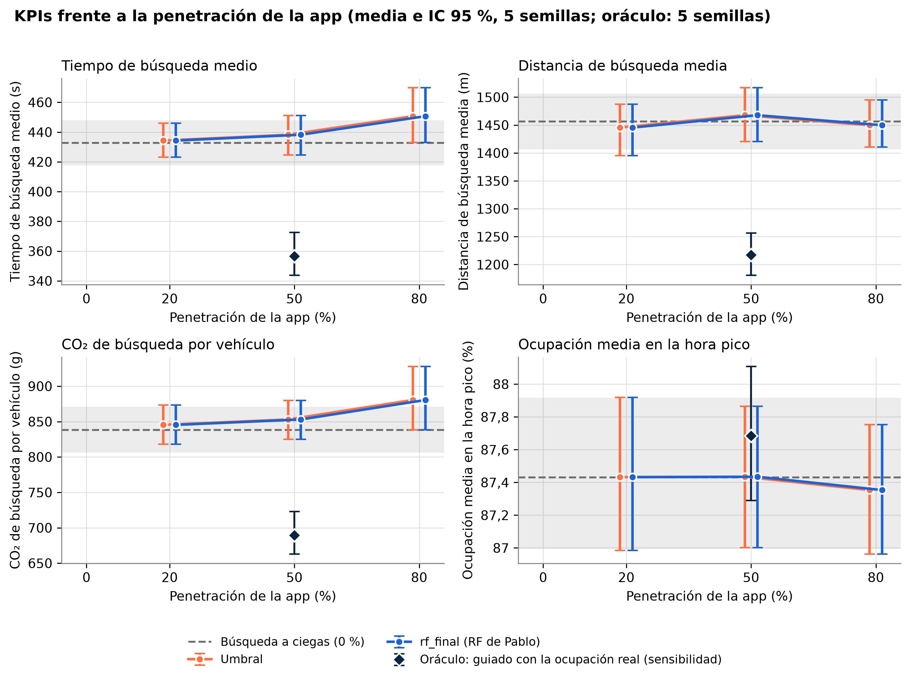
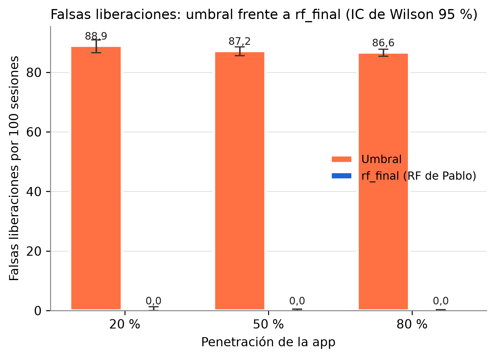
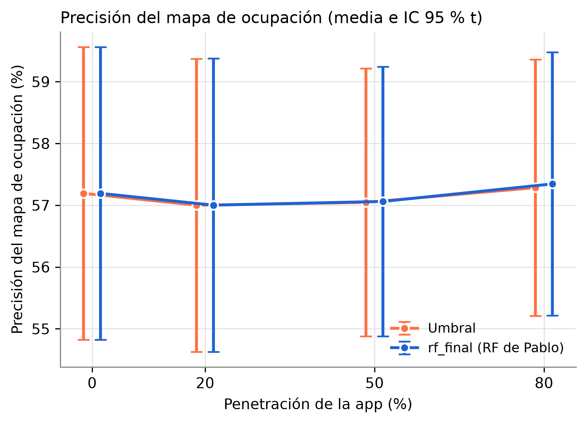

## Escenario de simulación y resultados experimentales

<!-- Plantilla: las cifras de resultados son marcadores que se rellenan desde
     kpis/resultados/final/resumen.csv con
     demo/.venv/bin/python demo/presentacion/generar_diapositivas.py --plantilla informe/tyrone.plantilla.md --salida informe/tyrone.md
     No se edita tyrone.md a mano. -->

Esta sección describe el escenario de SUMO sobre el que corre todo el sistema, el diseño de los
experimentos y lo que midieron. La pregunta es la del proyecto: si una parte de los conductores
que buscan parqueo en la zona SERT del Centro Histórico de Cuenca usa la app, ¿cuánto baja el
tiempo, la distancia y el CO₂ de la búsqueda, y qué tan fiable es el mapa de ocupación que la app
construye a partir del clasificador de movimiento?

### Escenario SUMO

**Red.** La red se construyó con `netconvert` a partir de OpenStreetMap, en el recuadro
`[-2,905; -79,013; -2,8895; -78,9945]`, que cubre el Centro Histórico y sus accesos. Tiene 985
aristas para autos, 1 824 peatonales, 775 cruces, 129 semáforos y 90,66 km de vías.
<!-- fuente: sumo/red/red_info.json -->
Se conservaron las aceras y los cruces peatonales porque el conductor, al bajarse, camina hasta su
destino y vuelve, y ese recorrido a pie es el que observa el clasificador.

**Puestos.** Los puestos SERT se generaron como `parkingArea` sobre las calles tarifadas
(residenciales, terciarias y secundarias con nombre, del lado derecho), con `5,5 m` por puesto y
`8 m` libres en cada esquina. Resultan 610 áreas con 6 194 puestos en 103 calles, una media de
10,15 puestos por área. <!-- fuente: sumo/parqueos/parqueos_info.json -->
Su identificador (`pa_<arista>_0`) es el mismo en SUMO, en el backend y en la app.

**Demanda.** La demanda de hora pico tiene tres componentes:

- autos de fondo que ocupan el `80 %` de los puestos desde el inicio, como estadía larga;
- tráfico de paso (`40 %` de las llegadas), que cruza la zona sin estacionar;
- buscadores, que van a 12 destinos reales (mercados, plazas e iglesias) con una estadía lognormal
  de `45 min` y que, si su puesto está lleno, siguen buscando con los `rerouter` de parqueo de SUMO.

**Calibración.** La tasa de llegadas `--veh-hora` se calibró para que la ocupación media en la hora
pico quede entre `85 %` y `95 %`, el rango en que buscar parqueo cuesta. Con `1800` veh/h, la
ocupación media de la línea base es de 87,4 % (IC 95 %
[87,0; 87,9] %).
<!-- fuente: kpis/resultados/final/resumen.csv -->
Cada corrida simula `75 min`: `15 min` de calentamiento y `60 min` de hora pico. Solo cuentan los
buscadores que estacionan dentro de la hora medida.

**Definiciones.** La búsqueda empieza cuando el auto entra a `300 m` de su destino (o a la arista
de su puesto objetivo) y termina al estacionar. La distancia de búsqueda es lo recorrido en ese
lapso, y el CO₂ de búsqueda, lo que SUMO (modelo HBEFA) atribuye a esos pasos. Estas definiciones
están fijas en `kpis/kpis.py` desde S2 y no cambiaron.

### Diseño experimental

La matriz cruza la penetración de la app {`0`, `20`, `50`, `80`} % con dos clasificadores de
movimiento, el umbral de velocidad y el `rf_final` de Pablo (bosque aleatorio congelado), y cinco
semillas. El `0 %` es la búsqueda a ciegas y corre una vez por semilla, lo que da 35 corridas.

- **Números aleatorios comunes.** La demanda depende solo de la semilla. Quién tiene app sale de un
  sorteo aparte (`default_rng([semilla, 7])`), así que los usuarios con app al `20 %` también la
  tienen al `50 %` y al `80 %`. Entre escenarios de una misma semilla salen los mismos autos a la
  misma hora; la única diferencia es la app.
- **Sistema completo.** Cada corrida usa el controlador TraCI de Freddy: guiado al puesto, peatones,
  emulador GPS con ruido, sesiones de cobro y KPIs del sistema. También usa la inferencia de Pablo,
  sin *mocks*.
- **Réplica.** La réplica independiente es la semilla. Los KPIs por vehículo se resumen con un IC
  95 % *bootstrap* jerárquico (se remuestrean semillas y, dentro de cada una, vehículos; 10 000
  remuestreos). Las falsas liberaciones usan un IC de Wilson, y los demás KPIs de sistema, t de
  Student entre semillas. Cada escenario se compara con la búsqueda a ciegas con Mann-Whitney U.
- **Sensibilidad (oráculo).** Cinco corridas más al `50 %` guían con la ocupación real de SUMO en
  lugar del mapa del sistema. No es algo que la app pueda hacer: es la cota superior de lo que
  ganaría con información perfecta de ocupación.

Las corridas de las semillas 1–3 se reutilizan de la matriz de S3, porque su configuración, red,
demanda y modelo tienen el mismo hash. `kpis/resultados/final/manifiesto.json` guarda el commit, la
versión de SUMO (1.12), los SHA-256 del modelo y de cada demanda, y los comandos para repetir todo.

### Resultados

*KPIs de búsqueda por escenario (media e IC 95 %; Δ frente a la búsqueda a ciegas; p de Mann-Whitney U).*

| Escenario | n semillas | Vehículos | Búsqueda (s) [IC 95 %] | Δ | p | Distancia (m) [IC 95 %] | Δ | CO₂ por vehículo (g) [IC 95 %] | Δ | Ocupación (%) [IC 95 %] |
|---|---:|---:|---:|---:|---:|---:|---:|---:|---:|---:|
| ciegas | 5 | 4 646 | 433 [418; 448] | — | — | 1 456 [1 407; 1 506] | — | 838 [806; 871] | — | 87,4 [87,0; 87,9] |
| p20_umbral | 5 | 4 695 | 434 [423; 446] | +0,4 % | 0,865 | 1 445 [1 395; 1 487] | −0,7 % | 845 [818; 874] | +0,8 % | 87,4 [87,0; 87,9] |
| p20_rf_final | 5 | 4 695 | 434 [423; 446] | +0,4 % | 0,865 | 1 445 [1 395; 1 487] | −0,7 % | 845 [818; 874] | +0,8 % | 87,4 [87,0; 87,9] |
| p50_umbral | 5 | 4 668 | 438 [425; 451] | +1,3 % | 0,125 | 1 468 [1 421; 1 517] | +0,8 % | 853 [825; 880] | +1,7 % | 87,4 [87,0; 87,9] |
| p50_rf_final | 5 | 4 668 | 438 [425; 451] | +1,3 % | 0,125 | 1 468 [1 421; 1 517] | +0,8 % | 853 [825; 880] | +1,7 % | 87,4 [87,0; 87,9] |
| p80_umbral | 5 | 4 627 | 451 [433; 470] | +4,1 % | 0,054 | 1 450 [1 411; 1 495] | −0,4 % | 880 [839; 928] | +5,0 % | 87,4 [87,0; 87,8] |
| p80_rf_final | 5 | 4 627 | 451 [433; 470] | +4,1 % | 0,054 | 1 450 [1 411; 1 495] | −0,4 % | 880 [839; 928] | +5,0 % | 87,4 [87,0; 87,8] |
| p50_oraculo | 5 | 4 790 | 357 [344; 373] | −17,6 % | < 0,001 | 1 217 [1 181; 1 257] | −16,4 % | 690 [663; 723] | −17,7 % | 87,7 [87,3; 88,1] |

<!-- fuente: kpis/resultados/final/resumen.md -->

*KPIs de búsqueda y ocupación frente a la penetración de la app, con el umbral, con `rf_final` y con el oráculo al 50 %.*

**Búsqueda con el sistema real.**
- La búsqueda a ciegas dura en media 433 s (IC 95 %
  [418; 448] s) y recorre 1 456 m.
  <!-- fuente: kpis/resultados/final/resumen.csv -->
- Con `rf_final`, el cambio frente a la búsqueda a ciegas es de +0,4 %,
  +1,3 % y +4,1 % al `20`, `50` y
  `80 %`. <!-- fuente: kpis/resultados/final/resumen.csv -->
- La distancia y el CO₂ siguen el mismo patrón: al `50 %`, +0,8 % y
  +1,7 %. <!-- fuente: kpis/resultados/final/resumen.csv -->

Ninguna de estas variaciones es una mejora: son de pocos puntos porcentuales y los IC de los
escenarios se solapan con el de la línea base. Si algo, la búsqueda tiende a subir con la
penetración: al `80 %` la diferencia con la búsqueda a ciegas tiene p = 0,054
(Mann-Whitney U). <!-- fuente: kpis/resultados/final/resumen.csv -->

Los autos con app no ganan frente a los que no la tienen. Al `50 %` buscan en media
442 s, frente a 434 s
de los demás en la misma corrida. <!-- fuente: kpis/resultados/final/resumen.csv -->

**El clasificador no cambia la búsqueda.** A igual penetración y semilla, el umbral y `rf_final`
producen exactamente la misma búsqueda, porque ninguna decisión del guiado cambia entre ellos.

**Por qué el guiado no ayuda.**
- El guiado recomienda el puesto libre más cercano al destino según el **mapa del sistema**.
- Ese mapa solo conoce las sesiones de los usuarios de la app. Al `50 %` y con
  87,4 % de ocupación real, casi todos los puestos ocupados lo están por
  autos sin app, que el mapa no ve. <!-- fuente: kpis/resultados/final/resumen.csv -->
- El guiado manda al conductor a un puesto que el sistema cree libre pero que está lleno; al
  llegar, busca como cualquier otro.
- Por la misma razón, la precisión del mapa queda en 57,1 % al `50 %`.
  <!-- fuente: kpis/resultados/final/resumen.csv -->
- Una falsa liberación suma un libre en un mapa que ya ve ese puesto libre, así que nunca cambia una
  recomendación.

**Cota superior: el oráculo.** Con la ocupación real, el guiado sí reduce la búsqueda:
- al `50 %`, la media baja a 357 s, un cambio de
  −17,6 % frente a la búsqueda a ciegas;
- los autos con app buscan 310 s y los sin app
  405 s;
- el CO₂ de búsqueda por vehículo cambia −17,7 %.

<!-- fuente: kpis/resultados/final/resumen.csv -->

La diferencia entre el oráculo y el sistema real mide el valor de la información de ocupación que
falta, no la calidad del clasificador.

*Umbral frente a `rf_final` por penetración: falsas liberaciones (Wilson 95 %), retardo de cierre, error de facturación y precisión del mapa.*

| Penetración | Clasificador | Sesiones | Falsas /100 [Wilson 95 %] | Retardo de cierre, mediana (s) [IC 95 %] | Error de facturación (USD) [IC 95 %] | Precisión del mapa (%) [IC 95 %] |
|---:|---|---:|---:|---:|---:|---:|
| 20 % | umbral | 801 | 88,9 [86,5; 90,9] | 26,7 [10,3; 43,1] | −0,157 [−0,171; −0,143] | 57,0 [54,6; 59,4] |
| 20 % | rf_final | 289 | 0,0 [0,0; 1,3] | 22,7 [9,8; 35,6] | 0,016 [0,009; 0,023] | 57,0 [54,6; 59,4] |
| 50 % | umbral | 1 971 | 87,2 [85,6; 88,6] | 25,2 [16,0; 34,4] | −0,153 [−0,168; −0,139] | 57,0 [54,9; 59,2] |
| 50 % | rf_final | 729 | 0,0 [0,0; 0,5] | 18,8 [17,2; 20,4] | 0,018 [0,014; 0,021] | 57,1 [54,9; 59,2] |
| 80 % | umbral | 3 076 | 86,6 [85,4; 87,8] | 17,6 [12,4; 22,8] | −0,145 [−0,153; −0,138] | 57,3 [55,2; 59,4] |
| 80 % | rf_final | 1 132 | 0,0 [0,0; 0,3] | 18,4 [17,0; 19,8] | 0,015 [0,012; 0,019] | 57,3 [55,2; 59,5] |
| 50 % | oráculo | 772 | 0,0 [0,0; 0,5] | 21,3 [15,8; 26,8] | 0,016 [0,013; 0,019] | 56,0 [54,1; 57,9] |

<!-- fuente: kpis/resultados/final/resumen.md -->

*Falsas liberaciones por 100 sesiones con el umbral y con `rf_final` (IC de Wilson 95 %).*

**El clasificador sí importa para el cobro.**
- Con el umbral, 87,2 de cada 100 sesiones se cierran antes de que el
  conductor vuelva (IC de Wilson [85,6;
  88,6] al `50 %`). Con `rf_final` son
  0,0 ([0,0;
  0,5]). <!-- fuente: kpis/resultados/final/resumen.csv -->
- El umbral confunde caminar despacio por el centro con el inicio de la conducción. Cada falsa
  liberación cierra la sesión y cobra de menos: el error de facturación medio es de
  −0,153 USD por sesión con el umbral, frente a
  0,018 USD con `rf_final`.
  <!-- fuente: kpis/resultados/final/resumen.csv -->
- El retardo mediano de cierre con `rf_final` es de 18,8 s desde que
  el conductor arranca. <!-- fuente: kpis/resultados/final/resumen.csv -->

*Precisión del mapa de ocupación frente a la penetración de la app.*

### Controles de cordura

1. **Teletransportes < 1 % por corrida:** cumple (máximo 0,166 % en 40 corridas).
2. **Línea base a ±10 % de S3-1:** cumple (final 432,7 s; S3-1 436,1 s; diferencia −0,79 %). S3-1 usó las semillas 1–3; la final, 1–5 (las 1–3 son las mismas corridas).
3. **rf_final sin más falsas liberaciones que el umbral:** cumple (20 %: umbral 88,9 vs rf_final 0,0; 50 %: umbral 87,2 vs rf_final 0,0; 80 %: umbral 86,6 vs rf_final 0,0).

<!-- fuente: kpis/resultados/final/controles.json -->

### Discusión

Los resultados separan dos preguntas que el proyecto había juntado.

**¿El clasificador detecta bien la llegada y la salida?** Sí. `rf_final` lleva las falsas
liberaciones prácticamente a cero, y con ellas el error de cobro. El cobro por tiempo real frente a
la tarjeta SERT solo tiene sentido con un clasificador así: con el umbral, la mayoría de las
sesiones se cerrarían antes de tiempo.

**¿La app reduce la búsqueda?** No con la información que tiene. Un mapa construido solo con las
sesiones de sus usuarios no conoce la ocupación real cuando la zona está casi llena, que es justo
cuando buscar cuesta. El oráculo muestra que el guiado funcionaría con información completa. Para
acercarse a esa cota hace falta una fuente de ocupación que no dependa de los usuarios, por ejemplo
los registros de la propia tarjeta SERT o sensores en las calles más demandadas. Queda como trabajo
futuro, fuera del alcance acordado.

### Limitaciones

- **Todo es simulado.** No hay pruebas de campo; el GPS es un modelo de ruido sobre las
  trayectorias de SUMO y el teléfono de la demo solo refleja un auto simulado.
- **El clasificador** se entrenó con GeoLife (Pekín) y no con trazas de Cuenca. Su desempeño en
  calles empedradas y estrechas puede ser distinto.
- **Un solo escenario temporal:** una hora pico, una red recortada al Centro Histórico y una tasa de
  llegadas calibrada. No se modelan días ni horarios distintos.
- **Cinco semillas por escenario:** los IC jerárquicos son anchos frente a diferencias de pocos
  puntos porcentuales.
- **El oráculo no es implementable:** solo acota el beneficio posible.
