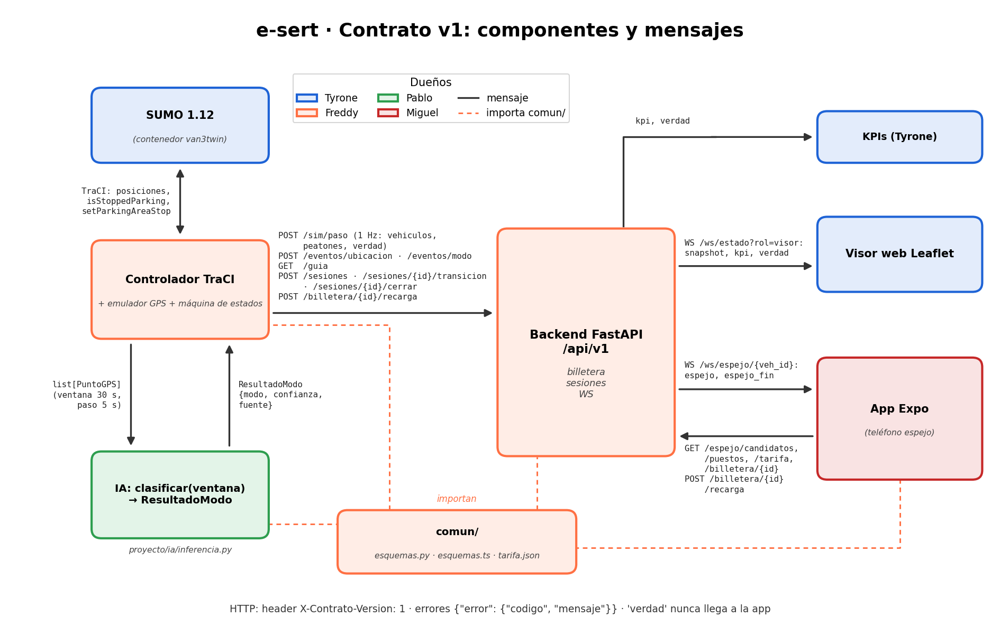
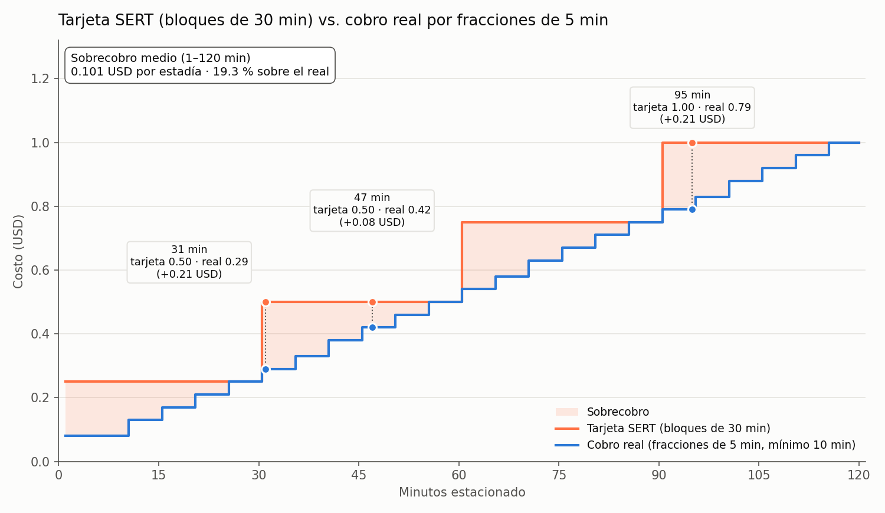

# S1 · Freddy 🍅: resumen semanal

## Sesión 1 · 2026-10-22 · Contrato v1 y esquemas compartidos

Contrato v1 completo en `codigo/comun/CONTRATO.propuesto.md`, con "Cambios respecto a v0":
el cierre de los autos simulados lo pide el controlador TraCI con `POST /sesiones/{id}/cerrar`;
hay formato y lista de errores, header `X-Contrato-Version: 1`, la ruta nueva
`POST /sim/paso` y el mensaje WS `verdad`, solo para el visor. El contrato se volvió código
compartido: `esquemas.py` (Pydantic v2, 41 modelos y 9 enums), `esquemas.ts` (espejo
TypeScript), `tarifa.json` + `tarifa.py` y 29 ejemplos JSON más un CSV de trazas. Lo cubren
163 tests de pytest, entre ellos la paridad `.ts` ↔ `.py`.

Explicación: [explicaciones/s1_explicacion.pdf](explicaciones/s1_explicacion.pdf)

## Sesión 2 · 2026-10-22 · Núcleo del backend (billetera, tarifa y sesiones)

Núcleo en Python puro, sin HTTP, en `codigo/backend/nucleo/`, con SQLAlchemy 2 + SQLite:
- billetera como libro de movimientos: el saldo se calcula y nunca se guarda;
- tarifa sobre `comun/`;
- `ServicioSesiones`, con las 5 reglas de cobro de `CONTEXTO.md`;
- `MapaOcupacion`, con recomendación por haversine.

Lo cubren 63 tests con 99 % de cobertura, incluidos un test de propiedad con 200
operaciones aleatorias y regresiones de los bugs que encontró el verificador. Con la tarjeta
SERT, el conductor paga en promedio 0,10 USD (19,3 %) más que con el cobro por fracciones.

Explicación: [explicaciones/s2_explicacion.pdf](explicaciones/s2_explicacion.pdf)
