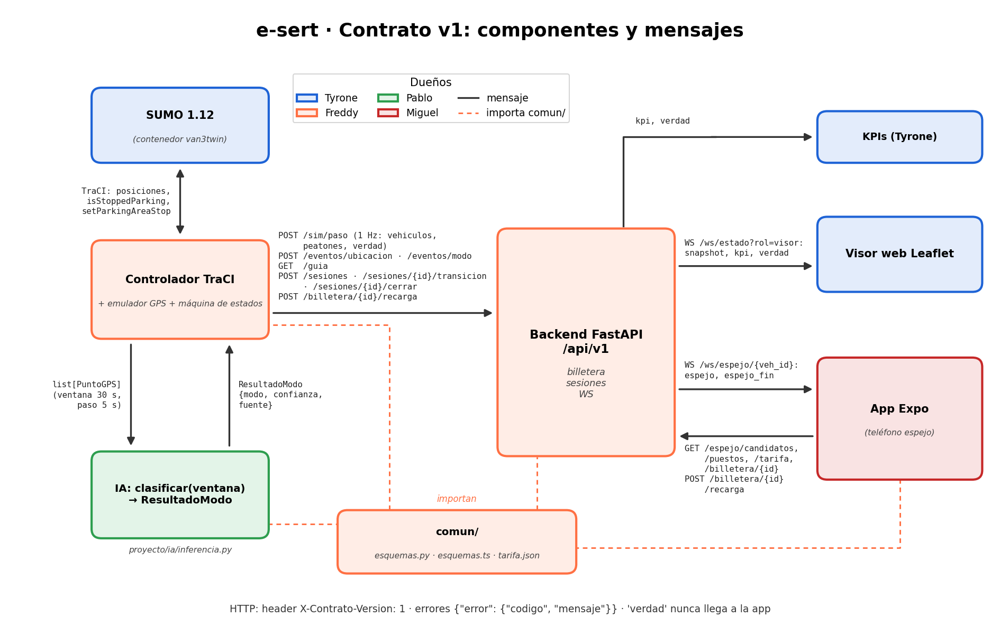

# S1 · Sesión 1 · Freddy: Contrato v1 y esquemas compartidos

## 1. Resumen en 5 líneas

1. Revisé el contrato v0 (`docs/CONTRATO.md`), cerré sus huecos y escribí la versión v1 completa en `comun/CONTRATO.propuesto.md`.
2. Convertí el contrato en código compartido: modelos Pydantic (`esquemas.py`) para TraCI, backend e IA, y tipos TypeScript (`esquemas.ts`) para la app.
3. La tarifa vive en un solo archivo (`tarifa.json`), y `tarifa.py` la valida y hace todos los cálculos de cobro.
4. En `ejemplos/` hay 29 JSON válidos (uno por mensaje) y un CSV de trazas, para que cada persona pruebe su parte sin esperar a las demás.
5. 163 tests de pytest garantizan que los ejemplos validan, que los datos malos fallan, que la tarifa cuadra y que el `.ts` y el `.py` tienen los mismos campos.

## 2. Conceptos clave

- **Contrato de interfaces:** acuerdo escrito sobre el formato de los mensajes entre módulos. Permite que cuatro personas trabajen por separado y que el domingo todo encaje.
- **Pydantic v2:** librería de Python que define un mensaje como una clase con tipos y restricciones (`lat` entre −90 y 90, `confianza` entre 0 y 1, patrón de `sesion_id`) y rechaza lo que no cumple. FastAPI la usa directamente, así que el backend valida gratis.
- **`extra="forbid"`:** un campo desconocido es un error. Así una errata como `velocidad_mp` se detecta en lugar de perderse en silencio.
- **Unión discriminada:** todos los mensajes WebSocket llevan un campo `tipo` (`snapshot`, `kpi`, `verdad`, `espejo`, `espejo_fin`), y Pydantic elige el modelo correcto según ese campo (`leer_mensaje_ws`).
- **Mensaje `verdad`:** la ocupación *real* de SUMO. Sirve para medir la precisión del mapa (estimado frente a real). Solo existe en simulación y nunca llega a la app.
- **Versionado por header:** cada petición HTTP lleva `X-Contrato-Version: 1`. Si alguien usa un cliente viejo, el backend lo rechaza con un error claro en lugar de fallar de forma rara.
- **Centavos enteros:** el dinero se calcula en centavos con `Decimal` y redondeo "mitad hacia arriba", para evitar errores de coma flotante (0,1 + 0,2 ≠ 0,3).
- **Paridad Python ↔ TypeScript:** como el `.ts` se escribe a mano, un test lo lee con expresiones regulares y lo compara campo por campo con los modelos de Python.

## 3. Cómo se generó cada cosa

| Resultado | Comando (desde semanas/S1/Freddy/codigo) | Entradas | Salidas |
|---|---|---|---|
| Entorno | python3 -m venv comun/.venv && comun/.venv/bin/pip install -r comun/requirements.txt | requirements.txt | .venv/ (ignorado por git) |
| Tests | comun/.venv/bin/pytest comun/tests | esquemas.py, esquemas.ts, tarifa.*, ejemplos/, CONTRATO.propuesto.md | 163 passed |
| Diagrama | comun/.venv/bin/python comun/diagrama_contrato.py | — (todo en el script) | ../evidencias/s1_contrato-diagrama.png |
| Ejemplos | Escritos una sola vez con un script temporal; ahora son archivos fijos del repo | — | comun/ejemplos/*.json, traza.csv |
| PDF | python herramientas/explicacion_pdf.py S1 Freddy 1 (desde la raíz) | este .md | s1_explicacion.pdf |

## 4. Mapa de archivos

| Archivo | Qué contiene | Quién lo usa |
|---|---|---|
| comun/CONTRATO.propuesto.md | Contrato v1 completo + "Cambios respecto a v0" | Todos; la unificación lo copia a docs/CONTRATO.md |
| comun/esquemas.py | 41 modelos Pydantic, 9 enums, tabla código → HTTP, leer_mensaje_ws | Freddy (TraCI, backend), Pablo (IA), Tyrone (KPIs) |
| comun/esquemas.ts | Los mismos tipos en TypeScript | Miguel (app); Tyrone (visor, si usa TS) |
| comun/tarifa.json | Parámetros de cobro | Backend y app |
| comun/tarifa.py | cargar_tarifa() y los cálculos de cobro | Backend, controlador TraCI y KPI de error de facturación |
| comun/ejemplos/ | 29 JSON + traza.csv | Tests de todos; mocks de la app y del visor |
| comun/tests/test_esquemas.py | 163 tests | CI y unificación |
| comun/diagrama_contrato.py | Genera el diagrama de componentes | Evidencia |

## 5. Recorrido del código

**`esquemas.py`**
- `Modelo`: base con `extra="forbid"` y `a_json()`.
- Tipos con restricción (`PuestoId`, `SesionId`, `Latitud`, `TSim`…) definidos una sola vez con `Annotated`.
- Un modelo por cuerpo REST (`EventoUbicacion`, `NuevaSesion`, `SesionCerrada`, `Billetera`…), por pieza del `/sim/paso` y por mensaje WS.
- `MensajeWS` + `leer_mensaje_ws()`: la unión discriminada.
- `FilaTraza.desde_csv()`: convierte las celdas vacías del CSV en `None`.

```python
class MensajeVerdad(Modelo):
    """`{"tipo": "verdad"}`: ocupación real de SUMO. Solo simulación y solo `?rol=visor`."""
    tipo: Literal["verdad"] = "verdad"
    t_sim: TSim
    ts: FechaISO
    puestos: List[OcupacionPuesto]
    estacionados: List[VehiculoId] = Field(default_factory=list)
    falsas_liberaciones: List[SesionId] = Field(default_factory=list)

MensajeWS = Annotated[
    Union[MensajeSnapshot, MensajeKpi, MensajeVerdad, MensajeEspejo, MensajeEspejoFin],
    Field(discriminator="tipo"),
]
```

**`tarifa.py`**
- `cargar_tarifa()`: valida el esquema y la coherencia entre parámetros (el cobro mínimo no supera el bloque mínimo, el bloque es múltiplo de la fracción).
- `minutos_cobrados()`, `costo_usd()`, `monto_retencion()`, `monto_debito()` y `tarjeta_sert_usd()`.

```python
def minutos_cobrados(minutos_reales: float, tarifa: Tarifa) -> int:
    fracciones = math.ceil(max(0.0, minutos_reales) / tarifa.fraccion_min - 1e-9)
    return max(tarifa.cobro_minimo_min, fracciones * tarifa.fraccion_min)
```

**`tests/test_esquemas.py`**
- `MODELO_POR_EJEMPLO`: asocia cada archivo de ejemplo con su modelo. Un ejemplo sin modelo hace fallar el test.
- `CASOS_MALOS`: 25 casos inválidos (modo inventado, latitud −95, hora sin zona, campo extra…).
- `_interfaces_ts()` y `_uniones_ts()`: el *parser* por expresiones regulares del `.ts`, que también resuelve `extends`. Con ellos se comparan modelos, campos, campos opcionales y valores de los enums.

## 6. Cómo se conecta con los demás

- **Tyrone (visor y KPIs):** recibe `snapshot`, `kpi` y `verdad` por `WS /ws/estado?rol=visor`. Los `puesto_id` coinciden con su `puestos.csv` (`pa_<edge>_<n>`, con capacidad).
- **Pablo (IA):** `clasificar(list[PuntoGPS]) -> ResultadoModo`, importando los modelos de `comun.esquemas`. Sus trazas siguen el CSV de §8 (su `segmento_id` está permitido como columna extra).
- **Miguel (app):** reemplaza su `tipos.ts` por `comun/esquemas.ts`. Se incorporan sus propuestas de `Sesion`, `Movimiento` y `ErrorApi`, y la app recibe `espejo`/`espejo_fin` por `/ws/espejo/{veh_id}`.
- **Freddy (S2):** el controlador TraCI envía `POST /sim/paso`, informa las transiciones y cierra las sesiones. El backend implementa las rutas y errores de §4 usando `tarifa.py`.

## 7. Resultados y evidencias

- 163 tests pasan; además, una prueba de mutación (borrar un campo del `.ts` o un valor de un enum) hace fallar los tests de paridad.
- 29 ejemplos JSON + 1 CSV; 25 casos malos rechazados.
- Ejemplo de cobro: 47 min reales → 50 min cobrados → $0,42; la tarjeta SERT costaría $0,50 → ahorro $0,08.



## 8. Limitaciones y decisiones

- `esquemas.ts` no se pudo compilar con `tsc`: la computadora no tiene Node y el contenedor tiene Node 12 sin `npm`. La paridad sí está verificada por los tests, y la sintaxis es la misma que ya usa la app de Miguel.
- La tarifa sigue siendo provisional, a la espera de que Miguel verifique la tarifa SERT. Se añadieron `aviso_tiempo_min` y `tarjeta_bloque_min` (este último con el supuesto de tarjetas de 1 hora).
- `snapshot.puestos` es la ocupación *estimada*. Cómo se estima para los autos sin app queda para el backend y los KPIs en S2.
- `X-Sim-Token` es opcional en local y obligatorio en el VPS (lo configura Tyrone).

## 9. Preguntas que podría hacer el profesor

1. **¿Por qué el backend no decide la salida del auto?** Porque el controlador TraCI es quien tiene a mano el GPS, el clasificador y la máquina de estados. El backend valida la transición, guarda el estado y cobra (`POST /sesiones/{id}/cerrar`).
2. **¿Cómo miden la precisión del mapa sin hacer trampa?** SUMO publica la ocupación real en el mensaje `verdad`, que el backend no usa para estimar el mapa y que nunca llega a la app.
3. **¿Cómo evitan que el `.ts` y el `.py` diverjan?** Con un test que lee el `.ts` con expresiones regulares y compara modelos, campos, opcionales y enums.
4. **¿Por qué centavos enteros?** Porque con flotantes el error de redondeo se acumula y afecta el KPI de error de facturación.
5. **¿Qué pasa si un auto se queda sin saldo?** Se debita igual (puede quedar en negativo hasta el margen), se avisa con `saldo_bajo`/`saldo_agotado` y se bloquean nuevas sesiones con `403 SESIONES_BLOQUEADAS`.
