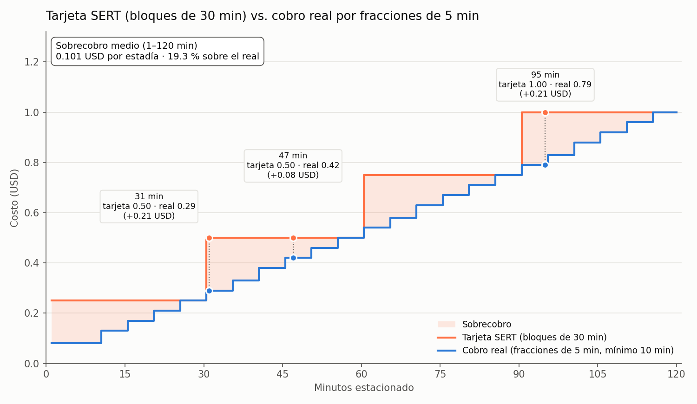

# S1 · Sesión 2 · Freddy: Núcleo del backend (billetera, tarifa y sesiones)

## 1. Resumen en 5 líneas

1. Construí el **núcleo del backend** en Python puro, sin HTTP: billetera, tarifa, sesiones de parqueo y mapa de ocupación.
2. El controlador TraCI lo importa directamente en los experimentos (cientos de autos, rápido y reproducible); en S2, FastAPI será solo una capa delgada encima.
3. La billetera es un **libro de movimientos**: el saldo nunca se guarda, siempre se calcula sumando recargas, débitos, retenciones y liberaciones.
4. Las 5 reglas de cobro de `CONTEXTO.md` están implementadas y probadas: 63 tests y 99 % de cobertura del núcleo.
5. La gráfica de evidencia muestra que, con la tarjeta SERT de papel, el conductor paga en promedio un 19,3 % más que con el cobro por fracciones.

## 2. Conceptos clave

- **Núcleo sin HTTP:** la lógica de negocio no sabe nada de la web. Se puede llamar miles de veces por segundo desde la simulación y probar sin levantar un servidor.
- **Libro de movimientos (*ledger*):** en lugar de guardar un "saldo" que se pueda corromper, se guarda cada asiento (recarga, retención, débito, liberación) y el saldo se calcula. Es como un estado de cuenta bancario.
- **Retención:** dinero apartado (no gastado) al llegar al puesto: el bloque mínimo de 30 min, $0,25. Al salir se libera y se debita el costo real.
- **Transacción atómica:** varias escrituras que ocurren todas o ninguna. Al iniciar una sesión, la fila de la sesión y la retención van juntas; si algo falla, no queda nada a medias.
- **SQLAlchemy 2 + SQLite:** ORM de Python y base de datos en un archivo, o en memoria (`sqlite:///:memory:`) para los experimentos.
- **Centavos enteros:** el dinero se guarda como entero en centavos, para no acumular errores de coma flotante.
- **Haversine:** fórmula de distancia sobre la esfera terrestre a partir de lat/lon. Con ella se elige el puesto libre más cercano al destino.
- **Test de propiedad:** en lugar de un caso fijo, se hacen 200 operaciones aleatorias (5 semillas) y se comprueba que una regla se cumple *siempre* (`saldo = Σ recargas − Σ débitos`).
- **Cobertura:** porcentaje de líneas del código que los tests ejecutan (`pytest-cov`).

## 3. Cómo se generó cada cosa

Todos los comandos se ejecutan desde `semanas/S1/Freddy/codigo`.

| Resultado | Comando | Entradas | Salidas |
|---|---|---|---|
| Entorno | python3 -m venv backend/.venv && backend/.venv/bin/pip install -r backend/requirements.txt | requirements.txt | backend/.venv (ignorado) |
| Tests y cobertura | backend/.venv/bin/pytest backend/tests --cov=backend/nucleo | nucleo/, comun/ | 63 passed, 99 % |
| Gráfica | backend/.venv/bin/python backend/graficas/cobro_sert_vs_real.py | nucleo/tarifa.py, comun/tarifa.json | evidencias/s2_cobro-sert-vs-real.png |
| Contenedor | docker exec van3twin pip3 install --user sqlalchemy pydantic | - | núcleo importable por el controlador TraCI |

## 4. Mapa de archivos

| Archivo | Qué contiene | Quién lo usa |
|---|---|---|
| backend/nucleo/db.py | Tablas (usuarios, movimientos, sesiones, puestos), BaseDatos, lectura de puestos.csv y mock de 20 puestos | Todo el núcleo |
| backend/nucleo/tarifa.py | minutos_cobrables, costo, costo_tarjeta_sert, retencion (sobre comun/tarifa.py) | Sesiones, gráfica, KPIs |
| backend/nucleo/billetera.py | Clase Billetera: recargar, retener, debitar, liberar, estado, movimientos | Sesiones, FastAPI (S2) |
| backend/nucleo/sesiones.py | ServicioSesiones: iniciar, transicion, cerrar, avisos, recibo, obtener | Controlador TraCI, FastAPI (S2) |
| backend/nucleo/ocupacion.py | MapaOcupacion: ocupar/liberar, libres_cerca, recomendar | GET /guia, snapshot, KPI de precisión del mapa |
| backend/nucleo/errores.py | ErrorNucleo con código y HTTP del contrato | FastAPI (S2) |
| backend/tests/ | 63 tests (tarifa, billetera, sesiones, ocupación, db, propiedad, sin HTTP y regresiones) | Verificación |
| backend/graficas/cobro_sert_vs_real.py | Gráfica de evidencia | Exposición |

## 5. Recorrido del código

**`billetera.py`.** `estado_centavos()` suma el libro por tipo de movimiento: nunca lee un saldo guardado.

```python
def estado_centavos(self, usuario, s=None):
    t = self.sumas(usuario, s)
    saldo = t[TM.recarga] - t[TM.debito]
    retenido = t[TM.retencion] - t[TM.liberacion]
    return {"saldo": saldo, "retenido": retenido, "disponible": saldo - retenido}
```

**`db.py`.** `BaseDatos.transaccion(s)` abre una transacción, o reutiliza la que ya está abierta. Así `ServicioSesiones` combina varias operaciones de la billetera en un todo-o-nada.

**`sesiones.py`.**
- `iniciar` valida, en este orden: puesto existente, sin sesión abierta, saldo no negativo, disponible ≥ retención y puesto con lugar. Después crea la sesión y retiene. El lugar se cuenta **en la base**, dentro de la transacción, y un índice único parcial impide dos sesiones abiertas por usuario; así, dos procesos (el controlador TraCI y FastAPI) no pueden sobrellenar un puesto. El mapa en memoria se sincroniza con ese conteo.
- `cerrar` calcula los minutos (con `t_sim` si los hay), debita, libera la retención y libera el puesto en el mapa.
- `avisos` calcula `saldo_bajo`, `saldo_agotado`, `tiempo_maximo_cerca`/`tiempo_maximo_superado` y `sesiones_bloqueadas`.

```python
minutos = _minutos(ses.inicio, fin, ses.t_sim_inicio, t_sim)
cobrados = tar.minutos_cobrables(minutos)
debito = tar.centavos(tar.costo(minutos))
self.billetera.debitar(ses.usuario_id, debito, sesion_id, fin, s)
pendiente = self.billetera.retenido_de_sesion(sesion_id, s)
if pendiente > 0:
    self.billetera.liberar(ses.usuario_id, pendiente, sesion_id, fin, s)
ses.estado = E.CERRADA.value
```

**`ocupacion.py`.** `recomendar()` recorre los puestos, descarta los que no tienen plazas libres y se queda con el más cercano al destino por haversine.

## 6. Cómo se conecta con los demás

- **Consume:** `comun/tarifa.json` y `comun/tarifa.py` (una sola fórmula de cobro) y `comun/esquemas.py` (las respuestas son los modelos del contrato: `SesionCreada`, `SesionCerrada`, `Billetera`, `Puesto`…). También lee el `puestos.csv` de Tyrone; mientras no esté en `proyecto/`, usa un mock de 20 puestos.
- **Entrega:**
  - para Freddy (TraCI, S2): `ServicioSesiones` importable en el contenedor;
  - para FastAPI (S2): `ErrorNucleo` → `{"error": {...}}` con su HTTP;
  - para Tyrone (KPIs): `MapaOcupacion.ocupacion()` como ocupación *estimada* del `snapshot`.

## 7. Resultados y evidencias

- 63 tests en verde, con 99 % de cobertura del núcleo (479 líneas, 4 sin cubrir).
- Ejemplos de cobro: 12 min → 15 min → $0,13; 3 min → 10 min → $0,08; 47 min → 50 min → $0,42, que deja un saldo de $4,58 tras recargar $5.
- **Sobrecobro de la tarjeta SERT:** $0,101 por estadía en promedio (19,3 %), entre 1 y 120 min. Por ejemplo, a los 31 min la tarjeta cobra $0,50 y el cobro real $0,29.
- Velocidad: unos 0,9 ms por operación de billetera en SQLite en memoria.



## 8. Limitaciones y decisiones

- **Tarjeta SERT a 30 min:** el prompt pide bloques de 30 min, así que corregí `tarjeta_bloque_min` (antes supuse 60) en `tarifa.json` y en el contrato.
- **Nombre del aviso:** se mantiene el del contrato, `tiempo_maximo_cerca`, en lugar de `tiempo_maximo_proximo` del prompt, para no romper la paridad con `esquemas.ts`.
- **Bloqueo derivado:** el "usuario bloqueado" no es una marca guardada; se deriva de `saldo < 0`. Así nunca se desincroniza del libro.
- **Saldo por debajo del margen:** el saldo puede quedar por debajo de −$0,50 si la sesión fue muy larga; el aviso `saldo_agotado` debía saltar antes.
- **Puestos mock:** se usan mientras `puestos.csv` no esté en `proyecto/`; el lector ya acepta el formato de Tyrone.
- **Retención, débito y liberación ligados a la sesión:** solo valen para una sesión del mismo usuario, y la retención no puede superar el disponible (bugs que encontró el verificador, corregidos con tests de regresión).
- **Distancia en línea recta:** `recomendar` usa haversine; el tiempo de manejo se mejora en S2.

## 9. Preguntas que podría hacer el profesor

1. **¿Por qué no guardar el saldo en una columna?** Porque podría desincronizarse del historial. Calculado del libro, siempre es auditable y correcto por construcción; el test de propiedad lo verifica.
2. **¿Qué pasa si el sistema falla a mitad de iniciar una sesión?** La sesión y la retención van en una sola transacción: o quedan las dos o ninguna. Hay un test que fuerza el fallo.
3. **¿Por qué el núcleo no usa HTTP?** Para que la simulación lo llame directamente con cientos de autos, sin latencia de red y de forma reproducible.
4. **¿El mapa de ocupación es la realidad?** No: solo ve las sesiones de la app. La diferencia con la ocupación real de SUMO (mensaje `verdad`) es el KPI de precisión del mapa.
5. **¿Cuánto ahorra el conductor frente a la tarjeta?** En promedio $0,10 por estadía (19 %), porque paga por fracciones de 5 min en lugar de por bloques de 30 min.
