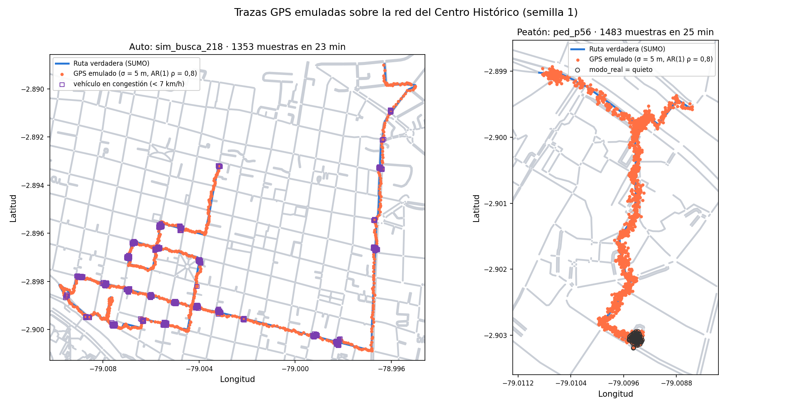
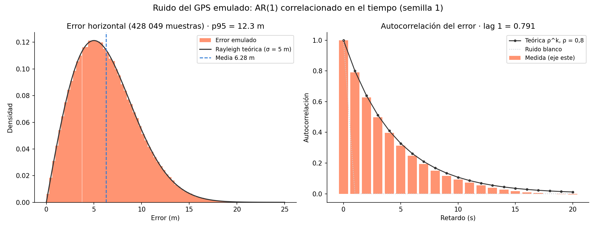

# S1 · Sesión 3 · Freddy: Controlador TraCI base y emulador de GPS

## 1. Resumen en 5 líneas

1. Construí el **controlador TraCI base**: arranca SUMO en el contenedor, avanza la simulación con suscripciones y tiene *hooks* donde en S2 se enchufan la máquina de estados y el guiado.
2. Construí un **emulador de GPS de teléfono**: a la posición verdadera de cada auto o peatón le suma un ruido correlacionado en el tiempo (AR(1), ρ = 0,8, σ = 5 m), pierde muestras y calcula la velocidad como lo haría un teléfono.
3. Sobre el escenario de hora pico de Tyrone, más 150 peatones propios, generé **3 semillas de trazas** de 30 minutos, de 413 000 a 448 000 filas cada una, con la etiqueta verdadera del modo.
4. Las trazas incluyen los casos difíciles para el clasificador de Pablo: autos en congestión a menos de 7 km/h y peatones rápidos.
5. Los 19 tests pasan, y las gráficas confirman que el ruido tiene la forma esperada: error medio de 6,28 m y autocorrelación con lag 1 de 0,791.

## 2. Conceptos clave

- **TraCI:** la interfaz para controlar SUMO desde Python paso a paso: leer posiciones, detener autos, mandarlos a un parqueo.
- **Suscripciones:** en lugar de pedir la posición de cada auto con una llamada aparte, se le dice a SUMO "en cada paso, mándame posición, velocidad y estado de parada de estos autos". Es mucho más rápido.
- **Hooks (`on_paso`):** funciones que el controlador llama después de cada paso. La lógica nueva (GPS, estados, guiado) se añade sin tocar el bucle.
- **Proceso AR(1):** el error de hoy se parece al de hace un segundo: `e_t = ρ·e_{t−1} + √(1−ρ²)·σ·ruido`. Con ρ = 0,8, el error se "arrastra" unos segundos, como un GPS real entre edificios (cañón urbano). El ruido blanco, en cambio, salta al azar en cada muestra.
- **Distribución de Rayleigh:** si el error este y el error norte son gaussianos con σ, el error horizontal (la distancia) sigue una Rayleigh con media σ·√(π/2) ≈ 6,27 m.
- **Velocidad por diferencias:** el teléfono estima la velocidad con las posiciones (ruidosas). Por eso una persona quieta "se mueve" unos 4 m/s: el ruido de la posición se convierte en velocidad aparente. Es justo lo que vuelve difícil la regla "más de 8 km/h = auto".
- **Etiqueta verdadera (`modo_real`):** la sabe SUMO. `vehiculo` es un auto circulando o detenido en el tráfico; `quieto`, un auto estacionado (con la persona adentro) o un peatón detenido; `a_pie`, un peatón caminando.
- **Choque de nombres `traci`:** nuestro módulo se llama `traci`, igual que la librería de SUMO. Por eso la de SUMO se carga con otro nombre (`sumo_traci`).

## 3. Cómo se generó cada cosa

Todo lo que usa SUMO se ejecuta dentro del contenedor, desde `semanas/S1/Freddy/codigo`, con `docker exec -w /home/vanet/results/e-sert/semanas/S1/Freddy/codigo van3twin bash -lc "..."`.

| Resultado | Comando | Entradas | Salidas |
|---|---|---|---|
| Copia del escenario | python traci/obtener_escenario.py (en la computadora) | rama origin/tyrone/s1 | traci/escenario/tyrone/sumo/ (ignorado) |
| Dependencias | pip3 install --user -r traci/requirements.txt (contenedor) | requirements.txt | pyproj, pytest, pydantic |
| Corrida base | python3 -m traci.controlador --cfg traci/escenario/tyrone/sumo/centro_base.sumocfg --hasta 300 | escenario de Tyrone | resumen por consola |
| Trazas | python3 -m traci.generar_trazas --semilla N (N = 1, 2, 3; la 1 con --muestra 5000) | escenario + peatones propios | traci/trazas/sumo_semillaN.csv (ignorados), sumo_semilla1_muestra.csv |
| Evidencias | python3 -m traci.graficas_gps --semilla 1 | sumo_semilla1.csv, red | evidencias/s3_trazas-gps.png, s3_ruido-gps.png |
| Tests | python3 -m pytest traci/tests (contenedor) o comun/.venv/bin/pytest traci/tests (computadora) | gps.py, trazas | 19 passed (2 de integración solo en el contenedor) |

## 4. Mapa de archivos

| Archivo | Qué contiene | Quién lo usa |
|---|---|---|
| traci/sumo.py | cargar_traci() y cargar_sumolib(): la librería de SUMO con otro nombre | Controlador y generador |
| traci/controlador.py | Controlador, ConfigControlador, hooks, suscripciones y CLI | Freddy en S2 (estados, guiado y backend) |
| traci/gps.py | EmuladorGPS (AR(1), pérdidas, precisión, velocidad) y etiquetas de modo | Generador; controlador en S2 |
| traci/generar_trazas.py | Peatones propios, corrida de una semilla, CSV y muestra | Pablo (entrenamiento) |
| traci/obtener_escenario.py | Copia el escenario de Tyrone desde su rama | Hasta la unificación |
| traci/graficas_gps.py | Las dos evidencias | Exposición |
| traci/trazas/sumo_semilla1_muestra.csv | 5000 filas: tramos de hasta 300 s de 19 agentes, con todas las clases y casos | Pablo, para revisar rápido |
| traci/tests/ | 19 tests (GPS, CSV del contrato, integración) | Verificación |

## 5. Recorrido del código

**`controlador.py`.** `paso()` avanza SUMO, suscribe a los autos y personas que acaban de salir, lee todas las suscripciones de una vez y llama a los hooks.

```python
tr.simulationStep()
self.t = tr.simulation.getTime()
for veh in tr.simulation.getDepartedIDList():
    if filtro is None or filtro(veh):
        tr.vehicle.subscribe(veh, self._vars_veh)
self.vehiculos = tr.vehicle.getAllSubscriptionResults()
...
for hook in self.hooks:
    hook(self, self.t)
```

**`gps.py`.** El núcleo `observar()` es puro: avanza el error AR(1), decide si la muestra se pierde, suma el error a la posición verdadera, calcula la velocidad y convierte a lat/lon.

```python
k = max(1.0, (t - estado.t) / self.periodo)
r = self.rho ** k
innov = self.sigma_m * math.sqrt(1 - r * r)
estado.ex = r * estado.ex + innov * self.rng.gauss(0, 1)
estado.ey = r * estado.ey + innov * self.rng.gauss(0, 1)
```

`muestrear_controlador()` lo conecta con el controlador y etiqueta cada muestra: estacionado → `quieto`; etapa de la persona → `a_pie` o `quieto`.

**`generar_trazas.py`.**
- `generar_peatones()` escribe personas que caminan entre 200 y 800 m, se detienen de 1 a 4 min y siguen; el 15 % camina a 2,2 m/s.
- `generar()` corre 5 min de calentamiento y 30 min grabados.
- Sigue al 30 % de los autos que entran y a 25 de los 4924 estacionados de fondo.
- `conversor_red()` proyecta con pyproj igual que `convertGeo`; la diferencia medida es de 1,6·10⁻⁹ m.

## 6. Cómo se conecta con los demás

- **Consume:**
  - de Tyrone: la red, los parkingAreas, la demanda y el `.sumocfg` (copia de su rama hasta la unificación);
  - de mi `comun/`: el formato del CSV (§8) y `FilaTraza` para validarlo.
- **Entrega a Pablo:** `traci/trazas/sumo_semilla{1,2,3}.csv`, con las 7 columnas del contrato más `lat_real, lon_real, velocidad_real_mps, caso`. Los archivos completos no están en git (40 MB cada uno): se regeneran con el comando de la sección 3, y en git va la muestra.
- **Para S2 (Freddy):** la máquina de estados, el guiado y la publicación en `/sim/paso` se enchufan como hooks del `Controlador`.

## 7. Resultados y evidencias

| Semilla | Filas | a_pie (rápidos) | quieto | vehículo (congestión) |
|---|---|---|---|---|
| 1 | 428 049 | 140 143 (19 992) | 171 116 | 116 790 (39 943) |
| 2 | 413 204 | 133 720 (15 852) | 156 868 | 122 616 (43 571) |
| 3 | 448 371 | 140 247 (24 293) | 180 004 | 128 120 (44 164) |

- Error horizontal medio: 6,28 m (teórico 6,27 m); p95 = 12,3 m. Autocorrelación con lag 1 de 0,791 (teórico 0,8).
- Peatones caminando, velocidad real media: rápidos 1,68 m/s frente a 1,09 m/s de los normales (semilla 1). Es menos que el máximo de 2,2 m/s por las esperas en cruces.
- La muestra del repo tiene 5000 filas de 19 agentes, en tramos consecutivos de hasta 300 s.
- Rendimiento: cada semilla de 35 min simulados tarda unos 4 min. El controlador con los ~5000 autos suscritos tarda unos 55 ms por paso.





## 8. Limitaciones y decisiones

- **Peatones propios:** el escenario de Tyrone no tiene peatones, así que el generador añade 150. El peatón que se baja del auto llega en S2.
- **Auto estacionado = `quieto`:** el conductor se cuenta "adentro" (no hay bajada en S1), tal como pide el prompt.
- **Semillas:** cambian la semilla de SUMO, los peatones y el ruido, pero la demanda de autos es la de la semilla 1 de Tyrone (su `demanda.rou.xml`).
- **Proyección:** en el generador se usa pyproj con la proyección de la red en lugar de `convertGeo`, porque da el mismo resultado sin una llamada TraCI por punto (verificado por un test).
- **Contenedor:** faltaba `pyproj`, aunque `CLAUDE.md` dice que viene; se instaló con `traci/requirements.txt`. La computadora tiene su propio SUMO, pero los tests de integración solo corren en el contenedor.
- **Bug encontrado por el verificador:** en SUMO 1.12 la velocidad de un `vType` es `maxSpeed`; con `speed`, los peatones "rápidos" caminaban como los normales y la etiqueta mentía. Se corrigió, se regeneraron las 3 semillas y ahora un test exige que los rápidos sean de verdad más rápidos.
- **Clases desbalanceadas:** `quieto` es ~40 % de las filas (autos estacionados toda la corrida). Pablo deberá balancear (pesos o submuestreo).
- **Rendimiento con todos los autos suscritos (~55 ms/paso):** en S2 conviene suscribir solo los autos con app o usar suscripciones de contexto.

## 9. Preguntas que podría hacer el profesor

1. **¿Por qué no ruido blanco?** Porque el error de un GPS real está correlacionado: el multitrayecto entre edificios desplaza la posición durante varios segundos. Con ruido blanco la traza "tiembla" de forma irreal y el clasificador aprendería un problema más fácil que el real.
2. **¿Por qué la velocidad no es la de SUMO?** Porque el teléfono no la conoce: la estima con posiciones ruidosas. Si se usara la velocidad verdadera, el clasificador haría trampa.
3. **¿Cómo saben que el ruido es correcto?** Por los tests (σ dentro de ±10 % y lag 1 ≈ 0,8) y por las gráficas: el histograma sigue la Rayleigh teórica y la autocorrelación sigue ρ^k.
4. **¿Qué son los casos difíciles?** Autos en congestión, que van a velocidad de peatón, y peatones rápidos. Son donde la regla de 8 km/h falla y donde el Random Forest debe ganar.
5. **¿Por qué las trazas completas no están en el repo?** Porque pesan unos 40 MB por semilla. Se regeneran con un comando y una semilla fija (es reproducible); en el repo va una muestra de 5000 filas.
