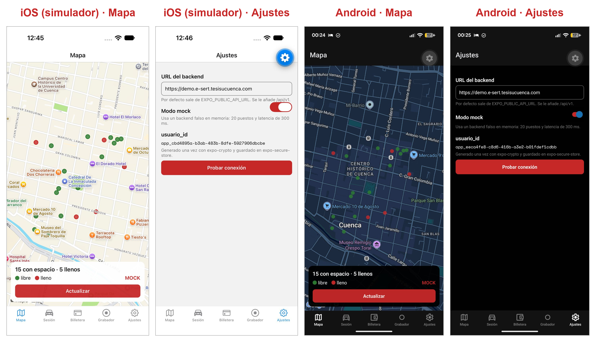
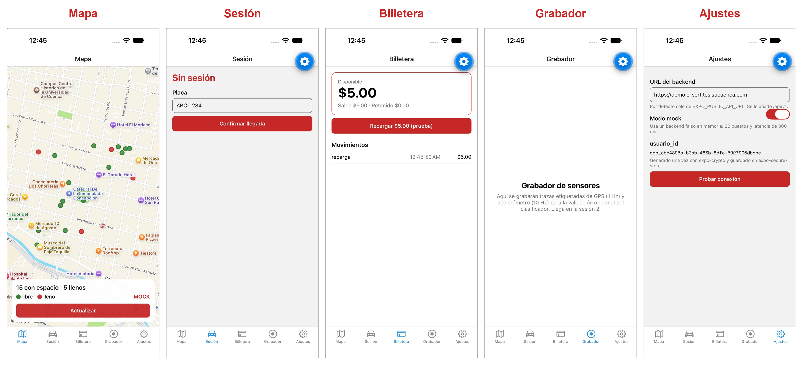
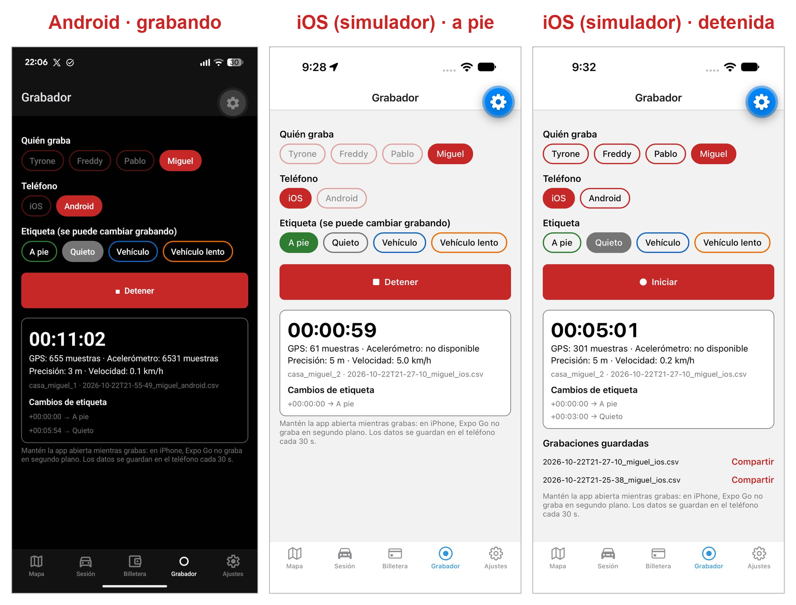
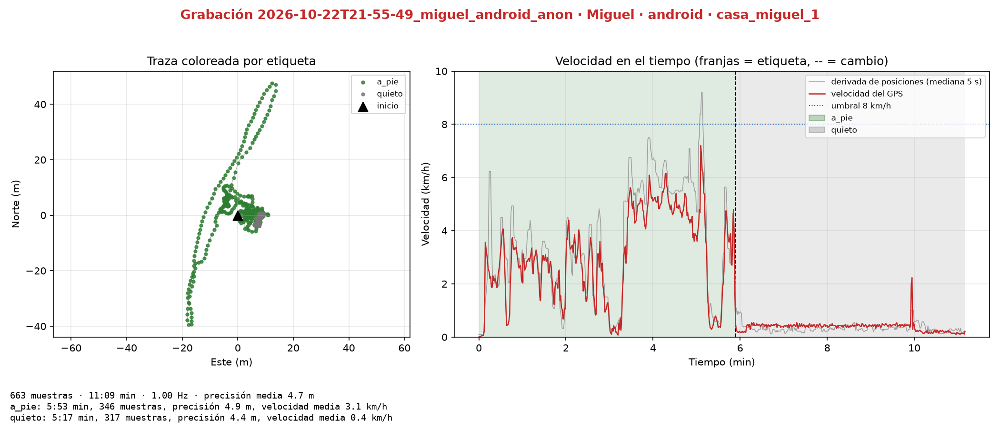
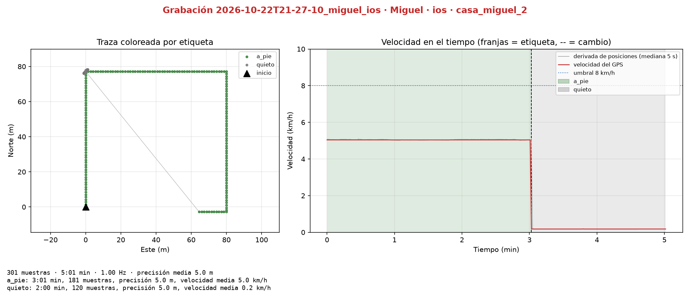

# S1 · Miguel 🔴 · Galería semanal

## Sesión 1 · 2026-10-22 · Proyecto Expo, navegación y cliente API

**Estado:** hecha (4/4 criterios).

- Se creó la app Expo **SDK 58** con TypeScript y `expo-router`, con 5 pestañas: Mapa, Sesión, Billetera, Grabador y Ajustes.
- Se escribió un cliente API tipado contra el contrato, con dos implementaciones de la misma interfaz `ApiESert`:
  - `cliente.ts`: el cliente HTTP real.
  - `mock.ts`: 20 puestos, billetera con la tarifa y 300 ms de latencia.
- La app se probó en Expo Go en un Android real y en el simulador de iPhone 18 Pro.

Explicación: [explicaciones/s1_explicacion.pdf](explicaciones/s1_explicacion.pdf)

## Sesión 2 · 2026-10-22 · Grabador de sensores etiquetado

**Estado:** parcial (3/4 criterios). En iOS solo se probó en el simulador, sin un iPhone físico.

- La pestaña **Grabador** registra:
  - el GPS a 1 Hz y el acelerómetro a 10 Hz;
  - 4 etiquetas, entre ellas `vehiculo_lento`, que se exporta como `vehiculo` + `trafico_lento`;
  - los cambios de etiqueta hechos sin detener la grabación.
- Los datos se vuelcan a disco cada 30 s. El CSV sigue el contrato y se comparte por correo o Drive.
- `graficar_grabacion.py` valida el CSV, lo dibuja y resume la duración por etiqueta y la precisión.
- **Android real:** 663 muestras a 1,00 Hz, 5:53 a pie y 5:17 quieto, con el cambio en caliente a los 5:54; el acelerómetro dio 9,9 Hz. La grabación se anonimizó antes de subirla.

Explicación: [explicaciones/s2_explicacion.pdf](explicaciones/s2_explicacion.pdf)
