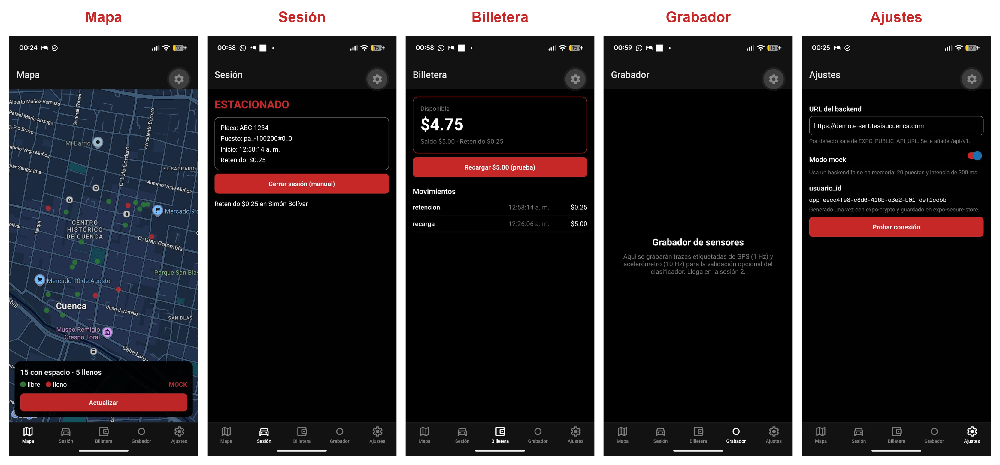

# S1 · Miguel 🔴 · Galería semanal

## Sesión 1 · 2026-10-22 · Proyecto Expo, navegación y cliente API

**Estado:** hecha (4/4 criterios).

- Se creó la app Expo **SDK 58** con TypeScript y `expo-router`, con 5 pestañas: Mapa, Sesión, Billetera, Grabador y Ajustes.
- Se escribió un cliente API tipado contra el contrato, con dos implementaciones de la misma interfaz `ApiESert`:
  - `cliente.ts`: el cliente HTTP real.
  - `mock.ts`: 20 puestos, billetera con la tarifa y 300 ms de latencia.
- La app se probó en Expo Go en un Android real y en el simulador de iPhone 18 Pro.

Explicación: [explicaciones/s1_explicacion.pdf](explicaciones/s1_explicacion.pdf)
