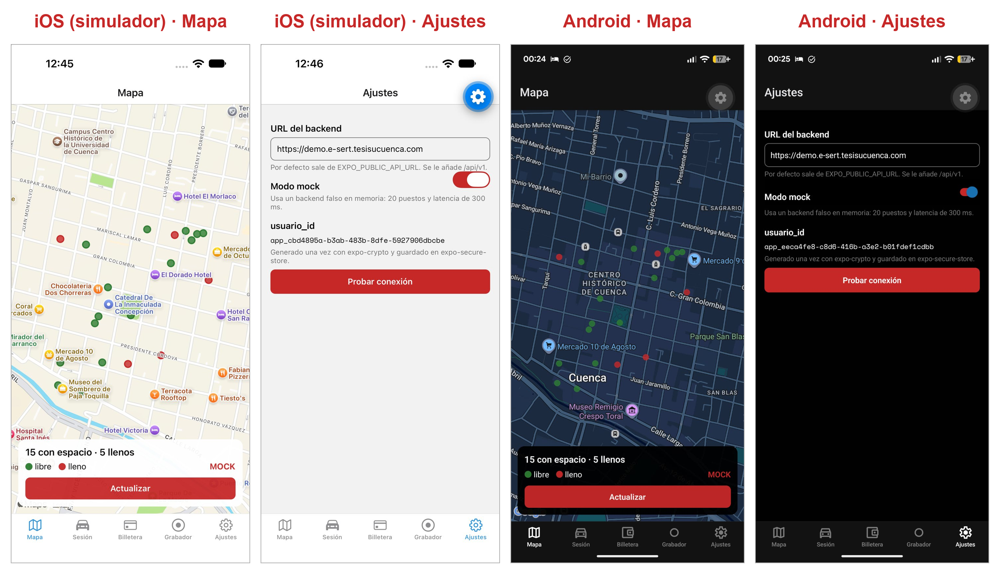
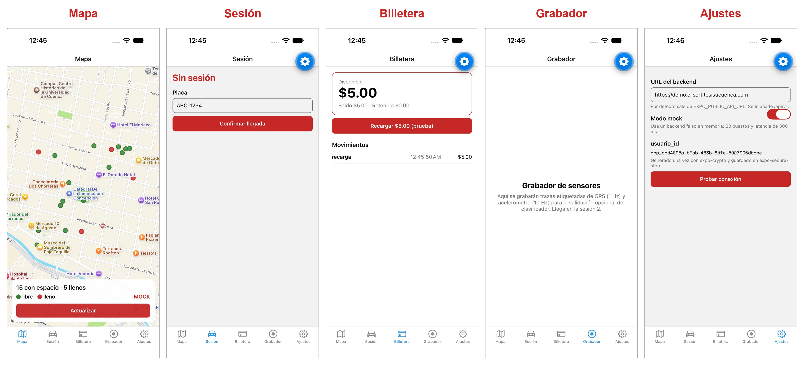

# S1 · Sesión 1 · Miguel: Proyecto Expo, navegación y cliente API

## 1. Resumen en 5 líneas

- Se creó la app móvil de e-sert con Expo SDK 58, TypeScript y `expo-router`, con 5 pestañas: Mapa, Sesión, Billetera, Grabador y Ajustes.
- El Mapa muestra los puestos SERT alrededor del Parque Calderón: verdes si tienen espacio y rojos si están llenos.
- Toda la comunicación con el backend pasa por una sola interfaz TypeScript (`ApiESert`), con dos implementaciones: el cliente HTTP real y un mock en memoria.
- Como el backend de Freddy aún no existe, la app arranca en modo mock (20 puestos falsos, billetera con la tarifa del contrato y 300 ms de latencia). El interruptor está en Ajustes.
- Se probó en un Android real con Expo Go y en el simulador de iPhone (Xcode) con Expo Go.

## 2. Conceptos clave

- **Expo y Expo Go:** Expo es un conjunto de herramientas sobre React Native. Expo Go es una app de la tienda que ejecuta nuestro código JavaScript sin compilar una app nativa. Así se evita la cuenta de desarrollador de Apple. La condición es que la versión de Expo Go del teléfono soporte la misma versión del SDK del proyecto (aquí, la 58).
- **expo-router:** la navegación se define con archivos. Cada archivo de `app/(tabs)/` es una pestaña y `_layout.tsx` declara la barra de pestañas.
- **Interfaz común (`ApiESert`):** el resto de la app no sabe si habla con el backend real o con el mock. Cambiar de uno a otro es solo un interruptor, y TypeScript garantiza que las dos versiones tengan las mismas funciones con los mismos tipos.
- **Mock:** un backend falso que responde con la misma forma que el contrato. Permite avanzar sin esperar a otra persona. Está marcado con `// MOCK:` para reemplazarlo cuando exista el backend.
- **Libro de movimientos (billetera):** no se guarda un saldo suelto: se guardan movimientos `recarga`, `retencion`, `debito` y `liberacion`. El saldo es la suma de las recargas menos la de los débitos. Lo retenido es la suma de las retenciones menos la de las liberaciones. Lo disponible es el saldo menos lo retenido.
- **Retención y cobro por fracciones:** al confirmar la llegada se retiene el bloque mínimo (30 min = $0,25). Al salir se cobran los minutos reales redondeados hacia arriba a múltiplos de 5, con un mínimo de 10 min, y se libera la retención.
- **expo-secure-store y expo-crypto:** `randomUUID()` genera el `usuario_id` (`app_<uuid4>`) una sola vez y SecureStore lo guarda cifrado en el teléfono, junto con la URL y el modo mock.

## 3. Cómo se generó cada cosa

| Resultado | Comando | Entradas | Salidas |
|---|---|---|---|
| Proyecto base | npx create-expo-app@latest app --template tabs | plantilla de Expo | codigo/app/ |
| Librerías nativas | npx expo install react-native-maps expo-crypto expo-secure-store | package.json | versiones compatibles con el SDK 58 |
| Comprobación de tipos | npx tsc --noEmit | todo app/ y src/ | sin errores |
| Prueba del mock | npm run prueba:mock | src/api/mock.ts, tarifa.ts | 24 comprobaciones OK |
| Bundles iOS/Android | npx expo export --platform ios --platform android | el proyecto | bundles Hermes (3,7 MB y 3,8 MB) |
| Servidor de desarrollo | npx expo start (o --tunnel) | el proyecto | QR para Expo Go |
| Capturas iOS | xcrun simctl io booted screenshot ... | simulador iPhone 18 Pro | evidencias/capturas/s1_ios-*.jpeg |
| Evidencia unida | python codigo/datos/herramientas/unir_capturas.py salida.png "rótulo=ruta" ... | capturas | evidencias/s1_app-pantallas.png |

## 4. Mapa de archivos

| Archivo | Qué contiene | Quién lo usa |
|---|---|---|
| app/app/_layout.tsx | Raíz: AjustesProveedor y tema claro u oscuro | toda la app |
| app/app/(tabs)/_layout.tsx | Las 5 pestañas con sus íconos | expo-router |
| app/app/(tabs)/index.tsx | Mapa con los círculos de los puestos | usuario |
| app/app/(tabs)/sesion.tsx | Confirmar la llegada y cerrar a mano (base) | usuario; se completará en S2-S3 |
| app/app/(tabs)/billetera.tsx | Saldo, retenido, disponible, movimientos y recarga de prueba | usuario; Payphone después |
| app/app/(tabs)/grabador.tsx | Marcador; el grabador llega en la sesión 2 | sesión 2 |
| app/app/(tabs)/ajustes.tsx | URL, modo mock, usuario_id, probar la conexión | usuario |
| app/src/api/tipos.ts | Tipos del contrato e interfaz ApiESert | cliente, mock y pantallas |
| app/src/api/tarifa.ts | Tarifa (sección 5) y funciones de cobro | mock, Billetera |
| app/src/api/cliente.ts | Cliente HTTP real con fetch | modo API |
| app/src/api/mock.ts | Backend falso en memoria | modo mock y prueba |
| app/src/api/pruebas/mock.prueba.ts | Prueba del mock en la computadora | npm run prueba:mock |
| app/src/ajustes/AjustesContexto.tsx | Contexto de React con los ajustes persistidos y la api activa | todas las pantallas |
| datos/herramientas/unir_capturas.py | Une capturas lado a lado con un rótulo | evidencias |

## 5. Recorrido del código

**`src/api/tipos.ts`:** define los tipos de la sección 4 (`Puesto`, `Guia`, `NuevaSesion`, `Billetera`...), la clase `ErrorApi` (estado HTTP, código y mensaje) y la interfaz que deben cumplir el cliente y el mock:

```ts
export interface ApiESert {
  listarPuestos(): Promise<Puesto[]>;
  pedirGuia(consulta: ConsultaGuia): Promise<Guia | null>; // null = 404
  enviarUbicacion(evento: EventoUbicacion): Promise<void>;
  enviarModo(evento: EventoModo): Promise<void>;
  crearSesion(datos: NuevaSesion): Promise<SesionCreada>;
  cerrarSesion(sesionId: SesionId, datos: CierreSesion): Promise<SesionCerrada>;
  obtenerSesion(sesionId: SesionId): Promise<Sesion>;
  obtenerBilletera(usuarioId: UsuarioId): Promise<Billetera>;
  recargar(usuarioId: UsuarioId, datos: Recarga): Promise<RecargaHecha>;
}
```

**`src/api/cliente.ts`:** `crearClienteHttp(urlBase)` arma `urlBase + /api/v1`. La función interna `pedir()` envía el header `X-Contrato-Version: 1`, corta a los 10 s y convierte las respuestas de error al formato del contrato en `ErrorApi`:

```ts
if (!respuesta.ok) {
  if (esCuerpoError(datos)) {
    throw new ErrorApi(respuesta.status, datos.error.codigo, datos.error.mensaje);
  }
  throw new ErrorApi(respuesta.status, `HTTP_${respuesta.status}`, texto || respuesta.statusText);
}
```

**`src/api/tarifa.ts`:** `minutosCobrados()` redondea hacia arriba a fracciones de 5 min, con un mínimo de 10:

```ts
const fracciones = Math.ceil(Math.max(0, minutosReales) / tarifa.fraccion_min - 1e-9);
return Math.max(tarifa.cobro_minimo_min, fracciones * tarifa.fraccion_min);
```

**`src/api/mock.ts`:**
- `generarPuestosFalsos()` crea 20 puestos con un generador pseudoaleatorio con semilla (mulberry32), así que siempre salen iguales; un tercio, más o menos, está lleno.
- `crearClienteMock()` guarda los puestos, las sesiones y los libros en memoria, y cada respuesta espera 300 ms.
- `crearSesion` comprueba que el puesto tenga espacio y que el disponible cubra la retención, y luego anota la `retencion`.
- `cerrarSesion` anota el `debito` y la `liberacion` y deja libre el lugar. El débito tiene un tope: el saldo puede quedar negativo como máximo en $0,50.

**`src/ajustes/AjustesContexto.tsx`:** carga los ajustes de SecureStore. Si no hay `usuario_id`, lo crea con `Crypto.randomUUID()` y expone `api`:

```ts
const api = useMemo(
  () => (modoMock ? mockCompartido : crearClienteHttp(urlApi)),
  [modoMock, urlApi]);
```

**`app/(tabs)/index.tsx`:** un `MapView` con la región inicial en el Parque Calderón (-2.8975, -79.0045) y un `<Circle>` por puesto, verde si `ocupados < capacidad` y rojo si no.

## 6. Cómo se conecta con los demás

- **Consume:** `docs/CONTRATO.md` secciones 1 a 5. Los tipos se escribieron a mano porque Freddy todavía no publica `comun/esquemas.ts`, y van marcados `// SINCRONIZAR con comun/esquemas.ts`. La tarifa va marcada `SINCRONIZAR con comun/tarifa.json`.
- **Entrega:** una app que, en cuanto exista el backend en `https://demo.e-sert.tesisucuenca.com`, funciona contra él con solo apagar el modo mock.
- **Propuesta para Freddy:** el contrato no define los campos de `GET /sesiones/{id}` ni los de cada movimiento. Usé `{sesion_id, usuario_id, placa, puesto_id, estado, inicio, fin, retenido, minutos_cobrados, debitado}` y `{movimiento_id, tipo, monto, ts, sesion_id?, referencia_payphone?}`.

## 7. Resultados y evidencias

- `npx tsc --noEmit`: 0 errores.
- `npm run prueba:mock`: 24 de 24 comprobaciones. Por ejemplo, 47,2 min se cobran como 50 min = $0,42; el saldo pasa de $5,00 a $4,58 y la retención de $0,25 se libera.
- Cliente HTTP probado contra un servidor falso: los 404 de `/guia` devuelven `null`, el 402 llega como `ErrorApi(SALDO_INSUFICIENTE)` y sin servidor el error es `SIN_CONEXION`.
- `expo-doctor`: 20/20.
- Android real (Expo Go) y simulador de iPhone 18 Pro (iOS 27, Expo Go): las 5 pestañas navegables y 15 puestos verdes y 5 rojos.





## 8. Limitaciones y decisiones

- **iOS se probó en el simulador**, no en un iPhone físico: Miguel solo tiene un Android por ahora. Queda pendiente repetirlo en un iPhone real.
- La primera vez Android mostró "Incompatible SDK version": la Expo Go instalada era anterior al SDK 58. Se resolvió actualizando Expo Go. No se bajó el SDK, porque la App Store solo ofrece la Expo Go más reciente.
- Diferencias entre plataformas: Android usa Google Maps y iOS Apple Maps. El interruptor de Android mostraba el botón azul del sistema, así que se forzó a blanco. En esta sesión no se piden permisos (la ubicación llega en la sesión 2).
- La pestaña Sesión es una base manual: toma el primer puesto libre. El guiado, la detección y el modo espejo quedan para sesiones posteriores.
- La recarga de la Billetera es directa al libro (de prueba). Payphone llega después.
- Los puestos del mock son inventados: no coinciden con los `parkingArea` de la red de Tyrone.
- En la computadora se usó Node 26 (CLAUDE.md pide Node 20 LTS) y funcionó sin problemas.

## 9. Preguntas que podría hacer el profesor

1. **¿Por qué Expo y no una app nativa?** Porque el equipo tiene 3 iPhone y 1 Android y no hay cuenta de desarrollador de Apple. Con Expo Go el mismo código TypeScript corre en los dos sistemas sin compilar ni firmar.
2. **¿Cómo se garantiza que el mock y el backend real sean intercambiables?** Los dos devuelven un objeto de tipo `ApiESert`, y `tsc --noEmit` falla si a alguno le falta una función o si un tipo no coincide.
3. **¿Cómo se calcula el cobro?** Al llegar se retiene el bloque mínimo de 30 min. Al salir se cobran los minutos reales redondeados a fracciones de 5, con un mínimo de 10 y a $0,50 por hora, y se libera la retención. Todo queda como movimientos en el libro.
4. **¿Qué pasa si el backend falla?** El cliente corta a los 10 s y convierte cualquier error en un `ErrorApi` con código y mensaje. Las pantallas muestran el mensaje en lugar de cerrarse.
5. **¿Por qué el `usuario_id` va en SecureStore?** Porque identifica la billetera del usuario y tiene que sobrevivir a reinicios de la app. SecureStore lo guarda cifrado (Keychain en iOS, Keystore en Android).
