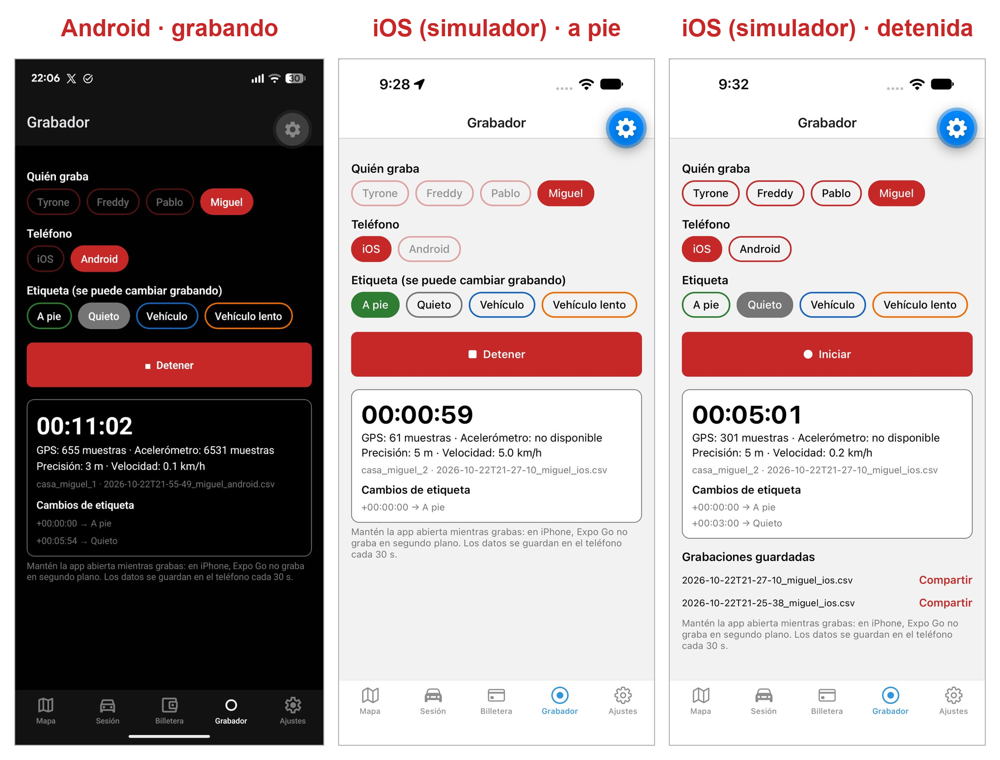
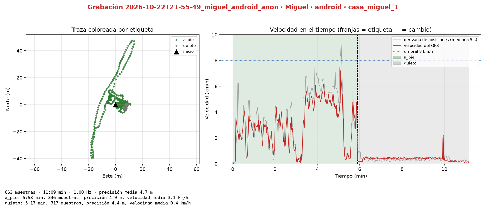
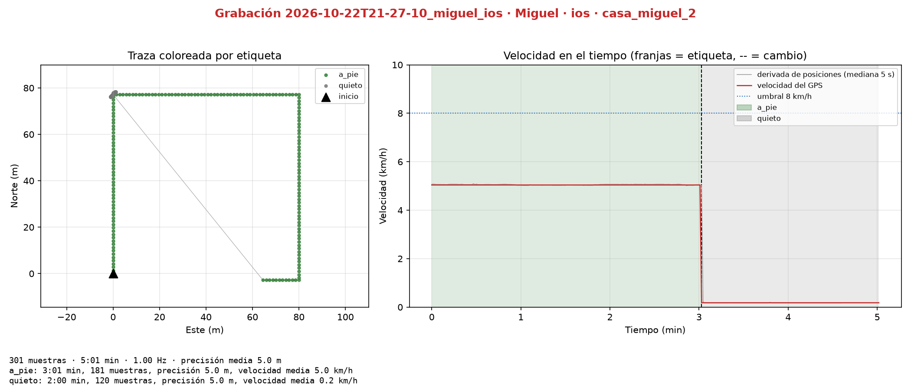

# S1 · Sesión 2 · Miguel: Grabador de sensores etiquetado

## 1. Resumen en 5 líneas

- La pestaña Grabador de la app graba el GPS (1 Hz) y el acelerómetro (10 Hz) con una etiqueta de modo: a pie, quieto, vehículo o vehículo lento.
- La etiqueta se puede cambiar sin detener la grabación (por ejemplo, al bajarse del auto), y el cambio queda registrado con su hora.
- El CSV sigue el formato de trazas del contrato: las 7 columnas en orden y luego `escenario,telefono,persona`. Se comparte por correo o Drive.
- El script de Python `graficar_grabacion.py` valida el CSV contra el contrato, lo grafica y resume la duración por etiqueta y la precisión.
- Sirve para las grabaciones caseras opcionales que Pablo puede usar como validación extra del clasificador. Se probó en un Android real (11 min) y en el simulador de iPhone (5 min).

## 2. Conceptos clave

- **Trazas etiquetadas:** una serie de puntos GPS donde cada punto lleva el modo verdadero (`modo_real`). Son la "respuesta correcta" con la que se mide el clasificador de movimiento.
- **Frecuencia de muestreo (1 Hz y 10 Hz):** el contrato fija ventanas de 30 s de GPS a 1 Hz. El acelerómetro se guarda a 10 Hz en otro archivo por si después se suman características de vibración. El SHL lo usa, pero GeoLife no lo tiene.
- **Cambio de etiqueta en caliente:** cada muestra toma la etiqueta vigente en el instante en que llega. Así el CSV muestra el cambio en la fila exacta, sin cortar la grabación.
- **`vehiculo_lento`:** el caso difícil de un auto en tráfico lento a velocidad de peatón. En el CSV es `modo_real=vehiculo` con `escenario=trafico_lento`, de modo que el clasificador ve la etiqueta verdadera y el análisis puede separar ese caso.
- **Volcado periódico a disco:** las muestras se acumulan en memoria y cada 30 s se añaden al final del archivo (`append`). Si la app se cierra, se pierden como máximo 30 s.
- **Keep-awake:** mantiene la pantalla encendida. En iPhone, Expo Go no puede leer el GPS en segundo plano.
- **Anonimización por traslación:** la traza se mueve para que empiece en el Parque Calderón. Las distancias y los tiempos no cambian, y por tanto tampoco las velocidades. El clasificador no pierde nada y no se revela dónde se grabó.
- **Velocidad nula o −1:** cuando el teléfono no conoce la velocidad, el campo queda vacío, como pide el contrato, en lugar de inventar un valor.

## 3. Cómo se generó cada cosa

| Resultado | Comando | Entradas | Salidas |
|---|---|---|---|
| Módulos nativos | npx expo install expo-location expo-sensors expo-keep-awake expo-file-system expo-sharing | package.json | versiones del SDK 58 |
| Tipos y pruebas | npx tsc --noEmit; npm run prueba:grabador | app/ y src/ | 0 errores; 12 comprobaciones OK |
| Grabación sintética | SALIDA_CSV=1 npx tsx src/sensores/pruebas/formato.prueba.ts | ninguna | datos/ejemplos/sintetica_muestra.csv |
| Grabación iOS | deep links y xcrun simctl location start (ruta a 1,4 m/s y luego vaivén lento) | simulador iPhone 18 Pro | datos/grabaciones/..._ios.csv |
| Grabación Android | pestaña Grabador en el teléfono de Miguel, Compartir | caminata casera y quieto | CSV del GPS y del acelerómetro |
| Anonimizado | python herramientas/anonimizar_grabacion.py original.csv --salida grabaciones/..._anon.csv | CSV original | CSV trasladado |
| Gráfica | python herramientas/graficar_grabacion.py grabaciones/..._anon.csv --salida evidencias/s2_primera-grabacion.png | CSV | PNG y resumen por consola |
| Captura unida | python herramientas/unir_capturas.py ... | capturas | evidencias/s2_grabador-pantalla.png |

## 4. Mapa de archivos

| Archivo | Qué contiene | Quién lo usa |
|---|---|---|
| app/src/sensores/formato.ts | Columnas, filas, etiquetas, nombre de archivo y usuario_id casa_ | grabador, exportar, pruebas |
| app/src/sensores/grabador.ts | Clase Grabador: permisos, GPS, acelerómetro, keep-awake, volcado y cambio de etiqueta | pantalla Grabador |
| app/src/sensores/exportar.ts | Carpeta de grabaciones, lista de archivos y compartir | pantalla Grabador |
| app/app/(tabs)/grabador.tsx | Pantalla: selectores, Iniciar/Detener, contadores y grabaciones guardadas | quien graba |
| app/src/sensores/pruebas/formato.prueba.ts | Prueba del formato y generador sintético | npm run prueba:grabador |
| datos/herramientas/graficar_grabacion.py | Validar, graficar y resumir una grabación | Miguel, Pablo |
| datos/herramientas/anonimizar_grabacion.py | Trasladar la traza antes de subirla | quien suba grabaciones |
| datos/grabaciones/ | Grabación Android anonimizada y prueba del simulador | Pablo (validación extra) |

## 5. Recorrido del código

**`formato.ts`:** convierte la etiqueta elegida en lo que pide el contrato y arma cada fila del CSV:

```ts
export function etiquetaAContrato(e: Etiqueta) {
  if (e === 'vehiculo_lento') return { modo_real: 'vehiculo', escenario: 'trafico_lento' };
  return { modo_real: e, escenario: '' };
}
export function limpiarVelocidad(speed) {   // nulo o -1 -> campo vacío
  return speed == null || !Number.isFinite(speed) || speed < 0 ? null : speed;
}
```

**`grabador.ts`:**
- `iniciar()` pide el permiso, crea los archivos con su encabezado, activa keep-awake, se suscribe al GPS y al acelerómetro y programa el volcado cada 30 s.
- `cambiarEtiqueta()` solo cambia la etiqueta vigente y anota el instante.
- `detener()` cancela las suscripciones, vuelca lo pendiente y escribe el `_meta.json`.

```ts
this.subGPS = await Location.watchPositionAsync(
  { accuracy: Location.Accuracy.BestForNavigation, timeInterval: 1000, distanceInterval: 0 },
  (pos) => this.alRecibirGPS(pos));
...
private volcar() {   // encadenado: dos volcados nunca se pisan
  this.volcando = this.volcando.then(async () => {
    const gps = this.pendientesGPS.splice(0);
    if (gps.length) await this.archivos.gps.write(gps.join('\n') + '\n', { append: true });
  });
}
```

**`grabador.tsx`:** usa el componente `Opciones` para los selectores. Al elegir una etiqueta llama a `cambiarEtiqueta`, que funciona también durante la grabación. Las etiquetas de vehículo muestran el aviso "Graba el acompañante". En desarrollo acepta deep links (`?accion=iniciar|etiqueta|detener`) para probarla en el simulador sin tocar la pantalla.

**`graficar_grabacion.py`:**
- `leer_y_validar()` exige las 7 columnas en orden y comprueba números, rangos, modos válidos, velocidad no negativa y `t` creciente. Avisa si la frecuencia no es de ~1 Hz o si hay huecos.
- `resumen()` calcula la duración, la precisión y la velocidad por etiqueta, y los cambios.
- `graficar()` dibuja la traza en metros locales y la velocidad con franjas por etiqueta.

## 6. Cómo se conecta con los demás

- **Consume:** el formato de trazas del contrato (§7 v0, §8 de la propuesta v1 de Freddy). De la propuesta tomé `usuario_id = casa_<persona>_<n>`, `t` en segundos Unix y las columnas extra después de las 7.
- **Entrega a Pablo:** `datos/grabaciones/*_anon.csv` en el mismo CSV que GeoLife y que el emulador de SUMO, listo para leer con su código. Es opcional: solo es validación extra.
- **Al resto del equipo:** si alguien quiere grabar, basta con instalar Expo Go y usar la pestaña Grabador.

## 7. Resultados y evidencias

**Android real (Miguel):**
- 663 muestras de GPS a 1,00 Hz en 11:09 min, con una precisión media de 4,7 m.
- 5:53 a pie (3,1 km/h de media) y 5:17 quieto (0,4 km/h).
- El cambio de etiqueta a los 5:53,8 aparece en la fila 348 del CSV y coincide con el "+00:05:54" de la pantalla.
- El acelerómetro dio 6617 muestras a 9,9 Hz.
- Hubo un solo hueco de 6 s, al arrancar, mientras el GPS fijaba la posición.

**Simulador de iPhone:**
- 301 muestras a 1,00 Hz en 5:01 min.
- 3:01 a pie (5,0 km/h) y 2:00 quieto. El cambio quedó registrado en el `_meta.json` y en el CSV.







## 8. Limitaciones y decisiones

- **iOS se probó en el simulador**, con ubicación simulada y sin acelerómetro. Falta una grabación en un iPhone físico.
- **En el simulador, una ubicación fija** genera una sola actualización. Para la fase "quieto" se simuló el temblor del GPS con un vaivén de ±2 m. En un teléfono real ese temblor ocurre solo, como muestra la grabación de Android: 317 muestras quieto.
- **La caminata casera fue lenta** (3,1 km/h de media, con tramos casi parados dentro de la casa). Es un ejemplo realista de por qué una regla de velocidad sola no basta, pero no representa una caminata por la calle.
- **Las grabaciones se anonimizan antes de subirse.** Los originales quedan fuera del repo.
- **En Android no se comparte el `_meta.json`.** No hace falta: el cambio de etiqueta ya está en el CSV, fila por fila.
- **Los deep links de prueba solo funcionan en desarrollo** (`__DEV__`).

## 9. Preguntas que podría hacer el profesor

1. **¿Para qué grabar datos propios si ya está GeoLife?** Son opcionales. Sirven para validar el clasificador con teléfonos actuales y con el caso de tráfico lento. La evaluación principal sigue siendo GeoLife, con usuarios nunca vistos, más los escenarios de SUMO.
2. **¿Cómo se asegura la frecuencia de 1 Hz?** Se pide al GPS una actualización por segundo sin filtro de distancia y se descartan las lecturas que llegan a menos de 0,5 s de la anterior. El script mide la frecuencia real (1,00 Hz en ambas pruebas) y avisa si se aleja de 1 Hz.
3. **¿Qué pasa si la app se cierra a mitad de la grabación?** Los datos se escriben en el teléfono cada 30 s, así que se pierden como máximo esos 30 s. El CSV queda válido porque cada volcado añade filas completas.
4. **¿Por qué el acompañante y no el conductor?** Por seguridad: nadie manipula el teléfono mientras maneja. Además, el acompañante puede marcar el cambio de etiqueta en el momento justo.
5. **¿La anonimización afecta al clasificador?** No. Solo traslada la traza: las distancias entre puntos, los tiempos, las velocidades, la precisión y las etiquetas quedan idénticos, y las características del modelo se calculan a partir de eso.
