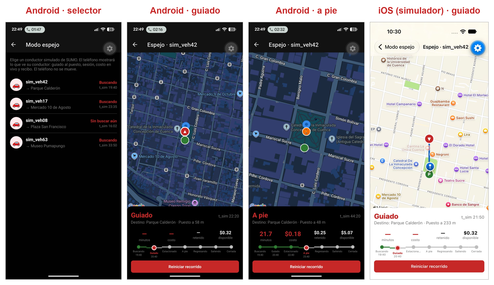
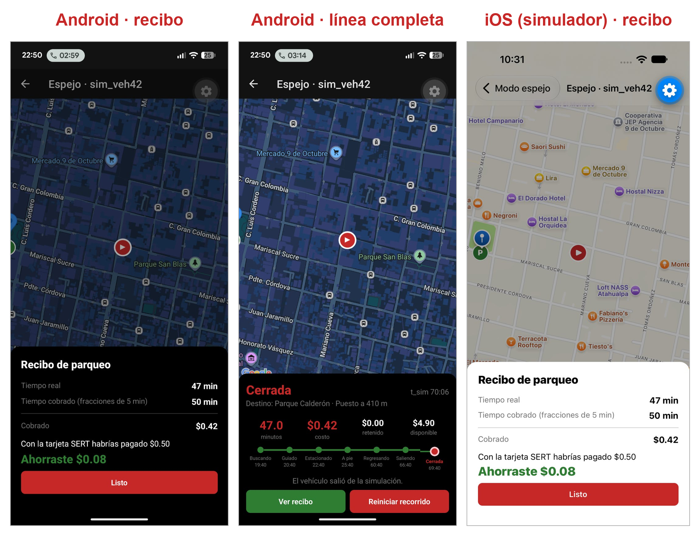

# S1 · Sesión 3 · Miguel: Reglas SERT, prototipo del conductor espejo y protocolo casero

## 1. Resumen en 5 líneas

- Se verificaron las reglas del SERT de Cuenca con fuentes oficiales (ordenanza de 2012, EMOV EP y GAD Municipal): USD 0,25 por media hora, máximo 2 h y tarjeta de 4 casilleros de 30 min. Los valores provisionales de `tarifa.json` coinciden con los reales.
- Se construyó en Expo Go el **modo espejo**: el teléfono muestra lo que ve un conductor simulado de SUMO (guiado, sesión, costo en vivo, avisos y recibo). El teléfono no se mueve.
- Como el backend del espejo aún no existe, un recorrido **mock** de 60 s reproduce un caso completo, de BUSCANDO a CERRADA, con mensajes que cumplen el JSON del contrato (§6b).
- Un test con jest valida cada mensaje, el orden de los estados, la duración y el recibo.
- Se escribió un protocolo de una página para las grabaciones caseras opcionales, con la regla de seguridad.

## 2. Conceptos clave

- **Teléfono espejo:** en la demo nadie maneja de verdad. El teléfono se suscribe a un vehículo simulado y dibuja su estado. Así se muestra la experiencia del conductor sin pruebas de campo.
- **Mock con la misma firma:** `suscribirMock(vehId, onMensaje) -> cancelar` tiene la forma exacta que tendrá el cliente del WebSocket real. Cambiar de uno a otro será cambiar una línea.
- **`t_sim` no uniforme:** el mock emite un mensaje por segundo real, pero el tiempo simulado avanza a saltos distintos según el estado (30 s por mensaje estacionado, 140 s a pie...). Así 60 s de demo cubren 47 min de parqueo.
- **Validador en tiempo de ejecución:** TypeScript solo comprueba los tipos al compilar. `esMensajeEspejo` revisa en ejecución que un JSON tenga todas las claves y tipos de §6b. Lo usan el test y la pantalla, que descarta los mensajes malformados.
- **Recibo frente a tarjeta SERT:** e-sert cobra el tiempo real en fracciones de 5 min. El SERT cobra medias horas completas por adelantado. 47 min cuestan USD 0,42 con e-sert y 2 casilleros (USD 0,50) con la tarjeta, así que el ahorro es USD 0,08.
- **Fuente oficial frente a prensa:** cada dato del SERT lleva su URL y su fecha de consulta. Lo que solo aparece en prensa o no se encontró queda marcado.

## 3. Cómo se generó cada cosa

| Resultado | Comando | Entradas | Salidas |
|---|---|---|---|
| Reglas SERT | Búsqueda web en fuentes oficiales (agente de investigación) | ordenanza, emov.gob.ec, cuenca.gob.ec, prensa | app/docs/sert_reglas.md |
| Recorrido JSON | npm run generar-mock | recorridoMock.ts, tarifa.ts | src/espejo/recorrido_mock.json (60 mensajes) |
| Test | npx jest src/espejo | recorridoMock.ts, validar.ts, el JSON | 11 tests OK |
| Tipos | npx tsc --noEmit | toda la app | 0 errores |
| Capturas iOS | xcrun simctl openurl (deep links) + simctl io screenshot | simulador iPhone 18 Pro | evidencias/capturas/s3_ios-espejo-*.jpeg |
| Capturas Android | Expo Go en el teléfono de Miguel | recorrido mock | evidencias/capturas/s3_android-espejo-*.jpeg |
| Evidencias | python datos/herramientas/unir_capturas.py ... | capturas | s3_espejo-prototipo.png, s3_espejo-recibo.png |

## 4. Mapa de archivos

| Archivo | Qué contiene | Quién lo usa |
|---|---|---|
| app/docs/sert_reglas.md | Reglas SERT con fuentes y tabla para tarifa.json | Freddy (contrato), informe |
| app/src/api/tipos.ts | Tipos del espejo (CandidatoEspejo, MensajeEspejo, ReciboEspejo, FinEspejo...) | toda la app |
| app/src/api/tarifa.ts | Tarifa v1 y fórmulas (costo, fracciones, tarjeta SERT) | mock, recibo |
| app/src/espejo/recorridoMock.ts | Generador del recorrido, candidatos y suscribirMock | pantallas, test, script |
| app/src/espejo/recorrido_mock.json | El recorrido de sim_veh42 en JSON | servidor mock de S2-3 (Freddy) |
| app/src/espejo/validar.ts | esMensajeEspejo y esFinEspejo | test, pantalla |
| app/src/espejo/componentes/ | MapaEspejo, LineaTiempo, CostoVivo, BannerAvisos, ReciboEspejo | pantalla del espejo |
| app/app/espejo/index.tsx | Selector de conductor | usuario |
| app/app/espejo/[vehId].tsx | Pantalla del conductor espejo | usuario |
| app/src/espejo/\_\_tests\_\_/recorridoMock.test.ts | Test del mock | npx jest |
| datos/PROTOCOLO_CASERO.md | Cómo grabar (opcional) y con seguridad | equipo |

## 5. Recorrido del código

**`recorridoMock.ts`:**
- `FASES` fija cuántos mensajes y cuántos minutos simulados tiene cada estado.
- `generarRecorrido()` recorre las fases. En cada fase calcula la posición (trayecto en L, salida, ida y vuelta a pie), la sesión, la billetera, los avisos y el recibo.
- Los puestos son puestos reales del `puestos.csv` de Tyrone.

```ts
export const FASES = [
  { estado: 'BUSCANDO', mensajes: 5, minutosSim: 1 },
  { estado: 'GUIADO', mensajes: 12, minutosSim: 2 },
  { estado: 'ESTACIONADO', mensajes: 6, minutosSim: 3 },
  { estado: 'A_PIE', mensajes: 15, minutosSim: 35 },
  { estado: 'REGRESANDO', mensajes: 8, minutosSim: 6 },
  { estado: 'SALIENDO', mensajes: 6, minutosSim: 3 },
  { estado: 'CERRADA', mensajes: 7, minutosSim: 0.5 },
];  // 3 + 35 + 6 + 3 = 47 min de sesión; 59 mensajes + espejo_fin = 60 s
```

**`suscribirMock()`:** emite un mensaje por segundo con `ts` igual a la hora real y devuelve la función para cancelar. El botón "Reiniciar recorrido" la llama y se vuelve a suscribir.

**`[vehId].tsx`:** guarda el último mensaje y, para la línea de tiempo, el `t_sim` en que empezó cada estado. Abre el recibo una sola vez, cuando llega, y lo cierra si la pantalla pierde el foco.

```ts
return suscribirMock(vehId, (m) => {
  if (esFinEspejo(m)) return setFin(true);
  if (!esMensajeEspejo(m)) return;          // descarta mensajes malformados
  setMensaje(m);
  if (m.estado) setInicios((p) => (m.estado! in p ? p : { ...p, [m.estado!]: m.t_sim }));
  if (m.recibo && !reciboMostrado) { reciboMostrado = true; setVerRecibo(true); }
});
```

**`MapaEspejo.tsx`:**
- El auto es un `Marker` con una flecha que rota según el rumbo entre dos mensajes. A pie se cambia por un peatón.
- Hay otro `Marker` para el destino y uno con la "P" para el puesto.
- La ruta es una `Polyline` de 5 px.
- En cada mensaje se llama a `animateToRegion` (800 ms), con más zoom cuando el conductor camina.

## 6. Cómo se conecta con los demás

- **Freddy:**
  - Los tipos se copiaron de su `comun/esquemas.ts` (v1, marcados SINCRONIZAR) y la tarifa de su `tarifa.py`.
  - Le entrego `recorrido_mock.json`, para que su servidor mock de S2-3 lo reproduzca tal cual, y la tabla de `sert_reglas.md`, para el contrato.
  - Queda una pregunta: la regla del aviso `saldo_bajo` durante la sesión.
- **Tyrone:** los puestos del mock son puestos reales de su `puestos.csv`. Le dejé observaciones sobre `calles_sert.yaml`: su red genera 6.194 plazas, frente a las ~2.500 oficiales.
- **Pablo:** el protocolo casero le dice dónde quedarán las grabaciones opcionales (`datos/grabaciones/`).

## 7. Resultados y evidencias

- **Recorrido:**
  - 60 mensajes: 59 `espejo` y 1 `espejo_fin`.
  - 47 min simulados entre la llegada y el cierre.
  - Recibo de 50 min cobrados = USD 0,42, frente a USD 0,50 con la tarjeta (ahorro de USD 0,08).
  - `saldo_bajo` aparece durante ESTACIONADO.
- **Pruebas:** `npx jest src/espejo` pasa 11/11 y `npx tsc --noEmit` da 0 errores.
- **Android (teléfono real) y simulador de iPhone:** el recorrido se ve completo en unos 60 s, del selector al recibo. La línea de tiempo cierra en Cerrada 69:40.





## 8. Limitaciones y decisiones

- **Es un mock.** No hay WebSocket todavía. El cambio al backend real está aislado en `suscribirMock`.
- **`saldo_bajo` durante la sesión:** el mock lo calcula como "saldo menos lo comprometido (retención o costo en curso, el mayor)". La propuesta v1 de Freddy usa "saldo menos costo en curso", y con esa regla el aviso no aparecería en ESTACIONADO. Lo propongo como pregunta para Freddy.
- **El trayecto es una "L" entre puntos**, no sigue la red real de calles. Con el backend llegará la ruta real de SUMO.
- **Reglas SERT no verificadas:**
  - el horario vigente oficial (solo hay prensa);
  - el precio exacto de la tarjeta (se infiere USD 0,25 por casillero);
  - un inventario oficial de plazas;
  - la recarga mínima de AppSERT.
- **iOS se probó solo en el simulador.** Android, en el teléfono real.

## 9. Preguntas que podría hacer el profesor

1. **¿Por qué un teléfono espejo y no la app con GPS real?** Todo el proyecto es simulado y no hay pruebas de campo en el Centro. El espejo muestra la experiencia del conductor con datos de SUMO y es reproducible en el aula.
2. **¿Cómo se sabe que el mock respeta el contrato?** El validador `esMensajeEspejo` revisa cada clave y tipo de §6b, y el test lo aplica a los 60 mensajes y al JSON exportado. Además comprueba que los estados no retroceden y que el recibo cuadra con la tarifa.
3. **¿La tarifa del proyecto es la real?** Sí: USD 0,25 por media hora (Art. 36 de la ordenanza del SERT) y máximo 2 h. Lo propio de e-sert es cobrar el tiempo real en fracciones de 5 min en vez de medias horas completas.
4. **¿De dónde sale el ahorro del recibo?** 47 min con tarjeta son 2 casilleros de 30 min (USD 0,50). Con e-sert se cobran 50 min a USD 0,50 por hora (USD 0,42). La diferencia es USD 0,08.
5. **¿Qué cambia cuando exista el backend?** Solo la fuente de los mensajes: `suscribirMock` se reemplaza por el cliente de `WS /ws/espejo/{veh_id}`, con la misma firma. Las pantallas y el validador no cambian.
