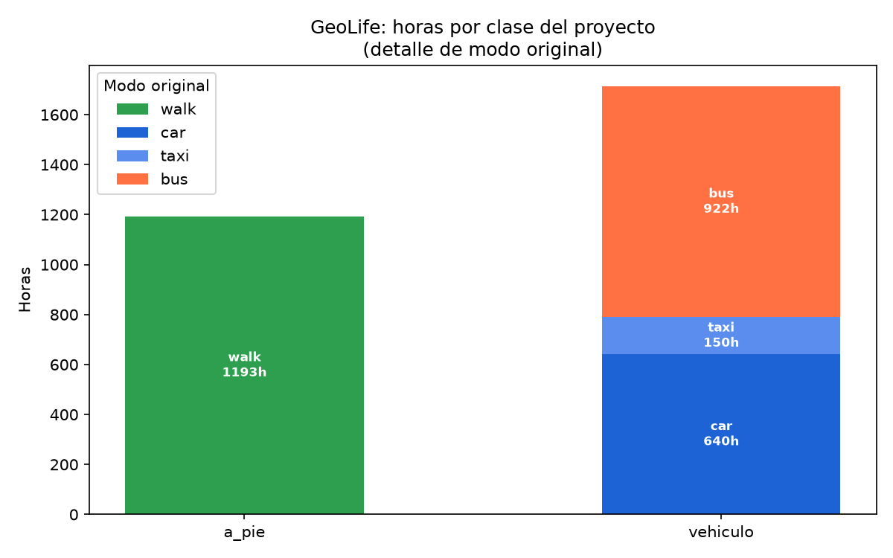
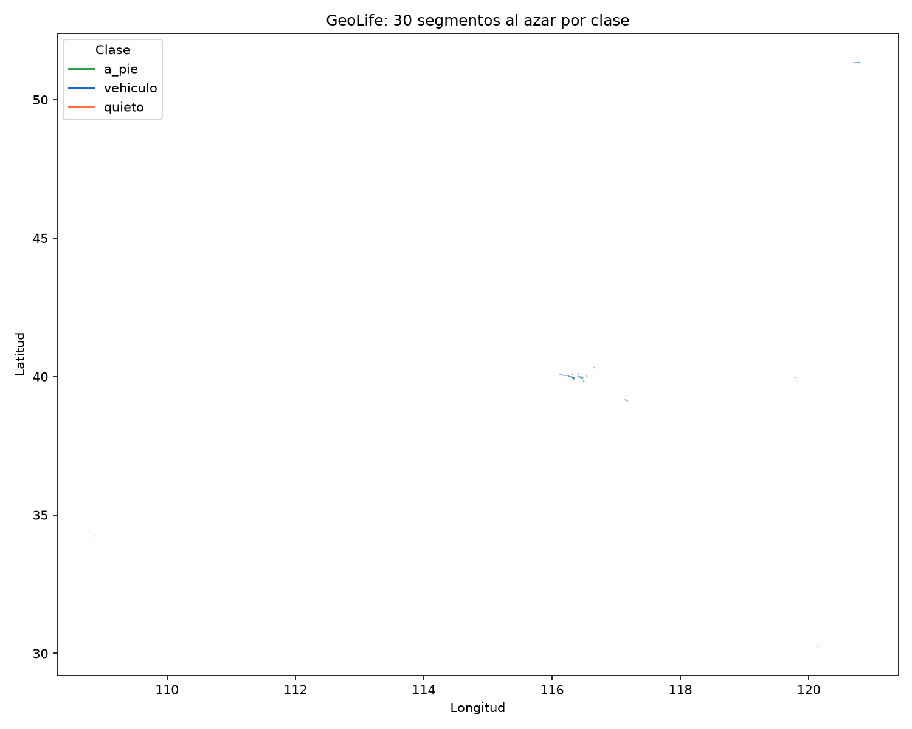
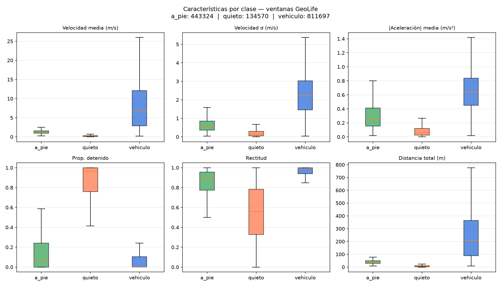

# S1 · Pablo 🟢 · Resumen semanal

## Sesión 1 · Ingesta del dataset GeoLife

Descarga e ingesta completa de GeoLife Trajectories 1.3: 64 usuarios etiquetados, 3.25 millones
de puntos GPS en un Parquet limpio con las columnas del contrato. Se mapearon los modos de
transporte (walk→a_pie, car/taxi/bus→vehiculo) y se descartaron los no aplicables (bike, train,
subway, airplane, etc.). Se escribieron 18 tests unitarios y dos evidencias gráficas.

**Estadísticas del dataset:**
- 64 usuarios con datos útiles
- 3,254,173 puntos en el Parquet
- 10,418 segmentos de movimiento
- 1,193 horas a pie, 1,713 horas en vehículo
- Intervalo de muestreo: mediana 2 s, p90 5 s

## Sesión 2 · Remuestreo, ventanas y características

Se construyó la librería genérica de preprocesamiento GPS que convierte trazas crudas en
ventanas de 30 s con 18 características numéricas. Se implementó remuestreo a 1 Hz con
interpolación lineal, ventaneo deslizante con paso de 5 s, y la derivación automática de
la clase `quieto` (velocidad efectiva < 0.3 m/s y desplazamiento neto < 10 m). Se aplicó
el pipeline al dataset GeoLife completo.

**Resultados:**
- 1,389,591 ventanas generadas
- vehiculo: 811,697 (58.4%), a_pie: 443,324 (31.9%), quieto: 134,570 (9.7%)
- 134,570 ventanas reetiquetadas como quieto
- 11 tests unitarios (incluye traza sintética tipo SUMO)
- 18 características: velocidad, aceleración, jerk, rumbo, proporciones, rectitud, distancia

