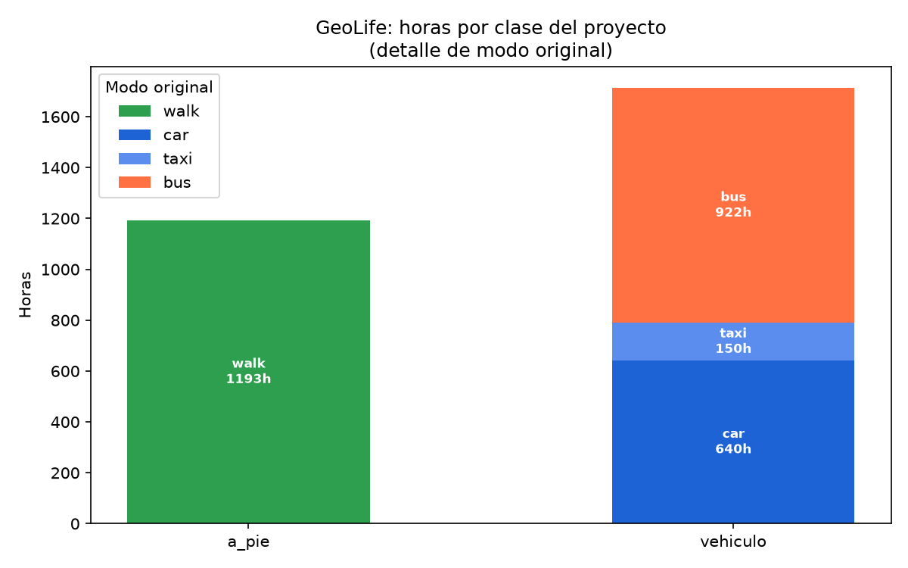
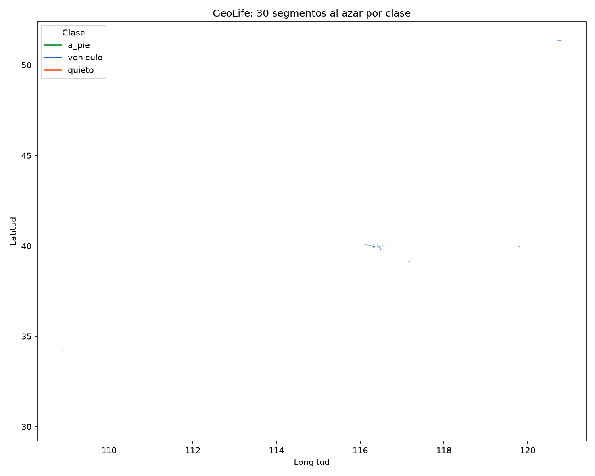

# S1 · Sesión 1 · Ingesta del dataset GeoLife

## 1. Resumen en 5 líneas

En esta sesión se descargó y procesó el dataset GeoLife Trajectories 1.3 de Microsoft Research,
que contiene trazas GPS reales de 182 usuarios en Beijing (2007–2012). De los 182, 69 tienen
etiquetas de modo de transporte; de esos, 64 aportan datos útiles para nuestro proyecto. Se
mapearon los modos originales a las tres clases del clasificador (a_pie, quieto, vehiculo) y se
generó un archivo Parquet limpio con 3.25 millones de puntos, listo para la extracción de
ventanas y el entrenamiento del Random Forest en sesiones posteriores.

## 2. Conceptos clave

- **GeoLife:** dataset público de Microsoft Research con trazas GPS de usuarios reales en
  Beijing. Es la base de entrenamiento del clasificador de movimiento del proyecto.
- **Modo de transporte → clase del proyecto:** GeoLife etiqueta 11 modos (walk, car, bus,
  taxi, bike, train, subway, airplane, boat, run, motorcycle). Solo nos quedamos con walk
  (→ a_pie), car, taxi y bus (→ vehiculo). Los demás se descartan porque no aplican al
  escenario urbano de parqueo.
- **Bus como vehículo:** bus se clasifica como `vehiculo` porque el clasificador opera sobre
  GPS puro (sin acelerómetro), y un bus en el Centro Histórico tiene un patrón de movimiento
  (velocidad, trayectoria) muy similar al de un auto. Distinguir bus de auto requeriría
  información adicional (paradas, rutas fijas) que no tenemos.
- **`merge_asof`:** función de pandas que une dos DataFrames ordenados por tiempo: para cada
  punto GPS, busca la etiqueta de labels.txt cuyo inicio sea el más reciente sin pasarse.
  Evita un bucle O(n²) sobre todos los intervalos.
- **Haversine:** fórmula para la distancia entre dos puntos en la superficie terrestre,
  usando sus coordenadas en grados. Se usa para calcular la velocidad entre puntos GPS
  consecutivos.
- **Filtro de saltos:** se descartan los puntos cuya velocidad instantánea supera 50 m/s
  (~180 km/h), que corresponden a errores del GPS o interpolaciones imposibles.
- **Parquet:** formato columnar binario, eficiente para leer subconjuntos de columnas y mucho
  más rápido que CSV para millones de filas.

## 3. Cómo se generó cada cosa

### Descarga del dataset
```bash
cd semanas/S1/Pablo/codigo/ia
python3 datos/descargar_geolife.py
```
- **Entrada:** URL del ZIP en Microsoft Research (~299 MB).
- **Salida:** `datos/crudos/Geolife Trajectories 1.3/Data/` (182 carpetas de usuarios).
- Es idempotente: si `datos/crudos/.extraido` existe, no descarga.

### Ingesta y procesamiento
```bash
python3 datos/ingesta_geolife.py
```
- **Entrada:** los archivos `.plt` y `labels.txt` de los 69 usuarios etiquetados.
- **Salida:**
  - `datos/procesados/geolife_etiquetado.parquet` (3.25M filas, 78 MB)
  - `datos/procesados/geolife_muestra.csv` (10,000 filas, muestra para el repo)
  - `datos/geolife_info.json` (estadísticas)

### Evidencias
```bash
python3 datos/evidencias_geolife.py
```
- **Salida:** `../../evidencias/s1_geolife-horas-por-modo.png` y
  `s1_geolife-trayectorias.png`.

### Tests
```bash
python3 -m pytest tests/test_ingesta.py -v
```

## 4. Mapa de archivos

| Archivo | Qué contiene | Quién lo usa |
|---|---|---|
| `datos/descargar_geolife.py` | Script de descarga idempotente del ZIP de GeoLife | Se ejecuta una vez; la ingesta depende de él |
| `datos/ingesta_geolife.py` | Lectura de .plt + labels, mapeo, filtrado, cálculo de velocidad | Genera el parquet y el JSON de info |
| `datos/evidencias_geolife.py` | Gráficas matplotlib de horas por modo y trayectorias | Genera los PNG de evidencia |
| `datos/geolife_info.json` | Estadísticas: puntos, segmentos, usuarios, horas por clase | Referencia para la documentación |
| `datos/procesados/geolife_etiquetado.parquet` | Dataset limpio con columnas del contrato | Sesión 2 (ventanas + features) y sesión 3 (entrenamiento) |
| `datos/procesados/geolife_muestra.csv` | 10,000 filas de muestra (va al repo) | Revisión rápida sin descargar GeoLife |
| `tests/test_ingesta.py` | 18 tests: mapeo, unión, filtro, haversine | CI y verificación |
| `tests/datos/` | .plt y labels.txt sintéticos para tests | test_ingesta.py |
| `requirements.txt` | Dependencias del módulo IA | Instalación del entorno |

## 5. Recorrido del código

### `datos/descargar_geolife.py`
- **`descargar()`:** descarga el ZIP con `requests` + `tqdm`, extrae con `zipfile`, marca con
  `.extraido` y borra el ZIP. Si `.extraido` existe, no hace nada.

### `datos/ingesta_geolife.py`
- **`leer_plt(archivo)`:** lee un .plt saltando 6 líneas de cabecera, convierte fecha+hora a
  timestamp UTC.
- **`leer_labels(archivo)`:** lee labels.txt (TSV con inicio, fin, modo).
- **`unir_con_etiquetas(puntos, labels)`:** usa `merge_asof` (direction="backward") para
  asignar a cada punto el intervalo etiquetado más reciente; descarta los que caen fuera.
- **`procesar_usuario(dir_usuario)`:** orquesta la lectura, unión, mapeo de modos, segmentación,
  cálculo de velocidad haversine y filtro de saltos para un usuario.
  ```python
  segmentos = (
      (merged["modo_original"] != merged["modo_original"].shift())
      | (merged["timestamp"].diff().dt.total_seconds() > 300)
  ).cumsum()
  ```
- **`generar_info(df, stats)`:** calcula horas por clase y por modo original, intervalo de
  muestreo (mediana, p90) y puntos descartados por motivo.
- **`ejecutar()`:** recorre los 69 usuarios, concatena, guarda parquet, muestra CSV e info JSON.

### `datos/evidencias_geolife.py`
- **`grafica_horas_por_modo()`:** barras apiladas por clase con detalle del modo original.
- **`grafica_trayectorias()`:** 30 segmentos al azar sobre lat/lon, coloreados por clase.

## 6. Cómo se conecta con los demás

- **Consume:** nada externo al módulo; GeoLife es el dato de entrada.
- **Entrega:** el Parquet con las columnas del contrato (§7:
  `usuario_id, t, lat, lon, precision_m, velocidad_mps, modo_real`) más `segmento_id` y
  `fuente="geolife"`. En la sesión 2 se generarán las ventanas de 30 s y las características
  para el Random Forest. En la sesión 3 se entrenará el clasificador con partición por
  usuario (GroupKFold).
- **Freddy (TraCI):** en S2 generará trazas SUMO con el mismo formato CSV del contrato,
  que se combinarán con GeoLife para el entrenamiento.

## 7. Resultados y evidencias

- **64 usuarios** con datos útiles (de 69 etiquetados, de 182 totales).
- **3,254,173 puntos** en el Parquet final.
- **10,418 segmentos** de movimiento.
- **Horas por clase:** a_pie: 1,193 h; vehículo: 1,713 h.
- **Horas por modo original:** walk: 1,193 h; bus: 922 h; car: 640 h; taxi: 150 h.
- **Descartados:** 1,603,697 puntos por modo no aplicable (bike, train, etc.);
  1,518 por velocidad imposible (>50 m/s); 0 por coordenadas fuera de rango.
- **Intervalo de muestreo:** mediana 2 s, p90 5 s.





## 8. Limitaciones y decisiones

- **No hay clase `quieto`:** GeoLife no la etiqueta. Se derivará en la sesión 2, a partir de
  ventanas donde la velocidad media sea muy baja (<0.5 km/h).
- **Bus como vehículo:** decisión deliberada; el GPS solo no distingue bus de auto en un
  entorno urbano.
- **Precision_m vacía:** GeoLife no reporta la precisión del GPS; queda como NaN.
- **Solo Beijing:** los datos son de una ciudad, no de Cuenca. Las trazas SUMO de Freddy
  complementarán con el escenario local.
- **Filtro de 50 m/s:** agresivo para eliminar saltos, pero conservador para no perder
  viajes en autopista (~120 km/h ≈ 33 m/s).

## 9. Preguntas que podría hacer el profesor

**¿Por qué usar GeoLife si los datos son de Beijing y no de Cuenca?**
Porque necesitamos trazas GPS reales etiquetadas por modo de transporte, y GeoLife es el
dataset público más grande y citado para esta tarea. Las trazas SUMO simuladas en la red del
Centro Histórico complementan con el escenario local.

**¿Por qué bus cuenta como vehículo?**
Porque el clasificador opera solo sobre GPS (posición y velocidad); un bus en calles urbanas
tiene un patrón de movimiento muy similar al de un auto. Separar bus requeriría datos de
paradas o rutas fijas que no tenemos.

**¿Cómo evitan que un usuario aparezca tanto en entrenamiento como en prueba?**
La partición se hará por usuario (GroupKFold): todos los segmentos de un usuario van al mismo
fold. Así, los usuarios de prueba son "nunca vistos" por el modelo.

**¿Qué pasa con los puntos entre dos intervalos etiquetados?**
Se descartan: `merge_asof` asigna el intervalo más reciente, pero si el punto cae después del
`fin` de ese intervalo, la máscara lo elimina. Solo se conservan puntos dentro de un intervalo
etiquetado.

**¿Por qué la mediana del intervalo de muestreo es 2 segundos si GeoLife reporta 1–5 s?**
Porque muchos usuarios tienen GPS configurado a 1 Hz, pero otros a 5 s. La mediana refleja la
distribución real; en la sesión 2 se remuestreará a 1 Hz para las ventanas del clasificador.
