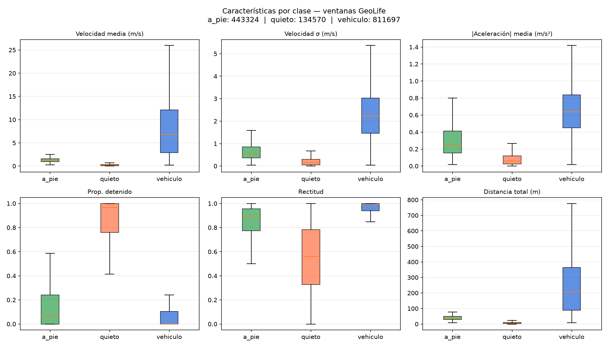

# S1 · Sesión 2 · Pablo: Remuestreo, ventanas y características

## 1. Resumen en 5 líneas

Se construyó la librería genérica de preprocesamiento GPS que convierte trazas crudas
(GeoLife, SUMO o teléfono) en ventanas de 30 s con 18 características numéricas. Se
implementó remuestreo a 1 Hz con interpolación lineal, ventaneo deslizante con paso de 5 s,
y la derivación automática de la clase `quieto` que GeoLife no trae. Se aplicó el pipeline
completo al dataset GeoLife, obteniendo 1,389,591 ventanas con 3 clases (vehiculo, a_pie,
quieto). La misma librería se usará en inferencia en vivo con TraCI y teléfonos reales.

## 2. Conceptos clave

- **Remuestreo a 1 Hz**: las trazas GPS originales tienen frecuencias irregulares (mediana
  2 s, pero hasta 60 s entre puntos). Se interpola linealmente lat/lon a exactamente 1
  muestra por segundo, partiendo el segmento cuando hay huecos mayores a 10 s para no
  inventar datos en vacíos largos.

- **Ventaneo deslizante (30 s, paso 5 s)**: cada ventana contiene 30 puntos GPS a 1 Hz.
  El paso de 5 s genera solapamiento del 83%, lo que aumenta el número de muestras de
  entrenamiento. Se descartan ventanas con menos del 80% de cobertura o pureza.

- **Derivación de `quieto`**: GeoLife solo etiqueta modos de transporte (walk, car, bus,
  etc.), no el estado estacionario. Se reetiqueta como `quieto` toda ventana cuya
  **velocidad efectiva** (desplazamiento neto / duración) sea < 0.3 m/s Y cuyo
  desplazamiento neto sea < 10 m. Se usa velocidad efectiva en vez de mediana instantánea
  porque el ruido GPS genera velocidades aparentes de ~2.6 m/s incluso estando quieto.

- **Mediana móvil (k=3)**: suavizado aplicado a lat/lon antes de calcular velocidades,
  para reducir el impacto del ruido GPS (~5 m de σ) en las características derivadas.

- **Haversine vectorizada**: fórmula de distancia sobre la esfera terrestre, implementada
  con NumPy para calcular distancias entre puntos GPS consecutivos de forma eficiente.

- **Pureza de ventana (80%)**: proporción mínima de puntos con la misma etiqueta dentro
  de una ventana. Descarta transiciones ambiguas entre modos.

## 3. Cómo se generó cada cosa

### ventanas_geolife.parquet (1,389,591 ventanas)
```bash
cd semanas/S1/Pablo/codigo
python3 -m ia.datos.construir_ventanas
```
- **Entrada**: `ia/datos/procesados/geolife_etiquetado.parquet` (3.25M puntos, 64 usuarios)
- **Salida**: `ia/datos/procesados/ventanas_geolife.parquet` (1.39M filas × 23 columnas)
- **Proceso**: por cada usuario, remuestrear → ventanear → extraer características

### Evidencia s2_caracteristicas-por-clase.png
```bash
python3 -m ia.datos.evidencias_ventanas
```
- **Entrada**: `ventanas_geolife.parquet`
- **Salida**: `semanas/S1/Pablo/evidencias/s2_caracteristicas-por-clase.png`

### Tests
```bash
python3 -m pytest ia/tests/test_ventanas.py -v
```

## 4. Mapa de archivos

- **ia/ventanas.py**: remuestrear() y ventanear(), libreria generica. Usado por construir_ventanas.py e inferencia en vivo (S3).
- **ia/caracteristicas.py**: extraer(ventana) con 18 features. Usado por construir_ventanas.py e inferencia en vivo (S3).
- **ia/datos/construir_ventanas.py**: Pipeline GeoLife completo. Se ejecuta una vez para generar el dataset.
- **ia/datos/evidencias_ventanas.py**: Boxplots de 6 features por 3 clases. Evidencia visual.
- **ia/tests/test_ventanas.py**: 11 tests con trazas sinteticas. Validacion de la libreria.
- **ia/README.md**: Documentacion del modulo y regla de quieto. Referencia del equipo.
- **ia/datos/procesados/ventanas_geolife.parquet**: 1.39M ventanas con features y etiqueta. Entrenamiento (S3).

## 5. Recorrido del código

### `ia/ventanas.py`

- **`remuestrear(df, hz=1, max_hueco_s=10)`**: interpola lat/lon a 1 Hz dentro de cada
  segmento. Detecta huecos > 10 s y parte el segmento en dos para no inventar datos.

```python
t_nuevo = np.arange(t_sub[0], t_sub[-1], 1.0 / hz)
lat_i = np.interp(t_nuevo, t_sub, sub["lat"].values)
lon_i = np.interp(t_nuevo, t_sub, sub["lon"].values)
```

- **`ventanear(df, largo_s=30, paso_s=5, ...)`**: genera ventanas deslizantes y deriva
  `quieto` usando velocidad efectiva:

```python
desp = desplazamiento_neto(sub["lat"].values, sub["lon"].values)
duracion = float(sub["t"].iloc[-1] - sub["t"].iloc[0])
vel_efectiva = desp / duracion if duracion > 0 else 0.0
if vel_efectiva < 0.3 and desp < 10.0:
    modo_mayoritario = "quieto"
```

### `ia/caracteristicas.py`

- **`extraer(ventana) → dict`**: calcula 18 features a partir de lat/lon/t. Usa mediana
  móvil de 3 muestras para suavizar posiciones antes de derivar velocidad.

```python
vel = velocidades_suavizadas(lat, lon, t)
acc = np.diff(vel) / dt_vel
jerk = np.diff(acc) / dt_acc
```

- **`_haversine_vec()`**: distancia Haversine vectorizada con NumPy.
- **`desplazamiento_neto()`**: distancia entre primer y último punto de la ventana.

### `ia/datos/construir_ventanas.py`

- **`procesar_usuario(uid, df)`**: pipeline completo por usuario.
- **`ejecutar()`**: lee parquet, itera secuencialmente por usuario, guarda resultado.

## 6. Cómo se conecta con los demás

- **Consume de la sesión 1**: `geolife_etiquetado.parquet` (trazas con columnas del contrato).
- **Consume del contrato (§2, §7)**: formato de ventanas (30 s, 1 Hz, paso 5 s) y formato
  de eventos (`usuario_id, t, lat, lon, precision_m, velocidad_mps, modo_real`).
- **Entrega a la sesión 3**: `ventanas_geolife.parquet` para entrenar el clasificador.
- **Entrega a inferencia en vivo**: `ventanas.py` y `caracteristicas.py` son librerías
  genéricas que se usarán con trazas SUMO y de teléfono sin modificación.

## 7. Resultados y evidencias

**Distribución de ventanas:**
- **vehiculo**: 811,697 ventanas (58.4%)
- **a_pie**: 443,324 ventanas (31.9%)
- **quieto**: 134,570 ventanas (9.7%)
- **Total**: 1,389,591 ventanas

Las 134,570 ventanas `quieto` fueron derivadas automáticamente (9.7% del total).

**Tests**: 11/11 pasan, incluyendo traza sintética tipo SUMO.



Los boxplots muestran separación clara entre clases: `vehiculo` tiene velocidad media alta
y rectitud alta, `a_pie` velocidades intermedias, y `quieto` velocidades cercanas a cero
con alta proporción de detenido.

## 8. Limitaciones y decisiones

- **Procesamiento secuencial**: se cambió de `joblib.Parallel(n_jobs=-1)` a secuencial
  porque los usuarios grandes (>300k puntos) consumían demasiada RAM con multiproceso,
  provocando OOM kills. El pipeline tarda ~68 min pero completa de forma estable.
- **Desbalance de clases**: `vehiculo` tiene 6× más ventanas que `quieto`. El modelo
  (sesión 3) deberá usar pesos de clase o submuestreo.
- **Velocidad efectiva vs. instantánea**: se eligió velocidad efectiva
  (desplazamiento/duración) para derivar `quieto` porque el ruido GPS genera velocidades
  instantáneas aparentes de ~2.6 m/s incluso estando quieto, incluso tras suavizado.
- **Sin datos SUMO reales**: se verificó con traza SUMO sintética. La integración con los
  datos reales de Freddy se hará cuando estén disponibles.

## 9. Preguntas que podría hacer el profesor

**P1: ¿Por qué derivar `quieto` en vez de usar una etiqueta existente?**
GeoLife solo etiqueta modos de transporte (walk, car, bus). No distingue "parado" de
"caminando lento". Para un sistema de parqueo necesitamos saber cuándo un vehículo está
estacionado, así que derivamos `quieto` con umbrales de velocidad efectiva y desplazamiento.

**P2: ¿Por qué usar velocidad efectiva y no la mediana de velocidades instantáneas?**
El ruido GPS (~5 m σ) genera velocidades instantáneas aparentes de ~2.6 m/s incluso
estando completamente quieto. La velocidad efectiva (desplazamiento neto / duración)
cancela el ruido porque los errores son aleatorios y se compensan en 30 s.

**P3: ¿Cómo garantizan que el mismo código funciona con SUMO y con teléfonos reales?**
`ventanas.py` y `caracteristicas.py` no dependen de GeoLife: solo necesitan las columnas
del contrato (t, lat, lon). Los tests incluyen una traza sintética tipo SUMO que verifica
esta independencia.

**P4: ¿Por qué ventanas de 30 s con paso de 5 s?**
30 s captura suficiente contexto para distinguir modos (un giro, una parada), y 5 s de
paso da solapamiento del 83% que aumenta las muestras sin perder resolución temporal.
Estos valores están definidos en el contrato del proyecto (§2).

**P5: ¿Qué pasa con el desbalance de clases?**
`vehiculo` tiene 6× más ventanas que `quieto`. En la sesión 3 se usarán pesos de clase
inversamente proporcionales a la frecuencia (`class_weight='balanced'` en scikit-learn)
para que el modelo no ignore la clase minoritaria.
