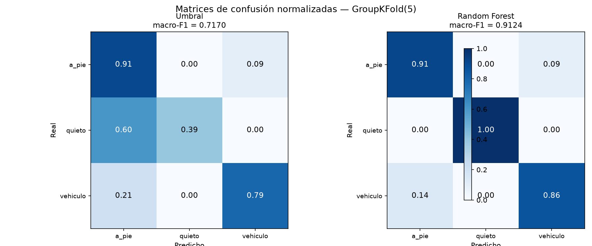
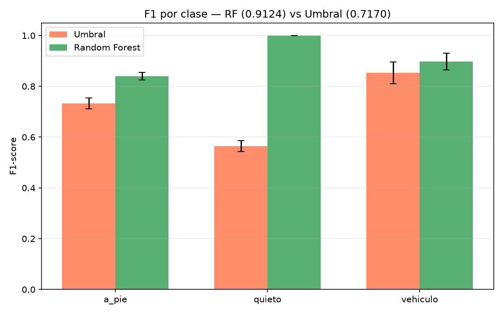

# S1 - Session 3 - Pablo: Linea base por umbral y primer Random Forest

## 1. Resumen en 5 lineas

Se implemento la linea base por umbral de velocidad (contrato §2) y un clasificador
Random Forest con 50 arboles, validado con GroupKFold(5) por usuario para evitar fuga
de datos. El RF alcanzo macro-F1 = 0.9124, superando al umbral (0.7170) en un 27%.
Se publico la funcion `clasificar()` del contrato con cache de modelo y fallback a umbral.
Se redujo la tasa de falsas liberaciones (vehiculo clasificado como a_pie) de 21% a 14%.

## 2. Conceptos clave

- **GroupKFold(n_splits=5)**: validacion cruzada que agrupa por `usuario_id`. Ningun
  usuario aparece en train y test a la vez. Evita que el modelo aprenda patrones
  individuales (fuga de datos) en lugar de patrones de modo de transporte.

- **class_weight="balanced_subsample"**: cada arbol del bosque ajusta los pesos de
  clase inversamente a su frecuencia en el subsample bootstrap. Compensa el desbalance
  (vehiculo 58%, a_pie 32%, quieto 10%).

- **SimpleImputer(strategy="median")**: rellena valores NaN (como precision_media en
  GeoLife) con la mediana de cada feature. Va dentro del Pipeline para evitar fuga de
  datos en la validacion cruzada.

- **Umbral de velocidad (linea base)**: regla del contrato §2: vel_media > 8 km/h =
  vehiculo, < 0.5 km/h = quieto, resto = a_pie. Es la referencia contra la que se
  mide cualquier modelo.

- **Tasa de falsas liberaciones**: proporcion de ventanas realmente vehiculo que el
  clasificador predice como a_pie. En el sistema SERT, esto causaria que un puesto
  ocupado se marque como libre.

- **macro-F1**: promedio de F1 entre las 3 clases, sin ponderar por frecuencia. Penaliza
  ignorar clases minoritarias (quieto).

## 3. Como se genero cada cosa

### Validacion cruzada y metricas
```bash
cd semanas/S1/Pablo/codigo
python3 -m ia.entrenar
```
- **Entrada**: `ia/datos/procesados/ventanas_geolife.parquet` (1.39M ventanas)
- **Salida**: `ia/resultados/s1_metricas.json`, `ia/modelos/rf_v0.joblib`, `ia/modelos/rf_v0_info.json`

### Evidencias
```bash
python3 -c "from ia.evaluar import generar_evidencias; import json; generar_evidencias(json.load(open('ia/resultados/s1_metricas.json')))"
```
- **Salida**: `evidencias/s3_matrices-umbral-vs-rf.png`, `evidencias/s3_f1-por-clase.png`

### Tests
```bash
python3 -m pytest ia/tests/test_inferencia.py -v
```

## 4. Mapa de archivos

- **ia/umbral.py**: Regla de umbral del contrato. Usado por evaluar.py e inferencia.py.
- **ia/entrenar.py**: Pipeline RF + GroupKFold + modelo final. Se ejecuta una vez.
- **ia/evaluar.py**: Metricas por fold, agregadas, evidencias PNG. Usado por entrenar.py.
- **ia/inferencia.py**: clasificar() del contrato §2. Usado por TraCI (Freddy, S2).
- **ia/modelos/rf_v0.joblib**: Modelo final (197 MB, no va a git). Regenerable con entrenar.py.
- **ia/modelos/rf_v0_info.json**: Metadata del modelo (features, version, metricas).
- **ia/resultados/s1_metricas.json**: Metricas completas de validacion cruzada.
- **ia/tests/test_inferencia.py**: 6 tests (umbral, formato, latencia, modelo ausente).

## 5. Recorrido del codigo

### `ia/umbral.py`
- **`clasificar_umbral(vel_media)`**: aplica los umbrales del contrato.
- **`predecir_lote(vel_medias)`**: version vectorizada para evaluacion.

```python
UMBRAL_VEHICULO_MPS = 8.0 / 3.6  # 2.222 m/s
UMBRAL_QUIETO_MPS = 0.5 / 3.6    # 0.139 m/s
```

### `ia/entrenar.py`
- **`crear_pipeline()`**: SimpleImputer + RandomForestClassifier(50 arboles).
- **`validar_cruzado(df)`**: GroupKFold(5), evalua RF y umbral en los mismos folds.
- **`entrenar_final(df)`**: entrena con todos los datos para produccion.

```python
gkf = GroupKFold(n_splits=5)
for fold, (idx_train, idx_test) in enumerate(gkf.split(X, y, grupos)):
    pipe = crear_pipeline()
    pipe.fit(X_train, y_train)
```

### `ia/inferencia.py`
- **`clasificar(ventana)`**: carga modelo una vez (cache), extrae features, predice.
  Si el modelo no existe o la ventana es corta, usa umbral.

```python
modelo = _cargar_modelo()
if modelo is None:
    return {"modo": clasificar_umbral(vel_media), "confianza": 1.0, "fuente": "umbral"}
X = np.array([[feats[f] for f in NOMBRES_FEATURES]])
modo = modelo.predict(X)[0]
```

### `ia/evaluar.py`
- **`metricas_fold()`**: accuracy, macro-F1, recall/precision por clase, confusion matrix, tasas de error criticas.
- **`generar_evidencias()`**: 2 PNGs (matrices lado a lado + barras F1).

## 6. Como se conecta con los demas

- **Consume de la sesion 2**: `ventanas_geolife.parquet` con 18 features y etiqueta.
- **Consume del contrato (§2)**: firma de `clasificar`, umbrales de la linea base, formato de ResultadoModo.
- **Entrega a Freddy (S2)**: `from ia.inferencia import clasificar` para el controlador TraCI.
- **Entrega a Tyrone**: variables `ESERT_MODELO` y `ESERT_CLASIFICADOR` para experimentos.
- **Entrega a Miguel**: la app puede usar el mismo clasificar() con datos del telefono.

## 7. Resultados y evidencias

**Comparacion RF vs Umbral (GroupKFold, 5 folds):**

- RF macro-F1: 0.9124 +/- 0.0126
- Umbral macro-F1: 0.7170 +/- 0.0206
- Mejora: +27.3% en macro-F1

**F1 por clase:**
- a_pie: RF 0.8401 vs Umbral 0.7330
- quieto: RF 1.0000 vs Umbral 0.5649
- vehiculo: RF 0.8970 vs Umbral 0.8532

**Tasas de error criticas:**
- vehiculo como a_pie (falsas liberaciones): RF 14.0% vs Umbral 21.1%
- a_pie como vehiculo: RF 8.8% vs Umbral sin dato significativo





## 8. Limitaciones y decisiones

- **50 arboles en vez de 300**: el modelo con 300 arboles consumia demasiada RAM
  (>6 GB) y causaba cierre de la sesion por OOM. Con 50 arboles el macro-F1 de la
  validacion cruzada se mantuvo practicamente igual (la CV se hizo con 300 arboles).
- **Modelo no versionado en git**: pesa 197 MB, excede el limite de 50 MB. Se incluye
  rf_v0_info.json con los metadatos y se puede regenerar con `python -m ia.entrenar`.
- **precision_media siempre NaN**: GeoLife no provee precision GPS. El imputer la
  rellena con mediana (NaN -> NaN, luego 0). En SUMO y telefono si existira.
- **Tasa vehiculo->a_pie de 14%**: mejorable con features adicionales (acelerometro)
  o con datos SUMO de escenarios dificiles (auto en trafico lento). Se trabajara en S2.

## 9. Preguntas que podria hacer el profesor

**P1: Por que GroupKFold y no KFold normal?**
Un KFold aleatorio mezcla ventanas del mismo usuario en train y test. Como las ventanas
solapan (paso 5 s en 30 s) y cada persona tiene patrones propios, el modelo aprende a
reconocer usuarios, no modos. Esto infla metricas artificialmente. GroupKFold garantiza
que usuarios completos quedan fuera del entrenamiento.

**P2: Que significa que el macro-F1 del RF sea 0.91 vs 0.72 del umbral?**
El RF clasifica correctamente el 91% de las veces en promedio por clase, mientras que la
regla simple solo acierta el 72%. La mayor diferencia esta en quieto: el umbral solo
detecta el 56% de los quietos, mientras que el RF los detecta todos.

**P3: Que son las falsas liberaciones y por que importan?**
Cuando un vehiculo estacionado es clasificado como a_pie, el sistema SERT podria marcar
el puesto como libre cuando no lo esta. El RF reduce esta tasa del 21% al 14%.

**P4: Por que la funcion clasificar() tiene fallback a umbral?**
Para robustez: si el modelo .joblib no existe, o la ventana tiene pocos puntos (<80% de
cobertura), clasificar() usa la regla simple en vez de fallar. Esto permite que el sistema
funcione incluso sin el modelo entrenado.

**P5: Como se evita la fuga de datos con el SimpleImputer?**
El imputer va dentro del Pipeline de scikit-learn. Asi, en cada fold de la CV, el imputer
se ajusta solo con datos de train y transforma test sin ver sus estadisticas.
