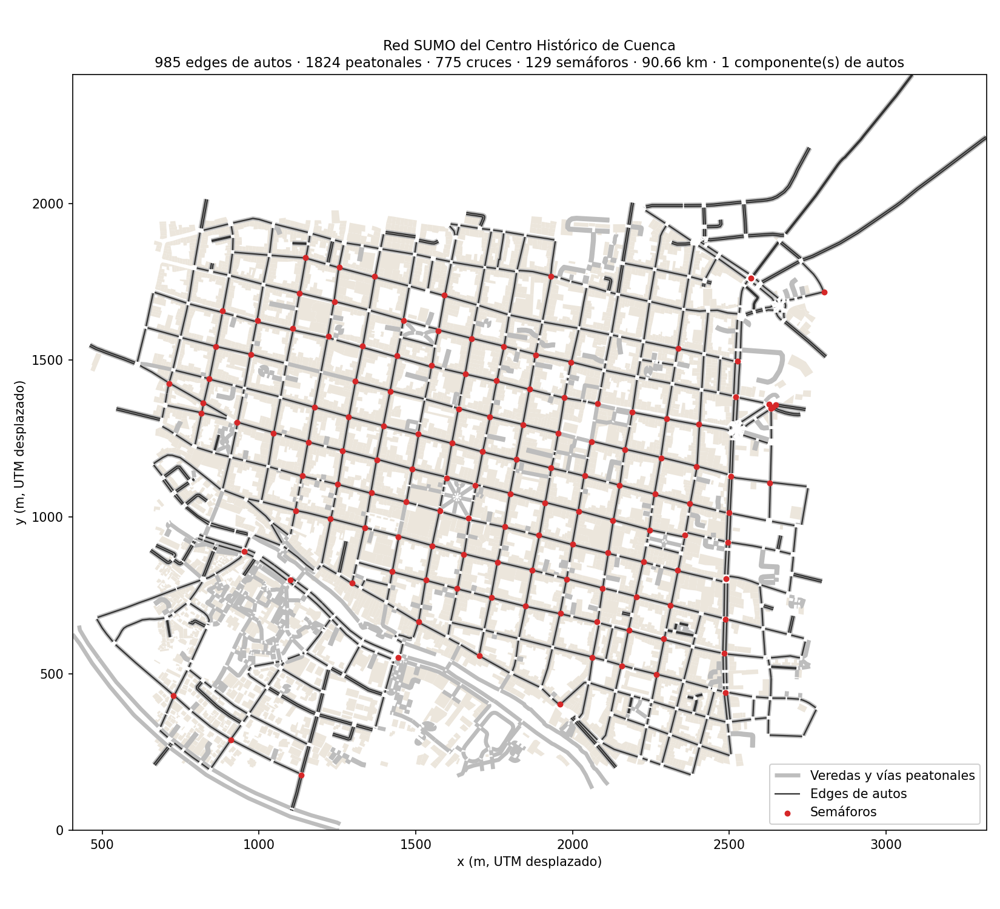
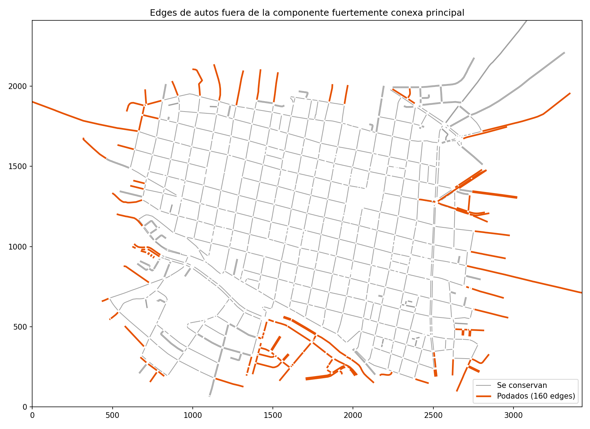
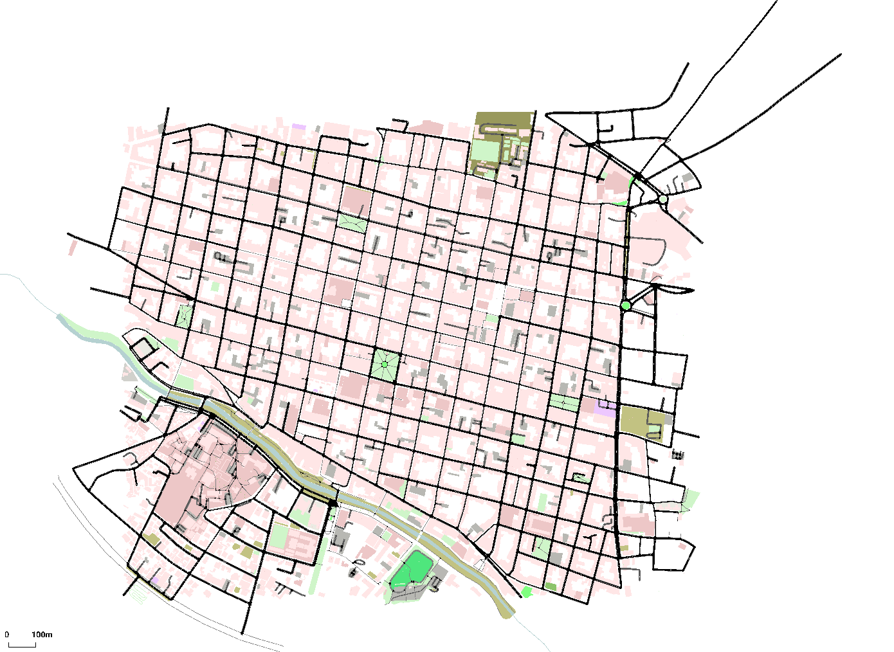

# Resumen S1 · Tyrone 🔵

## Sesión 1 · Red vial OSM del Centro Histórico en SUMO

`construir_red.py` descarga el OSM del Centro Histórico (Overpass), genera la red SUMO para
autos y peatones (veredas, cruces, semáforos, UTM 17S) y los edificios de fondo. Después la
valida automáticamente.

- 985 edges de autos y 1824 peatonales, 775 cruces, 129 semáforos y 90,66 km.
- La red de autos es una sola componente fuertemente conexa, tras podar 160 edges del borde.
- `sumo --end 10` termina con código 0, y los 20 peatones de prueba llegan sin teletransporte.

Comando:

```bash
docker exec -w /home/vanet/results/e-sert/semanas/S1/Tyrone/codigo/sumo/red van3twin bash -lc "python3 construir_red.py"
```







Explicación: [explicaciones/s1_explicacion.pdf](explicaciones/s1_explicacion.pdf)
