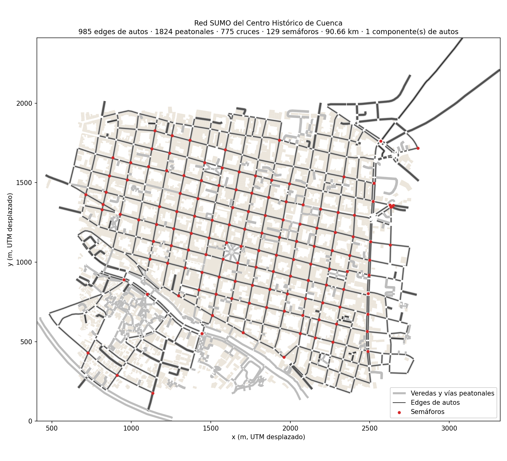
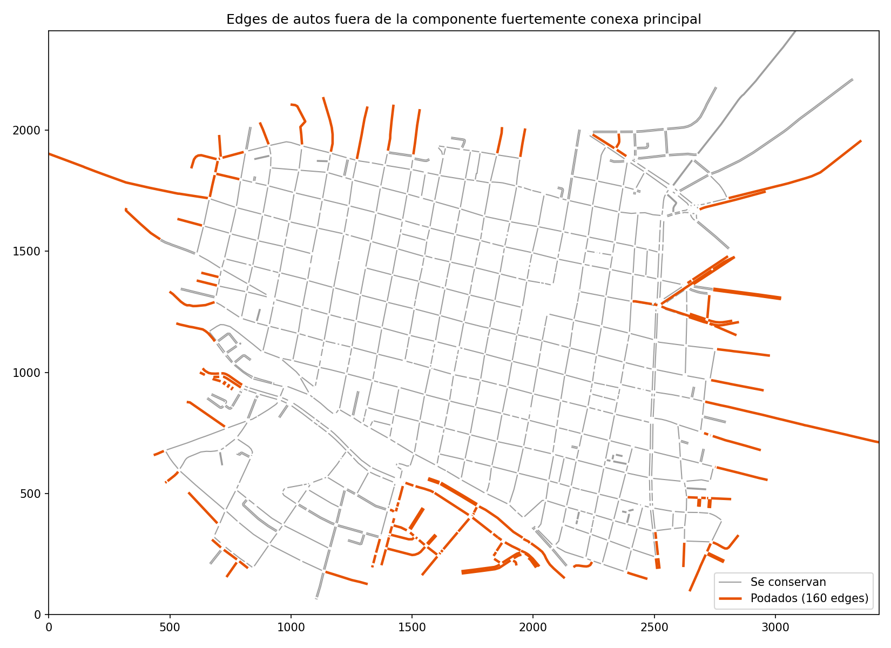
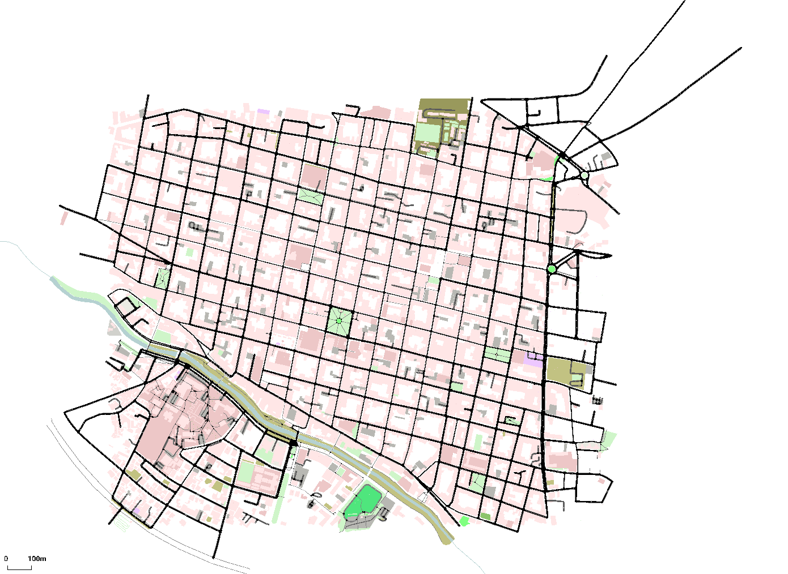

# S1 · Sesión 1 · Tyrone: Red vial OSM del Centro Histórico en SUMO

## 1. Resumen en 5 líneas

- Se creó `construir_red.py`, un script que descarga de OpenStreetMap el Centro Histórico de Cuenca y lo convierte en una red de SUMO.
- La red sirve para autos **y** peatones: tiene veredas, 775 cruces peatonales y 129 semáforos, y mide 90,7 km en total (63 km para autos).
- Los edificios se convierten en polígonos de fondo para que la red se vea en `sumo-gui` y en las gráficas.
- El script se valida solo: corre SUMO 10 s, simula 20 peatones (llegan todos, sin teletransporte) y deja todas las cifras en `red_info.json`.
- Es la base del proyecto: sobre esta red se colocan los `parkingArea` (sesión 2) y corren el controlador TraCI de Freddy y las trazas GPS de Pablo.

## 2. Conceptos clave

- **OpenStreetMap y Overpass.** OSM es el mapa libre del mundo. Overpass es una API que devuelve en XML todo lo que hay dentro de una caja (*bbox*): calles, edificios y semáforos. Usamos la caja `S,W,N,E = -2.9050,-79.0130,-2.8895,-78.9945`, que va del río Tomebamba a la Av. Gaspar Sangurima y de la Av. Huayna Cápac a la calle Coronel Talbot.
- **netconvert.** Es la herramienta de SUMO que transforma el OSM en una red `.net.xml`: carriles, intersecciones, conexiones permitidas y semáforos. Las opciones importantes son:
  - `--sidewalks.guess`: añade una vereda a cada calle donde OSM no la trae;
  - `--crossings.guess`: añade cruces peatonales (cebra) en las intersecciones;
  - `--walkingareas`: añade las esquinas donde se unen veredas y cruces;
  - `--junctions.join`: une en una sola intersección los nodos muy cercanos, que en OSM aparecen separados;
  - `--tls.guess-signals --tls.join`: reconoce los semáforos marcados como nodos sueltos y agrupa los de una misma intersección;
  - `--keep-edges.by-vclass passenger,pedestrian`: descarta lo que no es para autos ni peatones (por ejemplo, vías férreas);
  - `--proj.utm`: proyecta latitud y longitud a metros (UTM zona 17 S).
- **Edge, lane y junction.** Un *edge* es un tramo de calle entre dos intersecciones. Tiene uno o varios *lanes* (carriles), y cada carril dice qué vehículos permite. La vereda es un carril más, que solo permite `pedestrian`. Un *junction* es una intersección.
- **Componente fuertemente conexa (SCC).** Un grupo de calles en el que desde cualquiera se puede llegar a cualquier otra respetando los sentidos de circulación. Para que SUMO pueda rutear un auto entre dos puntos cualesquiera, la red de autos tiene que ser **una sola** SCC. El algoritmo que la calcula es el de Tarjan.
- **Poda.** La red cruda salía con 138 SCC. Casi todas eran calles de un solo sentido cortadas por el borde de la caja: se puede entrar y no salir, o al revés. Se quitan con `netconvert -s ... --remove-edges.input-file` (160 edges) y queda 1 SCC.
- **Teletransporte.** Cuando un vehículo o peatón queda atascado mucho tiempo, SUMO lo "teletransporta" más adelante. Un teletransporte indica un problema en la red, y por eso la prueba exige 0.
- **polyconvert.** Convierte los edificios, parques y ríos del OSM en polígonos de fondo con la misma proyección que la red.

## 3. Cómo se generó cada cosa

Todo sale de un solo comando, ejecutado dentro del contenedor `van3twin`:

```bash
docker exec -w /home/vanet/results/e-sert/semanas/S1/Tyrone/codigo/sumo/red van3twin \
  bash -lc "python3 construir_red.py"            # --sin-descarga reutiliza el OSM local
```

| Resultado | Cómo se produce | Entrada | Salida |
|---|---|---|---|
| OSM | POST a Overpass (requests) | bbox | red/centro.osm.xml (no se sube a git; su SHA-256 queda en red_info.json) |
| Red cruda | netconvert con las opciones de la sección 2 | OSM | salidas/centro_cruda.net.xml |
| Red final | poda iterativa de SCC con netconvert -s | red cruda | red/centro.net.xml |
| Edificios | polyconvert --type-file $SUMO_HOME/data/typemap/osmPolyconvert.typ.xml | OSM + red | red/centro.poly.xml |
| Configuración | la escribe el script | — | centro_red.sumocfg (solo red + polígonos) |
| Prueba de 10 s | sumo -c centro_red.sumocfg --end 10 | cfg | código de salida 0 |
| Prueba peatonal | randomTrips.py --pedestrians --validate (60 sorteados, se usan 20) + sumo --statistic-output | red | salidas/peatones.*.xml |
| Cifras | sumolib + conteo XML | red | red/red_info.json |
| Gráficas | matplotlib | red, polígonos | evidencias/s1_red-centro.png, s1_componentes-podadas.png |
| Captura GUI | traci.gui.screenshot sobre sumo-gui | cfg | evidencias/s1_red-centro-gui.png |

## 4. Mapa de archivos

| Archivo | Qué contiene | Quién lo usa |
|---|---|---|
| codigo/sumo/red/construir_red.py | El script completo | Tyrone (regenerar la red) |
| codigo/sumo/red/centro.net.xml | La red SUMO final (UTM) | Todos: Tyrone (parkingArea, demanda), Freddy (TraCI), Pablo (trazas) |
| codigo/sumo/red/centro.poly.xml | Edificios y fondo | sumo-gui, gráficas |
| codigo/sumo/red/red_info.json | Comandos, SHA-256 del OSM, cifras y pruebas | Informe, verificación |
| codigo/sumo/centro_red.sumocfg | Configuración sin demanda | Abrir la red en sumo-gui |
| codigo/sumo/requirements.txt | requests, matplotlib | Instalación en el contenedor |
| evidencias/s1_*.png | Gráficas y captura | Bitácora, informe |

## 5. Recorrido del código

`construir_red.py` se divide en funciones, una por paso:

- `descargar_osm(bbox)`: arma la consulta Overpass (nodos de la caja, las vías que los usan y todos los nodos de esas vías) y la prueba contra dos servidores espejo.
- `comando_netconvert()` / `comando_polyconvert()`: devuelven la lista de argumentos. Así el mismo texto se ejecuta y se guarda en `red_info.json`.
- `componentes_autos(net)`: construye el grafo dirigido de edges que permiten `passenger` y calcula sus SCC con Tarjan (versión iterativa, sin recursión).
- `podar_componentes()`: quita los edges que quedan fuera de la SCC más grande y repite hasta 5 veces.
- `validar_red()`: cuenta edges, veredas, cruces, semáforos y kilómetros, y lee la proyección.
- `prueba_sumo_10s()` y `prueba_peatonal()`: las dos pruebas automáticas.
- `grafica()`, `grafica_poda()` y `captura_gui()`: las evidencias.

La parte central es la poda:

```python
actual, podados = NET_CRUDA, []
for vuelta in range(1, max_vueltas + 1):
    comps = componentes_autos(sumolib.net.readNet(str(actual)))
    if len(comps) <= 1:
        break
    fuera = sorted(set().union(*comps[1:]))
    podados += fuera
    lista.write_text("\n".join(fuera) + "\n", encoding="utf-8")
    siguiente = SALIDAS / f"centro_poda{vuelta}.net.xml"
    ejecutar(["netconvert", "-s", actual, "--remove-edges.input-file", lista,
              "--remove-edges.isolated", "--output-file", siguiente])
    actual = siguiente
NET.write_bytes(actual.read_bytes())
```

## 6. Cómo se conecta con los demás

- **Consume:** nada del contrato. Es la primera pieza del proyecto.
- **Entrega:** `centro.net.xml`, con proyección `+proj=utm +zone=17 +ellps=WGS84 +datum=WGS84 +units=m` y `netOffset = -720182.23,321509.41`.
  - Freddy convierte posiciones a lat/lon con `traci.simulation.convertGeo(x, y)` o con `net.convertXY2LonLat(x, y)` de sumolib. Ambas usan esta proyección.
  - Pablo puede generar trazas GPS de peatones y autos sobre esta red.
- **Próximo paso propio:** en la sesión 2 se colocan los `parkingArea` sobre los bordes de las calles tarifadas de esta red.

## 7. Resultados y evidencias

| Cifra | Valor |
|---|---|
| Edges de autos / peatonales | 985 / 1824 |
| Edges de autos con vereda | 903 |
| Cruces peatonales / walkingareas | 775 / 1569 |
| Semáforos (programas tls) | 129 |
| Longitud total / de autos | 90,66 km / 63,05 km |
| Componentes de autos | 1 (tras podar 160 edges) |
| sumo --end 10 | código 0, sin advertencias |
| Prueba peatonal | 20/20 llegan, 0 teletransportes, 0 atascos; 1,05 km y 943 s de media |







## 8. Limitaciones y decisiones

- **Poda de 160 edges de autos.** Son sobre todo tramos de un solo sentido cortados por el borde de la caja y calles al sur del río, fuera de la zona SERT. Se prefirió una red 100 % ruteable a conservar tramos sin salida. Los IDs quedan en `red_info.json`.
- **Islas peatonales.** Al podar también se van las veredas de esos edges, y quedan pequeñas islas peatonales: de 60 viajes peatonales sorteados, 6 no tenían ruta y `--validate` los descartó. Por eso se sortean 60 y se simulan los 20 primeros válidos.
- **SUMO 1.12:**
  - `--keep-edges.components` existe, pero solo trabaja con componentes *débilmente* conexas y no garantiza que la red sea ruteable; por eso la SCC se calcula en Python.
  - SUMO 1.12 no imprime "Teleports: 0" cuando no hay teletransportes, así que se usa `--statistic-output`.
- **La red se extiende un poco más allá de la caja,** porque netconvert conserva completas las vías que la cruzan. `origBoundary` en `red_info.json` sale muy amplio porque Overpass también trae nodos de relaciones grandes, como el río. No afecta a la red.
- **El OSM cambia con el tiempo.** Por eso se guarda el SHA-256 del archivo usado. Si otra persona lo descarga otro día, las cifras pueden variar ligeramente.

## 9. Preguntas que podría hacer el profesor

1. **¿Por qué UTM y no lat/lon directamente?** SUMO trabaja en metros. UTM zona 17 S cubre Cuenca con una deformación despreciable a esta escala, y la conversión inversa se hace con `convertGeo` para el visor y la app.
2. **¿Por qué hacía falta podar la red?** Porque una ruta de auto solo existe si la red es fuertemente conexa. Sin la poda, al elegir destinos o puestos al azar habría rutas imposibles y autos que nunca llegan.
3. **¿Cómo se sabe que la red sirve para peatones?** Tiene veredas en 903 de 985 edges de autos y 775 cruces, y 20 peatones aleatorios recorrieron en promedio 1 km sin atascarse ni teletransportarse.
4. **¿Es reproducible?** Sí: un solo comando regenera todo. Los comandos exactos y el SHA-256 del OSM quedan en `red_info.json`, y con `--sin-descarga` se reconstruye con el mismo OSM.
5. **¿Por qué `--junctions.join`?** En OSM, una intersección de calles de dos carriles suele aparecer como varios nodos muy juntos. Sin unirlos salen microintersecciones con semáforos duplicados y giros raros.
