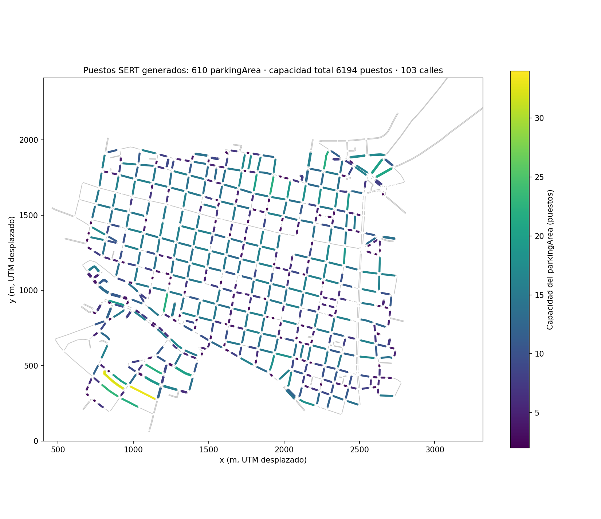

# S1 · Sesión 2 · Tyrone: Generación automática de puestos SERT (parkingArea)

## 1. Resumen en 5 líneas

- Se creó `generar_parkingareas.py`, que coloca automáticamente los puestos de parqueo tarifado (SERT) sobre las calles de la red de la sesión 1.
- Las reglas (qué calles, largo del puesto, margen en las esquinas) están en un archivo legible, `calles_sert.yaml`, que cualquiera del grupo puede ajustar.
- Resultado: 610 `parkingArea` con 6194 puestos en 103 calles, en promedio 10 puestos por tramo de cuadra.
- Genera `parqueos.add.xml` para SUMO y `puestos.csv`, que es parte del contrato: lo usan el backend de Freddy y el mapa de la app de Miguel.
- Se probó que SUMO carga los puestos sin advertencias y que 10 autos con destino a puestos aleatorios estacionan todos.

## 2. Conceptos clave

- **parkingArea.** Es el objeto de SUMO que representa una zona de parqueo junto a un carril, entre dos posiciones (`startPos` y `endPos`, en metros desde el inicio del carril). `roadsideCapacity` dice cuántos autos caben en fila a lo largo de la vereda. Un auto con `<stop parkingArea="..." duration="60"/>` sale del carril, ocupa un puesto y deja libre la vía.
- **Carril más a la derecha que permite autos.** Con veredas, el carril 0 de cada calle es la vereda (solo peatones). El puesto va en el primer carril que permite `passenger`, que normalmente es el 1.
- **Margen de esquina.** No se parquea a menos de 8 m de una intersección. Por eso el tramo útil va de `startPos = 8` a `endPos = largo − 8`, y la capacidad es `floor((endPos − startPos) / 5.5)`. Los tramos útiles de menos de 12 m no tienen puestos.
- **Filtros de calles.** Se incluyen los tipos de vía `residential`, `tertiary`, `secondary` y `unclassified` de OSM. Se excluyen las avenidas Huayna Cápac y Gaspar Sangurima (sin parqueo en la vía) y las calles sin nombre. Los nombres se comparan *normalizados*, sin tildes, sin mayúsculas y sin el prefijo "Avenida": en OSM la calle se llama "Gaspar Sangurima", y así igual coincide con "Avenida Gaspar Sangurima" del YAML.
- **Recorte por bbox.** La red se extiende más allá del Centro, porque netconvert conserva completas las vías que cruzan el borde. Sin recorte salían puestos en radiales como Calle Vieja o Barrial Blanco, de hasta 120 puestos por tramo. Ahora solo se crean puestos con los dos extremos dentro de la bbox de la sesión 1.
- **Determinismo.** Los edges se recorren ordenados por ID, los números se escriben con decimales fijos y no hay marcas de tiempo. Así dos ejecuciones dan archivos idénticos, byte a byte.

## 3. Cómo se generó cada cosa

```bash
docker exec -w /home/vanet/results/e-sert/semanas/S1/Tyrone/codigo/sumo/parqueos van3twin \
  bash -lc "python3 generar_parkingareas.py"      # --sin-prueba / --sin-grafica / --config otro.yaml
```

| Resultado | Entrada | Salida |
|---|---|---|
| Puestos para SUMO | red de la S1 + calles_sert.yaml | parqueos/parqueos.add.xml |
| Tabla del contrato | lo mismo | parqueos/puestos.csv |
| Resumen | lo mismo | parqueos/parqueos_info.json |
| Configuración | — | centro_parqueos.sumocfg (red + edificios + puestos) |
| Prueba de carga | sumo -c centro_parqueos.sumocfg --end 10 | 0 advertencias |
| Prueba de parqueo | 10 viajes con stop de 60 s, semilla 42 | salidas/prueba_parqueo.*.xml, salidas/parqueos_pruebas.json |
| Gráfica | puestos + red | evidencias/s2_puestos-sert.png |

## 4. Mapa de archivos

| Archivo | Qué contiene | Quién lo usa |
|---|---|---|
| sumo/parqueos/calles_sert.yaml | Reglas de qué calles y cómo | Tyrone; Miguel lo verifica contra la ordenanza |
| sumo/parqueos/generar_parkingareas.py | El generador y sus pruebas | Tyrone |
| sumo/parqueos/parqueos.add.xml | 610 parkingArea | SUMO, controlador TraCI (Freddy) |
| sumo/parqueos/puestos.csv | puesto_id, edge, lane, calle, capacidad, lat, lon, x, y | Backend (Freddy), app y visor |
| sumo/parqueos/parqueos_info.json | Capacidad total y por calle | Informe |
| sumo/centro_parqueos.sumocfg | Red + edificios + puestos | Escenarios de las semanas siguientes |

## 5. Recorrido del código

- `normalizar(nombre)`: quita tildes, mayúsculas y el prefijo "Avenida"/"Av.".
- `elegir_edges(net, cfg)`: recorre los edges ordenados por ID y aplica los filtros de tipo, nombre y `passenger`.
- `generar(net, cfg)`: por edge, elige el carril, calcula `startPos`/`endPos`/capacidad, aplica el recorte por bbox y el punto medio en lat/lon.
- `escribir_add`, `escribir_csv`, `escribir_sumocfg`: escriben los archivos con formato fijo.
- `prueba_carga()` y `prueba_estacionar()`: las dos pruebas con SUMO.
- `grafica()`: segmentos coloreados por capacidad con la escala *viridis*.

Parte central de `generar`:

```python
carriles = carriles_passenger(edge)
lados = [carriles[0]]                      # el carril 0 suele ser la vereda
if cfg["lado"] == "ambos" and len(carriles) >= 2 and es_un_sentido(edge):
    lados.append(carriles[-1])
for n, lane in enumerate(lados):
    L = lane.getLength()
    inicio, fin = margen, L - margen
    if fin - inicio < cfg["largo_minimo_tramo_m"]:
        continue
    capacidad = math.floor((fin - inicio) / largo)
    if not dentro_bbox(net, cfg["bbox_s_w_n_e"], punto_en_carril(lane, inicio),
                       punto_en_carril(lane, fin)):
        continue
    x, y = punto_en_carril(lane, (inicio + fin) / 2)
    lon, lat = net.convertXY2LonLat(x, y)
```

## 6. Cómo se conecta con los demás

- **Consume:** la red `centro.net.xml` de la sesión 1 y el formato de identificadores del contrato (`pa_<edgeId>_<n>`).
- **Entrega:**
  - `puestos.csv` a Freddy, que lo usa en `GET /puestos` y `/guia`, y a Miguel, para el mapa de la app;
  - `parqueos.add.xml` al controlador TraCI, para usar con `setParkingAreaStop`;
  - `centro_parqueos.sumocfg` como base de los escenarios de demanda (sesión 3).
- La latitud y la longitud del CSV son las del punto medio de cada `parkingArea`, convertidas con la misma proyección UTM 17S de la red.

## 7. Resultados y evidencias

| Cifra | Valor |
|---|---|
| parkingArea | 610 |
| Capacidad total | 6194 puestos |
| Calles con puestos | 103 |
| Capacidad media por parkingArea | 10,15 |
| Calles con más puestos | Gran Colombia y Simón Bolívar (211 c/u), Antonio Vega Muñoz (206), Pío Bravo (196) |
| sumo --end 10 | código 0, 0 advertencias |
| Prueba de parqueo | 10/10 estacionan y llegan |
| Determinismo | sha256 idéntico entre dos corridas |



## 8. Limitaciones y decisiones

- **La lista de calles es provisional.** Se generó por tipo de vía, no a partir de la ordenanza SERT; Miguel la verifica en su sesión 3. Los 6194 puestos pueden no coincidir con el número real de puestos SERT. Si la ordenanza da una lista, basta con llenar `incluir_nombres`.
- **Un solo lado por defecto.** Cada edge tiene puestos solo a la derecha. Una calle de doble sentido son dos edges, así que queda con puestos en las dos aceras. `lado: ambos` añade el borde izquierdo (`pa_<edge>_1`) solo en calles de un sentido con 2 o más carriles. Se probó: 944 parkingArea y 0 advertencias.
- **Recorte por bbox completo.** Un tramo que cruza el borde de la bbox se descarta entero, no se recorta.
- **No se modelan** garajes, paradas de bus, entradas de garaje ni zonas de carga: el margen de 8 m solo aproxima las esquinas.
- **SUMO 1.12:** no hizo falta adaptar nada; `parkingArea` con `roadsideCapacity` y `friendlyPos` funcionan igual.

## 9. Preguntas que podría hacer el profesor

1. **¿Por qué generar los puestos por script y no dibujarlos a mano?** Porque son más de 600 tramos. Un script es reproducible, se ajusta cambiando el YAML y se regenera si cambia la red.
2. **¿Cómo se calcula la capacidad?** Con el largo útil del carril (menos 8 m en cada esquina) dividido entre 5,5 m por auto, redondeado hacia abajo.
3. **¿Por qué el carril 1 y no el 0?** Porque, al tener veredas, el carril 0 es la vereda peatonal. El puesto debe ir junto a ella, en el primer carril que permite autos.
4. **¿Cómo se sabe que los puestos funcionan en la simulación?** SUMO los carga sin advertencias, y 10 autos con destino a puestos al azar estacionan todos (verificado con `--stop-output`).
5. **¿Qué pasa si cambian las calles tarifadas?** Se edita `calles_sert.yaml` (tipos, nombres incluidos o excluidos) y se vuelve a ejecutar el script. El CSV del contrato se regenera con el mismo formato.
