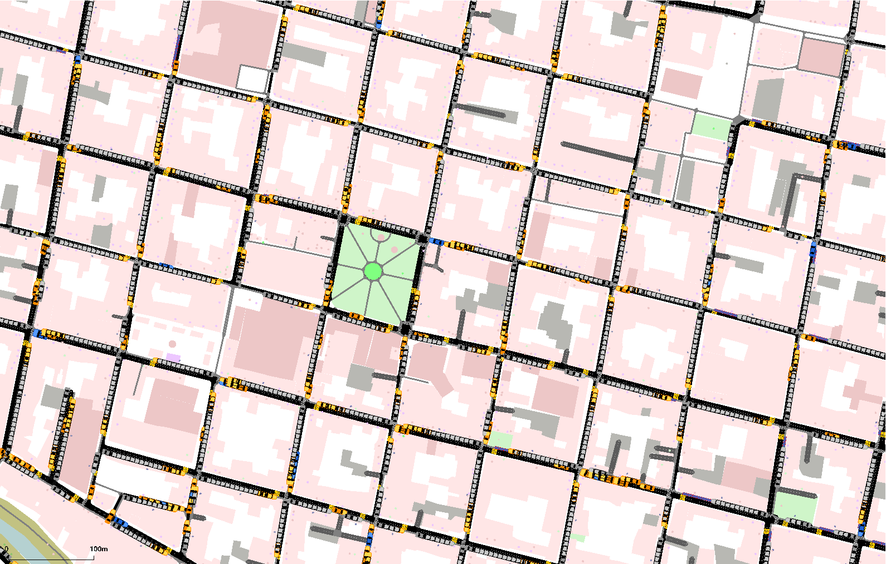
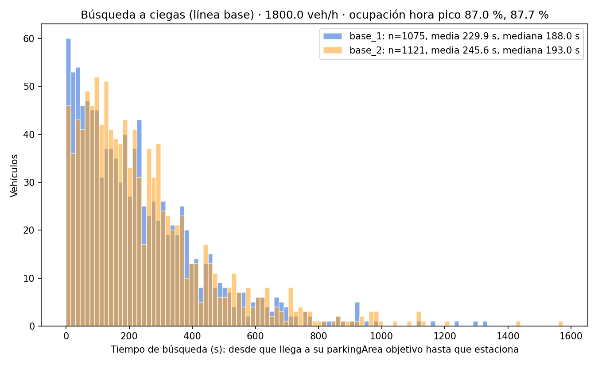
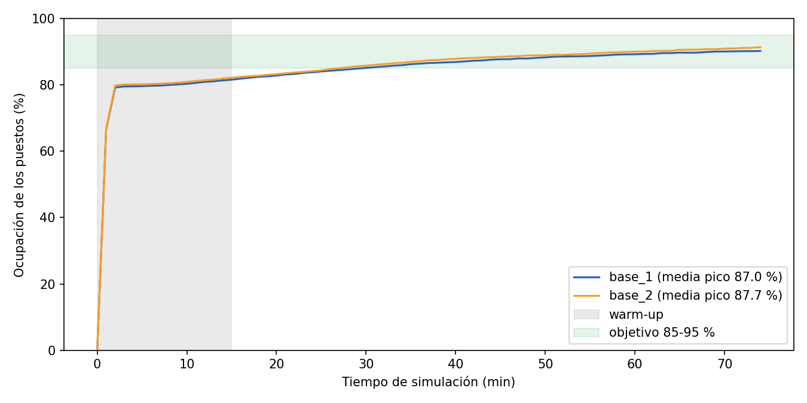

# S1 · Sesión 3 · Tyrone: Demanda y búsqueda a ciegas (línea base)

## 1. Resumen en 5 líneas

- Se generó la demanda de hora pico del Centro Histórico: autos que llegan a 12 destinos reales y buscan parqueo, más tráfico de paso.
- Los conductores buscan **a ciegas**: van al puesto más cercano a su destino y, si está lleno, prueban otro cercano sin saber si tiene lugar.
- Con 1800 llegadas por hora y un 80 % de puestos ocupados desde el inicio por autos de larga estadía, la ocupación media en la hora pico es de 87,0 % y 87,7 % (semillas 1 y 2).
- La búsqueda dura en promedio 230 y 246 s (medianas de 188 y 193 s), sin teletransportes.
- Es la **línea base**: en S2 y S3, los mismos autos usarán la app y se medirá cuánto se reducen el tiempo, la distancia y el CO₂.

## 2. Conceptos clave

- **Línea base.** Es el escenario contra el que se compara la app: los mismos autos y la misma red, pero sin información de ocupación. Sin ella no se puede decir que la app "mejora" algo.
- **Llegadas Poisson.** Los autos llegan al azar con una tasa promedio (veh/h): el tiempo entre llegadas sigue una distribución exponencial. Es el modelo clásico de llegadas independientes.
- **Estadía lognormal.** La duración del parqueo es siempre positiva y tiene una cola larga (pocos se quedan mucho). Se usa media 45 min y σ = 0,5, recortada a 10–120 min.
- **Edges de borde.** Por dónde entran y salen los autos. Son las calles cortadas por el borde del área (nodos sin salida a menos de 100 m de la bbox) y las que cruzan la bbox: 41 entradas y 43 salidas.
- **Ocupación de fondo.** Con 6194 puestos, llegar al 85–95 % solo con autos que llegan exigiría unos 7000 buscadores por hora. Por eso el 80 % de cada `parkingArea` empieza ocupado por autos de larga estadía (trabajadores y residentes) que no se mueven en la corrida. Representa la saturación típica del Centro en la mañana.
- **rerouter con `parkingAreaReroute`.** Es el mecanismo de SUMO para buscar parqueo. Cada `parkingArea` tiene un rerouter en su calle con la lista de alternativas a menos de 400 m. Con `visible="false"`, el conductor solo sabe si hay lugar cuando llega. Si su objetivo está lleno, elige una alternativa con este puntaje:
  - `parking.distance.weight = 1`: prefiere la más cercana a su posición actual;
  - `parking.probability.weight = 0.5`: prefiere la más cercana al puesto original, codificada en el atributo `probability`, de 1 en el mismo puesto a 0,1 a 400 m.

  Además, SUMO recuerda durante 10 min los puestos que ya encontró llenos. El resultado es "busca lo más cerca del destino".
- **Tiempo de búsqueda (provisional).** Va desde que el auto entra por primera vez a la calle de su puesto objetivo hasta que estaciona. Se calcula con los `exitTimes` de `vehroute-output` y el `started` de `stop-output`.

## 3. Cómo se generó cada cosa

Todo se corre dentro del contenedor, desde `semanas/S1/Tyrone/codigo/sumo/demanda/`:

```bash
python3 generar_demanda.py --semilla 1          # demanda.rou.xml, rerouters.add.xml, ../centro_base.sumocfg
cd .. && sumo -c centro_base.sumocfg            # 75 min simulados -> salidas/base_1/
cd demanda && python3 correr_base.py --semillas 1 2          # semillas 1 y 2 en paralelo + resumen.json
python3 analizar_base.py ../salidas/base_1 ../salidas/base_2 \
    --histograma ../../../evidencias/s3_busqueda-histograma.png \
    --ocupacion ../../../evidencias/s3_ocupacion-base.png
python3 captura_gui.py --carpeta ../salidas/base_1 --t 2700 \
    --salida ../../../evidencias/s3_escenario-base.png
```

| Resultado | Entrada | Salida |
|---|---|---|
| Demanda | red, puestos.csv, destinos.csv, semilla | demanda/demanda.rou.xml (4924 de fondo, 1277 buscan y 864 de paso en la semilla 1) |
| Búsqueda a ciegas | puestos.csv | demanda/rerouters.add.xml (610 rerouters, 74,7 alternativas de media) |
| Escenario | todo lo anterior | centro_base.sumocfg |
| Salidas de SUMO | cfg + semilla | salidas/base_N/: tripinfo, stops, vehroutes, emisiones, estadísticas |
| Análisis provisional | salidas | salidas/base_N/resumen.json, histograma y curva de ocupación |

## 4. Mapa de archivos

| Archivo | Qué contiene | Quién lo usa |
|---|---|---|
| sumo/demanda/destinos.csv | 12 destinos con lat, lon, peso y fuente OSM | Demanda; Freddy (destino del teléfono espejo) |
| sumo/demanda/generar_demanda.py | Generador de demanda, rerouters y cfg | Tyrone; Freddy en S2 (con_app) |
| sumo/demanda/demanda.rou.xml | Demanda de la semilla 1 (1800 veh/h) | centro_base.sumocfg |
| sumo/demanda/rerouters.add.xml | Búsqueda a ciegas | centro_base.sumocfg |
| sumo/centro_base.sumocfg | Escenario base con todas las salidas | KPIs (S2), controlador TraCI |
| sumo/demanda/correr_base.py | Corre varias semillas | Experimentos |
| sumo/demanda/analizar_base.py | Ocupación y tiempo de búsqueda (provisional) | Calibración; base de los KPIs de S2 |
| sumo/demanda/captura_gui.py | Captura de sumo-gui en la hora pico | Evidencias |

## 5. Recorrido del código

- `generar_demanda.py`:
  - `edges_borde(net)`: detecta las entradas y salidas: nodos sin salida cerca del perímetro, y edges que cruzan la bbox;
  - `generar(net, args)`: crea los autos de fondo, luego las llegadas Poisson y decide por cada una si es de paso o busca parqueo;
  - `escribir_rerouters(puestos)`: escribe un rerouter por `parkingArea` con sus alternativas a menos de 400 m y su `probability` por cercanía;
  - `estadia_s(rng)`: estadía lognormal con media 45 min, recortada a 10–120 min.
- `analizar_base.py`:
  - `ocupacion(...)`: curva de ocupación cada 60 s a partir de los intervalos de `stop-output` (con `write-unfinished`);
  - `tiempos_busqueda(...)`: para cada buscador, el instante en que entra al edge objetivo (`exitTimes` del edge anterior) y la hora en que estaciona.

Parte central de las llegadas:

```python
while True:
    t += rng.expovariate(tasa)                 # llegadas Poisson
    if t >= fin:
        break
    origen = rng.choice(entradas)
    destino_salida = rng.choice([s for s in salidas if s != origen])
    if rng.random() * 100 < args.porc_paso:    # tráfico de paso: cruza sin parar
        ...
    else:                                      # busca parqueo
        d = rng.choices(destinos, weights=pesos)[0]
        pa = d["pa"]                           # parkingArea más cercano al destino
        # <trip from=origen to=salida><stop parkingArea=pa duration=estadía/>
        #   <param key="con_app" value="0"/> ...
```

## 6. Cómo se conecta con los demás

- **Consume:** la red (S1-1), `parqueos.add.xml` y `puestos.csv` (S1-2).
- **Entrega a Freddy:**
  - cada vehículo trae `<param key="con_app" value="0"/>`. Es su interruptor en S2: si vale 1, el controlador TraCI lo guía con `setParkingAreaStop`;
  - los buscadores traen también `destino` y `pa_objetivo`, y su ID empieza con `busca_`;
  - los IDs de usuario simulado del contrato serán `sim_<vehId>`.
- **Entrega a los KPIs (S2, Tyrone):** las salidas de `salidas/base_N/` y el análisis provisional, que sirve de punto de partida.
- **Destinos:** `destinos.csv` sirve para el campo `destino` del modo espejo (CONTRATO 6b).

## 7. Resultados y evidencias

Calibración (semilla 1, ocupación de fondo 0,80):

| veh/h | Ocupación media hora pico | Búsqueda media | Teletransportes |
|---|---|---|---|
| 600 | 82,4 % | 94 s | 0 |
| 1000 | 84,0 % | 137 s | 0 |
| 1400 | 85,5 % | 185 s | 0 |
| **1800 (elegido)** | **87,0 %** | **230 s** | **0** |

Escenario base final (1800 veh/h):

| Cifra | Semilla 1 | Semilla 2 |
|---|---|---|
| Vehículos cargados | 7065 | 7250 |
| Ocupación media hora pico (mín–máx) | 87,0 % (81,5–90,2) | 87,7 % (82,1–91,3) |
| Vehículos teletransportados | 0 (0 %) | 0 (0 %) |
| Buscadores estacionados | 1075 / 1277 | 1121 / 1369 |
| Búsqueda media / mediana / p90 | 230 / 188 / 483 s | 246 / 193 / 525 s |







## 8. Limitaciones y decisiones

- **Ocupación de fondo estática.** Los autos de larga estadía no salen en la corrida, así que la ocupación sube de forma continua: de 82 a 91 %. El promedio de la hora pico cae en la franja, pero no hay un estado estacionario. En S2 se puede añadir rotación del fondo.
- **`--veh-hora` = 1800 en lugar de 600.** Es el valor calibrado. Con 600 solo se llega al 82,4 % (el fondo se fijó en 0,80 antes de calibrar).
- **SUMO 1.12:** no tiene `HBEFA4/PC_petrol_Euro-4`, así que se usa su equivalente `HBEFA3/PC_G_EU4`.
- **Tiempo de búsqueda provisional.** Solo cuenta desde la llegada al edge objetivo, no la distancia recorrida. Además, quedan buscadores sin estacionar al final: 35 y 84 llevaban más de 10 min buscando, y sus tiempos quedan censurados. El cálculo formal, con distancia y CO₂, es de S2.
- **Mismo puesto objetivo para destinos vecinos.** Parque Calderón, Catedral y Plaza de las Flores están muy cerca, y algunos comparten el puesto objetivo. Eso concentra la búsqueda, como pasa en la realidad.
- **Museo Pumapungo** está fuera de la bbox, por el sur. Su puesto objetivo es el más cercano dentro de la zona.

## 9. Preguntas que podría hacer el profesor

1. **¿Por qué hace falta una ocupación de fondo?** Porque la zona tiene 6194 puestos. Con estadías de 45 min, llegar al 85 % solo con autos que llegan exigiría unos 7000 buscadores por hora, imposible para la red. En la realidad, el Centro ya está casi lleno en la mañana por estadías largas.
2. **¿Cómo se modela "buscar a ciegas"?** Con rerouters de SUMO: cada puesto tiene alternativas a menos de 400 m, invisibles hasta llegar. El conductor elige la más cercana a su posición y a su objetivo, y recuerda las que encontró llenas.
3. **¿Por qué 1800 veh/h?** Es el valor que lleva la ocupación media de la hora pico al rango de 85–95 %. Se probaron 600, 1000, 1400 y 1800, y ninguno produjo teletransportes.
4. **¿Para qué sirve el warm-up?** Los primeros 15 min sirven para que los autos de fondo estacionen y el tráfico se estabilice. Las métricas se calculan solo en la hora siguiente.
5. **¿Cómo se convierte esto en el escenario con app?** Cambiando el `param con_app` a 1 en el 20, 50 u 80 % de los buscadores. El controlador de Freddy guía a esos autos al puesto libre más cercano con la ocupación actual.
