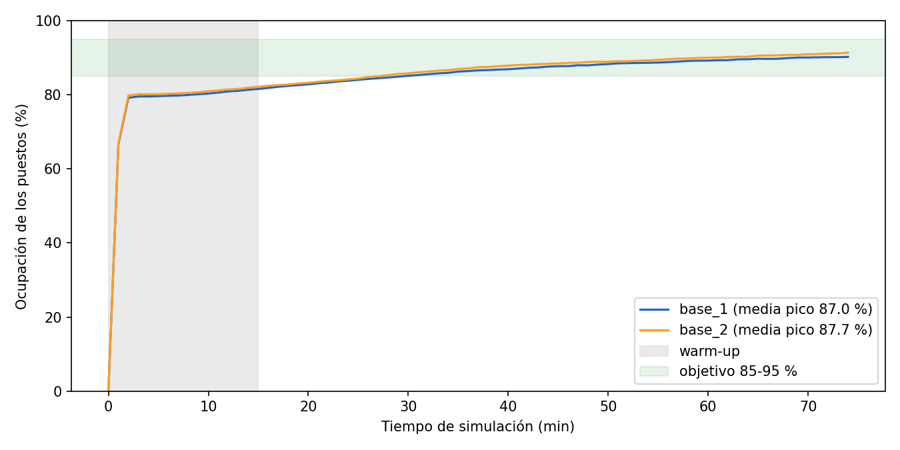
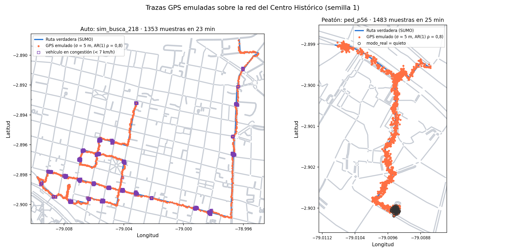
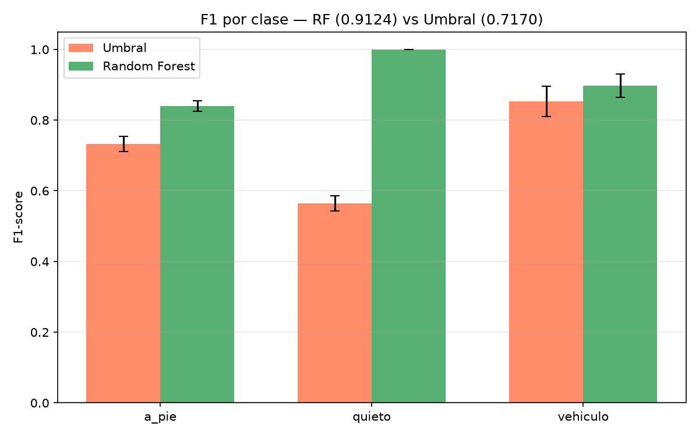
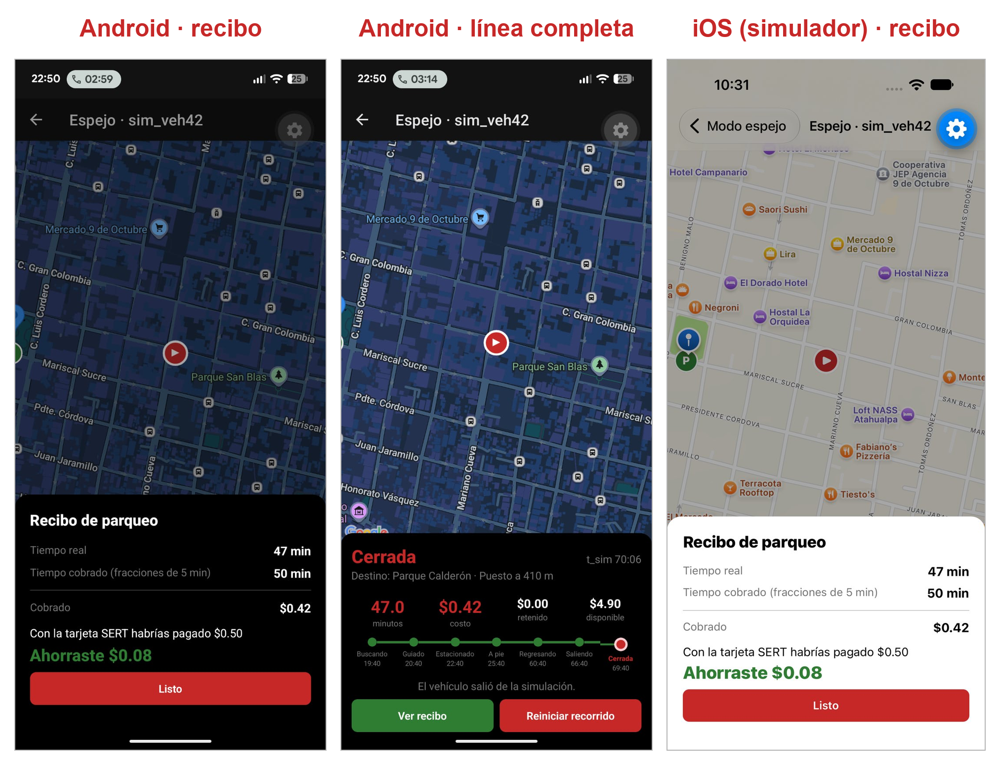

# S1 · Cambios de la semana (19-25 de octubre de 2026)

Este documento explica todos los cambios que entraron al repositorio durante la semana 1:

- qué hizo cada persona en sus tres sesiones;
- qué cambió la unificación (en `main`, `proyecto/` y el contrato);
- qué ajustes de planificación se aplicaron después.

Se puede leer sin abrir el código. El detalle técnico de cada sesión está en los PDF de
`semanas/S1/<Nombre>/explicaciones/`, y la auditoría completa de la unificación, en
`semanas/S1/unificacion-resultado.md`.

## 1. Resumen en cinco líneas

- Las cuatro personas entregaron sus tres sesiones a tiempo: 13 commits, 11 sesiones hechas y 1 parcial.
- Quedó construido el escenario base de SUMO: red del Centro Histórico, 610 puestos SERT y demanda de hora pico con búsqueda a ciegas.
- Quedaron listas las piezas de los demás: el contrato v1 con código compartido y el núcleo del backend (Freddy), el clasificador de movimiento (Pablo) y la app con el prototipo del espejo (Miguel).
- La unificación del viernes 23 fusionó todo en `main`, copió 192 archivos a `proyecto/` y **congeló el contrato v1**.
- Las pruebas pasan: 275 tests de Python sin fallos y una corrida corta de SUMO con código 0.

## 2. Estado del repositorio antes de la semana

Antes del 19 de octubre, `main` solo tenía la planificación:

- estructura de carpetas y prompts de las 4 semanas;
- `CLAUDE.md` y los documentos de `docs/`;
- el roadmap web y el `Dockerfile` para Dokploy;
- reglas generales del proyecto: todo simulado, solo Tyrone accede al VPS y a Payphone, solo
  Tyrone cambia la planificación y SUMO corre en el contenedor `van3twin`.

`proyecto/` estaba vacío, con solo marcadores `.gitkeep`, y `docs/CONTRATO.md` era el v0.

| Commit | Qué cambió |
|---|---|
| 99bc1fd | Estructura del proyecto, prompts de las 4 semanas y roadmap web |
| 174c31c | Dockerfile del roadmap en la raíz para Dokploy |
| 700a3d7 | Demo en línea en el VPS (backend y visor en demo.e-sert.tesisucuenca.com) |
| f9684c4 | Solo Tyrone accede al VPS/Dokploy y a Payphone |
| 98b5914 | Todo simulado: teléfono espejo de un conductor simulado |
| 221f2ac | Solo Tyrone cambia la planificación; la unificación descarta los cambios de los demás |
| 715751b | SUMO desde el contenedor van3twin: el repo se clona en results/ |

## 3. Cambios de cada persona

Cada persona trabajó solo en `semanas/S1/<Nombre>/` y en su bitácora, en una rama propia
(`<nombre>/s1`). La auditoría confirmó que nadie tocó archivos de otros ni de planificación.

### 3.1 Tyrone: escenario SUMO (rama tyrone/s1, 3 commits)

| Sesión | Título | Estado | Criterios |
|---|---|---|---|
| 1 | Red vial OSM del Centro Histórico en SUMO | hecha | 6/6 |
| 2 | Generación automática de puestos SERT (parkingArea) | hecha | 5/5 |
| 3 | Demanda y búsqueda a ciegas (línea base) | hecha | 6/6 |

**Sesión 1 · Red vial.** El script `construir_red.py`:

- descarga el OpenStreetMap del Centro Histórico;
- lo convierte con `netconvert` en una red para autos y peatones: 985 calles de autos, 1824
  de peatones, 775 cruces, 129 semáforos y 90,7 km, en proyección UTM 17;
- añade los edificios de fondo con `polyconvert`;
- poda las partes desconectadas, para que cualquier auto pueda ir de cualquier calle a
  cualquier otra.

La red se validó con SUMO y 20 peatones, sin teletransportes. Archivos nuevos:
`codigo/sumo/red/` (`centro.net.xml`, `centro.poly.xml`, `red_info.json`) y
`centro_red.sumocfg`.

**Sesión 2 · Puestos SERT.** `generar_parkingareas.py` lee `calles_sert.yaml` y coloca una
`parkingArea` en cada tramo de calle SERT. Resultado: 610 áreas con 6194 plazas en 103 calles.
Escribe dos archivos:

- `parqueos.add.xml`, para SUMO;
- `puestos.csv`, para el contrato: `puesto_id,edge,lane,calle,capacidad,lat,lon,x,y`, con IDs
  `pa_<edge>_<n>`.

Diez autos de prueba estacionaron sin advertencias.

**Sesión 3 · Demanda y búsqueda a ciegas.** `generar_demanda.py` crea la hora pico:

- 12 destinos reales del Centro;
- llegadas al azar (Poisson) con estadías lognormales;
- 40 % de tráfico de paso;
- 80 % de los puestos ocupados desde el inicio por autos de larga estadía.

La búsqueda "a ciegas" usa rerouters de SUMO. Si el puesto objetivo está lleno, el conductor
prueba alternativas a menos de 400 m sin saber si tienen lugar.

Se calibró a 1800 veh/h. Con ese valor, la ocupación media de la hora pico es de 87,0 % y
87,7 % (semillas 1 y 2), sin teletransportes, y la búsqueda dura 230-246 s en promedio. Es la
**línea base** contra la que se medirá la app en S2 y S3.

Cada vehículo trae `param con_app=0`, que en S2 será el interruptor del controlador de Freddy.

### 3.2 Freddy: contrato, backend y controlador TraCI (rama freddy/s1, 3 commits)

| Sesión | Título | Estado | Criterios |
|---|---|---|---|
| 1 | Contrato v1 y esquemas compartidos | hecha | 4/4 |
| 2 | Núcleo del backend: billetera, tarifa y sesiones | hecha | 4/4 |
| 3 | Controlador TraCI base y emulador de GPS | hecha | 4/4 |

**Sesión 1 · Contrato v1.** Escribió la propuesta completa del contrato
(`codigo/comun/CONTRATO.propuesto.md`) y el código que lo implementa:

- `esquemas.py` (Pydantic v2) y `esquemas.ts` (TypeScript);
- `tarifa.json` y `tarifa.py`;
- 29 ejemplos JSON y CSV;
- 163 tests que comprueban que los ejemplos validan y que el .ts y el .py tienen los mismos
  campos.

**Sesión 2 · Núcleo del backend.** `backend/nucleo/` está escrito en Python puro, con
SQLAlchemy y SQLite:

- la billetera es un libro de movimientos: recarga, retención, débito y liberación;
- la tarifa sigue el contrato;
- el ciclo de vida de la sesión aplica las 5 reglas de cobro;
- un mapa de ocupación estima qué puestos están libres.

Tiene 63 tests con 99 % de cobertura. Todavía no hay rutas HTTP (FastAPI llega en S2-1).

**Sesión 3 · Controlador TraCI y GPS.** El controlador (`traci/controlador.py`) se suscribe a
los vehículos y ofrece "ganchos" por paso. El emulador de GPS (`traci/gps.py`) añade un ruido
realista: AR(1) con rho = 0,8, sigma = 5 m y 2 % de pérdidas.

Con el escenario de Tyrone y 150 peatones generó trazas de 30 min en 3 semillas. Cubren las 3
clases de movimiento, autos en congestión y peatones rápidos. En git va una muestra de 5000
filas (`traci/trazas/sumo_semilla1_muestra.csv`).

### 3.3 Pablo: clasificador de movimiento (rama pablo/s1, 3 commits)

| Sesión | Título | Estado | Criterios |
|---|---|---|---|
| 1 | Ingesta del dataset GeoLife | hecha | 5/5 |
| 2 | Remuestreo, ventanas y características | hecha | 5/5 |
| 3 | Línea base por umbral y primer Random Forest | hecha | 4/4 |

**Sesión 1 · GeoLife.** Descargó e ingirió GeoLife 1.3: 64 usuarios etiquetados y 3,25
millones de puntos con las columnas del contrato. walk pasa a `a_pie`, y car, taxi y bus a
`vehiculo`. En git va `geolife_muestra.csv`, de 10 000 filas; el Parquet completo está
excluido por `.gitignore`.

**Sesión 2 · Ventanas.** Remuestreo a 1 Hz y ventanas de 30 s con paso de 5 s. La clase
`quieto` se deriva de la velocidad. Extrae 18 características por ventana: 1,39 millones de
ventanas.

**Sesión 3 · Clasificador.** El Random Forest logra un macro-F1 de 0,912, frente a 0,717 del
umbral simple. Se validó con GroupKFold por usuario, para que nadie aparezca a la vez en
entrenamiento y prueba. Las falsas liberaciones bajan de 21 % a 14 %.

Publicó `ia/inferencia.py`, con la función `clasificar(ventana)` del contrato. Si no hay
modelo, usa el umbral.

### 3.4 Miguel: app móvil y reglas SERT (rama miguel/s1, 4 commits)

| Sesión | Título | Estado | Criterios |
|---|---|---|---|
| 1 | Proyecto Expo, navegación y cliente API | hecha | 4/4 |
| 2 | Grabador de sensores etiquetado | **parcial** | 3/4 |
| 3 | Reglas SERT verificadas, prototipo del conductor espejo y protocolo casero | hecha | 6/6 |

**Sesión 1 · App.** App en Expo SDK 58 con 5 pestañas y mapa de puestos. El cliente de la API
(`cliente.ts`) y un mock (`mock.ts`) comparten la misma interfaz. Se probó en Android real y
en el simulador de iPhone.

**Sesión 2 · Grabador.** Graba GPS a 1 Hz y acelerómetro a 10 Hz con una etiqueta de clase que
se cambia en caliente, y exporta el CSV del contrato. Queda **parcial**: en iOS solo se probó
en el simulador, porque nadie tenía un iPhone físico.

**Sesión 3 · Reglas SERT y espejo.** Verificó la tarifa con fuentes oficiales: USD 0,25 por
media hora (Art. 36) y un máximo de 2 h. `tarifa.json` no necesita cambios. Construyó el
prototipo del conductor espejo, con un recorrido mock de 60 s de BUSCANDO al recibo, y el
protocolo de grabaciones caseras (opcionales, nunca manejando).

## 4. Cambios de la unificación

La unificación se ejecutó el **viernes 23 de octubre**, a pedido de Tyrone, en lugar del
domingo 25. Todo se hizo en la rama `unificacion/s1`, que al final se fusionó en `main`.

### 4.1 Fusiones

Se fusionaron las cuatro ramas en el orden Freddy, Tyrone, Pablo y Miguel (Freddy primero
porque trae el contrato). No hubo conflictos, porque cada persona escribe en su propia
carpeta. No hubo que revertir archivos fuera de carpeta ni descartar cambios a la
planificación.

### 4.2 Copia a proyecto/

`proyecto/` es la versión unificada desde la que todos trabajan la semana siguiente. Se
copiaron 192 archivos versionados, cada uno solo si pertenece al módulo de su dueño:

| Módulo en proyecto/ | Dueño | Archivos | Qué contiene |
|---|---|---|---|
| sumo/ | Tyrone | 21 | Red, puestos, demanda, rerouters y los tres .sumocfg |
| comun/ | Freddy | 39 | esquemas.py, esquemas.ts, tarifa, ejemplos y tests |
| backend/ | Freddy | 20 | Núcleo (billetera, tarifa, sesiones, ocupación) y tests |
| traci/ | Freddy | 14 | Controlador, emulador de GPS, muestra de trazas y tests |
| ia/ | Pablo | 27 | Ingesta, ventanas, características, umbral, RF, inferencia y tests |
| app/ | Miguel | 59 | App Expo completa (pestañas, cliente API, grabador y espejo) |
| datos/ | Miguel | 12 | Protocolo casero, herramientas y una grabación anonimizada |

No se copió `comun/CONTRATO.propuesto.md`, porque sigue su propio flujo y se aplicó a
`docs/CONTRATO.md`. Nunca se copian entornos virtuales, salidas de SUMO, secretos ni archivos
de más de 50 MB.

### 4.3 Contrato v1 congelado

`docs/CONTRATO.md` pasó del v0 al **v1, congelado el 2026-10-23**. Desde ahora, el contrato
solo cambia con una nueva propuesta de Freddy aprobada en una unificación. Principales cambios
respecto al v0:

- **Componentes:** diagrama de quién habla con quién. La máquina de estados corre en el
  controlador TraCI; el backend la valida, la guarda y cobra.
- **Identificadores:**
  - expresiones regulares de validación y el prefijo `ped_` para peatones;
  - un puesto es una `parkingArea` completa con capacidad, y su ID nunca va en la URL;
  - formatos de hora (zona obligatoria), dinero y unidades.
- **Sesión:** nace en `ESTACIONADO`. Hay una ruta de transición y el cierre de los autos
  simulados lo pide el controlador.
- **API:**
  - header `X-Contrato-Version: 1` y token `X-Sim-Token` para las rutas del controlador;
  - formato único de error con 15 códigos;
  - rutas nuevas `/salud`, `/tarifa`, `/sim/paso` y `/sesiones/{id}/transicion`;
  - campos completos de `Sesion` y `Movimiento`.
- **Paso de simulación** (`POST /sim/paso`): por aquí recibe el backend las posiciones, los
  estados y la ocupación real.
- **Tarifa:** fórmulas exactas de cobro, retención, tarjeta SERT equivalente, saldo negativo,
  bloqueo y avisos.
- **WebSocket:** mensaje nuevo `verdad`, con la ocupación real para medir la precisión del
  mapa; solo lo recibe el visor.
- **Espejo y trazas:** campos opcionales, `espejo_fin` completo, codificación del CSV y
  columnas extra permitidas.

### 4.4 Ajuste a los tests de comun

En `proyecto/`, 2 tests de `comun` leían `comun/CONTRATO.propuesto.md`, que no se copia. Por
decisión de Tyrone, ahora leen `docs/CONTRATO.md` cuando la propuesta no existe. Antes del
cambio se comprobó que, con el contrato congelado, los 163 tests pasaban. Era un problema de
ruta, no de contenido.

### 4.5 Verificaciones

| Módulo | Resultado |
|---|---|
| comun | 163 pasados |
| backend | 63 pasados |
| traci | 14 pasados, 3 saltados |
| ia | 35 pasados |
| SUMO (centro_base.sumocfg, 60 s en el contenedor) | código 0 |

Un verificador independiente revisó cada afirmación del resultado. Encontró que, al cambiar
el encabezado del contrato, se había perdido un párrafo ("manda esquemas.py"). Se restauró
antes de publicar.

### 4.6 Incoherencias que pasan a S2

El v1 manda. Cada diferencia se convierte en un pedido a su dueño:

- **Miguel:** `app/src/api/tipos.ts` se escribió a mano desde el v0. Debe reemplazarse por
  `comun/esquemas.ts` (le faltan `DetalleError`, `minutos_reales` y `saldo` en el cierre, entre
  otros).
- **Pablo:**
  - `inferencia.py` define sus propios tipos en lugar de importarlos de `comun.esquemas`;
  - el modelo `rf_v0.joblib` no está en git, así que `clasificar` hoy siempre usa el umbral;
  - la columna extra `fuente` del CSV de GeoLife comparte nombre con `FuenteModo`.
- **Freddy:**
  - adoptar el ajuste de los tests en su copia de S2;
  - responder la duda de Miguel sobre `saldo_bajo`;
  - valorar `tolerancia_ingreso_min: 10` (Art. 10 de la ordenanza) en la próxima propuesta.

## 5. Cambios de planificación aplicados después

Tyrone aplicó los dos pedidos `[Plan]` que dejaron Freddy y Miguel en sus bitácoras (commit
9dab6d3 en `main`):

| Archivo | Pedido de | Cambio | Por qué |
|---|---|---|---|
| CLAUDE.md | Freddy (S1-3) | `pyproj` (y `pydantic`) pasan a la lista de dependencias que se instalan en el contenedor | El contenedor solo trae numpy, matplotlib y lxml; el pyproj que había se instaló a mano |
| herramientas/explicacion_pdf.py | Miguel (S1-1) | Dentro de una celda de tabla, el código se escribe como texto plano | fpdf2 no admite etiquetas anidadas en las celdas y la generación del PDF fallaba |

## 6. Historial de main durante la semana

| Commit | Descripción |
|---|---|
| 75ebea3 | Fusiona freddy/s1 |
| 4631b62 | Fusiona tyrone/s1 |
| 23a8136 | Fusiona pablo/s1 |
| 738fd20 | Fusiona miguel/s1 |
| eda817b | Copia módulos de S1 a proyecto/ |
| 49ae999 | Congela el contrato v1 |
| 4076cb2 | Tests de comun leen el contrato congelado en proyecto/ |
| bc37a98 | Resultado de la unificación de S1 |
| c4a0e97 | Correcciones del verificador independiente |
| 4d14f0a | Unificación de S1 en main |
| 9dab6d3 | Aplica los pedidos de planificación de Freddy y Miguel |

## 7. Riesgos y pendientes para S2

- **App con tipos del v0** (riesgo principal). Miguel debe sincronizar con `comun/esquemas.ts`
  al inicio de S2.
- **Modelo RF ausente.** Freddy puede integrar `clasificar` desde ya, pero con el umbral, hasta
  que Pablo suba o regenere `rf_v0.joblib`.
- **API REST todavía inexistente.** Llega en S2-1. Hasta entonces, la app usa `mock.ts` y el
  visor de Tyrone, un mock del WebSocket.
- **Trazas completas.** En git solo está la muestra. Pablo debe regenerarlas en el contenedor
  para entrenar con datos de SUMO.
- **iPhone físico** para cerrar el criterio parcial de Miguel. No bloquea nada, porque todo es
  simulado.
- **KPIs formales** (distancia, CO2 y búsquedas censuradas) y, opcionalmente, rotación de la
  ocupación de fondo en el escenario de Tyrone.

Si alguien sube commits antes del sábado 24 a las 23:59, la unificación se reejecuta en una
rama nueva `unificacion/s1-r<HHMM>`.
