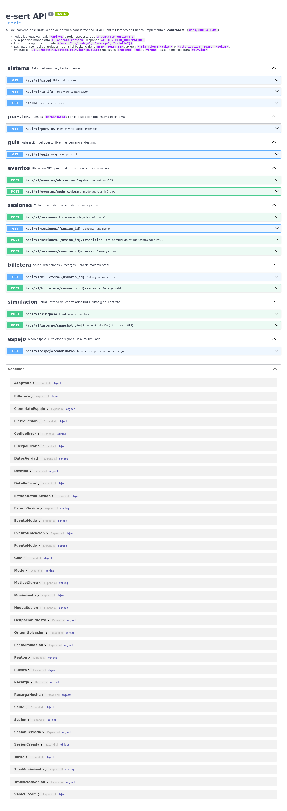
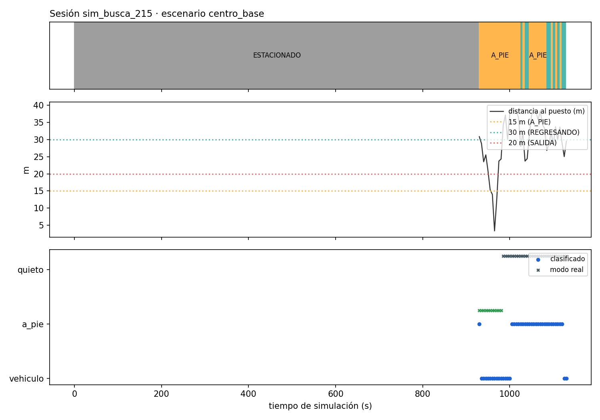
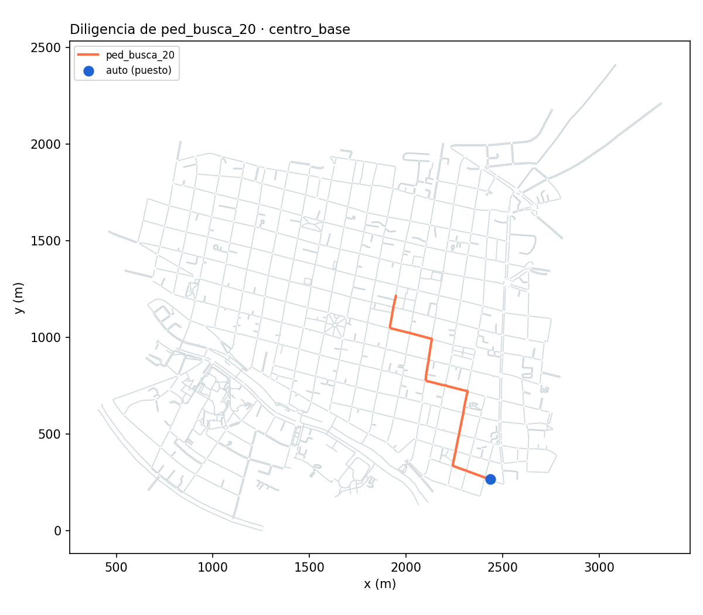

# S2 · Freddy 🍅: resumen semanal

## Sesión 1 · 2026-10-23 · Capa FastAPI sobre el núcleo, WebSocket y Swagger

El núcleo de S1 ya se puede usar por HTTP y por WebSocket, como dice el contrato v1:
- `backend/api/`, con `crear_app(Config)`: configuración `ESERT_*` con pydantic-settings, prefijo `/api/v1` y header `X-Contrato-Version: 1` en toda respuesta;
- un router por recurso y errores con el formato `{"error": ...}`;
- `WS /ws/estado` con `GestorConexiones`, una cola asyncio que acepta publicaciones desde otro hilo y un límite de 1 snapshot por segundo simulado; `verdad` solo llega a `rol=visor`;
- rutas del controlador con token: `/sim/paso` y su alias `/interno/snapshot`;
- Swagger con ejemplos de `comun/ejemplos/` y `openapi.json` exportado;
- listo para el VPS: `Dockerfile`, `/salud` en la raíz y `/visor` estático.

Lo cubren 102 tests, con 99 % de cobertura en `api/` + `nucleo/`. La lógica nueva (`nucleo/mundo.py`, `MapaOcupacion.guiar`) quedó en el núcleo.

Captura completa con las 16 operaciones desplegadas: [evidencias/s1_swagger.png](evidencias/s1_swagger.png) · paginada en A4: [evidencias/s1_swagger.pdf](evidencias/s1_swagger.pdf)

Explicación: [explicaciones/s1_explicacion.pdf](explicaciones/s1_explicacion.pdf)

## Sesión 2 · 2026-10-26 · Máquina de estados y peatones que hacen diligencias

Cada auto de búsqueda que estaciona genera un peatón que camina al destino, espera la diligencia y vuelve; el auto se libera cuando el peatón regresa. Una máquina de estados por usuario sigue la sesión con el GPS emulado y el clasificador cada 5 s.

Pruebas: 25 puras y 3 con SUMO, todas pasan. Corrida de 30 min del escenario base: 343 sesiones, 4 peatones volvieron al auto (1,2 %) y **214 falsas liberaciones (62,4 por cada 100 sesiones)** con el clasificador de umbral. El criterio de 95 % no se cumple; ver la bitácora.

Explicación: [explicaciones/s2_explicacion.pdf](explicaciones/s2_explicacion.pdf)
