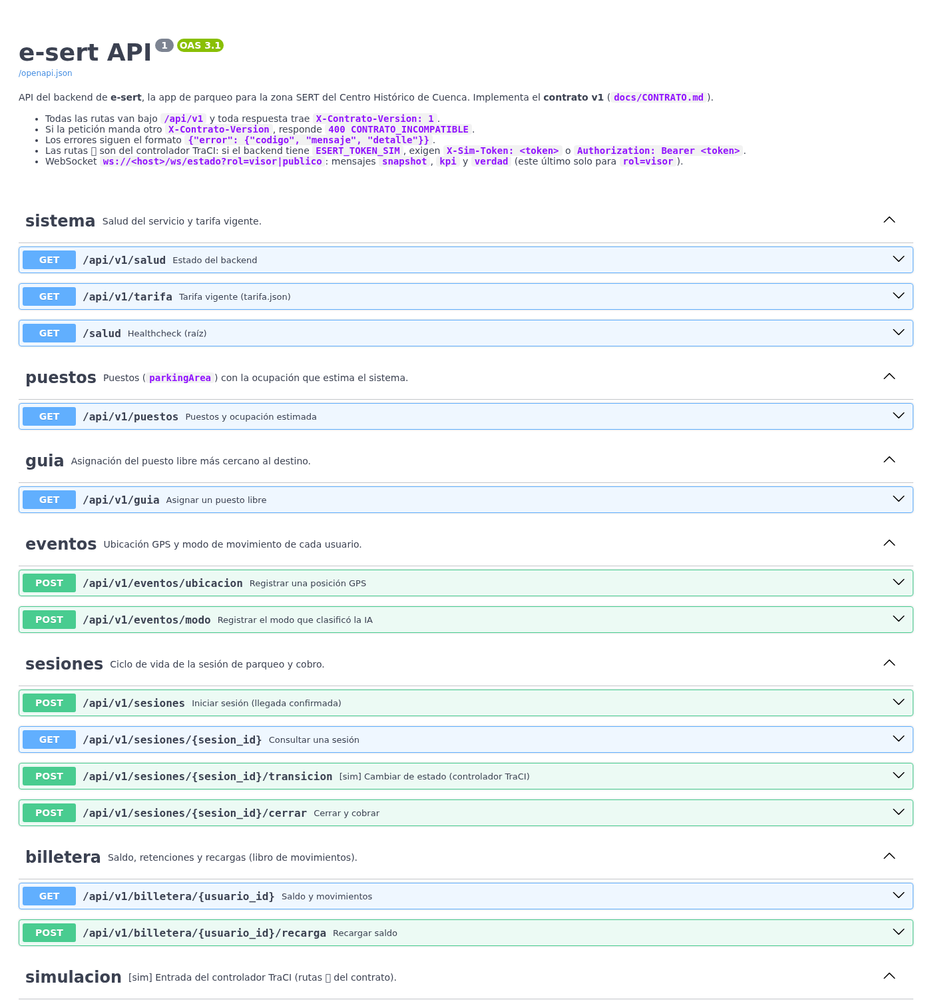
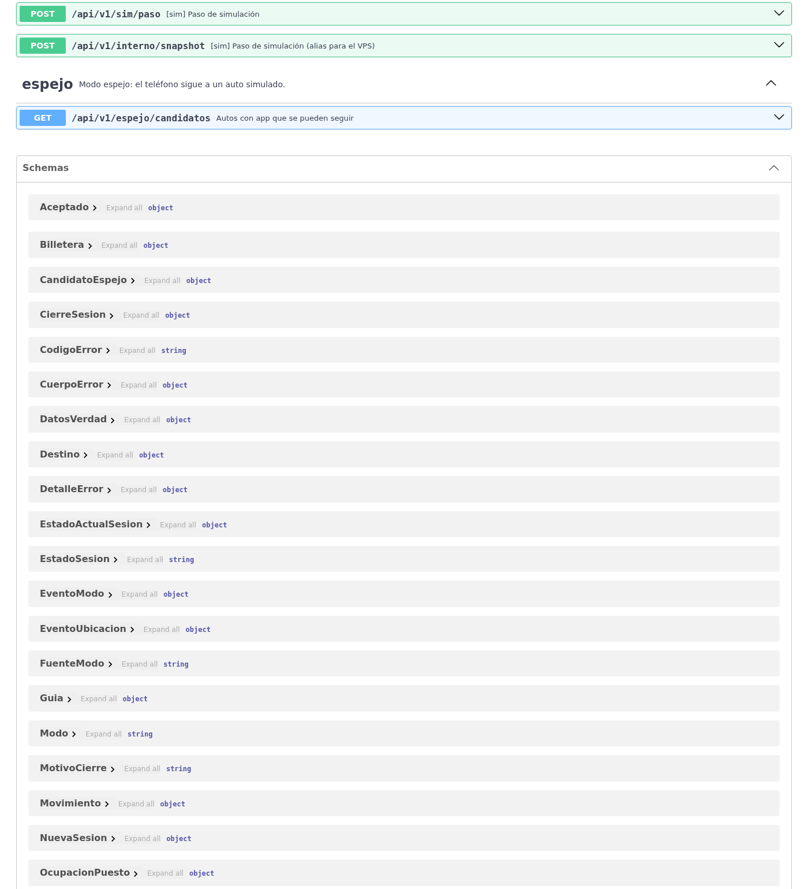
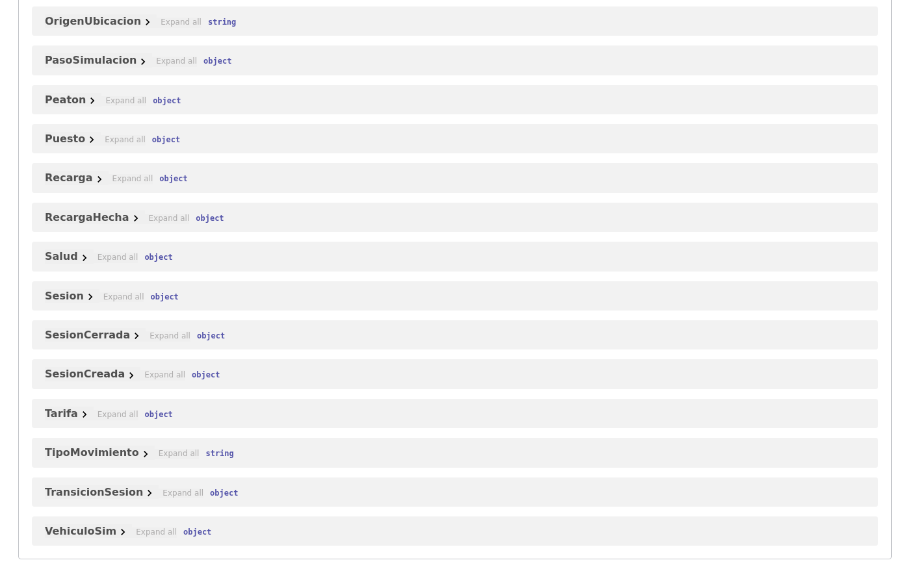
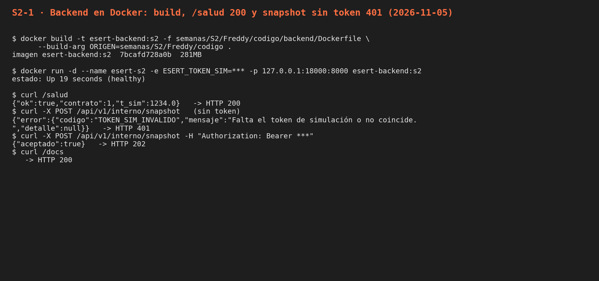

# S2 · Sesión 1 · Freddy: capa FastAPI sobre el núcleo, WebSocket y Swagger

## 1. Resumen en 5 líneas

1. El núcleo de S1 (billetera, sesiones y ocupación, en Python puro) ahora se puede usar por **HTTP** y por **WebSocket**, tal como dice el contrato v1.
2. FastAPI solo valida con los modelos de `comun/esquemas.py`, llama al núcleo y traduce sus errores al formato `{"error": {codigo, mensaje, detalle}}`.
3. El controlador TraCI publica cada paso de la simulación (`/sim/paso` o `/interno/snapshot`, con token). El backend lo convierte en mensajes `snapshot` y `verdad` para el visor, como mucho uno por segundo simulado.
4. Swagger (`/docs`) documenta las 16 operaciones con ejemplos tomados de `comun/ejemplos/`, y `backend/openapi.json` queda exportado.
5. El backend queda listo para el VPS: configuración por variables `ESERT_*`, `/salud` en la raíz, visor estático en `/visor` y un `Dockerfile` en dos etapas.

## 2. Conceptos clave

- **Capa delgada:** la regla del proyecto es que la lógica vive en `backend/nucleo/`. Así el controlador TraCI la usa directamente en los experimentos, sin HTTP, y la API no puede cobrar distinto que la simulación. Lo nuevo de lógica también fue al núcleo: `nucleo/mundo.py` y `MapaOcupacion.guiar`.
- **Fábrica de app (`crear_app(config)`):** cada test crea su propia app con SQLite en memoria (`sqlite:///:memory:`), con servicios nuevos y aislados. `backend.api.main:app` se construye recién cuando uvicorn lo pide, así importar el módulo en los tests no crea `./e-sert.db`.
- **Inyección con `Depends`:** las rutas no crean objetos. Piden `Billetera`, `ServicioSesiones`, `MapaOcupacion` o `EstadoMundo` a funciones que los sacan de `app.state.servicios`.
- **Middleware ASGI del contrato:** añade `X-Contrato-Version: 1` a toda respuesta HTTP, incluidos los 500. Rechaza con `400 CONTRATO_INCOMPATIBLE` cualquier otra versión, y convierte una excepción no controlada en `500 ERROR_INTERNO` con el formato del contrato.
- **Exception handlers:** `ErrorNucleo` lleva su código del contrato y la tabla `HTTP_POR_CODIGO` da el estado HTTP (`SALDO_INSUFICIENTE`→402, `PUESTO_LLENO`→409…). Los errores de validación de FastAPI salen como `422 VALIDACION`, con los campos inválidos en `detalle`.
- **WebSocket y cola asyncio:** `GestorConexiones` guarda los clientes y difunde a todos a la vez con `asyncio.gather`; descarta los que fallan. El controlador puede publicar **en proceso** desde otro hilo: `publicar()` usa `call_soon_threadsafe` para meter el mensaje en una `asyncio.Queue`, que un consumidor arrancado en el *lifespan* vacía.
- **Límite de 1 paso por segundo simulado:** se descarta un paso con `t_sim` a menos de 1 s del último difundido. Un `t_sim` menor se toma como una corrida nueva.
- **`verdad` solo para el visor:** `?rol=visor` (por defecto) la recibe y `?rol=publico` nunca. `?verdad=0` la apaga para un visor proyectado.
- **Token de simulación:** las rutas 🔒 aceptan `X-Sim-Token` (contrato) o `Authorization: Bearer` (DESPLIEGUE). El token se compara con `hmac.compare_digest`, que tarda lo mismo acierte o no.

## 3. Cómo se generó cada cosa

| Resultado | Comando (desde semanas/S2/Freddy/codigo/) | Entradas → salidas |
|---|---|---|
| Entorno | `python3.10 -m venv backend/.venv && backend/.venv/bin/pip install -r backend/requirements.txt` | `requirements.txt` → `.venv` (ignorado por git) |
| Tests y cobertura | `backend/.venv/bin/python -m pytest backend/tests --cov=backend/api --cov=backend/nucleo` | código → 102 tests, 99 % |
| `openapi.json` | `backend/.venv/bin/python -m backend.api.exportar_openapi` | app → `backend/openapi.json` |
| Servidor local | `ESERT_TOKEN_SIM=secreto backend/.venv/bin/uvicorn backend.api.main:app --reload --port 8000` | `puestos.csv` de Tyrone (610 puestos) → API en `:8000` |
| Captura de Swagger | script de Playwright: abre `/docs`, despliega cada operación y llama a `page.screenshot(full_page=True)` | `/docs` → `evidencias/s1_swagger.png` y `s1_swagger-rutas.png` |
| Trozos de la captura de rutas | `backend/.venv/bin/python comun/paginar_captura.py ../evidencias/s1_swagger-rutas.png --trozos` | `s1_swagger-rutas.png` → `s1_swagger-rutas_1.png` … `_3.png` (cortados por filas en blanco para que cada uno quepa en una página) |
| PDF de la captura completa | `backend/.venv/bin/python comun/paginar_captura.py ../evidencias/s1_swagger.png --pdf` | `s1_swagger.png` → `evidencias/s1_swagger.pdf` (A4, un trozo por página) |
| Imagen Docker | `docker build -f semanas/S2/Freddy/codigo/backend/Dockerfile --build-arg ORIGEN=semanas/S2/Freddy/codigo .` (desde la raíz del repo) | repo → imagen con `/srv/{backend,comun,ia,visor,datos}` |

## 4. Mapa de archivos

| Archivo | Qué contiene | Quién lo usa |
|---|---|---|
| `backend/api/main.py` | `Config`, `crear_app`, middleware del contrato, montaje de pagos y visor, `/salud` en la raíz | uvicorn, Dockerfile, tests |
| `backend/api/dependencias.py` | `Servicios` (todo lo del núcleo), getters para `Depends`, `exigir_token_sim`, `publicar_snapshot` | rutas, controlador TraCI en proceso |
| `backend/api/errores.py` | handlers de errores al formato del contrato | `main.py` |
| `backend/api/ws.py` | `GestorConexiones`, cola y `WS /ws/estado` | visor de Tyrone |
| `backend/api/ejemplos.py` | carga `comun/ejemplos/*.json` para Swagger | rutas |
| `backend/api/rutas/*.py` | un router por recurso: sistema, puestos, guía, eventos, sesiones, billetera, simulación | app de Miguel, controlador, visor |
| `backend/api/exportar_openapi.py` | exporta `openapi.json` | Miguel (cliente TS), documentación |
| `backend/nucleo/mundo.py` | último estado de cada usuario, último paso, límite 1/s, `snapshot`/`verdad`, candidatos del espejo | API y, más adelante, el controlador |
| `backend/nucleo/ocupacion.py` | + `guiar()` → `Guia` o `SIN_PUESTOS_LIBRES` | `GET /guia` |
| `backend/Dockerfile`, `requirements-servidor.txt`, `.env.ejemplo` | imagen para Dokploy y nombres de las variables | Tyrone (VPS) |
| `backend/tests/test_api.py`, `test_api_ws.py` | 29 tests REST + 10 de WebSocket | CI / verificador |
| `comun/CONTRATO.propuesto.md` | 6 cambios aditivos al contrato | unificación del domingo |
| `comun/paginar_captura.py` | parte capturas muy altas en trozos de una página (PNG o PDF) | evidencias de esta sesión |

## 5. Recorrido del código

**`api/main.py`**
- `Config`: lee `ESERT_DB_URL`, `ESERT_TOKEN_SIM`, `ESERT_CORS_ORIGENES`, `ESERT_PUESTOS_CSV` y `ESERT_VISOR_DIR`. También acepta los alias `E_SERT_*` y `SIM_TOKEN`.
- `MiddlewareContrato`: añade el header de versión, rechaza otras versiones y convierte excepciones sueltas en 500 del contrato.
- `crear_app`: arma los servicios, registra los routers bajo `/api/v1` y monta `backend.pagos.rutas` si existe.

```python
app = FastAPI(title="e-sert API", version=e.CONTRATO_VERSION, description=DESCRIPCION,
              openapi_tags=ETIQUETAS, lifespan=ciclo)
app.state.servicios = Servicios.armar(config.db_url, config.puestos_csv, config.token_sim)
errores.registrar(app)
for r in ROUTERS:
    app.include_router(r, prefix=PREFIJO)
app.include_router(router_ws)
...
app.add_middleware(MiddlewareContrato)
```

**`api/rutas/sesiones.py`**: cada ruta tiene una sola línea de trabajo, una llamada al núcleo.

```python
def crear(nueva: e.NuevaSesion = Body(...), srv: ServicioSesiones = Depends(dep.sesiones)):
    return srv.iniciar(nueva.usuario_id, nueva.placa, nueva.puesto_id, nueva.ts, nueva.t_sim)
```

**`nucleo/mundo.py` → `EstadoMundo.aplicar_paso`**: aplica el límite de 1/s y construye los mensajes.

```python
previo = self._t_difundido
if previo is not None and previo <= paso.t_sim < previo + self.intervalo_min_s:
    return None
self._t_difundido = paso.t_sim
self.ultimo_paso = paso
...
snapshot = e.MensajeSnapshot(..., puestos=self.mapa.ocupacion(), espejos=espejos)
```

**`api/ws.py` → `GestorConexiones.difundir`**

```python
destino = [ws for ws, quiere_verdad in list(self.clientes.items()) if quiere_verdad or not es_verdad]
resultados = await asyncio.gather(*(ws.send_text(texto) for ws in destino), return_exceptions=True)
for ws, r in zip(destino, resultados):
    if isinstance(r, BaseException):
        self.desconectar(ws)
```

## 6. Cómo se conecta con los demás

- **Consume:** `comun/esquemas.py` y `comun/ejemplos/` (contrato v1), `comun/tarifa.json` y `proyecto/sumo/parqueos/puestos.csv` de Tyrone (610 puestos; si falta, el mock de 20).
- **Entrega a Miguel (app):** la API REST en `http://<host>:8000/api/v1` y su descripción en `openapi.json`. Si existe `backend/pagos/rutas.py` con una variable `router`, se monta solo bajo `/api/v1`. Por ejemplo, `APIRouter(prefix="/pagos")` queda en `/api/v1/pagos/...`.
- **Entrega a Tyrone (visor y VPS):** `ws://<host>:8000/ws/estado?rol=visor`, el visor estático en `/visor`, el `Dockerfile` y `.env.ejemplo`.
- **Para el controlador TraCI (yo, S2-2 y S2-3):** `POST /api/v1/interno/snapshot` o `/sim/paso` con token. En el mismo proceso se usa `app.state.servicios.publicar_snapshot(paso)`.

## 7. Resultados y evidencias

- **102 tests** pasan (63 del núcleo, 29 REST y 10 WebSocket), con **99 % de cobertura** en `backend/api/` + `backend/nucleo/`.
- Flujo feliz: recarga de $5, sesión, cierre a los 47 min. Se cobran 50 min, $0,42, y el saldo queda en $4,58.
- `grep` en `backend/api/`: no hay cálculos de cobro ni de ocupación (solo aparecen en docstrings).
- Prueba manual con `curl` usando todos los ejemplos de `comun/ejemplos/`: cada código esperado (200/201/202/400/401/404/409) salió con el formato correcto.

Swagger con las rutas desplegadas (la captura `s1_swagger-rutas.png`, repartida en tres trozos para que quepa en el PDF):







La captura completa, con cada operación abierta y sus ejemplos (1400 × 24 458 px), está en `evidencias/s1_swagger.png` y, paginada para leerla cómodamente, en `evidencias/s1_swagger.pdf`.

## 8. Limitaciones y decisiones

- **Docker (resuelto el 2026-11-05):** el 23 de octubre no había Docker en la máquina, porque faltaba la integración de WSL con Docker Desktop. Ya activada, `docker build -f semanas/S2/Freddy/codigo/backend/Dockerfile --build-arg ORIGEN=semanas/S2/Freddy/codigo .` construye la imagen (281 MB). El contenedor queda `healthy`, `/salud` responde 200, el snapshot sin token da 401 (`TOKEN_SIM_INVALIDO`), con `Bearer` da 202 y `/docs` responde 200.


- **Contrato v1 frente al prompt:** el prompt pedía `verdad` solo con `?verdad=1`, `Authorization: Bearer` y `/interno/snapshot`. El contrato congelado dice que el visor recibe `verdad` por defecto, `X-Sim-Token` y `/sim/paso`. Se aceptan las dos formas y la propuesta queda en `CONTRATO.propuesto.md`.
- `/salud` no lleva `version` porque `Salud` del contrato no la admite (también va en la propuesta).
- `POST /eventos/*` **no** cambian el mapa de ocupación: por diseño, el mapa lo deciden las sesiones. Los eventos guardan el último estado del usuario.
- `WS /ws/espejo/{veh_id}` (§7) no entra en esta sesión. `GET /espejo/candidatos` sí está.
- Falta el límite de tasa de recargas de DESPLIEGUE.md: no hay código de error para el 429 en el contrato.
- Posible carrera menor: un cliente WS recién aceptado puede perder un mensaje difundido en ese mismo instante. No se reprodujo.
- En la computadora solo hay Python 3.10, y el `CLAUDE.md` pide 3.11 o superior. El código es compatible con 3.10 y la imagen usa 3.11.

## 9. Preguntas que podría hacer el profesor

1. **¿Por qué no pusieron la lógica en las rutas de FastAPI?** El controlador TraCI usa el mismo núcleo sin HTTP en los experimentos. Si la lógica estuviera en las rutas, simulación y app podrían cobrar distinto.
2. **¿Cómo evitan saturar el visor si SUMO corre más rápido que en tiempo real?** El núcleo descarta los pasos a menos de 1 s simulado del último difundido, así que el visor recibe como mucho un snapshot por segundo simulado.
3. **¿Por qué la app no recibe la ocupación real (`verdad`)?** En la realidad el sistema no la conoce. Mostrarla haría trampa en el KPI de precisión del mapa, así que solo la ve el visor del operador.
4. **¿Qué pasa si un cliente WebSocket se cae?** `asyncio.gather(..., return_exceptions=True)` recoge el error, el cliente se descarta y los demás siguen recibiendo.
5. **¿Cómo protegen la API en internet?** Las rutas del controlador exigen un token que se compara en tiempo constante. La configuración va por variables de entorno, nunca en el repo, y la billetera es solo de prueba.
