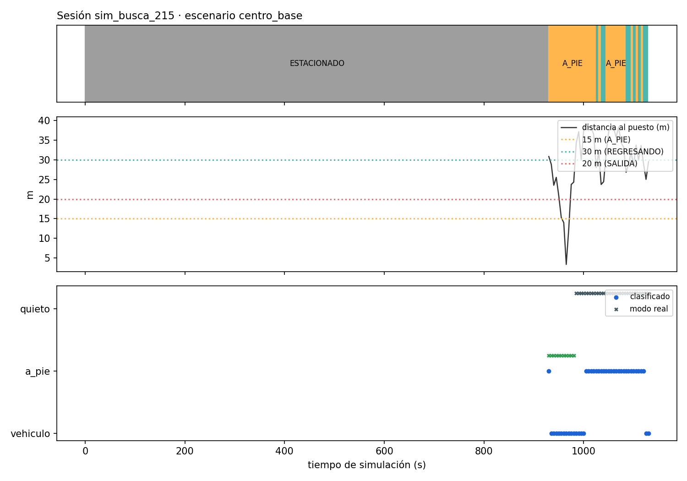
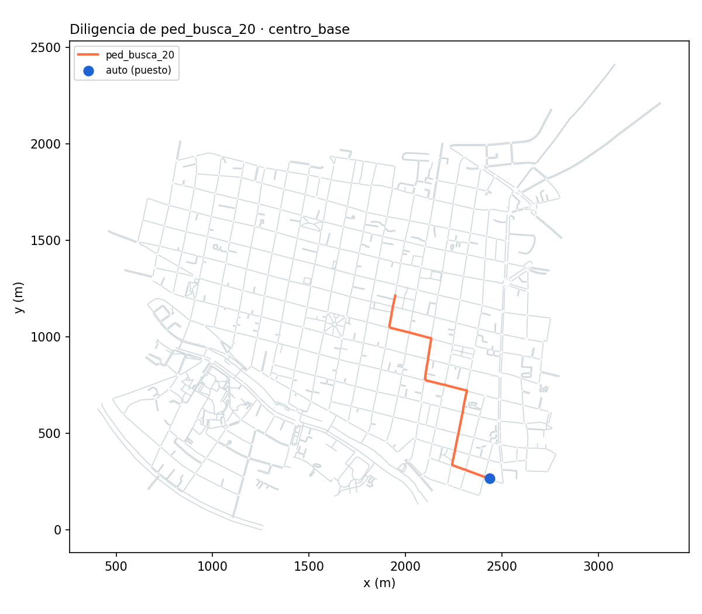

# S2 · Sesión 2 · Freddy: peatones de diligencia y máquina de estados

## 1. Resumen en 5 líneas
- Cada auto de búsqueda que estaciona en el escenario base genera un peatón (`ped_<veh>`) que camina al destino del auto, hace una diligencia y vuelve. El auto solo se libera cuando el peatón regresa.
- Una máquina de estados por usuario (`sim_<veh>`) sigue la sesión de parqueo con las reglas y umbrales del contrato §3.
- El "teléfono" de cada usuario usa el `EmuladorGPS` de S1-3: lleva la posición del auto si está dentro y la del peatón si camina.
- Cada 5 s, un buffer de 30 s de GPS se pasa a `clasificar` (módulo de Pablo) para decidir el modo `a_pie`, `quieto` o `vehiculo`.
- Sirve para medir dos cosas del proyecto: que ningún auto quede estacionado para siempre y cuántas **falsas liberaciones** (marcar libre un puesto que sigue ocupado) produce el sistema.

## 2. Conceptos clave
- **Diligencia:** salida a pie del conductor (ir a un destino, esperar y volver). Se modela como una secuencia de *etapas* de SUMO: caminar, esperar, caminar.
- **Etapa de persona (`appendWalkingStage`, `appendWaitingStage`):** cada peatón recibe su itinerario completo al llegar. SUMO lo ejecuta solo.
- **Parada extendida:** el auto se queda con `setParkingAreaStop(..., duration=86400)` hasta que el peatón vuelve. Así no se va solo cuando termina su estadía original.
- **Máquina de estados (`MaquinaSesion`):** función pura, sin TraCI, con estados `ESTACIONADO → A_PIE → REGRESANDO → SALIENDO → CERRADA`. Así se prueba sin SUMO.
- **Falsa liberación:** cerrar la sesión mientras el auto sigue físicamente estacionado. Se comprueba con `traci.vehicle.isStoppedParking` en el momento del cierre.
- **Buffer circular de 30 s:** mantiene las últimas muestras del teléfono; `clasificar` solo se llama cuando el buffer cubre la ventana completa, cada 5 s.
- **Umbral de distancia:** la sesión mide la distancia del teléfono al punto donde estacionó el auto (no al centro del parkingArea, ver sección 8).

## 3. Cómo se generó cada cosa

| Resultado | Comando | Entradas | Salidas |
|---|---|---|---|
| Copia del escenario | cp -r proyecto/sumo .../traci/escenario/tyrone/sumo (escenario de Tyrone) | proyecto/sumo/ | traci/escenario/tyrone/sumo/ (ignorado por git) |
| Corrida de 30 min | docker exec ... python3 -m traci.correr_sesiones --hasta 1800 | centro_base.sumocfg, destinos.csv | traci/salidas/*.csv y resumen_centro_base.json |
| Pruebas puras | python3 -m pytest traci/tests -m "not sumo" | — | 25 pasan |
| Pruebas con SUMO | python3 -m pytest traci/tests/test_peatones.py -m sumo | escenario mínimo de 5 autos (fixture) | 3 pasan |
| Evidencias | python3 -m traci.graficas_sesion --escenario centro_base | traci/salidas/*.csv, red de Tyrone | evidencias/s2_*.png |

Todos los comandos de SUMO se ejecutan dentro del contenedor `van3twin`, desde `semanas/S2/Freddy/codigo`.

## 4. Mapa de archivos

| Archivo | Qué contiene | Quién lo usa |
|---|---|---|
| traci/peatones.py | GestorPeatones: crea peatones, sus etapas y reanuda autos | correr_sesiones.py, pruebas |
| traci/estados.py | MaquinaSesion (pura) y ControlSesiones (hook de TraCI, CSV, falsas) | correr_sesiones.py, pruebas |
| traci/clasificacion.py | ClasificadorUsuario (buffer 30 s, cada 5 s) y carga de clasificar | estados.py |
| traci/correr_sesiones.py | CLI: enchufa los dos hooks al Controlador y escribe el resumen | Freddy (corridas) |
| traci/graficas_sesion.py | Evidencias PNG | Freddy |
| traci/tests/test_estados.py | 9 pruebas puras de la máquina y del buffer | pytest -m "not sumo" |
| traci/tests/test_peatones.py | 3 pruebas con SUMO (tres casos difíciles) | pytest -m sumo |
| traci/tests/conftest.py | Marcador sumo y fixture del escenario mínimo | pruebas |
| traci/gps.py, traci/controlador.py | Del módulo de S1 (copia de proyecto/traci/) | esta sesión los usa |
| proyecto/ia/inferencia.py | clasificar de Pablo (solo se lee) | clasificacion.py |

## 5. Recorrido del código

**`peatones.py`**
- `GestorPeatones.on_paso(ctrl, t)`: al detectar una llegada (`getParkingStartingVehiclesIDList`), crea al peatón; luego revisa quién volvió.
- `GestorPeatones._llegada`: extiende la parada, crea el peatón y le asigna sus etapas (ida, espera, vuelta; o la espera en el auto).
- `arista_peatonal(tr, x, y)`: convierte un punto a una arista caminable, evitando las áreas internas de cruce.
- `_destino_con_camino`: si el destino del auto no tiene acera o camino, elige otro por peso.

```python
ida, t_ida = _camino(tr, edge_auto, arista[0])
espera = max(MIN_DILIGENCIA_S, t_estadia - 2 * t_ida)
tr.person.appendWalkingStage(ped, ida, pos_dest)
tr.person.appendWaitingStage(ped, espera, "diligencia")
tr.person.appendWalkingStage(ped, vuelta, pos_auto)
```

**`estados.py`**
- `MaquinaSesion.actualizar(modo, distancia_m, t_sim)`: aplica la regla de transición de la ventana y devuelve las transiciones; `SALIENDO` se cierra en el mismo paso.
- `ControlSesiones.on_paso(ctrl, t)`: abre sesiones, toma una muestra GPS por usuario y procesa cada ventana.
- `ControlSesiones._cerrar`: al cerrar, comprueba `isStoppedParking`; si el auto sigue estacionado, cuenta una falsa liberación.

**`clasificacion.py`**
- `ClasificadorUsuario.observar` / `evaluar`: buffer de 30 s y llamada a `clasificar` cada 5 s.
- `cargar_clasificar()`: importa `ia.inferencia.clasificar` desde `proyecto/`; si falta, usa un MOCK con la regla de umbral.

## 6. Cómo se conecta con los demás
- **Consume de S1 (Freddy):** `EmuladorGPS` (ruido AR(1), pérdidas) y `Controlador` (suscripciones y hooks).
- **Consume de Tyrone:** la red, la demanda (`destino` y `clase` por vehículo), los parkingAreas y `destinos.csv`.
- **Consume de Pablo:** `clasificar(ventana)` de `proyecto/ia/inferencia.py`. En esta corrida se usó su regla de respaldo (`fuente = umbral`), porque `rf_v0.joblib` no está en el repo.
- **Entrega:** CSV de transiciones, ventanas y falsas liberaciones; resumen JSON. Todavía **no** llama al backend (`POST /sim/paso`, `POST /sesiones/{id}/cerrar`): eso queda para la siguiente sesión.

## 7. Resultados y evidencias

Corrida de 30 min del escenario base (semilla 1, GPS semilla 1):

| Medida | Valor |
|---|---|
| Llegadas de búsqueda con peatón | 343 |
| Peatones que volvieron al auto | 4 (1,2 %) |
| Peatones pendientes al final | 339 |
| Destinos sustituidos (sin acera o sin camino) | 129 |
| Casos: diligencia / en auto / regreso corto / sin camino | 255 / 39 / 46 / 3 |
| Sesiones cerradas / abiertas al final | 215 / 128 |
| Falsas liberaciones | 214, es decir 62,4 por cada 100 sesiones |
| Ventanas clasificadas | 17 250, todas con fuente = umbral |





Pruebas: 25 pasan en el modo puro y 3 con SUMO (un escenario de 5 autos con estadías cortas, en los tres casos difíciles).

## 8. Limitaciones y decisiones
- **Peatones que no vuelven en 30 min.** Las caminatas son largas (un destino a 1–1,5 km). Con 30 min, la mayoría sigue caminando al final. Por eso el criterio de "más del 95 %" **no se cumple**.
- **Falsas liberaciones.** El clasificador de umbral (de respaldo) calcula la velocidad como distancia recorrida entre muestras con ruido de 5 m. Un teléfono quieto parece moverse a ~4 m/s, por encima del umbral de 2,2 m/s. Esto no es un fallo de la máquina de estados: las transiciones cumplen las reglas del contrato. El problema es la entrada.
- **Puesto = punto donde se estacionó el auto.** Un parkingArea mide ~100 m; su centro quedaría a más de 30 m de cualquier auto y nunca se cumpliría el regreso. Por eso la distancia se mide al punto de estacionamiento.
- **Peatones sobre la acera, no en el carril de parqueo.** Caminar hasta el carril del parkingArea hizo caer a SUMO 1.12 al volver. Los peatones usan la acera más cercana al auto.
- **Destinos sin acera.** Algunos destinos de `destinos.csv` caen en áreas internas de cruce o en el borde del mapa (p. ej. Museo Pumapungo). Se sustituyen por otro destino, y la sustitución queda contada.
- **Nombre de la API.** El prompt pedía `getParkingStartingVehicleIDList`; en SUMO 1.12 se llama `getParkingStartingVehiclesIDList`.
- **Sin verificador independiente.** No se lanzó un subagente verificador; la verificación fue ejecutar las pruebas y la corrida.

## 9. Preguntas que podría hacer el profesor
1. **¿Por qué no se libera el puesto al instante cuando el conductor se baja?** Porque la sesión solo cierra cuando el teléfono indica que el auto se va. Liberar al bajarse produciría falsas liberaciones de inmediato.
2. **¿Qué es una falsa liberación y cómo se mide?** Cerrar la sesión mientras el auto sigue estacionado. Se comprueba en SUMO con `isStoppedParking` en el momento del cierre.
3. **¿Por qué la máquina de estados es pura?** Así se prueba sin SUMO y se garantiza que las reglas del contrato no dependen de la simulación.
4. **¿Por qué el buffer es de 30 s y el paso de 5 s?** Son los valores del contrato §2: la ventana da suficiente señal para la velocidad media y el paso permite reaccionar a tiempo.
5. **¿Por qué el resultado de falsas liberaciones es alto?** El clasificador de respaldo confunde el ruido del GPS con movimiento. Pablo debe entregar el modelo RF (o features robustas al ruido, como el desplazamiento neto) antes de medir de nuevo.
