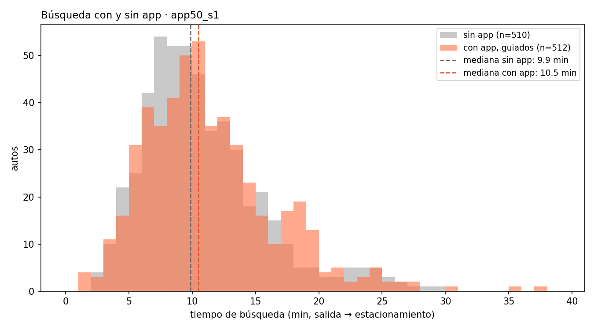
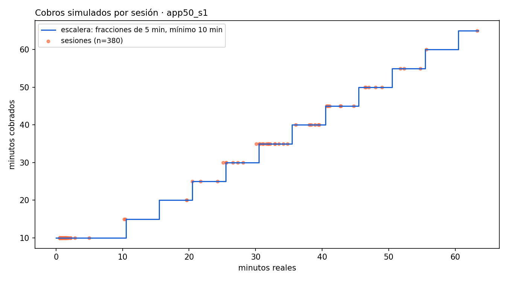

# S2 · Sesión 3 · Freddy: guiado, sesiones y cobro en la simulación

## 1. Resumen en 5 líneas
- Los autos con app se guían al puesto libre más cercano a su destino con `rerouteParkingArea`, abren una sesión al estacionar, cobran al salir y el libro de la billetera cuadra.
- El controlador importa `backend/nucleo/` directamente (sin HTTP): billetera, sesiones y mapa de ocupación viven en memoria durante la corrida.
- Se corrieron 75 minutos simulados con 50 % de autos con app (`app50_s1`) y una línea base sin app (`base_s1`), y también una variante con ocupación real de SUMO como oráculo.
- Resultado principal: el guiado con lo que sabe el sistema (solo sesiones de la app) hace la búsqueda más larga; con la ocupación real, la hace más corta.
- Queda documentado el cobro (el mínimo de 10 min domina porque las sesiones son muy cortas) y la retención de las sesiones que siguen abiertas al final.

## 2. Conceptos clave
- **Guiado (`rerouteParkingArea`):** cambia la parada de un auto en vuelo para llevarlo a otro parkingArea. Antes de llamarla se comprueba que SUMO tenga ruta desde la posición actual, porque si no, SUMO aborta.
- **Ocupación del mapa:** `MapaOcupacion` cuenta solo las sesiones abiertas de la app. Los autos sin app no aparecen en él, así que el sistema no sabe si un puesto está lleno por ellos.
- **Oráculo (`--fuente verdad`):** usa `parkingarea.getVehicleCount`, la ocupación real de SUMO. Sirve para comparar, no es algo que el sistema pueda conocer.
- **Sesión:** la abre el núcleo al estacionar (`ServicioSesiones.iniciar`), retiene el bloque mínimo de 30 min y la cierra al detectar la salida (`cerrar`), con el débito del tiempo real.
- **Cobro:** fracciones de 5 min con mínimo de 10 min (`tarifa.minutos_cobrables`).
- **Retención:** dinero apartado mientras la sesión está abierta. Al cerrar, se libera.

## 3. Cómo se generó cada cosa

| Resultado | Comando | Entradas | Salidas |
|---|---|---|---|
| Escenarios con app | `python3 -m traci.escenario_app` | demanda base de `proyecto/sumo` (mock de `--porc-app`) | `escenario/tyrone/sumo/*.sumocfg`, `demanda/app50_s1.rou.xml`, `base_s1.rou.xml` |
| Corrida con guiado (mapa) | `python3 -m traci.correr_guiado --escenario app50_s1` | `app50_s1.sumocfg` | `traci/salidas/sesiones_app50_s1.csv`, `busqueda_app50_s1.csv`, `libro_app50_s1.json`, `resumen_guiado_app50_s1.json` |
| Corrida con oráculo | `python3 -m traci.correr_guiado --escenario app50_s1 --fuente verdad` | igual | igual, con sufijo `_app50_s1_verdad` |
| Línea base sin app | `python3 -m traci.correr_guiado --escenario base_s1 --sin-guia` | `base_s1.sumocfg` | resultados con sufijo `_base_s1` |
| Auditoría del cobro | `python3 -m traci.auditar_cobro --escenario app50_s1 --stops ...` | sesiones, libro y `stop-output` de SUMO | `traci/salidas/auditoria_cobro_*.json` |
| Evidencias | `python3 -m traci.graficas_s3 --escenario app50_s1` | `busqueda_*.csv`, `sesiones_*.csv` | `evidencias/s3_*.png` |
| Pruebas | `python3 -m pytest traci/tests` | — | 37 pasan, 1 omitida (de S1) |

Todos los comandos de SUMO se ejecutan dentro del contenedor `van3twin`, desde `semanas/S2/Freddy/codigo`.

## 4. Mapa de archivos

| Archivo | Qué contiene | Quién lo usa |
|---|---|---|
| traci/puente_nucleo.py | Billetera, sesiones y mapa del núcleo en memoria; recarga inicial; publicador opcional | correr_guiado, estados, pruebas |
| traci/guiado.py | Guia (asignación, revisión y reasignación) y RegistroBusqueda | correr_guiado, pruebas |
| traci/estados.py | Máquina de estados por usuario; ahora abre y cierra sesiones en el núcleo | correr_guiado |
| traci/correr_guiado.py | CLI de la corrida con app, escritura de CSV y resumen | Freddy |
| traci/escenario_app.py | Mock de `--porc-app` (50 % con app) y escenario base | Freddy |
| traci/auditar_cobro.py | Auditoría del cobro y del libro | Freddy |
| traci/graficas_s3.py | Evidencias PNG de S3 | Freddy |
| traci/tests/test_guiado.py | Pruebas puras del guiado y del publicador; una prueba con SUMO | pytest |

## 5. Recorrido del código

**guiado.py**
- Guia.on_paso: al salir un auto con app lo guía; al estacionar lo marca; revisa cada 10 s si su puesto se llenó.
- Guia._guiar: elige el puesto libre más cercano al destino que tenga ruta desde el auto, y reroutea.
- Guia._revisar: si el puesto asignado está lleno según la fuente, reasigna, hasta 3 veces; después queda a ciegas.

```python
pid = recomendar((lat, lon), self.puestos, lambda p: self._libres(ctrl, p), excluidos)
if self._alcanzable(ctrl, veh, pid):
    ctrl.traci.vehicle.rerouteParkingArea(veh, pid)
```

**puente_nucleo.py**
- PuenteNucleo.iniciar / cerrar / transicion: traduce la máquina de estados a las operaciones del núcleo.
- PuenteNucleo.libro: saldo y retención por usuario, en centavos.
- Publicador: envía snapshots en un hilo con cola de tamaño 1; si la red se atrasa, descarta el viejo.

**estados.py**
- ControlSesiones.on_paso: abre la sesión al estacionar y la cierra al pasar a CERRADA; si el auto sale de la red sin detección, la cierra como manual.

**auditar_cobro.py**
- Compara el débito con el costo de los minutos, y con los tiempos reales de `stopinfo` de SUMO.

## 6. Cómo se conecta con los demás
- **Consume de Tyrone:** la red, la demanda con `param destino` y `con_app` (mock hasta que llegue `origin/tyrone/s2`), los parkingAreas y `parqueos/puestos.csv`.
- **Consume de S2-2:** la máquina de estados y el GPS emulado.
- **Consume del backend (Freddy):** `backend/nucleo/` (copia en `codigo/backend`).
- **Entrega:** CSV de sesiones, búsqueda y libro; resumen JSON; PNG. El publicador existe, pero no se usó contra el VPS (Freddy no tiene credenciales de Tyrone).

## 7. Resultados y evidencias

Corrida `app50_s1`, 75 min simulados, fuente mapa (la del sistema):

| Medida | Valor |
|---|---|
| Autos con app guiados | 638 |
| Reasignaciones | 0 |
| Sesiones abiertas (máquina / núcleo) | 512 / 380 cerradas, 132 abiertas |
| Falsas liberaciones | 335, es decir 65,4 por cada 100 sesiones |
| Tiempo medio de búsqueda con app / sin app | 11,3 / 10,8 min |
| Mediana con app / sin app | 10,5 / 9,9 min |
| Minutos reales / cobrados medios por sesión | 5,4 / 13,8 |
| Auditoría: fallos de coherencia del débito | 0 |
| Auditoría: error de facturación medio / máximo | −0,063 / 0,46 USD |
| Libro: usuarios que no cuadran | 0 de 638 |
| Retención final | 33,00 USD = 132 sesiones abiertas × 0,25 USD |

Corrida `app50_s1_verdad` (oráculo):

| Medida | Valor |
|---|---|
| Reasignaciones / autos a ciegas tras agotarlas | 1257 / 209 |
| Tiempo medio de búsqueda con app / sin app | **10,0 / 10,7 min** |
| Mediana con app / sin app | 9,3 / 9,9 min |
| Falsas liberaciones | 358 de 541 sesiones |





Pruebas: 37 pasan. La prueba con SUMO comprueba que cada auto con app tiene exactamente una sesión (cerrada o abierta) y que el libro cuadra.

## 8. Limitaciones y decisiones
- **El guiado con la ocupación del sistema empeora la búsqueda.** El mapa solo ve sesiones abiertas: los autos guiados que aún no estacionaron no cuentan, y los autos `fondo` que llenan los puestos son invisibles. Con la ocupación real, el guiado sí reduce la búsqueda. Mejora propuesta: contar las reservas de los autos en GUIADO en el mapa.
- **Falsas liberaciones de 65 %.** Las sesiones duran unos 35 s porque el clasificador de umbral (de respaldo; falta `rf_v0.joblib`) confunde el ruido del GPS con movimiento. Por eso casi todas pagan el mínimo de 10 min. Es el mismo problema de S2-2, ahora con dinero.
- **Retención al final.** 132 sesiones siguen abiertas porque sus autos aún están estacionados al cumplirse los 75 min; el libro explica la retención con exactitud. El criterio «retención final 0» no se cumple por esto, y se explica aquí.
- **Mock de `--porc-app`.** `origin/tyrone/s2` no existe todavía; se usó un escenario propio al 50 % (marcado MOCK).
- **Codificación de los destinos.** TraCI devuelve el texto de los parámetros en latin-1: `Calderón` llega como `Calderón`. Se corrige en el código al leerlo (`texto_traci`). Esto afectó también a los peatones de S2-2, cuya cifra de sustituciones de destino debe volver a medirse.
- **Publicación.** El publicador funciona con una URL caída (sin bloquear la corrida), pero la simulación baja un 3 % de velocidad. No se publicó al VPS.
- **Crash del oráculo.** Una corrida con `verdad` falló por corrupción de memoria en SUMO después de muchos reencaminamientos. La versión final (con comprobación de alcanzabilidad) terminó sin errores.

## 9. Preguntas que podría hacer el profesor
1. **¿Por qué el guiado puede empeorar la búsqueda?** Porque la información del sistema es incompleta: no ve autos sin app ni reservas. Con la ocupación real, la búsqueda baja un 6 %.
2. **¿Qué pasa si el auto no puede llegar al puesto recomendado?** Se descarta ese puesto y se toma el siguiente que sí tenga ruta; si ninguno, el auto queda a ciegas.
3. **¿Cómo se garantiza que el libro cuadra?** Cada movimiento es un asiento; el saldo es recargas menos débitos, y la retención neta es exactamente un bloque por sesión abierta. La auditoría lo verifica para los 638 usuarios.
4. **¿Por qué el cobro mínimo domina?** Porque las sesiones son muy cortas por la detección errónea; con un clasificador mejor, el cobro sería más cercano al tiempo real.
5. **¿Por qué no se publica al VPS desde esta sesión?** Porque las credenciales y el despliegue son de Tyrone; la sesión solo deja el publicador probado contra una URL caída.
