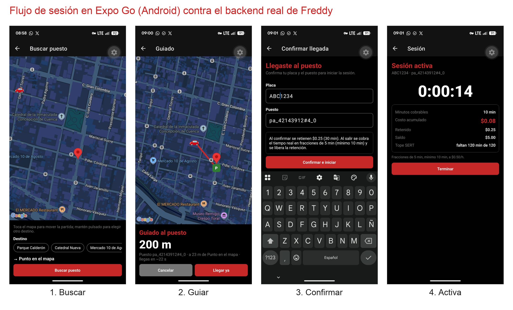
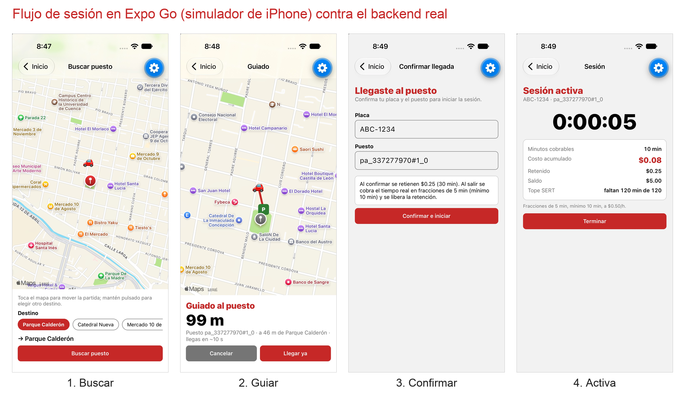
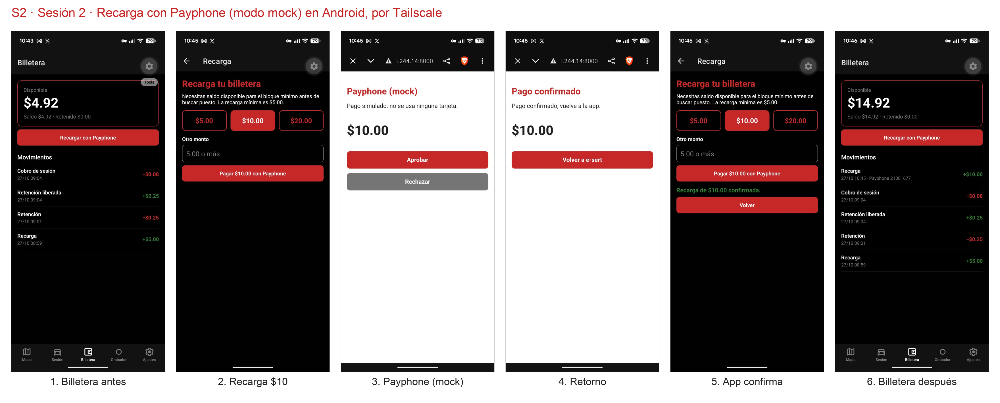
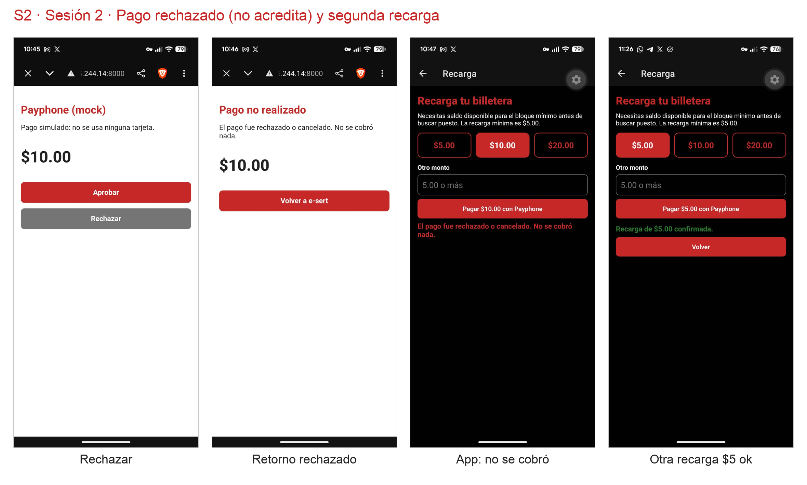
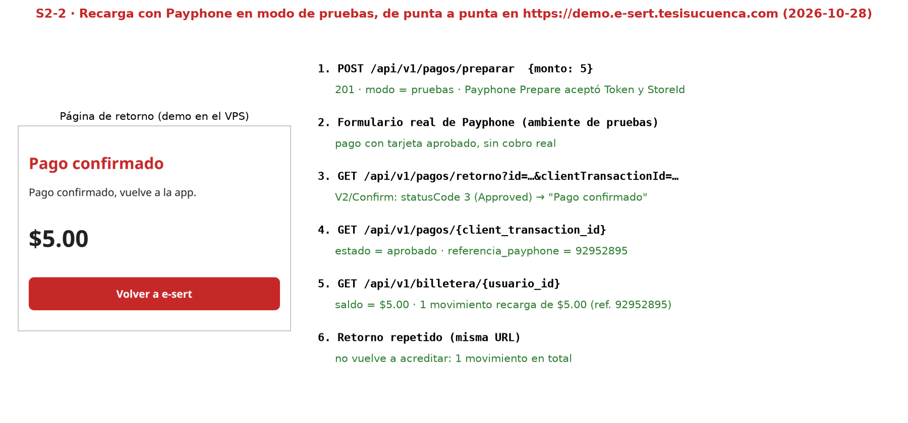
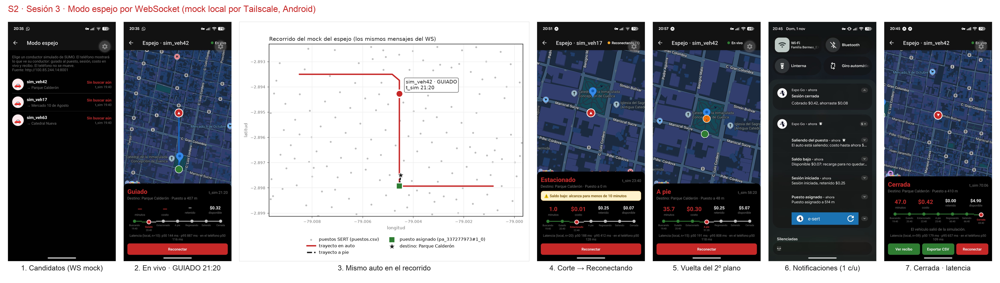
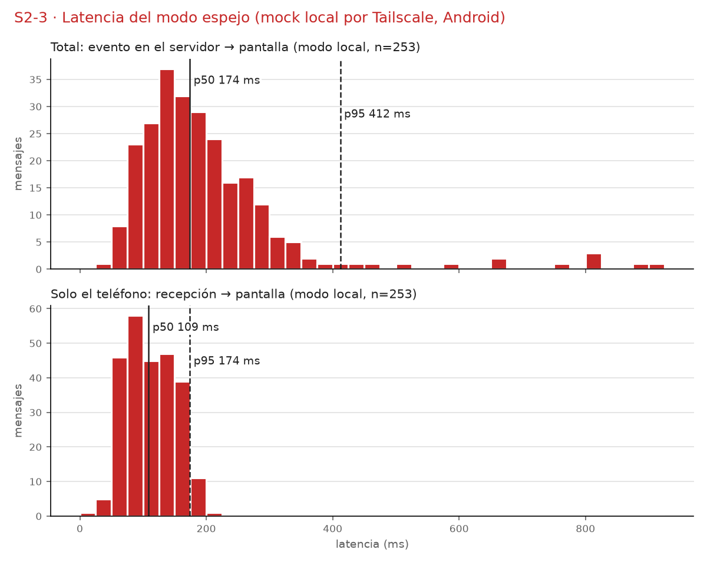

# S2 · Miguel 🔴 · Galería semanal

## Sesión 1 · 2026-10-27 · Flujo de sesión de parqueo (buscar → guiar → confirmar → activa)

**Estado:** parcial (4/5 criterios). Lo único pendiente es probar en un iPhone físico: iOS se probó en el simulador.

- El flujo completo funciona en Expo Go contra el **backend real de Freddy** (rama `freddy/s2`), en el Android de Miguel y en el simulador de iPhone:
  - elegir destino (lista de `destinos.csv` de Tyrone o pulsación larga);
  - recarga previa si no hay saldo;
  - guiado simulado a 8 m/s;
  - placa y puesto;
  - sesión activa con costo en vivo y cierre manual.
- Los tipos y la tarifa son una copia de `comun/` verificada por hash (`npm run verificar-contrato`).
- El estado se guarda en AsyncStorage: al cerrar y reabrir la app vuelve a la sesión activa.
- `npm test`: 91 tests (placa, tarifa igual a `tarifa.py`, los 15 códigos de error del cliente, mock, estado y costo). `npm run probar-backend`: 10/10 contra el backend real.

Explicación: [explicaciones/s1_explicacion.pdf](explicaciones/s1_explicacion.pdf)

## Sesión 2 · 2026-10-27 · Billetera y recarga con Payphone en modo de pruebas

**Estado:** hecha (6/6 criterios). El modo `pruebas` de Payphone se probó el 28-oct en la demo del VPS con las credenciales de Tyrone.

- `backend/pagos/` (router `/api/v1/pagos/*` que el backend de Freddy monta solo):
  - `AdaptadorPayphone` (*Prepare* y *V2/Confirm* según la documentación de Payphone del 27-oct, montos en centavos) y `AdaptadorMock` con página "Aprobar/Rechazar";
  - tabla propia `intenciones_pago` y retorno **idempotente**: la billetera se acredita una sola vez por `clientTransactionId`;
  - `responseUrl` armada desde `ESERT_URL_PUBLICA`; credenciales solo en `.env`.
- App: Billetera (saldo, retenido, disponible y movimientos con fecha local, *pull to refresh*) y Recarga ($5, $10, $20 o monto libre ≥ $5, navegador del sistema y consulta del estado hasta 10 veces).
- Prueba en Android con Expo Go por Tailscale: $4.92 → aprobar $10 → **$14.92**, un solo movimiento "Payphone 21081677"; un pago rechazado no acredita.
- pytest 30/30 (más los 102 de Freddy con pagos montado), Jest 99/99, `tsc` sin errores.
- **Payphone real (modo de pruebas) en `https://demo.e-sert.tesisucuenca.com`:** $5 aprobados → "Pago confirmado" → intención `aprobado` (ref. 92952895) → billetera $0 → **$5.00**, un solo movimiento aunque se repita el retorno.

Explicación: [explicaciones/s2_explicacion.pdf](explicaciones/s2_explicacion.pdf)

## Sesión 3 · 2026-11-01 · Modo espejo conectado a la simulación

**Estado:** hecha (6/6 criterios), contra un **servidor mock** local (`# MOCK`): el `WS /ws/espejo/{veh_id}` de Freddy todavía no existe (S3-3).

- La app lista candidatos (`GET /api/v1/espejo/candidatos`) y sigue un auto por `WS /ws/espejo/{veh_id}` (CONTRATO §7).
- El WebSocket se reconecta solo (1, 2, 4, 8, 16, 30 s con *jitter* ±20 %), cierra y reabre tras 5 s de silencio y al volver del segundo plano. Un indicador en la cabecera muestra En vivo, Reconectando, Sin conexión o Finalizado.
- Notificaciones locales una sola vez por auto y estado: Puesto asignado, Sesión iniciada, Saldo bajo, Saliendo y Sesión cerrada.
- Pruebas en Android por Tailscale: tras el corte del servidor cada 20 s, la app volvió en 1.0–1.6 s; tras 39 s en segundo plano, reconectó al volver.
- Latencia evento → pantalla, modo local, 253 mensajes de 3 recorridos completos y 3 parciales: **p50 174 ms, p95 412 ms**; solo el teléfono, p50 109 ms y p95 174 ms.
- Jest 140/140 (52 del espejo), `tsc` sin errores, tests del mock 12/12.

Explicación: [explicaciones/s3_explicacion.pdf](explicaciones/s3_explicacion.pdf) · Resumen de la semana: [evidencias/resumen_S2_Miguel.pdf](evidencias/resumen_S2_Miguel.pdf)
