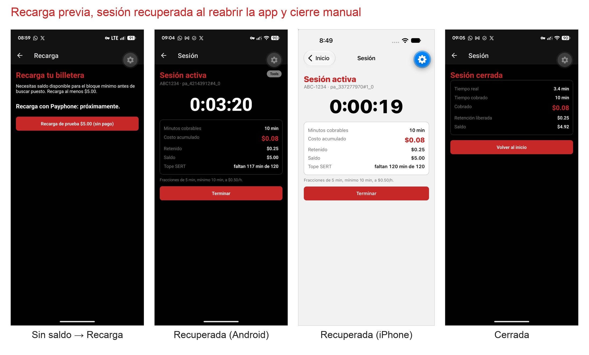

# S2 · Miguel 🔴 · Galería semanal

## Sesión 1 · 2026-10-27 · Flujo de sesión de parqueo (buscar → guiar → confirmar → activa)

**Estado:** parcial (4/5 criterios). Lo único pendiente es probar en un iPhone físico: iOS se probó en el simulador.

- El flujo completo funciona en Expo Go contra el **backend real de Freddy** (rama `freddy/s2`), en el Android de Miguel y en el simulador de iPhone:
  - elegir destino (lista de `destinos.csv` de Tyrone o pulsación larga);
  - recarga previa si no hay saldo;
  - guiado simulado a 8 m/s;
  - placa y puesto;
  - sesión activa con costo en vivo y cierre manual.
- Los tipos y la tarifa son una copia de `comun/` verificada por hash (`npm run verificar-contrato`).
- El estado se guarda en AsyncStorage: al cerrar y reabrir la app vuelve a la sesión activa.
- `npm test`: 91 tests (placa, tarifa igual a `tarifa.py`, los 15 códigos de error del cliente, mock, estado y costo). `npm run probar-backend`: 10/10 contra el backend real.

Explicación: [explicaciones/s1_explicacion.pdf](explicaciones/s1_explicacion.pdf)
