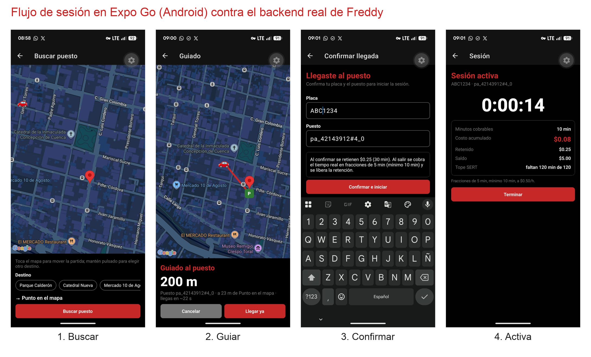
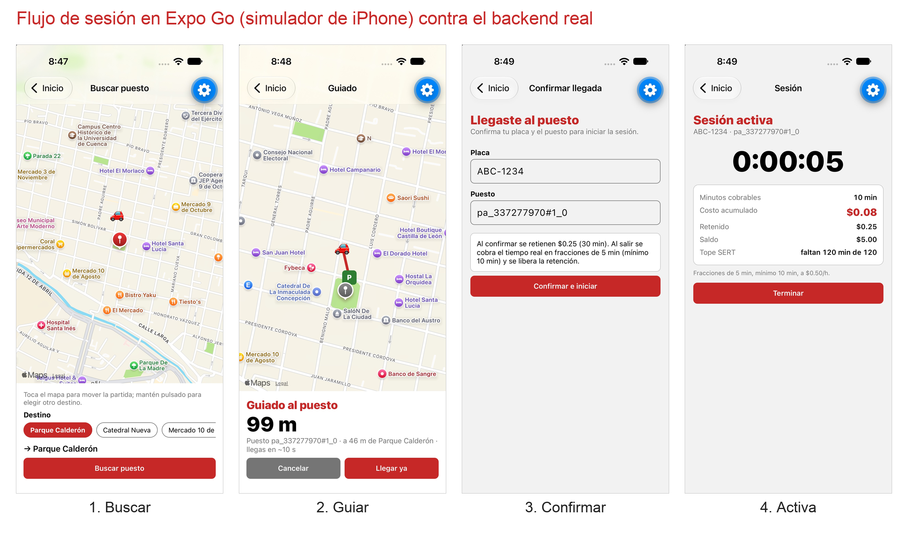
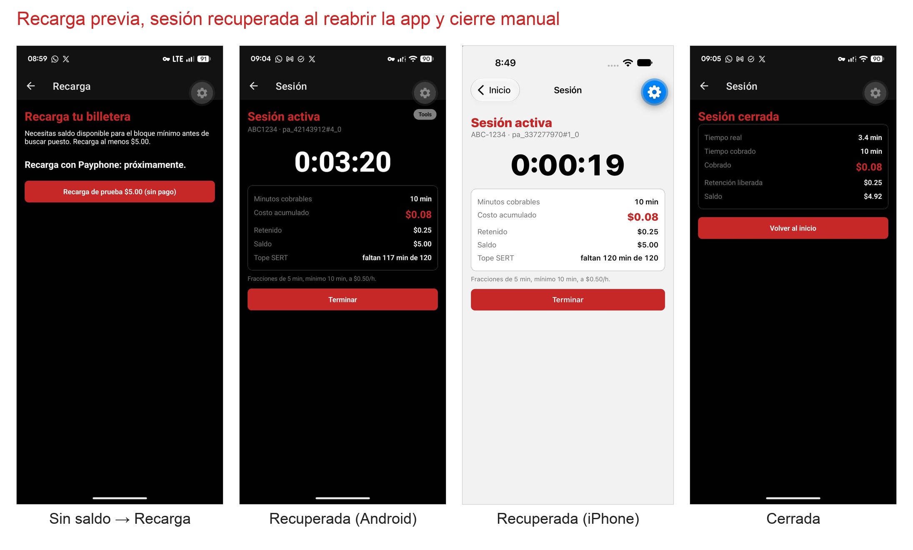

# S2 · Sesión 1 · Miguel: Flujo de sesión de parqueo en la app (buscar → guiar → confirmar → activa)

## 1. Resumen en 5 líneas

- La app de Expo Go ya hace el recorrido completo de un conductor: elige un destino, recibe un puesto SERT libre, llega guiado, confirma placa y puesto, y ve la sesión activa con su costo en vivo hasta que la termina.
- Funciona contra el **backend real de Freddy** (rama `freddy/s2`, corrido en la computadora), probado en el teléfono Android de Miguel y en el simulador de iPhone. El mock de S1 sigue disponible con `EXPO_PUBLIC_USE_MOCK=1`.
- Todo es simulado: la partida es una esquina del Centro y el auto avanza solo hacia el puesto a 8 m/s; el teléfono no se mueve.
- El estado del flujo se guarda en el teléfono (AsyncStorage): si se cierra la app con una sesión abierta, al volver a abrirla regresa a la sesión activa.
- Los tipos y la tarifa ya no se escriben a mano: son una copia de `comun/` verificada por *hash* con `npm run verificar-contrato`.

## 2. Conceptos clave

- **Copia verificada del contrato:** Metro (el empaquetador de Expo) no resuelve bien archivos fuera de la carpeta de la app, así que `comun/esquemas.ts` y `comun/tarifa.json` se copian a `src/contrato/`. Un script compara el SHA-256 de la copia con el original y falla si difieren, para que nadie edite la copia a mano.
- **Cliente tipado con *timeout*:** cada llamada usa `fetch` con un `AbortController` que la corta a los 8 s. Los errores del contrato `{"error": {"codigo", "mensaje"}}` se convierten en `ErrorApi`, y `mensajeUsuario` los traduce a un texto en español para el usuario (por ejemplo, `SALDO_INSUFICIENTE` → "Recarga al menos $5 para buscar puesto").
- **Estados del contrato en la app:** `BUSCANDO` y `GUIADO` existen solo en el teléfono (todavía no hay `sesion_id`); desde `ESTACIONADO` la sesión existe en el backend. Un `useReducer` aplica las transiciones y un Context las comparte con todas las pantallas.
- **Persistencia con AsyncStorage:** después de cada cambio, el estado se guarda como JSON. Al arrancar se lee primero y, hasta haberlo leído, no se guarda nada (si no, el estado vacío pisaría la sesión guardada).
- **Distancia *haversine* y avance simulado:** la distancia entre dos puntos sobre la esfera terrestre. `simularAvance` mueve la posición 8 m por segundo en línea recta hacia el puesto, sin pasarse; a menos de 25 m se considera "llegado".
- **Costo en vivo con la regla del contrato:** minutos cobrables = máximo entre 10 y los minutos reales redondeados hacia arriba a fracciones de 5; costo = minutos × $0,50 / 60, al centavo. La app lo calcula igual que `tarifa.py` (comprobado con 16 casos generados en Python), pero el cobro real lo hace el backend al cerrar.
- **Retención:** al confirmar se retienen $0,25 (bloque mínimo de 30 min). Al cerrar se debita el costo real y la retención se libera.

## 3. Cómo se generó cada cosa

| Resultado | Comando | Entradas | Salidas |
|---|---|---|---|
| Copia del contrato | cp de proyecto/comun/esquemas.ts (con cabecera) y tarifa.json | proyecto/comun/ | app/src/contrato/ |
| Verificación del contrato | npm run verificar-contrato | src/contrato/, proyecto/comun/ | OK o DIFIERE por archivo; exit 1 si difiere |
| Lista de destinos | python3 scripts/destinos.py | proyecto/sumo/demanda/destinos.csv (Tyrone) | src/datos/destinos.ts (12 destinos) |
| Tests | npm test | \_\_tests\_\_/, src/espejo/\_\_tests\_\_/ | 7 suites, 91 tests OK |
| Tipos | npx tsc --noEmit | toda la app | 0 errores |
| Prueba contra el backend real | npm run probar-backend -- http://192.168.3.168:8000/api/v1 | backend de freddy/s2 | 10 comprobaciones OK |
| Capturas iPhone | xcrun simctl openurl (enlaces buscar?auto=1, confirmar?placa=...) + simctl io screenshot | simulador iPhone 18 Pro | evidencias/capturas/s1_ios-*.jpeg |
| Capturas Android | Expo Go en el teléfono de Miguel | flujo a mano | evidencias/capturas/s1_android_*.jpeg |
| Evidencias | python scripts/montaje.py salida.png capturas... --titulos ... | capturas | s1_flujo-sesion.png, s1_flujo-sesion-ios.png, s1_recarga-recuperar-cerrar.png |

## 4. Mapa de archivos

| Archivo | Qué contiene | Quién lo usa |
|---|---|---|
| app/src/contrato/esquemas.ts, tarifa.json | Copia de comun/ (no editar) | tipos.ts, tarifa.ts |
| app/scripts/verificar_contrato.mjs | Compara hashes con proyecto/comun/ | npm run verificar-contrato |
| app/src/api/cliente.ts | Cliente HTTP, getGuia/crearSesion/getSesion/cerrarSesion/getBilletera, mensajes | pantallas, probar_backend.ts |
| app/src/api/tipos.ts | Reexporta el contrato + ErrorApi, ApiESert y tipos del espejo | toda la app |
| app/src/api/mock.ts | Backend falso alineado con la v1 (bloqueo, SESION_ACTIVA, débito completo) | modo mock |
| app/src/estado/sesion.ts | Reductor del flujo, persistencia y SesionProveedor | pantallas, _layout.tsx |
| app/src/sesion/placa.ts, geo.ts, cobro.ts | Placa, haversine y avance, costo en vivo y avisos | pantallas, tests |
| app/src/datos/destinos.ts | 12 destinos del Centro (copia de Tyrone) | buscar.tsx |
| app/app/buscar.tsx | Partida, destino, billetera y GET /guia | usuario |
| app/app/recarga.tsx | "Próximamente" + recarga de prueba | usuario |
| app/app/sesion/guiar.tsx, confirmar.tsx, activa.tsx | Guiado, confirmación y sesión activa | usuario |
| app/scripts/montaje.py | Tira horizontal de capturas | evidencias de S2-1 y S2-2 |
| app/scripts/probar_backend.ts | Flujo completo contra el backend real | verificación |
| app/\_\_tests\_\_/ | placa, tarifa, cliente, mock, estado, cobro | npm test |
| app/.env.example | Plantilla de EXPO_PUBLIC_API_URL y EXPO_PUBLIC_USE_MOCK | equipo |

## 5. Recorrido del código

**`src/estado/sesion.ts`:** `reductor(estado, accion)` aplica `BUSCAR`, `GUIA_RECIBIDA`, `AVANZAR`, `SESION_CREADA`, `CERRADA`, `REINICIAR` y `RESTAURAR`. `SesionProveedor` lee AsyncStorage al arrancar y guarda en cada cambio. `rutaDelFlujo` dice a qué pantalla volver.

```ts
useEffect(() => {
  cargarFlujo().then((guardado) => {
    if (guardado) despachar({ tipo: 'RESTAURAR', estado: guardado });
    setRestaurado(true);
  });
}, []);

// Se guarda en cada cambio, pero solo después de restaurar (si no, se pisaría lo guardado).
useEffect(() => {
  if (restaurado) guardarFlujo(flujo);
}, [flujo, restaurado]);
```

**`app/sesion/guiar.tsx`:** un `setInterval` de 1 s dentro de `useFocusEffect` (se limpia al salir de la pantalla) avanza la posición. Un efecto mira la distancia y, si baja de 25 m, pasa a confirmar.

```ts
useFocusEffect(useCallback(() => {
  if (!guia) return;
  const id = setInterval(() => {
    const actual = posRef.current;
    if (actual) despachar({ tipo: 'AVANZAR', posicion: simularAvance(actual, guia, VELOCIDAD_SIM_MPS) });
  }, 1000);
  return () => clearInterval(id);
}, [guia, despachar]));
```

**`src/api/cliente.ts`:** `pedir()` hace el `fetch` con *timeout*; sin respuesta lanza `TIEMPO_AGOTADO` o `SIN_CONEXION` (códigos solo del cliente); con error del contrato, `ErrorApi(estado, codigo, mensaje)`. `raizApi` acepta la URL con o sin `/api/v1`.

**`src/sesion/cobro.ts`:** `resumenCobro(minutosReales, saldo)` devuelve minutos cobrables, costo, minutos que faltan para el tope de 120 y los avisos `tiempo_maximo_cerca`, `tiempo_maximo_superado`, `saldo_bajo` y `saldo_agotado`, con las reglas de CONTRATO §5.

**`app/sesion/confirmar.tsx`:** la placa se normaliza a mayúsculas al escribir y se valida con `^[A-Z]{3}-?\d{3,4}$`. Se envía el `ts` del teléfono en `POST /sesiones`, para que el cronómetro y el cobro del backend partan del mismo instante.

## 6. Cómo se conecta con los demás

- **Freddy:** consume `GET /guia`, `POST /sesiones`, `GET /sesiones/{id}`, `POST /sesiones/{id}/cerrar`, `GET /billetera/{id}` y `POST /billetera/{id}/recarga` de su backend S2, y sus `comun/esquemas.ts` y `tarifa.json`. Lo atendido de sus pedidos de S1: `tipos.ts` ya sale de `esquemas.ts` (Billetera con `bloqueada`, SesionCerrada con `minutos_reales` y `saldo`, 15 códigos de error).
- **Tyrone:** la lista de destinos es su `destinos.csv`; los puestos que asigna `/guia` son los de su `puestos.csv`.
- **Entrega:** el flujo de la app para la demo y `montaje.py` para las evidencias de S2-2. La pantalla de Recarga queda lista para conectar Payphone en S2-2.

## 7. Resultados y evidencias

- `npm test`: 7 suites y 91 tests OK (placa, tarifa igual a `tarifa.py` en 16 casos, 15 códigos de error del cliente, mock, estado y persistencia, costo en vivo).
- `npm run verificar-contrato`: `esquemas.ts` y `tarifa.json` idénticos a `proyecto/comun/`.
- `npm run probar-backend`: 10/10 contra el backend real. Billetera nueva en $0 → `SALDO_INSUFICIENTE`; recarga de $5; sesión con retención de $0,25; `SESION_ACTIVA` al repetir; cierre de 12 min → 15 cobrados, $0,13, saldo $4,87; `SESION_YA_CERRADA`.
- Android (teléfono real): sesión de 3,4 min → 10 min cobrados, $0,08, saldo $4,92. Se recuperó a los 3:20 tras cerrar Expo Go.
- iPhone (simulador): mismo recorrido y recuperación al reabrir Expo Go.







## 8. Limitaciones y decisiones

- **iPhone solo en el simulador.** Todavía no hay un iPhone físico; Android se probó en el teléfono real.
- **Recarga de prueba sin pago.** El backend real arranca toda billetera en $0; mientras llega Payphone (S2-2), la pantalla Recarga tiene un botón de prueba que llama a `POST /billetera/{id}/recarga`.
- **El guiado es en línea recta**, no por calles; el modo espejo (S2-3) mostrará la ruta real de SUMO.
- **El mock da $5 iniciales**, a diferencia del backend real ($0), para poder probar sin recargar.
- **Enlaces de desarrollo** (`?auto=1`) solo funcionan con `__DEV__`; sirven para manejar el simulador desde la terminal.
- **El cierre automático** por detección es de S3; aquí solo hay "Terminar" (`motivo: "manual"`).

## 9. Preguntas que podría hacer el profesor

1. **¿Cómo sabe la app que sus tipos son los del contrato?** Son una copia de `comun/esquemas.ts`, y `npm run verificar-contrato` compara el hash SHA-256 con el original y falla si difieren.
2. **¿Qué pasa si se cierra la app en medio de una sesión?** El estado se guarda en AsyncStorage después de cada cambio. Al abrirla, `RecuperarFlujo` lee el estado y navega a la sesión activa; el cronómetro sigue desde el `inicio` guardado.
3. **¿El costo que ve el usuario es el que se cobra?** Se calcula con la misma fórmula y la misma `tarifa.json` que el backend (los tests lo comparan con `tarifa.py`), pero el cobro oficial es el del backend al cerrar.
4. **¿Por qué se pide recargar antes de buscar puesto?** Por la regla de cobro 1 del proyecto: sin disponible para el bloque mínimo ($0,25) no se puede retener al llegar. Por eso se consulta la billetera antes de `GET /guia`.
5. **¿Por qué el teléfono no usa el GPS?** El proyecto es simulado y no hay pruebas en la calle: la partida es una esquina del Centro y el avance hacia el puesto se simula a 8 m/s.
