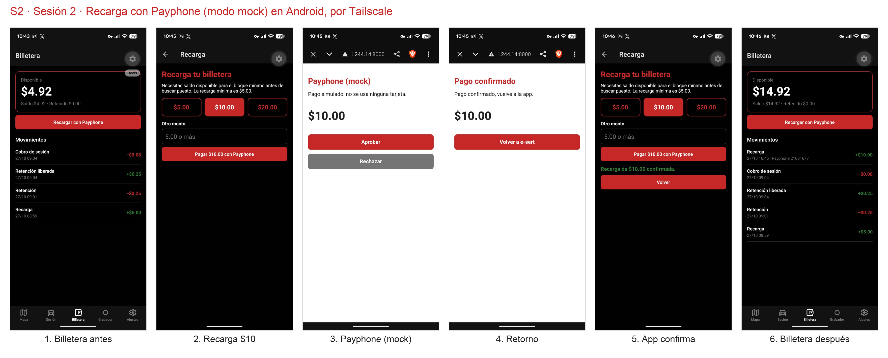
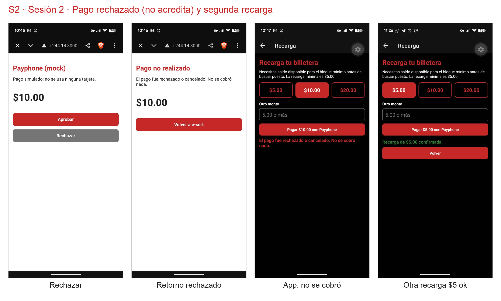

# S2 · Sesión 2 · Miguel: Billetera y recarga con Payphone en modo de pruebas

## 1. Resumen en 5 líneas

1. Se creó `backend/pagos/`, el módulo que recarga la billetera con el Botón de Pagos de Payphone, más un modo **mock** para trabajar sin credenciales.
2. El backend prepara el pago, Payphone (o el mock) cobra, vuelve a nuestra `responseUrl`, el servidor **confirma** y acredita la billetera de Freddy **una sola vez**.
3. En la app, la pantalla **Recarga** ofrece $5, $10, $20 o un monto libre ≥ $5, abre el pago en el navegador del sistema y luego consulta el estado hasta 10 veces.
4. La pantalla **Billetera** muestra saldo, retenido, disponible y los movimientos con fecha local, y se actualiza deslizando hacia abajo.
5. Se probó de punta a punta en Android con Expo Go por Tailscale: $4.92 → aprobar $10 → $14.92, y un pago rechazado no acredita nada.

## 2. Conceptos clave

- **Botón de Pagos (Prepare / Confirm):** Payphone no cobra con una sola llamada. Primero *Prepare* registra la intención (monto, `clientTransactionId`, `responseUrl`) y devuelve un enlace al formulario de pago. Después del pago, Payphone redirige a la `responseUrl` con `id` y `clientTransactionId`, y el servidor debe llamar a *Confirm* en menos de 5 minutos o Payphone reversa el pago.
- **Montos en centavos:** Payphone recibe enteros (`$7.50` → `750`) y exige `amount = amountWithoutTax + amountWithTax + tax + service + tip`. Una recarga de billetera no grava IVA, así que todo va en `amountWithoutTax`.
- **Intención de pago:** una fila de la tabla propia `intenciones_pago` con estado `pendiente`, `aprobado` o `rechazado`. Es la "verdad" que la app consulta; así no depende de que el navegador vuelva bien a la app.
- **Idempotencia:** el retorno puede llegar varias veces (recarga de la página, reintentos, dos pestañas). El paso a `aprobado` es un `UPDATE … WHERE estado = 'pendiente'` dentro de la misma transacción que la recarga: solo el primero lo consigue y acredita. Además se comprueba que no exista ya un movimiento con ese `referencia_payphone`.
- **Confirmación del lado del servidor:** la app nunca dice "pagué"; solo el backend, con el token, pregunta a Payphone. Así nadie puede acreditarse saldo llamando a la API.
- **Modo mock:** `AdaptadorMock` tiene la misma interfaz que el real, y su `pay_url` es una página local con "Aprobar" y "Rechazar" que vuelve a la misma `responseUrl`. Todo el flujo (retorno, idempotencia, app) se prueba igual sin Payphone.
- **Referer y página puente:** Payphone solo abre su formulario si la visita viene del dominio registrado. Por eso `pay_url` apunta a `/pagos/ir/{id}` en nuestro dominio, que envía `Referrer-Policy: origin` y salta al formulario.
- **Deep link y `openAuthSessionAsync`:** la app abre el pago en el navegador del sistema (Payphone no permite *webviews*) y espera a que vuelva a `exp://…/--/pagos/retorno` (Expo Go) o `esert://pagos/retorno` (app propia). En Android se ofrece además un enlace `intent://`.

## 3. Cómo se generó cada cosa

| Resultado | Comando | Entradas | Salidas |
|---|---|---|---|
| Tests del backend | python -m pytest backend/pagos/tests -q (desde la carpeta con backend/ y comun/ de Freddy) | payphone.py, intenciones.py, rutas.py, app de Freddy | 30 tests en verde |
| Tests de la app | npx jest y npx tsc --noEmit en codigo/app | pantallas y src/api/pagos.ts | 99 tests en verde, tsc sin errores |
| Backend local | PAYPHONE\_MODO=mock ESERT\_URL\_PUBLICA=http://100.85.244.14:8000 uvicorn backend.api.main:app --host 0.0.0.0 --port 8000 | .env de pagos, puestos.csv | API con /api/v1/pagos/... montado |
| App en el teléfono | REACT\_NATIVE\_PACKAGER\_HOSTNAME=100.85.244.14 npx expo start --lan | .env con EXPO\_PUBLIC\_API\_URL | Expo Go por Tailscale |
| Evidencia | python scripts/montaje.py ../../evidencias/s2\_billetera-recarga.png (capturas) --titulos ... --encabezado ... | capturas del teléfono en evidencias/capturas/ | s2\_billetera-recarga.png y s2\_recarga-rechazada.png |

## 4. Mapa de archivos

| Archivo | Qué contiene | Quién lo usa |
|---|---|---|
| codigo/backend/pagos/payphone.py | ConfigPagos, AdaptadorPayphone (Prepare y Confirm), AdaptadorMock | rutas.py, tests |
| codigo/backend/pagos/intenciones.py | Tabla intenciones\_pago y procesar\_retorno idempotente | rutas.py, tests |
| codigo/backend/pagos/rutas.py | Router /pagos: preparar, ir, mock, retorno, consultar | backend/api/main.py de Freddy |
| codigo/backend/pagos/.env.ejemplo | Variables sin valores (PAYPHONE\_\*, ESERT\_URL\_PUBLICA) | quien despliega (Tyrone) |
| codigo/backend/pagos/requirements.txt | httpx | imagen del backend |
| codigo/backend/pagos/tests/ | 30 tests con httpx.MockTransport | pytest |
| codigo/app/src/api/pagos.ts | prepararPago, consultarPago, esperarConfirmacion, leerMonto | recarga.tsx |
| codigo/app/app/recarga.tsx | Montos, Payphone en el navegador y consulta del estado | usuario |
| codigo/app/app/(tabs)/billetera.tsx | Saldo, retenido, disponible y movimientos con pull to refresh | usuario |
| codigo/app/app/pagos/retorno.tsx | Destino del deep link de vuelta: regresa a Recarga | expo-router |

## 5. Recorrido del código

**`payphone.py`**: `ConfigPagos.desde_entorno()` lee variables de entorno y, si faltan, `backend/pagos/.env`; `response_url` se arma con `ESERT_URL_PUBLICA`. `AdaptadorPayphone.preparar` envía el cuerpo de *Prepare* en centavos; `confirmar` llama a `V2/Confirm` y da por aprobado solo `statusCode == 3` y `"Approved"`. El token va solo en la cabecera y nunca en `repr` ni en los logs.

```python
def confirmar(self, payment_id, client_transaction_id):
    datos = self._post("/api/button/V2/Confirm", {"id": int(payment_id), "clientTxId": client_transaction_id})
    aprobado = datos.get("statusCode") == 3 and datos.get("transactionStatus") == "Approved"
    return {"aprobado": aprobado, "monto_usd": int(datos.get("amount") or 0) / 100,
            "autorizacion": datos.get("authorizationCode"), ...}
```

**`intenciones.py`**: `procesar_retorno` no vuelve a llamar a Payphone si la intención ya no está pendiente; sin `id` (cancelación) la marca rechazada; si Payphone no responde la deja pendiente; si el monto o el `clientTransactionId` no coinciden, no acredita.

```python
with bd.transaccion() as s:
    ganado = s.execute(update(IntencionPago)
        .where(IntencionPago.client_transaction_id == ctid, IntencionPago.estado == PENDIENTE)
        .values(estado=APROBADO, referencia_payphone=payment_id, ...)).rowcount == 1
    ya_asentada = s.scalar(select(Movimiento.id).where(Movimiento.referencia_payphone == payment_id))
    if ganado and ya_asentada is None:
        billetera.recargar(intencion.usuario_id, intencion.monto_centavos / 100,
                           referencia_payphone=payment_id, s=s)
```

**`rutas.py`**: `preparar` rechaza `monto < 5` con `RECARGA_MINIMA`, guarda la intención y devuelve `pay_url = /pagos/ir/{id}`. `retorno` llama a `procesar_retorno` y responde una página corta con el botón "Volver a e-sert" (en Android, enlace `intent://…#Intent;scheme=exp;end`). `enlace_app` hace esa conversión según el *User-Agent*.

**`recarga.tsx`**: prepara el pago con el deep link `Linking.createURL('pagos/retorno')`, abre `openAuthSessionAsync` y, vuelva como vuelva el usuario, consulta `GET /pagos/{id}`.

```tsx
const pago = await prepararPago(urlApi, usuarioId, monto, urlApp);
await WebBrowser.openAuthSessionAsync(pago.pay_url, urlApp);
const intencion = await esperarConfirmacion(() => consultarPago(urlApi, pago.client_transaction_id));
```

**`pagos.ts`**: `esperarConfirmacion` consulta hasta 10 veces cada 2 s, tolera fallos de red sueltos y devuelve la última respuesta; `leerMonto` acepta coma o punto, máximo 2 decimales y mínimo $5.

## 6. Cómo se conecta con los demás

- **Freddy (billetera y API):** se usa solo `Billetera.recargar(usuario, monto, referencia_payphone=id, s=sesión)`, `dep.servicios` y `dep.billetera`, y los errores `ErrorNucleo` con `RECARGA_MINIMA`, `VALIDACION` y `ERROR_INTERNO`. Su `crear_app` monta `backend.pagos.rutas` en `/api/v1` sin cambios.
- **Contrato:** las rutas `/pagos/*` no están en el contrato v1. Se piden a Freddy para `CONTRATO.propuesto.md`. La app sigue usando `GET /billetera/{id}` del contrato.
- **Tyrone (VPS y Payphone):** tiene las credenciales de prueba y el dominio. Debe registrar la `responseUrl` `https://demo.e-sert.tesisucuenca.com/api/v1/pagos/retorno` y cargar `PAYPHONE_*` en Dokploy.
- **Entrega:** el saldo recargado es el que usa la búsqueda de puesto de S2-1 (si no alcanza, lleva a Recarga).

## 7. Resultados y evidencias

- pytest: **30/30** (monto < 5 rechazado, tres retornos acreditan una sola vez, rechazo y cancelación no acreditan, error de red queda pendiente, el token nunca aparece en los logs, el saldo de Freddy cuadra).
- Jest: **99/99** y `tsc` sin errores.
- Android con Expo Go por Tailscale: billetera **$4.92 → +$10 → $14.92**, un único movimiento "Recarga · Payphone 21081677"; el pago rechazado no cambió el saldo; una segunda recarga de $5 también se confirmó.





## 8. Limitaciones y decisiones

- **Modo `pruebas` sin probar:** las credenciales de prueba solo las tiene Tyrone y Payphone exige una `responseUrl` pública HTTPS en el dominio registrado. El código está listo; en `pruebas` sin credenciales, `preparar` responde `ERROR_INTERNO` con la lista de variables que faltan.
- **Volver a la app en Android con Expo Go:** la página de retorno no logra abrir Expo Go desde la pestaña del navegador (Brave), ni sola ni con el botón. Se cierra la pestaña y la app confirma igual consultando el estado. Con una APK propia (esquema `esert://` registrado) se espera que funcione; queda para probar.
- **Unicidad de `referencia_payphone`:** se usa el `id` de Payphone como `referencia_payphone`. No se tocó la billetera para hacerla única; la unicidad la garantiza la intención.
- **Retorno con Confirm fallido:** si Payphone no responde, la intención queda pendiente sin límite de tiempo; Payphone reversa el pago a los 5 minutos si nadie confirma.
- **Página puente `/pagos/ir`:** se añadió porque Payphone valida el Referer del dominio; la app no puede mandarlo.

## 9. Preguntas que podría hacer el profesor

1. **¿Qué pasa si Payphone llama dos veces al retorno?** La segunda ve la intención en `aprobado` y no vuelve a acreditar; además el `UPDATE` condicionado garantiza que, aunque lleguen a la vez, solo uno acredita. Hay un test que llama 3 veces.
2. **¿Por qué no acredita la app cuando el navegador dice "pago aprobado"?** Porque la app no es de confianza: cualquiera podría llamar a la API. Solo el servidor, con el token, confirma con Payphone.
3. **¿Por qué los montos en centavos?** Así lo exige Payphone y evita errores de redondeo con decimales binarios (0.1 + 0.2).
4. **¿Cómo se prueba sin credenciales?** Con `AdaptadorMock` y con `httpx.MockTransport`, que simula las respuestas de Payphone en los tests.
5. **¿Dónde están las credenciales?** Solo en `backend/pagos/.env` (ignorado por git) o en las variables de Dokploy; el repo solo tiene `.env.ejemplo` vacío.
