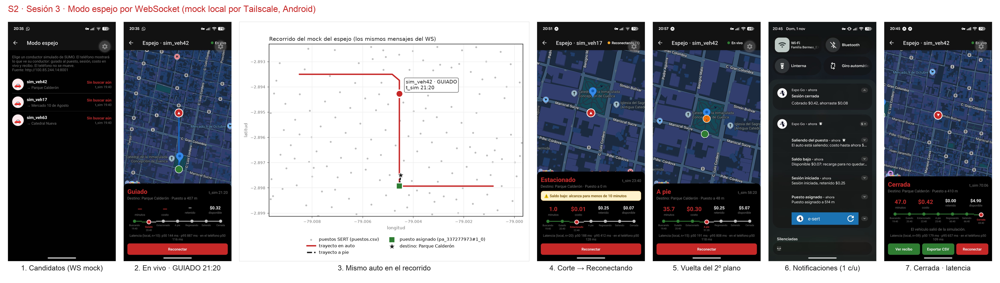
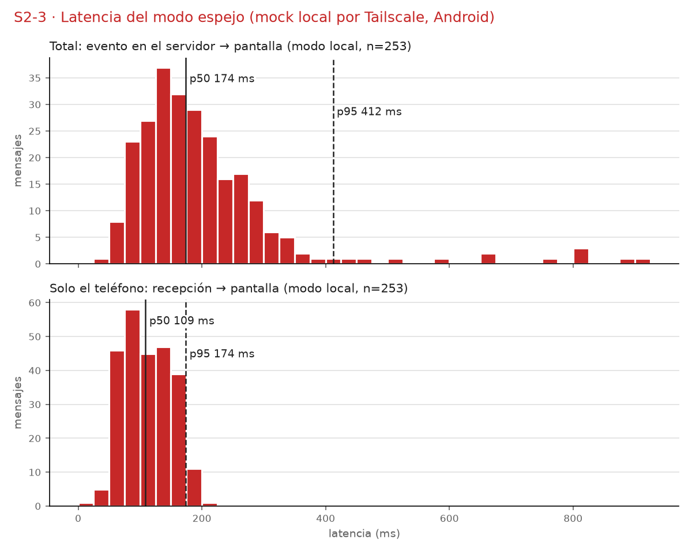

# S2 · Sesión 3 · Miguel: Modo espejo conectado a la simulación

## 1. Resumen en 5 líneas

1. El modo espejo de la app dejó de usar el temporizador interno de S1-3 y ahora sigue a un auto simulado por la red: `GET /api/v1/espejo/candidatos` y `WS /ws/espejo/{veh_id}` (CONTRATO §7).
2. Como Freddy todavía no publica el WebSocket del espejo (el VPS responde 404), se usó un **servidor mock** local que reproduce el recorrido grabado a 1 Hz, marcado `# MOCK`.
3. El WebSocket se reconecta solo (1, 2, 4, 8, 16, 30 s), detecta 5 s de silencio y se cierra y reabre al pasar la app a segundo plano.
4. Las transiciones GUIADO, ESTACIONADO, SALIENDO y CERRADA, y el aviso de saldo bajo, llegan como notificaciones locales una sola vez cada una.
5. Se midió la latencia evento → pantalla en un Android por Tailscale: **p50 174 ms y p95 412 ms** (253 mensajes, 3 recorridos completos).

## 2. Conceptos clave

- **Modo espejo:** el teléfono no se mueve ni envía su GPS. Elige un auto con app de la simulación y muestra lo que vería su conductor: guiado al puesto, sesión, costo en vivo y recibo.
- **WebSocket:** una conexión que queda abierta y por la que el servidor empuja mensajes sin que la app pregunte. Cada mensaje `espejo` trae el estado completo, así que si se pierde uno no hay que reconstruir nada.
- **Reconexión exponencial con *jitter*:** tras una caída se espera 1 s, luego 2, 4, 8, 16 y como máximo 30 s, con una variación aleatoria de ±20 % para que muchos teléfonos no reconecten a la vez. El contador vuelve a cero con el primer mensaje recibido.
- **Vigilancia de silencio:** los mensajes llegan a 1 Hz; si pasan 5 s sin ninguno, la conexión está "muerta" aunque el sistema no lo haya notado, y se reabre.
- **AppState:** en segundo plano el sistema suele congelar la app; se cierra el socket a propósito y, al volver, se reconecta al instante.
- **Notificaciones locales:** las programa el propio teléfono (no un servidor). En Expo Go de Android las *push* remotas ya no existen desde el SDK 53, pero las locales sí.
- **Método de Cristian:** para comparar la hora del servidor (`ts`) con la del teléfono se estima el desfase de reloj con 5 peticiones a `/salud`: hora del servidor + la mitad del tiempo de ida y vuelta. Se usa la muestra con menor ida y vuelta.
- **Latencia total y del cliente:** la total va de que el servidor emite el mensaje a que se pinta; depende del desfase estimado. La del cliente (recepción → pintado) no depende del reloj y muestra cuánto pone el propio teléfono.

## 3. Cómo se generó cada cosa

| Resultado | Comando | Entradas | Salidas |
|---|---|---|---|
| Servidor mock | python mock\_espejo/servidor\_mock.py --host 0.0.0.0 --port 8001 [--bucle] [--cortar-en 20] | src/espejo/recorrido\_mock.json | WS y REST del espejo en el puerto 8001 |
| Tests de la app | npx jest src/espejo y npx tsc --noEmit | código del espejo | 52 tests en verde (140 en toda la app) |
| Tests del mock | python -m pytest -q en mock\_espejo | servidor\_mock.py | 12 tests en verde |
| App en el teléfono | REACT\_NATIVE\_PACKAGER\_HOSTNAME=100.85.244.14 npx expo start --lan | .env con EXPO\_PUBLIC\_ESPEJO\_URL | Expo Go por Tailscale |
| Latencias | la app las envía al mock al terminar cada recorrido (POST /api/v1/espejo/latencias) | mediciones del teléfono | s3\_latencias-espejo.csv |
| Histograma | python scripts/latencia\_espejo.py s3\_latencias-espejo.csv s3\_latencia-espejo.png | el CSV | s3\_latencia-espejo.png |
| Mapa del recorrido | python scripts/mapa\_espejo.py mapa.png --t-sim 1280 --puestos proyecto/sumo/parqueos/puestos.csv | recorrido\_mock.json y puestos.csv | mapa para la evidencia |
| Evidencia | python scripts/montaje.py s3\_espejo-en-vivo.png (capturas y mapa) | capturas del teléfono | s3\_espejo-en-vivo.png |

## 4. Mapa de archivos

| Archivo | Qué contiene | Quién lo usa |
|---|---|---|
| app/src/api/espejo.ts | getCandidatos, urlWsEspejo (https → wss), baseEspejo, urlSalud | selector y hook |
| app/src/espejo/socketEspejo.ts | Clase SocketEspejo: reconexión, silencio, AppState, validación | usarEspejo |
| app/src/espejo/usarEspejo.ts | Hook: mensaje, inicios, fin, conexión, latencia; mock interno o red | pantalla del espejo |
| app/src/espejo/notificaciones.ts | NotificadorEspejo (una vez por auto y estado) y permisos | usarEspejo |
| app/src/espejo/latencia.ts | estimarDesfase (Cristian), RegistroLatencia, percentil, exportarCSV | usarEspejo, pantalla |
| app/src/espejo/componentes/IndicadorConexion.tsx | En vivo, Reconectando, Sin conexión, Finalizado | cabecera |
| app/app/espejo/index.tsx y [vehId].tsx | Selector de candidatos y pantalla del espejo | usuario |
| app/mock\_espejo/ | Servidor mock, README, tests y requirements | pruebas locales |
| app/scripts/latencia\_espejo.py y mapa\_espejo.py | Histograma y mapa de la evidencia | cierre de la sesión |

## 5. Recorrido del código

**`socketEspejo.ts`**: `conectar` abre el socket y escucha AppState. `recibir` valida cada mensaje (`esMensajeEspejo`), reinicia el contador al primero y rearma la vigilancia. `perdida` programa el siguiente intento; `espejo_fin` y `cerrar()` lo impiden. Las dependencias (socket, AppState, azar, reloj) se inyectan para probarlo con un socket falso.

```ts
export function esperaReconexion(intento: number, aleatorio = Math.random): number {
  const base = Math.min(ESPERAS_BASE_MS * 2 ** (intento - 1), ESPERA_MAXIMA_MS);
  return Math.round(base * (1 + JITTER * (2 * aleatorio() - 1)));
}

private perdida(): void {
  if (this.terminado || this.enSegundoPlano) return;
  this.soltarSocket();
  if (this.temporizadorReconexion) return; // ya hay un reintento en curso
  this.intento += 1;
  this.manejadores?.onEstado(this.intento >= 6 ? 'sin_conexion' : 'reconectando', this.intento);
  this.temporizadorReconexion = setTimeout(() => { this.temporizadorReconexion = null; this.abrir(); },
    esperaReconexion(this.intento, this.dep.aleatorio));
}
```

**`usarEspejo.ts`**: con el modo mock de la app usa `suscribirMock` (S1-3, sin red); si no, estima el desfase, crea el `SocketEspejo` y, con cada mensaje, actualiza la pantalla, pasa el mensaje al notificador y mide la latencia en el cuadro siguiente:

```ts
notificador.current.procesar(m);
requestAnimationFrame(() => {
  registro.current.registrar({ t_sim: m.t_sim, ts: m.ts, recibidoEn, pintadoEn: Date.now() });
});
```

**`notificaciones.ts`**: `NotificadorEspejo.procesar` guarda las claves `veh_id|estado` ya enviadas, así que ni los mensajes repetidos a 1 Hz ni las reconexiones duplican avisos. `prepararNotificaciones` pide permiso y crea el canal Android "espejo"; si Expo Go lo rechaza, usa el canal por defecto.

**`latencia.ts`**: `estimarDesfase` hace 5 peticiones a `/salud` y se queda con la de menor ida y vuelta; usa `ts` del cuerpo o, si no existe, el header `Date`. `RegistroLatencia` calcula `lat_total = pintado − ts − desfase` y `lat_cliente = pintado − recepción`, y exporta el CSV.

**`mock_espejo/servidor_mock.py`**: cada auto tiene un reloj propio que arranca con la primera conexión; el mensaje enviado es el del segundo actual, como en una simulación en vivo, así que al reconectar se sigue donde va el auto. `--cortar-en N` cierra cada conexión a los N s y `--bucle` repite el recorrido.

## 6. Cómo se conecta con los demás

- **Contrato (§7):** se consumen `CandidatoEspejo`, `MensajeEspejo` y `espejo_fin` tal como están en `comun/esquemas.ts` (copia verificada por hash). El mensaje ya trae `ts`; no hizo falta pedirlo.
- **Freddy:** falta `WS /ws/espejo/{veh_id}` en el backend (S3-3). `GET /espejo/candidatos` ya existe pero devuelve `[]` sin simulación. Cuando publique el WS, la app solo necesita quitar `EXPO_PUBLIC_ESPEJO_URL` para usar su backend.
- **Tyrone:** el visor ya resalta los ids de `espejos` del snapshot, pero el backend nunca llena ese conjunto: hay que añadirlo al abrir un WS del espejo.
- **Entrega:** pantallas del espejo listas para el backend real, servidor mock reutilizable y la medición de latencia.

## 7. Resultados y evidencias

- Jest: **52/52** en `src/espejo` (140/140 en toda la app); `tsc` sin errores; tests del mock **12/12**.
- Reconexión tras el corte de 20 s: la app volvió en **1.0–1.3 s** (log del mock). Tras 39 s y 11 s en segundo plano, reconectó al volver.
- Notificaciones: 5 por auto (Puesto asignado, Sesión iniciada, Saldo bajo, Saliendo, Sesión cerrada), una sola vez cada una.
- Latencia, modo local por Tailscale, n = 253: total **p50 174 ms, p95 412 ms**; solo el teléfono **p50 109 ms, p95 174 ms**.





## 8. Limitaciones y decisiones

- **Mock en vez del backend real:** el WS del espejo es de Freddy en S3-3. Todo lo de la app está probado contra el mock con el mismo formato del contrato.
- **Sin sumo-gui:** Docker no estaba corriendo y el auto del mock no existe en SUMO. La evidencia une el teléfono con un mapa del recorrido dibujado con los mismos mensajes.
- **Solo modo local:** el VPS aún no tiene el espejo, así que no se compararon latencias VPS frente a local.
- **Canal de notificaciones:** en Expo Go (SDK 58, Android) crear el canal "espejo" falla con un `NullPointerException` interno. Las notificaciones van al canal por defecto. Con una APK propia debería funcionar el canal de alta importancia.
- **La parte del teléfono pesa:** unos 110 ms de los 174 ms son del propio teléfono (React Native y el mapa redibujándose). Es un punto a mejorar si se necesita más fluidez.
- **Primeras muestras sin desfase:** durante las pruebas, el desfase se estimaba en paralelo con el socket, así que las primeras muestras de cada recorrido usaron desfase 0 (la primera del CSV marca 887 ms). Eso puede inflar algo el p95 total. Ya está corregido: ahora el socket se abre después de estimar el desfase.
- **Notificaciones entre visitas:** el registro de lo ya notificado vive en la pantalla; si se sale y se vuelve a entrar al mismo auto, se notifica otra vez.
- **Hora del servidor:** `/salud` del backend real no trae `ts`; el método cae al header `Date` (resolución de 1 s). El mock sí lo trae.

## 9. Preguntas que podría hacer el profesor

1. **¿Por qué el tope de 30 s y el *jitter*?** Para no saturar el servidor: si cae y vuelven cientos de teléfonos a la vez, el azar los reparte en el tiempo y el tope evita esperas absurdas.
2. **¿Cómo sabes que la conexión murió si el sistema no avisa?** Por la vigilancia: los mensajes llegan a 1 Hz, y 5 s sin ninguno bastan para darla por perdida.
3. **¿Cómo evitas notificaciones repetidas?** Se guarda la pareja (auto, estado) ya notificada; los mensajes repetidos y las reconexiones no vuelven a notificar.
4. **¿Por qué medir dos latencias?** La total depende de estimar bien el reloj del servidor; la del cliente no, y muestra cuánto tarda el propio teléfono en pintar.
5. **¿Qué cambia cuando Freddy publique el espejo?** Nada en el código: se quita `EXPO_PUBLIC_ESPEJO_URL` y la app usa la URL de su backend.
