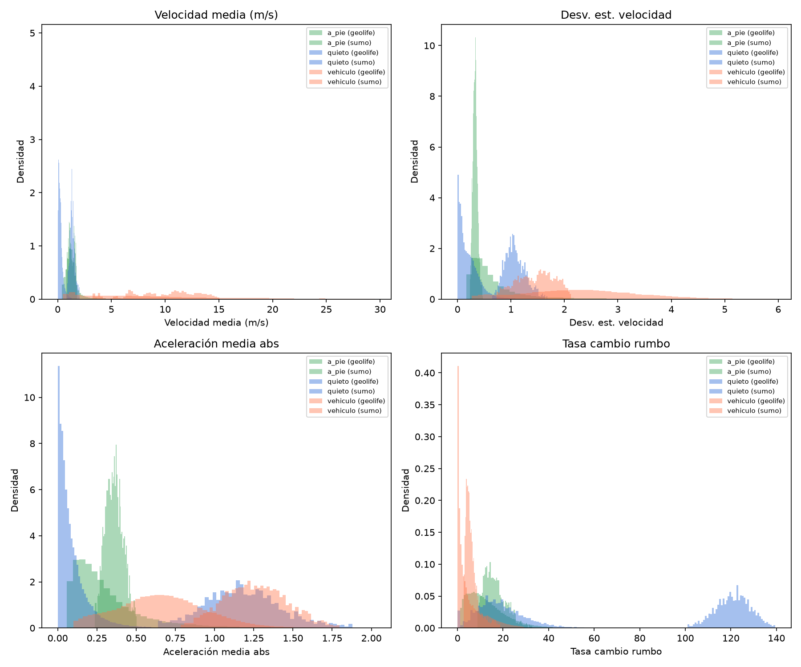
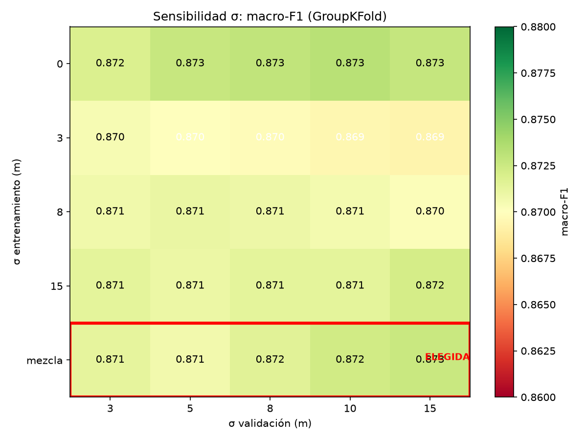
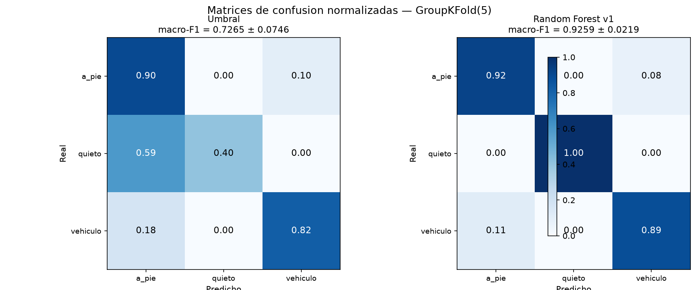
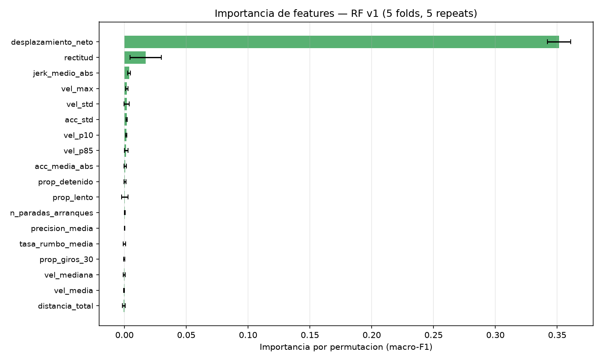
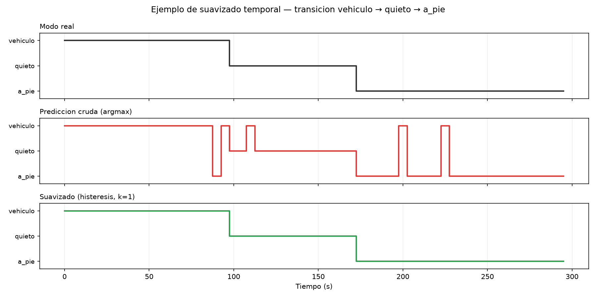
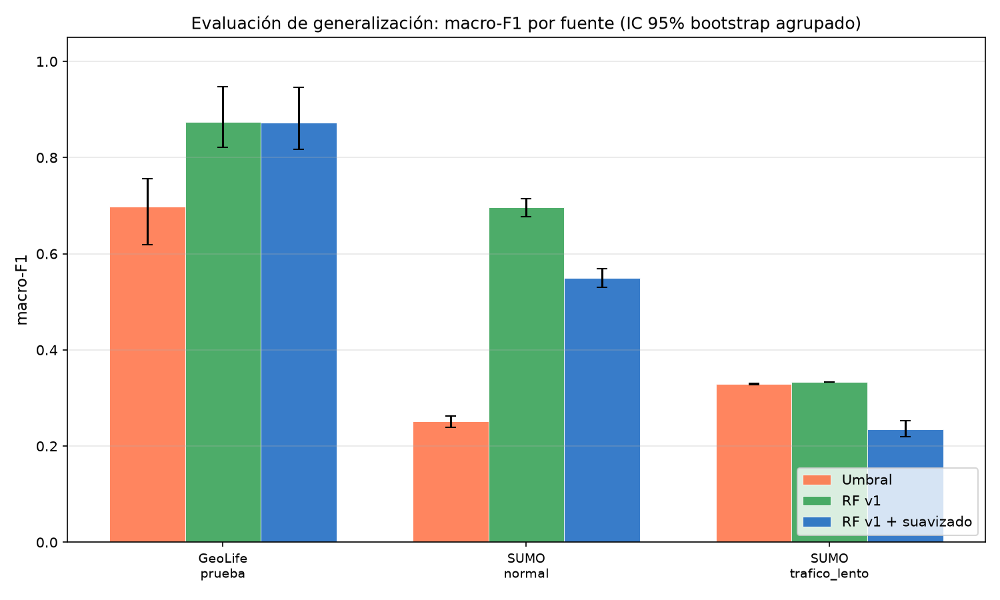
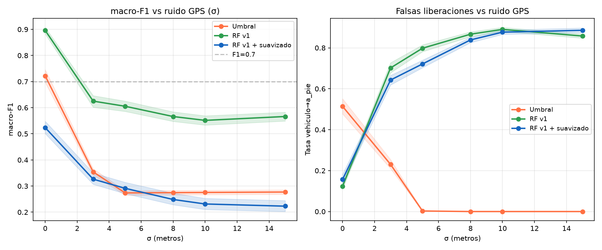
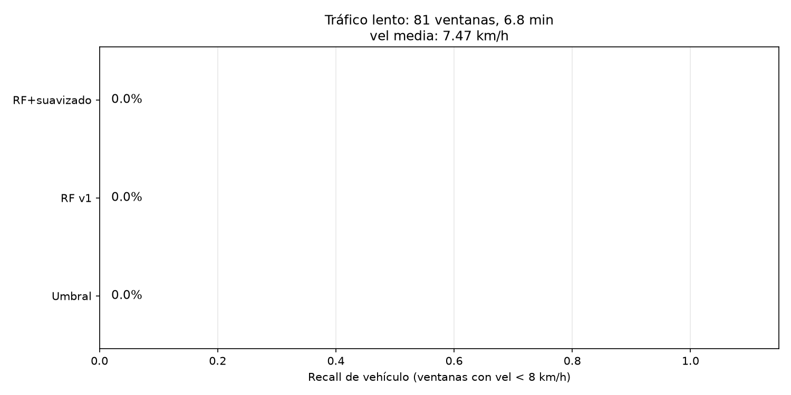

# S2 · Pablo 🟢 · Resumen semanal

## Sesión 1 · Ventanas desde trazas de SUMO y ruido GPS calibrado con literatura

Se creó la partición fija de usuarios GeoLife (20% prueba, 10 usuarios, semilla 2026) con
semillas SUMO 101–105 reservadas para escenarios difíciles en S2-3. Se implementó ruido GPS
AR(1) calibrado con valores de la literatura (σ de 3 a 15 m en cañón urbano, ρ = 0.8 a 1 Hz)
y se generaron ventanas desde trazas SUMO mock (7,982 ventanas de 3 clases).

El análisis de sensibilidad σ_entrenamiento × σ_validación con GroupKFold mostró diferencias
< 0.3% en macro-F1 entre configuraciones. Se eligió la mezcla U(3,15) por diversidad de
condiciones GPS. Se mezcló GeoLife + SUMO en `ventanas_v2.parquet` (1,650,500 ventanas)
con augmentation del 50% y prueba aparte sin aumentar (294,579 ventanas).

**Métricas de la rejilla (macro-F1 promedio):**
- σ_entr=0: 0.872 | σ_entr=3: 0.870 | σ_entr=8: 0.871 | σ_entr=15: 0.871 | σ_entr=mezcla: 0.872

**Comparación KS GeoLife vs SUMO:**
- Las distribuciones difieren significativamente (D > 0.15 en todas las features), esperado
  con trazas MOCK. Se normalizará al recibir trazas reales de Freddy.

**Tests:** 11/11 pasan (partición, ruido AR(1), no fuga, hash).

## Sesión 2 · Ajuste de hiperparámetros, importancia y suavizado temporal (rf_v1)

Se entrenó el modelo Random Forest v1 con RandomizedSearchCV (15 iteraciones sobre 50k
ventanas submuestreadas) y validación GroupKFold(3) sobre 537k ventanas. Los mejores
hiperparámetros: n_estimators=200, max_depth=20, min_samples_leaf=3, max_features=sqrt,
class_weight=balanced.

Se analizó la importancia por permutación: `desplazamiento_neto` domina (0.3514), seguido
de `rectitud` (0.0171). Se implementó suavizado temporal con histéresis k=1 que reduce 61.9%
los cambios espurios sin pérdida significativa de F1.

**Métricas de validación cruzada (macro-F1):**
- RF v1: 0.9259 ± 0.0219
- Umbral: 0.7265 ± 0.0746

**Suavizado elegido:** histéresis k=1 (reducción 61.9%, delta_F1 = -0.0003)

**Tests:** 25/25 pasan.

## Sesión 3 · Evaluación de generalización con usuarios no vistos y escenarios difíciles de SUMO

Se evaluó el clasificador RF v1 sobre **294,579 ventanas de GeoLife** (10 usuarios no vistos)
y **43,508 ventanas de SUMO** (semillas 101-105, escenarios normal y tráfico lento). El
hallazgo principal es una **brecha de dominio importante**: el RF funciona bien en GeoLife
(macro-F1 = 0.87) pero cae a 0.70 en SUMO normal y a 0.33 en tráfico lento.

En tráfico lento, el RF clasifica el 100% de los vehículos como peatones (tasa veh->a_pie =
100%). El análisis de ventanas con vel < 8 km/h (81 ventanas, 6.8 min) confirma que ningún
sistema reconoce vehículos lentos: recall = 0% para todos.

Las curvas F1 vs σ muestran que el ruido GPS no es el factor dominante; la brecha de dominio
GeoLife->SUMO es más importante que el nivel de ruido.

**Métricas principales por fuente:**

| Fuente | RF macro-F1 | Umbral macro-F1 | RF tasa veh->a_pie |
|--------|-------------|-----------------|-------------------|
| GeoLife prueba | 0.8743 [0.821, 0.947] | 0.6983 [0.619, 0.756] | 24.3% |
| SUMO normal | 0.6958 [0.677, 0.714] | 0.2512 [0.239, 0.262] | 69.3% |
| SUMO tráfico lento | 0.3333 [0.333, 0.333] | 0.3292 [0.328, 0.330] | 100.0% |

**Brecha de generalización (RF):** GeoLife -5.2pp, SUMO normal -23.0pp, SUMO tráfico lento -59.3pp.

**Tests:** 11/11 pasan.

