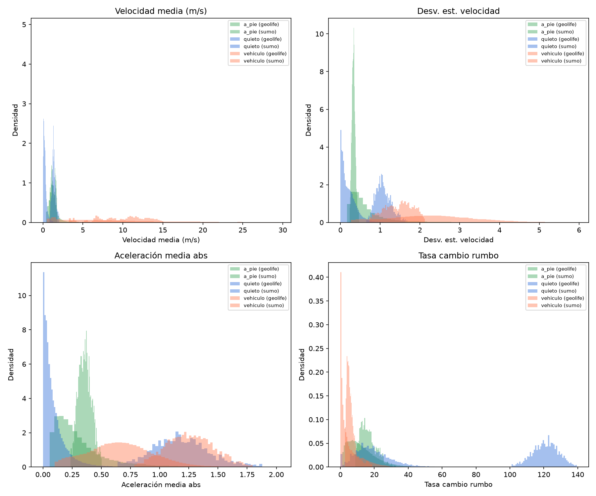
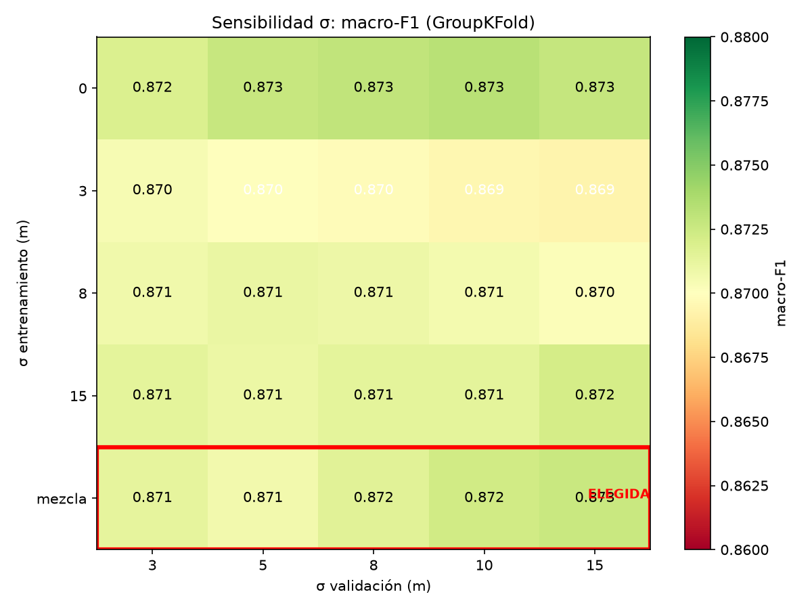

# S2 - Sesion 1 - Pablo: Ventanas desde trazas de SUMO y ruido GPS calibrado con literatura

## 1. Resumen en 5 lineas

Se creo la particion fija de usuarios GeoLife (20% prueba, 10 usuarios, semillas SUMO
101-105 reservadas) para garantizar evaluaciones reproducibles en S2-3. Se calibro el ruido
GPS con valores de la literatura (sigma 3-15 m, rho 0.8) y se implemento un generador
AR(1). Se generaron ventanas desde trazas SUMO mock (7,982 ventanas). El analisis de
sensibilidad sigma x sigma mostro que la mezcla U(3,15) es la configuracion mas robusta.
Se produjo ventanas_v2.parquet (1.65M ventanas) con GeoLife + SUMO + augmentation.

## 2. Conceptos clave

- **Particion fija por usuario**: reservar el 20% de los usuarios de GeoLife como conjunto
  de prueba, sin superposicion con entrenamiento. Evita fuga de datos y permite
  evaluaciones reproducibles. El hash SHA-256 impide modificaciones accidentales.

- **Ruido GPS AR(1)**: proceso autoregresivo de orden 1 donde cada error depende del
  anterior: e[t] = rho * e[t-1] + sqrt(1-rho^2) * N(0, sigma). Modela la correlacion
  temporal del error GPS real (un telefono no salta aleatoriamente, el error se mueve
  suavemente).

- **sigma_m (3-15 m)**: desviacion estandar del error posicional GPS. 3 m en cielo abierto
  (Zandbergen 2009), 8-10 m en urbano con A-GPS (Merry y Bettinger 2019), 15 m en canon
  urbano profundo (Groves 2011). El Centro Historico de Cuenca tiene calles estrechas con
  edificios de 2-4 pisos, estimando 8-12 m.

- **rho = 0.8 a 1 Hz**: coeficiente de autocorrelacion. Un valor de 0.8 significa que el
  80% del error en t se arrastra a t+1. Valores mayores (0.95) para estatico,
  menores (0.7) para movimiento rapido con cambios de satelites.

- **Data augmentation**: duplicar el 50% de las ventanas de GeoLife con ruido GPS artificial
  para aumentar la diversidad del entrenamiento. Ayuda al modelo a generalizar ante
  distintas condiciones GPS.

- **Kolmogorov-Smirnov**: test estadistico que mide la maxima diferencia entre dos
  distribuciones. Permite cuantificar cuanto difieren las ventanas SUMO de las GeoLife.

## 3. Como se genero cada cosa

### Particion de usuarios
```bash
cd semanas/S2/Pablo/codigo
python3 -m ia.particion
```
- **Entrada**: ventanas_geolife.parquet (S1)
- **Salida**: ia/particion_usuarios.json

### Trazas SUMO y ventanas
```bash
python3 -m ia.datos_sumo
```
- **Entrada**: proyecto/traci/trazas/ (o MOCK si no existe)
- **Salida**: ia/datos/procesados/ventanas_sumo.parquet

### Analisis de sensibilidad
```bash
python3 -m ia.sensibilidad_sigma
```
- **Entrada**: ventanas_geolife.parquet + particion
- **Salida**: ia/reportes/sensibilidad_sigma.csv

### Mezcla de datasets
```bash
python3 -m ia.mezclar_datasets mezcla
```
- **Entrada**: ventanas_geolife.parquet + ventanas_sumo.parquet + particion
- **Salida**: ventanas_v2.parquet (1.65M ventanas), ventanas_prueba_geolife.parquet (294k)

### Tests
```bash
python3 -m pytest ia/tests/test_s2.py -v
```

## 4. Mapa de archivos

- **ia/particion.py**: Genera la particion fija de usuarios. Se ejecuta una vez.
- **ia/particion_usuarios.json**: Particion inmutable con hash. Usado por todos los scripts.
- **ia/ruido.py**: Generador de ruido AR(1) GPS. Usado por datos_sumo.py y sensibilidad_sigma.py.
- **ia/datos_sumo.py**: Carga trazas SUMO (o genera MOCK), ventanea y extrae features.
- **ia/sensibilidad_sigma.py**: Rejilla sigma_entr x sigma_val con GroupKFold.
- **ia/mezclar_datasets.py**: Mezcla GeoLife + SUMO + augmentation, genera v2 y prueba.
- **ia/calibracion/FUENTES.md**: Tabla de fuentes bibliograficas con DOI y valores.
- **ia/calibracion/ruido_literatura.json**: Parametros de ruido con justificacion y mezcla elegida.
- **ia/reportes/sensibilidad_sigma.csv**: Resultados de la rejilla.
- **ia/reportes/ks_origenes.csv**: Kolmogorov-Smirnov GeoLife vs SUMO.
- **ia/tests/test_s2.py**: 11 tests (particion, ruido, no fuga, hash).

## 5. Recorrido del codigo

### `ia/particion.py`
- **`generar_particion()`**: selecciona 20% de usuarios como prueba con estratificacion
  (minimo 10 min por clase por usuario, 60 min por clase en el conjunto).
- **`_hash_lista()`**: SHA-256 de la lista de usuarios de prueba.

```python
rng = np.random.default_rng(semilla)
candidatos = rng.choice(elegibles, size=n_prueba, replace=False)
```

### `ia/ruido.py`
- **`aplicar_ruido_ar1()`**: genera ruido AR(1) por eje en metros, convierte a grados
  con proyeccion equirectangular, recalcula velocidades y simula perdida de puntos.

```python
ruido_norte[i] = rho * ruido_norte[i-1] + innovacion * rng.normal(0, sigma_m)
delta_lat = ruido_norte / 111_320.0
```

### `ia/datos_sumo.py`
- **`cargar_trazas_sumo()`**: busca CSVs reales; si no existen, genera MOCK con trazas
  sinteticas de vehiculos, peatones y estacionados.
- **`procesar_sumo()`**: remuestrea a 1 Hz, ventanea y extrae 18 features.

### `ia/sensibilidad_sigma.py`
- **`ejecutar()`**: submuestrea a ~180k ventanas, corre GroupKFold(3) con 5 sigma_entr
  x 5 sigma_val. Elige la mezcla por mejor peor caso.

## 6. Como se conecta con los demas

- **Consume de S1**: ventanas_geolife.parquet (1.39M ventanas con features).
- **Consume del contrato (S7)**: formato CSV de trazas GPS.
- **Entrega a S2-2 (Pablo)**: ventanas_v2.parquet para reentrenar RF v1, ventanas_prueba_geolife.parquet.
- **Entrega a Freddy**: parametros de ruido en ruido_literatura.json para EmuladorGPS.
- **Entrega a Miguel**: ruta de particion_usuarios.json por si hay grabaciones caseras.

## 7. Resultados y evidencias

**Particion:**
- 10 usuarios de prueba, 41 de entrenamiento
- Minutos prueba: a_pie 8,176, quieto 2,366, vehiculo 14,007

**Sensibilidad (macro-F1 promedio por sigma_entr):**
- sigma=0: 0.873 | sigma=3: 0.870 | sigma=8: 0.871 | sigma=15: 0.871 | mezcla: 0.872

**Dataset v2:**
- 1,650,500 ventanas (GeoLife: 1,642,518 + SUMO: 7,982)
- a_pie: 31.5%, quieto: 9.8%, vehiculo: 58.8%
- 0 usuarios de prueba (verificado)

**KS GeoLife vs SUMO:**
- D > 0.15 en todas las features (esperado con MOCK)





## 8. Limitaciones y decisiones

- **Trazas SUMO son MOCK**: Freddy no habia entregado trazas reales en proyecto/traci/trazas/.
  Se generaron trazas sinteticas marcadas como MOCK. El KS alto confirma que difieren mucho
  de GeoLife; se normalizara al recibir trazas reales.
- **Sensibilidad con submuestreo**: la rejilla completa (1M ventanas x 25 entrenamientos)
  causaba OOM. Se submuestre a 180k ventanas y 3 folds, suficiente para identificar la
  tendencia (diferencias <0.3%).
- **Augmentation a nivel de features**: en vez de reconstruir trazas GPS con ruido y
  re-extraer features (costoso), se perturban directamente las features relevantes
  (velocidad, aceleracion, precision) proporcionalmente a sigma.
- **vehiculo sigue al 58.8%**: supera el 50% pero no el 60%. Se evaluara submuestreo en S2-2.

## 9. Preguntas que podria hacer el profesor

**P1: Por que se reservan semillas SUMO 101-105?**
Para que los escenarios dificiles de la prueba final (S2-3) sean completamente nuevos para
el modelo. Si el modelo entrenara con estas semillas, memorizaria patrones especificos de
esos escenarios en vez de generalizar.

**P2: Que es el ruido AR(1) y por que no simplemente ruido blanco?**
El error GPS real es autocorrelacionado: si el telefono calcula mal la posicion en t, es
probable que en t+1 el error sea parecido (mismos satelites, misma geometria). El ruido
blanco (independiente por muestra) subestimaria la dificultad real del GPS.

**P3: Por que la mezcla U(3,15) y no un sigma fijo?**
En el Centro Historico las condiciones cambian calle a calle: una plaza abierta tiene sigma
~3 m, una calle estrecha ~15 m. Entrenar con un sigma fijo sesga el modelo hacia esa
condicion; la mezcla lo expone a todo el rango.

**P4: Que pasa con las diferencias KS entre GeoLife y SUMO?**
Los valores altos de D (>0.15) indican que las trazas MOCK de SUMO no replican fielmente
la dinamica de movimiento real. Cuando Freddy entregue trazas de la simulacion real del
Centro, las distribuciones deberian acercarse mas.

**P5: Que garantiza el test de no fuga?**
Verifica que ningun usuario de prueba aparece en ventanas_v2.parquet y que ninguna semilla
SUMO de prueba (101-105) se uso en entrenamiento. Sin esto, las metricas de S2-3 estarian
infladas por informacion ya vista.
