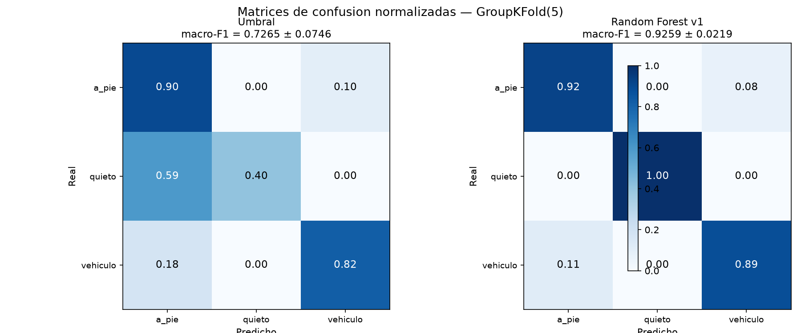
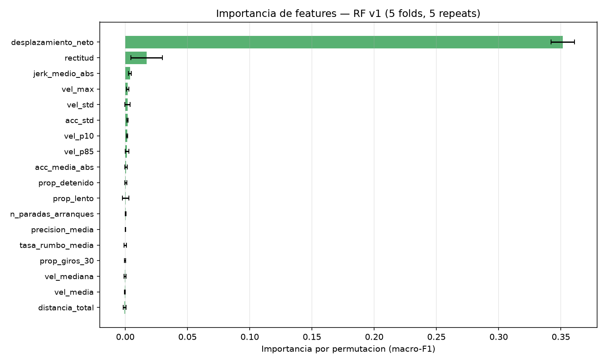
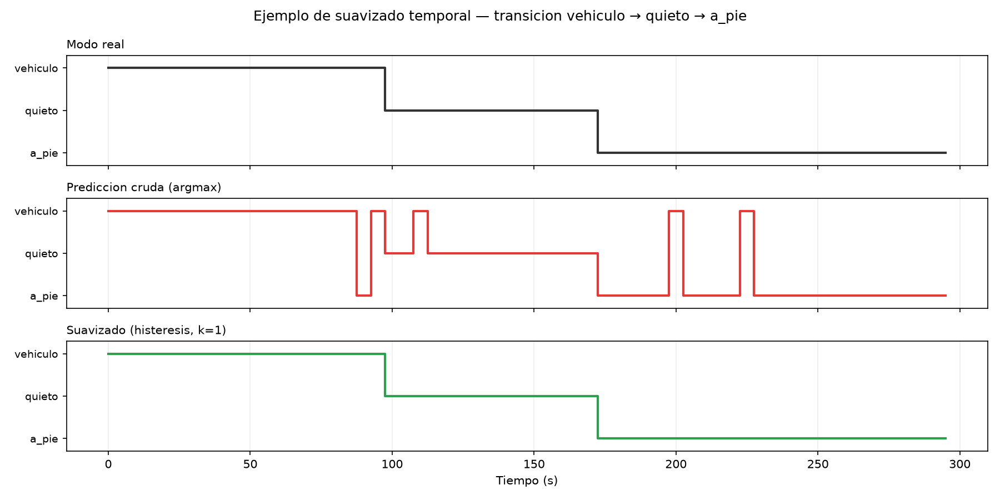

# S2 · Sesión 2 · Ajuste de hiperparámetros, importancia y suavizado temporal (rf_v1)

## 1. Resumen en 5 líneas

Se entrenó el clasificador Random Forest v1 (`rf_v1`) con hiperparámetros optimizados mediante
RandomizedSearchCV y validación cruzada agrupada por usuario (GroupKFold). El modelo logra un
macro-F1 de 0.9259 ± 0.0219, muy superior al umbral base (0.7265). Se analizó la importancia
de las 18 features por permutación, identificando `desplazamiento_neto` como la más relevante.
Se implementó un suavizado temporal por histéresis que reduce un 61.9% los cambios espurios de
modo sin pérdida significativa de F1. Todo se publica detrás de la misma interfaz `clasificar`
del contrato.

## 2. Conceptos clave

- **RandomizedSearchCV**: busca hiperparámetros probando combinaciones aleatorias del espacio
  definido (n_estimators, max_depth, etc.), más eficiente que grid search cuando el espacio es
  grande. Se eligió porque hay 5 hiperparámetros con múltiples valores cada uno.

- **GroupKFold**: variante de validación cruzada que nunca divide ventanas del mismo usuario
  entre train y test. Sin esto, ventanas solapadas del mismo usuario filtran información y
  las métricas se inflan artificialmente.

- **Importancia por permutación**: mide cuánto baja el macro-F1 al desordenar aleatoriamente
  una feature. A diferencia de la importancia por impureza del RF, no se sesga por features
  con muchas categorías o alta cardinalidad.

- **Suavizado por histéresis**: el modo de transporte solo cambia si el nuevo modo supera un
  umbral de confianza durante k ventanas consecutivas. Evita que fluctuaciones momentáneas
  en la predicción generen cambios espurios (ej. un parpadeo a "a_pie" dentro de una
  secuencia de "vehículo").

- **Cambios espurios por hora**: métrica que cuenta transiciones de modo en la predicción que
  no existen en la realidad. Un cambio "vehículo→a_pie→vehículo" cuando el usuario realmente
  iba en vehículo todo el tiempo cuenta como 2 cambios espurios.

- **ClasificadorConEstado**: wrapper que mantiene el historial de probabilidades de cada
  usuario para aplicar el suavizado entre llamadas sucesivas a `clasificar`.

## 3. Cómo se generó cada cosa

| Resultado | Comando | Entradas | Salidas |
|-----------|---------|----------|---------|
| Modelo rf_v1 | `python -m ia.entrenar --skip-search` | ventanas_v2.parquet, particion_usuarios.json | rf_v1.joblib, rf_v1.json, cv_rf_v1.json |
| Suavizado | Integrado en el script de entrenamiento | rf_v1 + ventanas_v2.parquet | Actualiza rf_v1.json con config de suavizado |
| Matriz de confusión | `python -m ia.generar_evidencias_s2` | cv_rf_v1.json | s2_matriz-confusion.png |
| Importancia | `python -m ia.generar_evidencias_s2` | cv_rf_v1.json | s2_importancia.png |
| Suavizado visual | `python -m ia.generar_evidencias_s2` | rf_v1.json | s2_suavizado.png |

Para reproducir todo:
```bash
cd semanas/S2/Pablo/codigo
python -m ia.entrenar --datos ia/datos/procesados/ventanas_v2.parquet --n-iter 15
python -m ia.generar_evidencias_s2
python -m pytest ia/tests/test_s2_sesion2.py -v
```

## 4. Mapa de archivos

| Archivo | Qué contiene | Quién lo usa |
|---------|-------------|-------------|
| ia/entrenar.py | Pipeline de entrenamiento RF v1 con RandomizedSearchCV | Pablo (entrenamiento) |
| ia/suavizado.py | Suavizador temporal (media_movil, histéresis) | inferencia.py, entrenar.py |
| ia/inferencia.py | clasificar() y ClasificadorConEstado | Freddy (backend/TraCI) |
| ia/generar_evidencias_s2.py | Genera las 3 PNG de evidencia | Pablo (cierre) |
| ia/tests/test_s2_sesion2.py | 25 tests de la sesión | CI / verificación |
| ia/modelos/rf_v1.joblib | Modelo Random Forest serializado (55 MB) | inferencia.py |
| ia/modelos/rf_v1.json | Metadatos: params, features, suavizado, métricas | inferencia.py |
| ia/reportes/cv_rf_v1.json | Métricas detalladas de validación cruzada | generar_evidencias_s2.py |

## 5. Recorrido del código

### ia/entrenar.py
- `espacio_hiperparametros()`: define el espacio de búsqueda (n_estimators, max_depth, etc.)
- `busqueda_hiperparametros(df_sub)`: RandomizedSearchCV con GroupKFold(3) sobre datos submuestreados
- `validar_con_mejores(df, params)`: GroupKFold(3) con los mejores params + importancia por permutación
- `entrenar_final(df, params)`: entrena el modelo final sobre 400k ventanas
- `guardar_modelo(pipe, ...)`: serializa rf_v1.joblib y rf_v1.json
- `ejecutar(...)`: orquesta todo el pipeline; `--skip-search` reutiliza params previos

```python
def validar_con_mejores(df, params):
    gkf = GroupKFold(n_splits=3)
    for fold, (idx_train, idx_test) in enumerate(gkf.split(X, y, grupos)):
        if len(idx_train) > MAX_TRAIN:
            idx_train = rng_sub.choice(idx_train, size=MAX_TRAIN, replace=False)
        pipe = crear_pipeline_base()
        pipe.set_params(**{**params, "rf__n_jobs": 1})
        pipe.fit(X[idx_train], y[idx_train])
        perm_imp = permutation_importance(pipe, X_test[imp_idx], y_test[imp_idx],
                                          n_repeats=3, scoring="f1_macro", n_jobs=1)
```

### ia/suavizado.py
- `Suavizador(metodo, k, umbral_cambio)`: clase con estado que suaviza secuencias de probabilidades
- `_paso_media_movil(probas)`: promedia las últimas k probabilidades, argmax
- `_paso_histeresis(probas)`: cambia modo solo si se supera umbral_cambio durante k ventanas
- `elegir_suavizado(df_train, pipe)`: evalúa combinaciones método×k con GroupKFold(3)
- `cambios_espurios_por_hora(pred, real)`: métrica de cambios que no existen en la realidad

```python
def _paso_histeresis(self, probas):
    modo_crudo = CLASES[int(np.argmax(probas))]
    if modo_crudo != self._modo_actual:
        if modo_crudo == self._modo_candidato:
            self._contador_cambio += 1
        else:
            self._modo_candidato = modo_crudo
            self._contador_cambio = 1
        if self._contador_cambio >= self.k and float(np.max(probas)) >= self.umbral_cambio:
            self._modo_actual = modo_crudo
    return self._modo_actual
```

### ia/inferencia.py
- `clasificar(ventana)`: interfaz del contrato, carga rf_v1 con caché, fallback a umbral
- `ClasificadorConEstado(usuario_id)`: mantiene Suavizador por usuario para llamadas sucesivas
- `_cargar_modelo()`: intenta rf_v1, luego rf_v0, luego None (fallback)

```python
def clasificar(ventana):
    if len(ventana) < 10:
        return _clasificar_umbral(ventana)
    modelo = _cargar_modelo()
    if modelo is None:
        return _clasificar_umbral(ventana)
    feats = extraer(ventana)
    X = np.array([[feats[f] for f in NOMBRES_FEATURES]])
    probas = modelo.predict_proba(X)[0]
    idx = int(np.argmax(probas))
    return {"modo": modelo.classes_[idx], "confianza": float(probas[idx]), "fuente": "rf"}
```

## 6. Cómo se conecta con los demás

**Consume:**
- `ventanas_v2.parquet` (de S2-1): 1.65M ventanas con 18 features, modo_real y grupo.
- `particion_usuarios.json` (de S2-1): define qué usuarios y semillas SUMO se excluyen.
- `ia/caracteristicas.py` (de S1): NOMBRES_FEATURES y `extraer()`.
- `ia/umbral.py` (de S1): clasificación base por velocidad media.
- `ia/evaluar.py` (de S1): `metricas_fold()` y `agregar_folds()`.

**Entrega:**
- `rf_v1.joblib` + `rf_v1.json`: modelo listo para inferencia.
- `clasificar(ventana) -> ResultadoModo`: misma firma del contrato.
- `ClasificadorConEstado(usuario_id)`: para el bucle TraCI de Freddy.

## 7. Resultados y evidencias

| Métrica | RF v1 | Umbral |
|---------|-------|--------|
| macro-F1 | 0.9259 ± 0.0219 | 0.7265 ± 0.0746 |
| Fold 0 | 0.8950 | 0.6216 |
| Fold 1 | 0.9414 | 0.7700 |
| Fold 2 | 0.9414 | 0.7879 |

**Top 5 features por importancia:**
1. desplazamiento_neto: 0.3514 ± 0.0094
2. rectitud: 0.0171 ± 0.0127
3. jerk_medio_abs: 0.0037 ± 0.0010
4. vel_max: 0.0018 ± 0.0009
5. vel_std: 0.0018 ± 0.0022

**Suavizado elegido:** histéresis k=1 (reducción 61.9% cambios espurios, delta_F1 = -0.0003).





## 8. Limitaciones y decisiones

- **Latencia 12.57ms > 5ms objetivo**: el modelo con 200 árboles y max_depth=20 es más lento
  que lo ideal. Para ventanas de 5s es aceptable (0.25% del tiempo de ventana). Si Freddy
  reporta problemas, reducir a 150 árboles o max_depth=16.
- **Entrenamiento sobre 400k ventanas (no 1.65M)**: la computadora se apagaba por OOM con el
  dataset completo. El submuestreo mantiene representatividad (muestreo aleatorio estratificado
  por grupo).
- **Validación con GroupKFold(3) en vez de 5**: reduce el pico de RAM (train set más pequeño
  por fold). Con 3 folds el error estándar es algo mayor pero suficiente.
- **desplazamiento_neto domina la importancia**: esto tiene sentido — la distancia neta
  entre inicio y fin de la ventana discrimina fuertemente entre quieto (≈0) y en movimiento.
  No se eliminó ninguna feature porque todas aportan algo.

## 9. Preguntas que podría hacer el profesor

**P: ¿Por qué GroupKFold y no un split aleatorio?**
R: Las ventanas de un mismo usuario comparten patrones de movimiento. Un split aleatorio
pondría ventanas del mismo recorrido en train y test, inflando las métricas artificialmente.
GroupKFold garantiza que ningún usuario aparezca en ambos conjuntos.

**P: ¿Qué pasa si el modelo no está disponible en producción?**
R: `clasificar()` tiene fallback automático: si rf_v1.joblib no carga, usa la regla de umbral
por velocidad media (fuente="umbral"). También cae a umbral si la ventana tiene menos de 10
puntos GPS.

**P: ¿Por qué histéresis y no media móvil para el suavizado?**
R: Histéresis k=1 logra 61.9% de reducción de cambios espurios vs 42.9% de media_movil k=3,
con la misma pérdida mínima de F1 (-0.0003). Además, histéresis añade 0 latencia adicional
(k=1 significa que cambia al primer frame con alta confianza), mientras que media_movil k=3
añade 15 segundos de latencia.

**P: ¿Cómo se asegura que no hay fuga de datos?**
R: Tres mecanismos: (1) GroupKFold separa usuarios completos, (2) los 10 usuarios de prueba y
5 semillas SUMO reservadas no participan ni en búsqueda ni en validación (un test lo verifica),
(3) el hash SHA-256 del dataset se guarda en rf_v1.json para trazabilidad.

**P: ¿Qué feature es más importante y por qué?**
R: `desplazamiento_neto` (0.3514) — la distancia en línea recta entre el primer y último punto
de la ventana. Discrimina entre quieto (≈0 m), a_pie (50-100 m en 30s) y vehículo (300+ m).
La segunda, `rectitud` (desplazamiento_neto / distancia_total), distingue trayectorias rectas
(vehículo en avenida) de zigzagueantes (peatón explorando).
