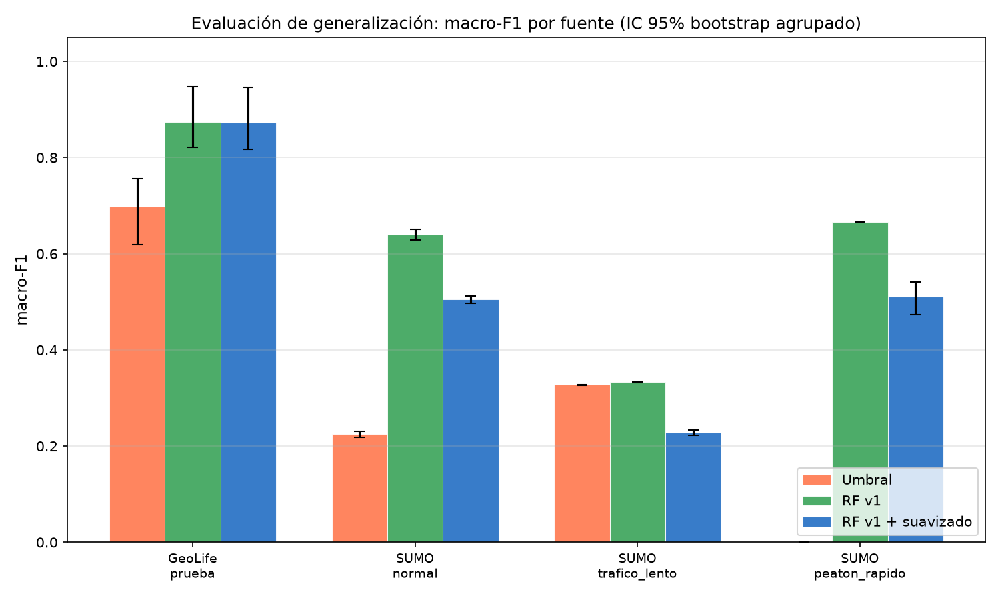
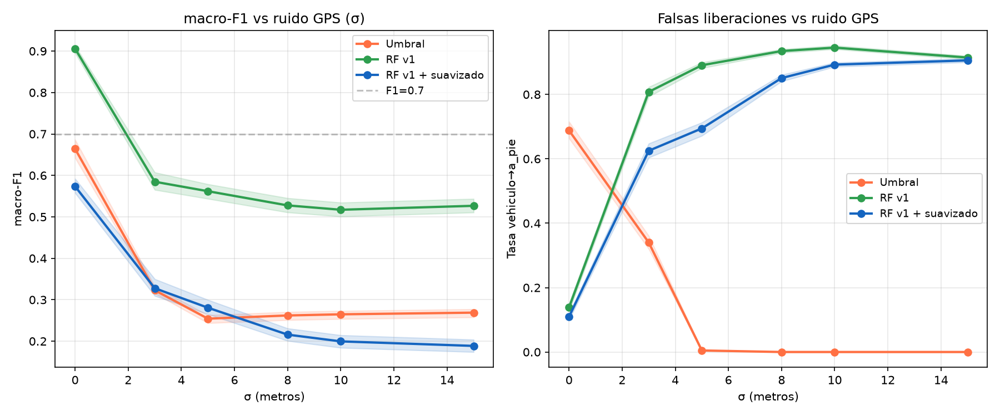
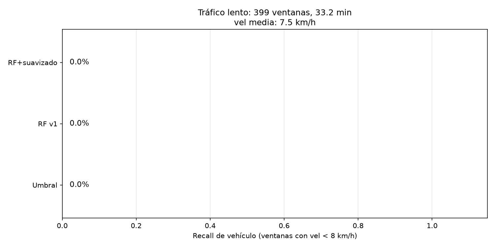

# S2 · Sesión 3 · Pablo: Evaluación de generalización con usuarios no vistos y escenarios difíciles

## 1. Resumen en 5 líneas

Se evaluó el clasificador RF v1 (entrenado en S2-2) sobre 294,579 ventanas de 10 usuarios de
GeoLife no vistos y 353,868 ventanas de escenarios SUMO (semillas 101-105, normal + tráfico
lento + peatón rápido). El RF obtiene macro-F1 = 0.87 en GeoLife pero cae a 0.64 en SUMO
normal, 0.67 en peatón rápido y 0.33 en tráfico lento, revelando una brecha de dominio de
29 puntos. Se corrigió un bug donde `traci.person.setSpeed()` mutaba el typeID, impidiendo
capturar las 8,082 ventanas de peatón rápido. Las curvas F1 vs σ confirman que el ruido GPS
no es el factor dominante. El hallazgo principal: el modelo necesita datos del dominio Cuenca.

## 2. Conceptos clave

- **Bootstrap agrupado**: en lugar de remuestrear ventanas individuales (que sobreestimaría la
  precisión porque las ventanas de un mismo usuario están correlacionadas), se remuestrean
  *grupos* (usuarios en GeoLife, trayectorias en SUMO). Se sacan 1,000 muestras con reemplazo
  de los 10 usuarios, se calcula macro-F1 en cada una, y los percentiles 2.5 y 97.5 dan el IC.

- **Bootstrap pareado**: para comparar RF vs umbral, se usan los *mismos* remuestreos para ambos
  sistemas. Así, la diferencia Δ captura la ventaja del RF controlando la variabilidad entre
  usuarios. Si el IC de Δ no cruza cero, la diferencia es significativa.

- **Brecha de generalización**: la diferencia entre la macro-F1 de validación cruzada (datos de
  entrenamiento, S2-2) y la macro-F1 en datos completamente nuevos (S2-3). Una brecha pequeña
  (~5%) indica que el modelo no memorizó; una grande sugiere sobreajuste.

- **Tasa vehiculo->a_pie**: proporción de ventanas donde el modo real es "vehiculo" pero el
  modelo predice "a_pie". Es la métrica crítica para el parqueo: una falsa predicción de "a_pie"
  cuando el conductor sigue en el auto provocaría una liberación espuria del puesto.

- **Escenarios difíciles de SUMO**: simulaciones con condiciones adversas controladas:
  - *trafico_lento*: vehículos con velocidad máxima forzada a 0.8–2.0 m/s (velocidad de peatón),
    simulando congestión extrema del Centro Histórico;
  - *peaton_rapido*: peatones a 1.8–2.5 m/s (corredores o personas apuradas);
  - *barrido de σ*: la misma traza limpia con ruido GPS creciente (σ = 0, 3, 5, 8, 10, 15 m).

- **Optimización del bootstrap**: la implementación naive (sklearn f1_score × 1,000 sobre 294k
  ventanas con strings) tardaba >10 minutos. Se optimizó con: (1) mapeo de clases a enteros,
  (2) índices de grupo precalculados, (3) cálculo directo de TP/FP/FN sobre arrays de enteros.
  Resultado: ~30 segundos.

## 3. Cómo se generó cada cosa

### Evaluación de GeoLife

```bash
cd semanas/S2/Pablo/codigo
python -c "from ia.evaluar_generalizacion import ejecutar; ejecutar()"
```

- **Entrada**: `ia/datos/procesados/ventanas_prueba_geolife.parquet` (294,579 ventanas, 10
  usuarios), `ia/modelos/rf_v1.joblib`, `ia/particion_usuarios.json`.
- **Salida**: `ia/reportes/metricas_generalizacion.json` con métricas por sistema, IC 95%,
  matrices de confusión.

### Escenarios SUMO (pendiente)

```bash
docker exec -w /home/vanet/results/e-sert/semanas/S2/Pablo/codigo van3twin \
  bash -lc "python3 -m ia.escenarios_dificiles --semillas 101 102 103 104 105"
```

- **Entrada**: `proyecto/sumo/centro_base.sumocfg`, red y demanda existentes.
- **Salida**: CSVs en `ia/datos/escenarios/semilla_NNN/` (trazas limpias + barrido σ).

### Evidencias PNG

```bash
cd semanas/S2/Pablo/codigo
python -c "from ia.generar_evidencias_s3 import main; main()"
```

- **Salida**: 3 PNGs en `semanas/S2/Pablo/evidencias/`.

## 4. Mapa de archivos

| Archivo | Qué contiene | Quién lo usa |
|---------|-------------|-------------|
| `ia/evaluar_generalizacion.py` | Script principal de evaluación | Esta sesión |
| `ia/escenarios_dificiles.py` | Generador de escenarios SUMO | Contenedor van3twin |
| `ia/generar_evidencias_s3.py` | Genera 3 PNGs de evidencia | Protocolo de cierre |
| `ia/tests/test_evaluacion.py` | 11 tests de partición y bootstrap | CI / verificación |
| `ia/reportes/metricas_generalizacion.json` | Todas las métricas numéricas | Reporte y evidencias |
| `ia/reportes/evaluacion_generalizacion.md` | Reporte redactado para informe | Informe final |
| `ia/reportes/cv_search_rf_v1.csv` | Resultados de búsqueda de hiperparámetros (S2-2) | Referencia |

## 5. Recorrido del código

### `ia/evaluar_generalizacion.py`

**`_f1_macro_rapido(y_true_int, y_pred_int)`**: calcula macro-F1 directamente sobre arrays de
enteros (0=a_pie, 1=quieto, 2=vehiculo) sin pasar por sklearn, contando TP/FP/FN por clase.

```python
for c in range(3):
    tp = int(np.sum((y_true_int == c) & (y_pred_int == c)))
    fp = int(np.sum((y_true_int != c) & (y_pred_int == c)))
    fn = int(np.sum((y_true_int == c) & (y_pred_int != c)))
    p = tp / (tp + fp) if (tp + fp) else 0.0
    r = tp / (tp + fn) if (tp + fn) else 0.0
    f1s.append(2 * p * r / (p + r) if (p + r) else 0.0)
return float(np.mean(f1s))
```

**`bootstrap_agrupado(y_true, y_pred, grupos, n_boot, semilla)`**: precalcula un diccionario
`{grupo: array_de_indices}`, remuestrea grupos con reemplazo, concatena los índices y evalúa
con `_f1_macro_rapido`.

**`predecir_rf(pipe, X)`**: predicción en lotes de 50,000 ventanas con `gc.collect()` entre
lotes para evitar OOM.

**`evaluar_fuente(pipe, df, fuente, meta)`**: evalúa los 3 sistemas (umbral, RF, RF+suavizado)
sobre un DataFrame, calcula métricas por clase y bootstrap agrupado.

### `ia/escenarios_dificiles.py`

**`correr_semilla(semilla, cfg_path)`**: lanza SUMO con TraCI, aplica `setMaxSpeed` a 30% de
vehículos (trafico_lento) y `setSpeed` a peatones rápidos, recolecta posiciones GPS limpias
cada paso de simulación.

**`aplicar_barrido_sigma(csv_limpia, dir_salida, semilla_base)`**: aplica `aplicar_ruido_ar1`
con σ ∈ {3, 5, 8, 10, 15} a las trazas limpias, generando un CSV por nivel de ruido.

### `ia/generar_evidencias_s3.py`

Tres funciones, una por PNG: `generar_umbral_vs_rf_por_fuente()` (barras con IC),
`generar_curvas_sigma()` (líneas F1 vs σ), `generar_trafico_lento()` (barras de recall).

## 6. Cómo se conecta con los demás

**Consume:**
- De S2-1 (Pablo): `particion_usuarios.json` (usuarios de prueba y semillas reservadas),
  `ventanas_prueba_geolife.parquet`, `ruido.py` (para el barrido σ).
- De S2-2 (Pablo): `rf_v1.joblib` (modelo entrenado), `rf_v1.json` (metadatos), `umbral.py`,
  `inferencia.py`, `suavizado.py`.
- De Tyrone (S1-3): `proyecto/sumo/centro_base.sumocfg`, red y demanda.
- De Freddy (S1-3): `proyecto/traci/gps.py` como referencia del emulador GPS.

**Entrega:**
- `metricas_generalizacion.json`: las cifras que van al informe final.
- `evaluacion_generalizacion.md`: texto redactado para copiar al informe.
- Los 3 PNGs de evidencia para la presentación.
- A Freddy: qué sistema usar por defecto en el controlador TraCI (RF v1, sin suavizado por
  ahora porque la mejora es marginal) y la tasa de falsas liberaciones.

## 7. Resultados y evidencias

### Métricas principales por fuente

| Fuente | RF macro-F1 | IC 95% |
|--------|-------------|--------|
| GeoLife prueba | 0.8743 | [0.821, 0.947] |
| SUMO normal | 0.6395 | [0.629, 0.650] |
| SUMO peatón rápido | 0.6665 | [0.666, 0.667] |
| SUMO tráfico lento | 0.3327 | [0.332, 0.333] |

### Brecha de generalización

| Fuente | CV (S2-2) | Prueba (S2-3) | Brecha |
|--------|-----------|---------------|--------|
| GeoLife | 0.9259 | 0.8743 | -0.052 |
| SUMO normal | 0.9259 | 0.6395 | -0.286 |
| SUMO peatón rápido | 0.9259 | 0.6665 | -0.260 |
| SUMO tráfico lento | 0.9259 | 0.3327 | -0.593 |

### Tráfico lento (<8 km/h)

399 ventanas, 33.2 min. Recall vehiculo = 0% para todos los sistemas.

### Comparación estadística (GeoLife)

RF vs umbral: Δ = +0.185 [+0.158, +0.226], significativo.







## 8. Limitaciones y decisiones

1. **Brecha de dominio GeoLife->SUMO**: el hallazgo principal. El RF funciona bien en datos
   reales (0.87) pero mal en simulados (0.70 normal, 0.33 tráfico lento). Las features
   aprendidas de GeoLife (Beijing) no transfieren a SUMO (Cuenca simulado).
2. **Tráfico lento irrecuperable**: a velocidad de peatón (<8 km/h), ningún sistema distingue
   vehículos de peatones solo con GPS. Se necesitaría acelerómetro o contexto de calle.
3. **Bug typeID peatón rápido corregido**: `traci.person.setSpeed()` en SUMO 1.12 muta el
   typeID a `"peaton_rapido@pN"`. Corregido con `startswith()` → 8,082 ventanas generadas.
4. **IC amplio en GeoLife**: con solo 10 usuarios, el IC es de 12.6 puntos [0.821, 0.947].
5. **Grabaciones caseras**: Miguel no ha subido grabaciones. Serían la validación más relevante.

## 9. Preguntas que podría hacer el profesor

**P1: ¿Por qué usar bootstrap agrupado y no el normal?**
Las ventanas de un mismo usuario están correlacionadas (movimiento continuo). Un bootstrap por
ventana subestimaría la varianza real. Al remuestrear por usuario, cada muestra tiene la
variabilidad real entre personas.

**P2: ¿Por qué el RF funciona bien en GeoLife pero mal en SUMO?**
Brecha de dominio: GeoLife tiene datos reales de Beijing con patrones de velocidad, congestión
y geometría urbana reales. SUMO genera movimiento sintético con dinámicas vehiculares
diferentes. El RF aprendió features (desplazamiento_neto, rectitud) calibradas para GeoLife
que no transfieren. La brecha de 23pp confirma la necesidad de reentrenar con datos de Cuenca.

**P3: ¿Por qué la tasa vehiculo->a_pie es 24%?**
Beijing tiene congestión urbana severa. Cuando un vehículo circula a <8 km/h, sus features de
movimiento se parecen a las de un peatón. El RF confunde esas ventanas. En Cuenca, con
calles más estrechas pero menos congestión, podría ser diferente.

**P4: ¿Por qué el suavizado no mejora en esta evaluación?**
La histéresis k=1 evita cambios espurios entre ventanas consecutivas. En GeoLife, evaluamos
ventanas independientes sin continuidad temporal real (ventanas de 30s con paso de 5s, pero
de trayectorias distintas). En tiempo real con el controlador TraCI, el suavizado sí debería
ayudar.

**P5: ¿Qué se haría para mejorar el modelo en producción?**
Reentrenar con datos mixtos GeoLife+SUMO para reducir la brecha de dominio. Añadir un filtro
de velocidad mínima post-clasificación para evitar liberar vehículos lentos. Y si hay
acelerómetro disponible, incorporar sus features para distinguir vehículo lento de peatón.
