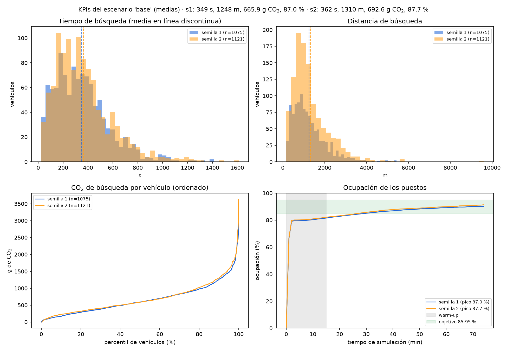
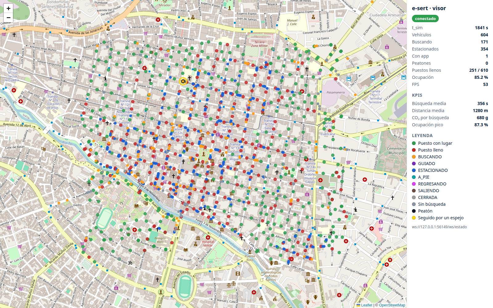
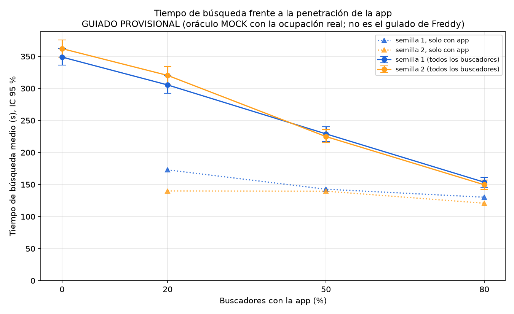
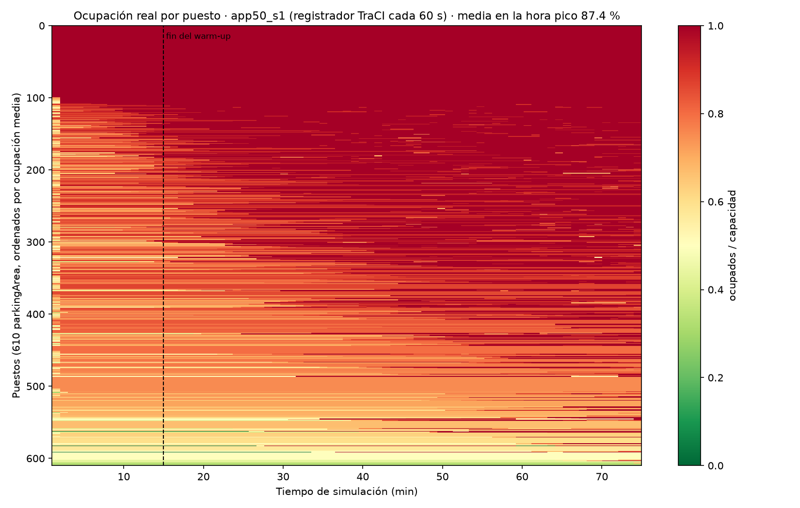

# Resumen S2 · Tyrone 🔵

## Sesión 1 · KPIs de la línea base (búsqueda, distancia, CO₂ y ocupación)

El módulo `kpis/` convierte las salidas XML de SUMO en los indicadores del proyecto, con
definiciones fijas escritas en el docstring de `kpis.py`. La búsqueda empieza al entrar a
300 m del destino (o al edge del puesto objetivo) y termina al estacionar.

- Línea base (1800 veh/h, 2 semillas, 2196 buscadores):
  - búsqueda media de **356 s** (IC 95 % 347–365);
  - **1280 m** recorridos;
  - **680 g de CO₂** por búsqueda.
- Ocupación media en la hora pico: 87,0 % y 87,7 %.
- Con radio 0 se reproducen exactamente los 230 y 246 s provisionales de S1-3. La diferencia
  es solo de definición.
- 13 tests con XML sintéticos; cada semilla se calcula en 5–8 s.

```bash
cd semanas/S2/Tyrone/codigo
python -m kpis.kpis --salidas sumo/salidas/base_1 --escenario base --semilla 1
```



## Sesión 2 · Visor web Leaflet y servidor WS de prueba

`visor/` es una página estática (sin build) con Leaflet 1.9 en canvas, alimentada por
`/ws/estado`:
- puestos en verde si tienen lugar y en rojo si están llenos;
- autos coloreados por estado, con borde grueso si tienen app;
- halo amarillo en el vehículo que sigue un teléfono espejo;
- panel con conteos, KPIs y estado de la conexión;
- reconexión automática (1, 2, 4… hasta 30 s).

- `grabar_snapshots.py` (TraCI) grabó 15 min de hora pico: 900 snapshots que validan contra
  el contrato. En git va una muestra de 60.
- `servidor_prueba.py` los reproduce y manda los KPIs de S2-1. El visor funciona también
  servido por el backend real de Freddy en `/visor/`, con el WS del mismo origen.
- 54 FPS con ~1200 marcadores, 169 cambios de color de puestos en 15 min y 9 tests.

```bash
cd semanas/S2/Tyrone/codigo
python -m visor.servidor_prueba --puerto 8001 --velocidad 5   # http://localhost:8001/visor/
```



## Sesión 3 · Escenarios con penetración de app y registro de la ocupación real

`generar_escenarios.py` produce `{base,app20,app50,app80}_s{1,2}`, con dos garantías:
- dentro de cada semilla, la demanda es idéntica (mismos vehículos y horas de salida; solo
  cambia `con_app`);
- los usuarios con app están anidados (253 ⊂ 624 ⊂ 1018).

`kpis/registrar_ocupacion.py`, un hook del Controlador de Freddy, guarda la ocupación real de
los 610 puestos cada 60 s. Coincide exactamente con el stop-output en las 8 corridas.

Con el guiado provisional (oráculo MOCK, optimista), la búsqueda media baja así:

| % app | Búsqueda media s1 / s2 | Distancia | CO₂ por búsqueda |
|---|---|---|---|
| 0 | 349 / 362 s | 1248 / 1310 m | 666 / 693 g |
| 20 | 306 / 320 s | 1092 / 1163 m | 586 / 624 g |
| 50 | 229 / 225 s | 811 / 804 m | 438 / 424 g |
| 80 | 154 / 150 s | 531 / 525 m | 294 / 289 g |

Las 8 corridas terminan sin teletransportes. En S3-1 se repiten con el guiado de Freddy.

```bash
docker exec -w /home/vanet/results/e-sert/semanas/S2/Tyrone/codigo/sumo/escenarios van3twin \
    bash -lc "python3 generar_escenarios.py && python3 correr_escenarios.py"
cd semanas/S2/Tyrone/codigo && python -m kpis.resumen_escenarios --calcular --guiado-provisional
```




